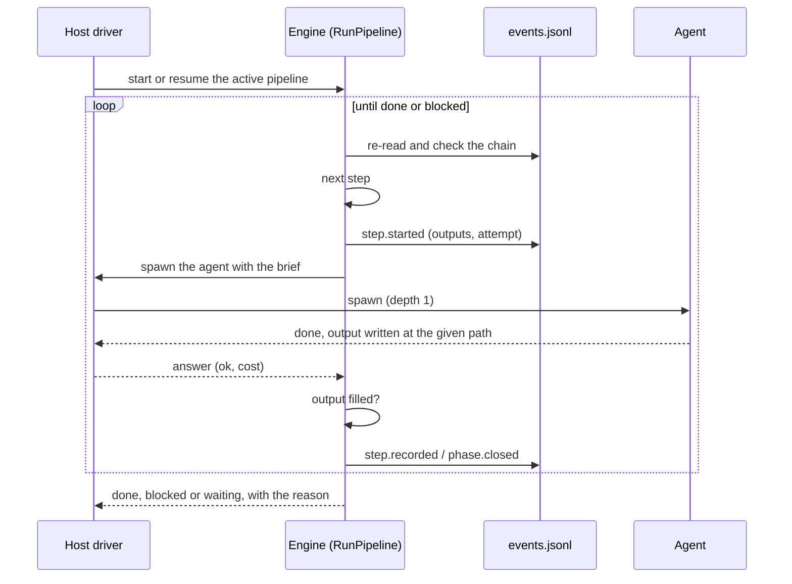

# Architecture

> One engine decides everything; each host runs it with what it does best. Only the driver
> spawns agents, and no agent spawns another.

## The problem to solve

SKRAFT must run the same pipeline under Claude Code, GitHub Copilot CLI and VS Code, on
Windows and macOS. These hosts do not offer the same means: one spawns an agent with
`$.agent.spawn`, another with `ctx.agent`, the third has neither.

In v1, the phase order and the verdicts lived in the prose of an orchestrator agent. Each
host and each model followed it its own way. V2 takes these decisions out of the prose and
puts them in tested code, the same everywhere.

## The engine of use cases

The **engine** (`plugins/skraft-framework/engine/`) is split into four layers.

| Layer | Content | What it may import |
| --- | --- | --- |
| `domain/` | Pure rules: next step, expected outputs, state derived from the journal, configuration, gates | `domain/` only |
| `application/` | Use cases: `Init`, `RunPipeline`, `Observe`, `RunGate`, `Doctor`… and their contracts (spawn an agent, show progress, read and write the journal) | `domain/` and `application/` |
| `infrastructure/` | Files, git, processes, clock, hashes | `domain/`, `infrastructure/` and the contracts in `application/ports/`; never a driver or a use case |
| `drivers/` | One driver per host: `claude-mod/`, `copilot-workflow/`, `copilot-sdk/`, `cli/` | What it assembles; never another driver |

A **use case** is a complete action from the user's point of view: start a pipeline, move it
forward, observe its state, run the gates. It decides; it does no input or output itself.

`domain/` and `application/` use no `node:` modules, no `process`, no `child_process`, no
`$`. That is what lets the same code be loaded by the Claude Code mod module, which has no
Node, and by the Copilot workflow, which has it. A tested architecture rule enforces it.

> « Good architecture makes the system easy to understand, easy to develop, easy to maintain, and easy to deploy. »
> — Martin, R. C., *Clean Architecture*, 2017.

## The host drivers

A **host driver** connects the engine to a host. It gives the engine the means to spawn an
agent and show progress, then calls the use case. It decides neither the order, nor the
verdict, nor the progress.

| Driver | Spawns agents with | Shows the run | Entry point | Available |
| --- | --- | --- | --- | --- |
| Claude Code mod | `$.agent.spawn` | "Skraft" pane | `/skraft …`, `/skraft decide …`, tool `mcp__skraft__run_pipeline` | Yes |
| Copilot CLI dynamic workflow | `ctx.agent`, replayed on resume | Workflow log (`ctx.log`) | workflow `skraft-pipeline`, tool `skraft_decide` | Yes |
| VS Code, Copilot SDK | The Copilot CLI started headless, running the same workflow | The terminal | `engine/drivers/copilot-sdk/skraft-run.mjs` | Yes |
| VS Code, fallback | The orchestrator agent, on the step returned by `skraft next` | `WORKFLOW.md`, `skraft status` | `skraft next` / `skraft record` | Yes |
| `skraft` command line | — (spawns no agent; `next` hands them to the orchestrator) | Text or JSON | `init`, `status`, `report`, `decide`, `gate`, `doctor`, `workflow`, `journal adopt`, `publish` | Yes |

In the mod, each `$` call stays a one-line function in the registered module. The rest of
the driver receives these functions and is tested without Claude Code.

As [Skwad](https://github.com/Kochava-Studios/skwad) does, the run shows the agent at work:
`skraft status` and the Skraft pane show the open step, its agent and its attempt; the pane
also draws the workflow graph with verdicts, gates and cost, and answers a waiting question
with a button. `skraft doctor` says which of the two VS Code drivers runs and why.

When the engine needs a human (ratify the ADRs, consent to publishing visuals, fix the
machine), it asks the driver. The mod opens a `$.ui.ask` dialog; the Copilot workflow logs
the question and pauses durably with `ctx.pause`. The answer is journaled, whatever the host.
With no answer the run **waits** (fail closed); `skraft decide`, `/skraft decide` or the
`skraft_decide` tool record the answer later, and the next run acts on it without starting an
agent again. The engine decides which question to ask and what the answer does; the driver
only carries it.

Under Copilot, when the host renders canvases, the `skraft-pipeline` canvas draws the same
view as the Claude Code pane and carries answer buttons; an answer is recorded there only once
it is confirmed in Copilot's dialog. Rendering in the Copilot app and in the CLI terminal is not
measured yet: the probe opens the canvas headless only.

## The driver ↔ engine loop

The driver calls `RunPipeline`. The engine re-reads the journal, computes the next step,
pre-creates the expected output from its template, journals the start, then asks the driver
to spawn the agent. When the agent returns, the engine checks the output itself and journals
the result before deciding what comes next.

A missing output triggers another attempt with the list of missing paths, up to three, then a
named stop, `missing-outputs`; the same failure twice stops the run sooner. An agent the host cannot spawn stops the run on `agent-unavailable`
without consuming the attempt. A step the machine cannot run (program not found, Git
failing) does not stop the run: the engine asks a human to fix it and `RETRY`, or `ABORT`.

## Depth 1

Only the driver spawns agents. No agent spawns another agent, review lenses included. In v1,
the DELIVER reviewer spawned its lenses (depth 2): extra context cost, duplicated checks, and
behaviour that depended on the host.

At depth 1, the driver can spawn several agents in parallel when the host allows it, and the
engine sees every spawn in its journal.

A review node runs this way. The driver spawns the node's lenses in parallel; each answers
with typed findings. The driver then spawns `finding-refuter` on each blocker, high and
medium finding, on the inputs of its lens. When one lens alone finds what sends the work
back, the refuter judges its findings with every input of the review and the lenses that
passed (V1's Dissent Rule): it upholds or sets each aside, and says why. The engine computes
the verdict from what remains: `APPROVED` goes on,
`NEEDS_REWORK` sends the findings back to the phase agent, a lens without a usable answer
blocks the review.

## Checks in code

What an agent could forget, the engine checks.

| Check | Where | Available |
| --- | --- | --- |
| Phase order | Engine domain, from the workflow graph | Yes |
| Expected outputs pre-created and checked | `RunPipeline` | Yes |
| Journal integrity | Hash chain, checked on every read | Yes |
| Gates (build, format, lint, test, architecture, coverage, mutation) | `RunGate`, commands from `skraft-config.json` | Yes, as DELIVER steps and with `skraft gate` |
| Write scope | Git diff after each step | Yes |
| TDD red and green commits | Each red commit replayed after the step | Yes |
| Unpublished ADRs edited in place, ratified only by a human | ADR check after each attempt (`adr-lifecycle`), ask node `adr` | Yes |
| Review verdict | Typed findings, refutation, computed verdict | Yes (DESIGN, DISTILL, DELIVER) |

## Rejected alternatives

**A standalone engine, server or binary.** An executor outside the host would drive the
agents from the outside. It would need its own model-provider credentials, and SKRAFT would
no longer live in the developer's host. V2 keeps execution in the host and puts in the
engine what such an executor would bring: typed nodes, "done" proven by a command, capped
loops, failure classes, event journal.

**An agent-driven loop as the primary driver.** An agent calls `skraft next`, does the step,
calls `skraft record`. It works everywhere, but costs a round trip per step, serialises the
lenses and leaves progress to a model that can drift from the loop. It stays only as the
VS Code fallback, where the engine refuses any `next` until the previous step is recorded.

**Keeping the hooks.** See [Guardrails: from hook to engine]({{ "/en/explanation/hooks" | relative_url }}).

## Going further

- [State and recovery]({{ "/en/explanation/hve-core" | relative_url }}) — the chained journal.
- [Clean Architecture]({{ "/en/explanation/clean-architecture" | relative_url }}) — the dependency rule applied to the engine.
- [Reference: the skraft command line]({{ "/en/reference/cli" | relative_url }}).
- [Reference: tracking folder and journal]({{ "/en/reference/run-journal" | relative_url }}).

## Sources

- Martin, R. C., *Clean Architecture*, 2017.
