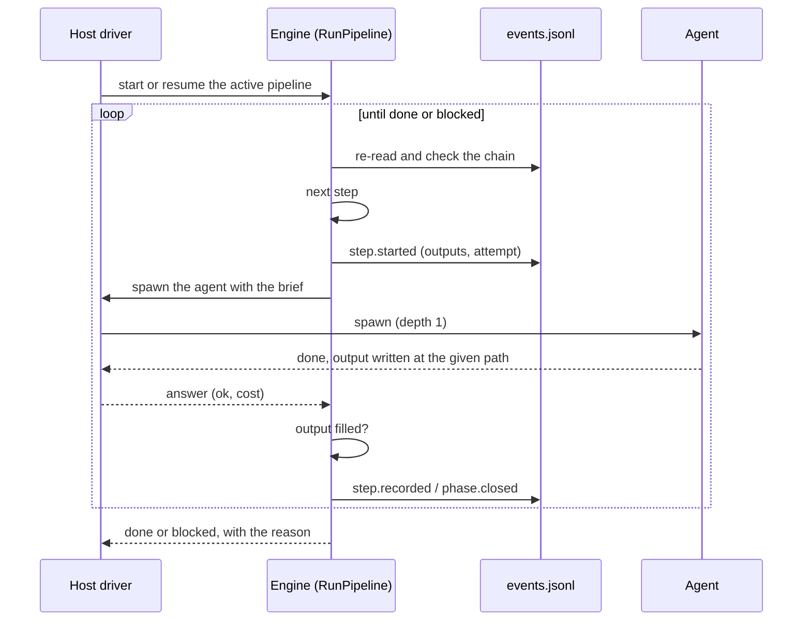

# Architecture

> One engine decides everything; each host runs it with what it does best. Only the driver
> spawns agents, and no agent spawns another.

## The problem to solve

SKRAFT must run the same pipeline under Claude Code, GitHub Copilot CLI and VS Code, on
Windows and macOS. These hosts do not offer the same means: one spawns an agent with
`$.agent.spawn`, another with `ctx.agent`, the third has neither.

In v1, the phase order and the verdicts lived in the prose of an orchestrator agent. Each
host and each model followed it its own way. V2 takes these decisions out of the prose and
puts them in tested code, the same everywhere.

## The engine of use cases

The **engine** (`plugins/skraft-framework/engine/`) is split into four layers.

| Layer | Content | What it may import |
| --- | --- | --- |
| `domain/` | Pure rules: next step, expected outputs, state derived from the journal, configuration, gates | `domain/` only |
| `application/` | Use cases: `Init`, `RunPipeline`, `Observe`, `RunGate`, `Doctor`… and their contracts (spawn an agent, show progress, read and write the journal) | `domain/` and `application/` |
| `infrastructure/` | Files, git, processes, clock, hashes | The contracts in `application/`, never a driver or a use case |
| `drivers/` | One driver per host: `claude-mod/`, `copilot-workflow/`, `copilot-sdk/`, `cli/` | What it assembles; never another driver |

A **use case** is a complete action from the user's point of view: start a pipeline, move it
forward, observe its state, run the gates. It decides; it does no input or output itself.

`domain/` and `application/` use no `node:` modules, no `process`, no `child_process`, no
`$`. That is what lets the same code be loaded by the Claude Code mod module, which has no
Node, and by the Copilot workflow, which has it. A tested architecture rule enforces it.

> « Good architecture makes the system easy to understand, easy to develop, easy to maintain, and easy to deploy. »
> — Martin, R. C., *Clean Architecture*, 2017.

## The host drivers

A **host driver** connects the engine to a host. It gives the engine the means to spawn an
agent and show progress, then calls the use case. It decides neither the order, nor the
verdict, nor the progress.

| Driver | Spawns agents with | Shows the run | Entry point | Available |
| --- | --- | --- | --- | --- |
| Claude Code mod | `$.agent.spawn` | "Skraft" pane | `/skraft …`, tool `mcp__skraft__run_pipeline` | Yes |
| Copilot CLI dynamic workflow | `ctx.agent`, replayed on resume | Workflow log (`ctx.log`); Canvas in lot 8 | workflow `skraft-pipeline`, tool `skraft_decide` | Yes |
| VS Code, Copilot SDK | The same driver as the workflow | Canvas | — | Lot 10 |
| VS Code, fallback | The orchestrator agent, on the step returned by `skraft next` | `WORKFLOW.md` | `skraft next` / `skraft record` | Lot 10 |
| `skraft` command line | — (spawns no agent today) | Text or JSON | `init`, `status`, `gate`, `doctor` | Yes |

In the mod, each `$` call stays a one-line function in the registered module. The rest of
the driver receives these functions and is tested without Claude Code.

Showing the agent currently in progress, as [Skwad](https://github.com/Kochava-Studios/skwad)
does, is in progress: today `skraft status` and the Skraft pane show the open step, its
agent and its attempt.

> **Coming next.** Questions to the human (`$.ui.ask`, `ctx.pause`, `skraft decide`):
> planned for lot 5. The Copilot Canvas and the full pane view: planned for lot 8.

## The driver ↔ engine loop

The driver calls `RunPipeline`. The engine re-reads the journal, computes the next step,
pre-creates the expected output from its template, journals the start, then asks the driver
to spawn the agent. When the agent returns, the engine checks the output itself and journals
the result before deciding what comes next.

A missing output triggers a second attempt with the list of missing paths, then a named stop,
`missing-outputs`. An agent the host cannot spawn stops the run on `agent-unavailable`
without consuming the attempt.

## Depth 1

Only the driver spawns agents. No agent spawns another agent, review lenses included. In v1,
the DELIVER reviewer spawned its lenses (depth 2): extra context cost, duplicated checks, and
behaviour that depended on the host.

At depth 1, the driver can spawn several agents in parallel when the host allows it, and the
engine sees every spawn in its journal.

> **Coming next.** Lenses spawned in parallel by the driver and the verdict computed by the
> engine: planned for lot 4.

## Checks in code

What an agent could forget, the engine checks.

| Check | Where | Available |
| --- | --- | --- |
| Phase order | Engine domain | Yes (RESEARCH); DESIGN, DISTILL, DELIVER in lot 3 |
| Expected outputs pre-created and checked | `RunPipeline` | Yes |
| Journal integrity | Hash chain, checked on every read | Yes |
| Gates (build, format, lint, test, architecture, coverage, mutation) | `RunGate`, commands from `skraft-config.json` | Yes, run with `skraft gate` |
| Write scope | Git diff after each step | Lot 3 |
| Review verdict | Typed findings, computed verdict | Lot 4 |

## Rejected alternatives

**A standalone engine, server or binary.** An executor outside the host would drive the
agents from the outside. It would need its own model-provider credentials, and SKRAFT would
no longer live in the developer's host. V2 keeps execution in the host and puts in the
engine what such an executor would bring: typed nodes, "done" proven by a command, capped
loops, failure classes, event journal.

**An agent-driven loop as the primary driver.** An agent calls `skraft next`, does the step,
calls `skraft record`. It works everywhere, but costs a round trip per step, serialises the
lenses and leaves progress to a model that can drift from the loop. It will stay only as the
VS Code fallback (lot 10), where the engine will refuse any `next` until the previous step is
recorded.

**Keeping the hooks.** See [Guardrails: from hook to engine]({{ "/en/explanation/hooks" | relative_url }}).

## Going further

- [State and recovery]({{ "/en/explanation/hve-core" | relative_url }}) — the chained journal.
- [Clean Architecture]({{ "/en/explanation/clean-architecture" | relative_url }}) — the dependency rule applied to the engine.
- [Reference: the skraft command line]({{ "/en/reference/cli" | relative_url }}).
- [Reference: tracking folder and journal]({{ "/en/reference/run-journal" | relative_url }}).

## Sources

- Martin, R. C., *Clean Architecture*, 2017.
