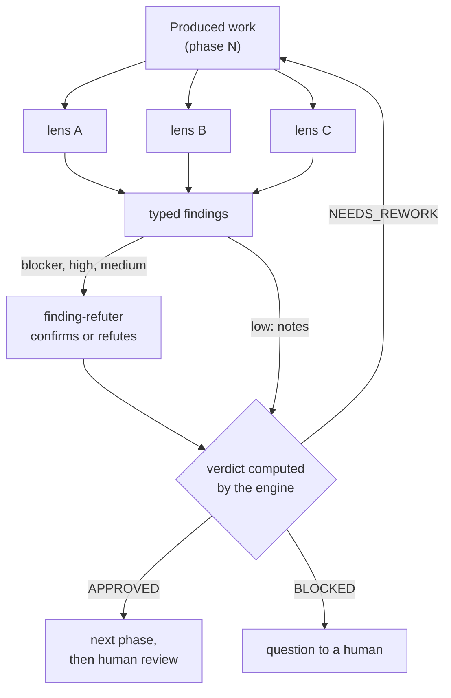



# Review before review — why and how

> Before a human reads it, independent lenses attack the work from several angles and the engine
> computes a verdict from what they find. Human review receives an already-filtered artifact —
> not a draft.

## The problem: human review absorbs too much noise

When the first read of a change is done by a human, it spends the team's most expensive time on
defects a systematic check could have caught: a test that asserts nothing, a dependency that
violates a boundary, a forgotten acceptance criterion, a name that hides the intent. The reviewer
tires on the trivial and misses the subtle, and every round trip stretches the cycle.

The *review before review* idea: insert an **assisted adversarial** review between production
and human review. It does not replace the human; it hands them work already cleared of
detectable defects, so they can focus on what only they can judge.

## Why it works

Two well-established observations ground this approach.

First, peer review remains one of the most effective quality practices, and several independent
eyes, guided by written criteria, find what a single reader misses
([Wiegers, 2002]({{ cites }}#cite-wiegers-peer-reviews-2002)). The earlier a defect is found, the
less it costs: assisted review moves detection upstream, before the human even looks.

Second, speed and stability are not a trade-off: the highest-performing teams ship often and
break rarely, because they automate checks instead of deferring them to a late manual review
([Forsgren et al., 2018]({{ cites }}#cite-forsgren-accelerate-2018)).

## How SKRAFT applies it

Each reviewed phase has its own **review**: lenses that did not produce the work, each in a fresh
context, each from a single angle. They read and modify nothing: the producing agent writes, the
lenses only ask — Meyer's command-query separation
([Meyer, 1997]({{ cites }}#cite-meyer-oosc-1997)) applied to roles.

*Figure 1 — A SKRAFT review: the lenses find, the refuter checks, the engine decides; a single
finding that stands is enough to send the work back.*

Each blocker, high or medium finding goes to `finding-refuter`, which rereads the cited location
and confirms or refutes it, saying why. A single finding that stands is enough to send the work
back (`NEEDS_REWORK`); low findings remain notes. A lens that cannot conclude blocks the review
instead of counting as approval. When only one lens finds what would send the work back while
the others passed, the refuter judges it with every input of the review — the *Dissent Rule*: a
lone voice is neither set aside without a reason nor followed without a check. Rework is bounded
before it reaches a human, and the verdict keeps its findings: human review sees **why** the work
passed.

The exact verdict computation: [Gates]({{ "/en/reference/gates" | relative_url }}#review-run).

## The DELIVER lenses in practice

In DELIVER, the command gates run first; then come the lenses, each independent and covering a
different angle.

| Lens | What it checks |
| --- | --- |
| `architecture-boundaries` | Boundaries between the Domain, Application, Infrastructure and API layers are respected |
| `cold-reader` | A developer meeting the code for the first time understands its intent, in the business's language |
| `test-integrity` | Tests actually verify a behaviour: no façade test, no test weakened to pass |

The review is not fixed: when the change touches a mock or a contract the `software-engineer`
wired, the matching fidelity lens (`mock-fidelity` or `contract-fidelity`) joins the review, and
its findings go through the same refuter and the same verdict. See
[Mocking with Microcks]({{ "/en/explanation/deep-dive/mocking-microcks" | relative_url }}) and
[Contract testing]({{ "/en/explanation/deep-dive/contract-testing" | relative_url }}).

> **Jargon** — *Domain / Application / Infrastructure / API*: the Clean Architecture layers; each
> has a precise responsibility and depends only on inner layers
> ([Clean Architecture]({{ "/en/explanation/clean-architecture" | relative_url }})).

## What changes, and what does not

The pull request no longer reaches the human carrying mechanically detectable defects; the
reviewer no longer flags basic errors and focuses on design and business intent. Fewer revision
cycles per story are expected *(estimated)*.

Human judgement stays whole: business relevance, non-obvious design choices, user experience.
SKRAFT filters the noise; it does not decide in the reviewer's place.

## What adversarial review does not see

The lenses detect **structural and coverage violations**: a boundary crossed, a test that
verifies nothing, code whose intent is opaque. They do not detect **factual errors**: a business
rule invented by the model, a non-existent external API cited as valid, a wrong domain assumption
built into the logic. Those errors are invisible to a structural reading. Catching them takes
business acceptance tests and the human reviewer's judgement: the guardrails keep the structure
honest, not the facts.

## Pitfalls & anti-patterns

- **Lens = producer**: the review loses its independence and its power to refute.
- **Averaging synthesis**: aggregating opinions into an "average" instead of honouring each
  finding that stands lets the critical one slip — the engine never averages.
- **Infinite loop**: without a retry bound, a disagreement between agent and lens never reaches
  the human — SKRAFT bounds and escalates.

## Going further

- [The team and handoffs]({{ "/en/explanation/pipeline/team" | relative_url }}) — who produces, who judges.
- [Reference: gates and verdict]({{ "/en/reference/gates" | relative_url }}).
- [The lens catalogue]({{ "/en/dashboard/" | relative_url }}).
- [For executives]({{ "/en/explanation/for-executives" | relative_url }}) — the effect on lead time.

## Sources

- [Forsgren, N., Humble, J. & Kim, G. *Accelerate*, 2018.]({{ cites }}#cite-forsgren-accelerate-2018)
- [Meyer, B. *Object-Oriented Software Construction*, 2nd ed., 1997.]({{ cites }}#cite-meyer-oosc-1997)
- [Wiegers, K. *Peer Reviews in Software*, 2002.]({{ cites }}#cite-wiegers-peer-reviews-2002)
