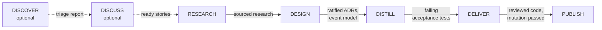



# The SKRAFT pipeline

> SKRAFT does not impose one chain: it offers journeys, and in each one the output of a step
> becomes the input of the next.

## Why several journeys

A team does not always start from the same place. Sometimes the story is ready, sometimes the
backlog is a pile of raw issues, sometimes there is only inherited code with no written intent.
One pipeline for all three would force you either to invent a story where there is none, or to
skip checks where one already exists.

SKRAFT therefore separates three things:

- **product preparation** — DISCOVER then DISCUSS, in the `skraft-backlog` plugin. It is
  optional and the developer starts it; see [The backlog]({{ "/en/explanation/backlog" | relative_url }});
- **the engineering pipeline** — RESEARCH, DESIGN, DISTILL, DELIVER and then publication, which
  the engine conducts for one refined story; the `skraft-orchestrator` agent only starts or
  resumes it;
- **the Brownfield journey** — a sibling journey to take over an existing system, not a
  preliminary phase; see [Take over an existing system]({{ "/en/explanation/brownfield" | relative_url }}).

The two plugins share files, never code: the stories DISCUSS writes into the tracking folder are
the ones the engine can read. Each installs and runs without the other.

## The artifact flow

In the core journey, the thread is not an agent but an **artifact**: each phase reads what the
previous one wrote, and the engine checks the expected output is there before moving on.

*Figure 1 — The artifact flow of the core journey: dotted, the optional product preparation;
solid, the phases the engine conducts.*

This choice has a consequence: a phase cannot "remember" a decision it did not write down.
What is not in an artifact does not exist for the next phase, which keeps every handoff
readable by a human. When the stories already come from DISCUSS,
`skraft init <slug> --from-artifacts` starts the run in DESIGN: the research happened upstream.

☕ Running example — Starbucks <em>(illustrative)</em>

To see this flow in action, follow one request — "order and pay for a drink in the Starbucks
app" — from idea to code, phase by phase:
[Follow an end-to-end example]({{ "/en/explanation/pipeline/fil-rouge" | relative_url }}).

## What each phase brings

- [DISCOVER]({{ "/en/explanation/pipeline/discover" | relative_url }}) — triage before choosing:
  know what is worth working on.
- [DISCUSS]({{ "/en/explanation/pipeline/discuss" | relative_url }}) — clarify before
  designing: a story the business and the code understand the same way.
- [RESEARCH]({{ "/en/explanation/pipeline/research" | relative_url }}) — look for evidence
  before deciding.
- [DESIGN]({{ "/en/explanation/pipeline/design" | relative_url }}) — decide the architecture and
  have a human ratify it.
- [DISTILL]({{ "/en/explanation/pipeline/distill" | relative_url }}) — write the executable
  contract, failing, before the code.
- [DELIVER]({{ "/en/explanation/pipeline/deliver" | relative_url }}) — make that contract pass
  in small proven steps, then test the tests.

The inputs, outputs, paths, agents, lenses and loop-back edges of each phase are in the
[Phases]({{ "/en/reference/phases" | relative_url }}) reference; what each gate checks, in
[Gates]({{ "/en/reference/gates" | relative_url }}).

## Why each phase has its review

Whoever produces an artifact is not who judges it. DESIGN, DISTILL and DELIVER go before
read-only review lenses; DISCOVER and DISCUSS have their own lenses in `skraft-backlog`.
RESEARCH has no review: the engine only checks its document is filled, and DESIGN, which reads
it, remains its judge. This is peer review applied to every handoff: a defect caught in the
phase that introduced it costs less than in the next one
([Wiegers, 2002]({{ cites }}#cite-wiegers-peer-reviews-2002)). The full reasoning:
[Review before review]({{ "/en/explanation/deep-dive/review-before-review" | relative_url }}).

## The explanation pages

**Orientation and journeys**

- [The running example]({{ "/en/explanation/pipeline/fil-rouge" | relative_url }}) — one example followed end to end.
- [The team and handoffs]({{ "/en/explanation/pipeline/team" | relative_url }}) — who produces, who judges, who starts.
- [The backlog]({{ "/en/explanation/backlog" | relative_url }}) — the `skraft-backlog` plugin and its automations.
- [Take over an existing system]({{ "/en/explanation/brownfield" | relative_url }}) — the Brownfield journey.

**Understand the system**

- [Architecture]({{ "/en/explanation/architecture" | relative_url }}) — a neutral engine, one driver per host.
- [The event journal]({{ "/en/explanation/event-journal" | relative_url }}) — why `events.jsonl` replaced the written state.
- [Guardrails]({{ "/en/explanation/guardrails" | relative_url }}) — why the checks live in the engine, not in hooks.
- [Token economy]({{ "/en/explanation/token-economy" | relative_url }}) — why cost is decided at design time.

**Craft foundations**

- [Software craftsmanship]({{ "/en/explanation/software-craftsmanship" | relative_url }}),
  [Domain-Driven Design]({{ "/en/explanation/domain-driven-design" | relative_url }}),
  [Clean Architecture]({{ "/en/explanation/clean-architecture" | relative_url }}).

**Deep dives**

- [Review before review]({{ "/en/explanation/deep-dive/review-before-review" | relative_url }}),
  [Outside-In TDD]({{ "/en/explanation/deep-dive/outside-in-tdd" | relative_url }}),
  [Walking Skeleton]({{ "/en/explanation/deep-dive/walking-skeleton" | relative_url }}),
  [Mocking with Microcks]({{ "/en/explanation/deep-dive/mocking-microcks" | relative_url }}),
  [Contract testing]({{ "/en/explanation/deep-dive/contract-testing" | relative_url }}),
  [Read an evaluation verdict]({{ "/en/explanation/deep-dive/reading-a-verdict" | relative_url }}).

**For executives**

- [For executives]({{ "/en/explanation/for-executives" | relative_url }}).

## Sources

- [Wiegers, K. *Peer Reviews in Software*, 2002.]({{ cites }}#cite-wiegers-peer-reviews-2002)
