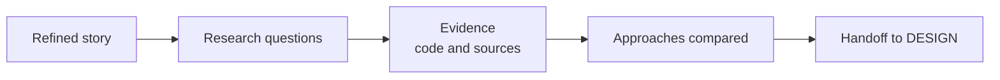





# RESEARCH — reduce uncertainty before designing

> RESEARCH looks for evidence in the code, the conventions and external sources. It recommends
> an approach without writing code or making the architecture decision.

## Why this phase exists

An architect who designs without looking at what exists reinvents an aggregate that is already
there, or picks a library the repository has abandoned. RESEARCH separates two jobs: **knowing
what is true** and **deciding what to do**. The `solution-researcher` only does the first.
Because it builds nothing, what it reports can be trusted: it has no stake in defending a
solution it already wrote.

It is the first phase the engine conducts. Before starting the researcher, the run asks the
developer whether they consent to publishing the pull request and, for a front end, the
screenshots: these questions come early so they do not interrupt the run later.

☕ Running example — Starbucks <em>(illustrative)</em>

The story "order a customised drink" enters with its criteria. RESEARCH spots the existing
payment provider, the repository's constraints and the integration options. It hands DESIGN a
sourced recommendation, without choosing the ADR.

## A claim without a source is removed

Every finding of the research document cites a repository path with its lines, or a URL. A claim
the researcher cannot verify is not hedged: it is removed. The document compares several
approaches, recommends one with its reasons and keeps the others with the evidence against them,
then lists what DESIGN will have to decide.

*Figure 1 — A story's path through RESEARCH: from questions to evidence, from evidence to
compared approaches, then the handoff to DESIGN.*

## No review, but a judge downstream

RESEARCH is the only engineering phase without review lenses. The engine only checks that the
document exists and is filled: not empty, not identical to the template, no placeholder left.
Judging the substance falls to DESIGN, which must cite these findings rather than search the
code again; consistency between the research and the ADRs is then judged by the DESIGN review.
One more review would cost a round of lenses on a document the next phase reads anyway.

When the stories come from DISCUSS with `skraft init --from-artifacts`, the run starts in
DESIGN: the research happened during product preparation.

## Going further

- [Reference: RESEARCH]({{ "/en/reference/phases" | relative_url }}#research) — nodes, output, check, attempts.
- [Reference: the research document]({{ "/en/reference/run-journal" | relative_url }}#research-document).
- [DESIGN]({{ "/en/explanation/pipeline/design" | relative_url }}) — the phase that decides.
