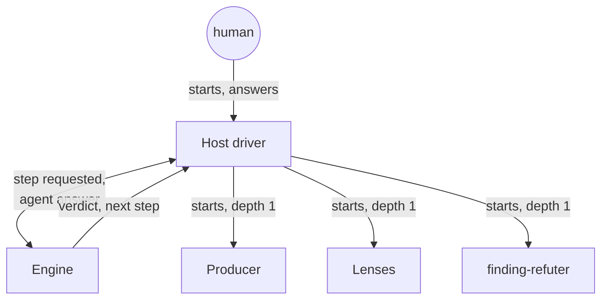



# The team — the pipeline as a relay race

> Agents that produce, lenses that judge, an engine that decides and a driver that starts.
> Nobody approves their own work, and no agent starts another.

## Four roles, never mixed

SKRAFT is not a monolithic agent. The work splits into four roles, and each does only its own.

- **Producers** write an artifact: `solution-researcher` (RESEARCH), `solution-architect`
  (DESIGN), `acceptance-designer` (DISTILL), `software-engineer` (DELIVER), `pr-writer` (the
  pull request prose).
- **Judges** read without modifying anything: the review lenses, each from a single angle, and
  `finding-refuter`, which confirms or refutes each finding that would send the work back.
- **The engine** decides: the next step, what the agent receives, the expected output, the
  gates, the verdict of a review. It is tested code, the same on every host.
- **The host driver** executes: the Claude Code mod, the Copilot workflow or the VS Code agent
  loop starts the agent the engine asks for and hands back its answer.

A fifth actor keeps the decisions that commit the team: **the human**. They ratify ADRs, consent
to publication, choose how surviving mutants are treated. No agent answers in their place.

*Figure 1 — Who starts whom in the engineering pipeline: the driver is the only one that starts
agents; the engine starts nothing, it decides.*

## The orchestrator only starts

The `skraft-orchestrator` agent is the entry point the developer selects, but it produces nothing
and decides nothing. Under Claude Code, its only tool starts the pipeline; under Copilot CLI, it
starts the `skraft-pipeline` workflow; under VS Code without the SDK, it conducts the
`skraft next` / `skraft record` loop and starts the agents the step lists. It then relays what
the run reports. In v1, the phase order and the verdicts lived in its prose; in V2 they are in
the engine, and the run state is in the [event journal]({{ "/en/explanation/event-journal" | relative_url }}).

## Why only the driver starts agents

**Depth 1**: the driver starts every agent, lenses and refuter included, and no agent starts
another. In v1, the DELIVER reviewer started its own lenses, at depth 2. That cost one more
context, duplicated checks, and the behaviour depended on what each host allowed a sub-agent to
do.

At depth 1, the engine sees every start in its journal, the driver can start a review's lenses
in parallel when the host allows it, and a lens cannot delegate its judgement. The detail of the
mechanism is in [Architecture]({{ "/en/explanation/architecture" | relative_url }}).

Two cases sit outside the engineering pipeline without breaking the rule. In `skraft-backlog`,
the developer starts `backlog-discoverer` or `backlog-planner` as the main agent of their
session, and that producer starts its own lenses: no sub-agent starts another. In
`skraft-brownfield`, `brownfield-refactorer`, also started as the main agent, may hand work to
`refactoring-worker`, which starts no one.

## Nobody approves their own work

DISCOVER, DISCUSS, DESIGN, DISTILL and DELIVER each have their review, by lenses that did not
produce the work and each run in a fresh context. RESEARCH is the exception: the engine checks
its document is filled, and DESIGN remains its judge. This is peer review applied to every
handoff ([Wiegers, 2002]({{ cites }}#cite-wiegers-peer-reviews-2002)).

## Going further

- [The running example]({{ "/en/explanation/pipeline/fil-rouge" | relative_url }}) — the handoffs on one example.
- [Reference: phases]({{ "/en/reference/phases" | relative_url }}) — producer, lenses and human decision of each phase.
- [Reference: hosts]({{ "/en/reference/hosts" | relative_url }}) — what each driver starts and how.
- [The agent catalogue]({{ "/en/dashboard/" | relative_url }}).
- [Review before review]({{ "/en/explanation/deep-dive/review-before-review" | relative_url }}).

## Sources

- [Wiegers, K. *Peer Reviews in Software*, 2002.]({{ cites }}#cite-wiegers-peer-reviews-2002)
