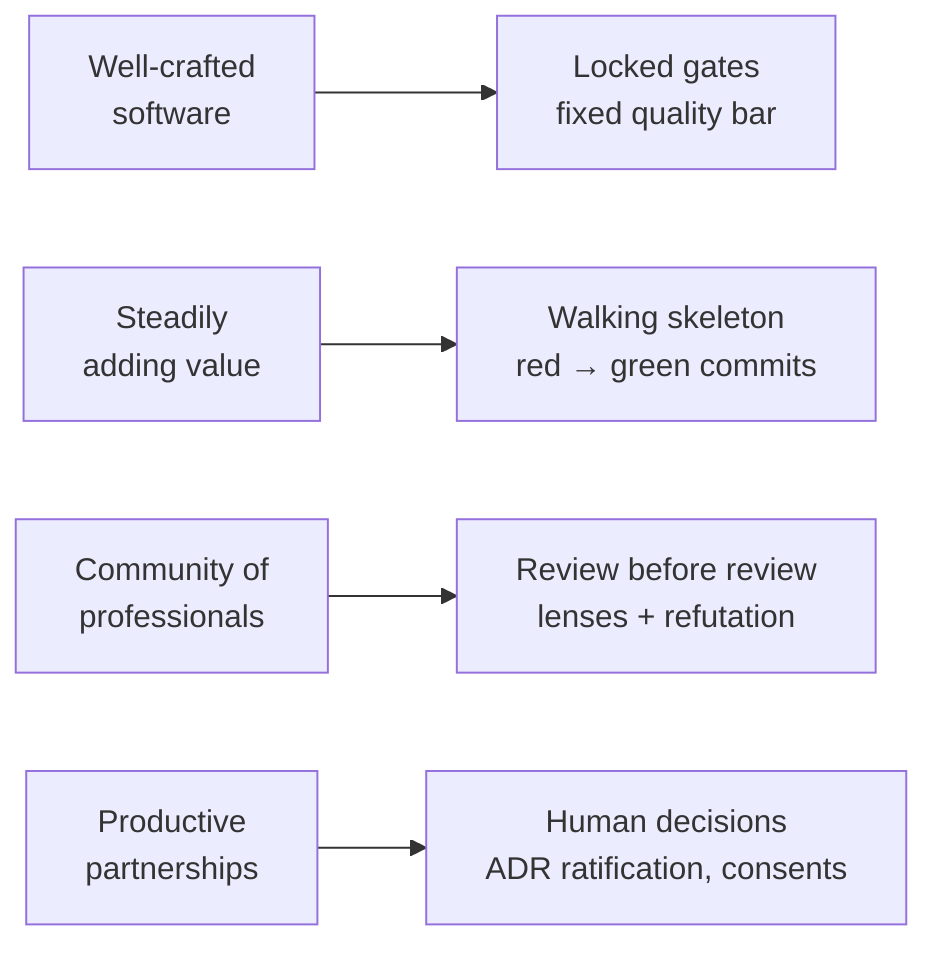
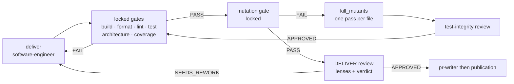



# Software craftsmanship — why skraft makes it a rule

> Craftsmanship is not a coding style: it is a commitment to quality. skraft takes it at its
> word and hands it to the engine, so that it holds even when an agent writes the code.

## The problem: "it works" is not enough

A coding assistant produces in minutes what used to take a day. The speed changes; the question
does not: will this code still be changeable in six months? Code that passes the demo but that
nobody dares touch is debt, and an agent digs it as fast as it writes.

The *software craftsmanship* movement grew out of that observation long before AI. Pete McBreen
proposes to see software development as a craft rather than as an engineering line: quality comes
from practitioners who master their trade and answer for it, not from a process meant to replace
them ([McBreen, 2001]({{ cites }}#cite-mcbreen-craftsmanship-2001)).

## What craftsmanship asks for

In 2009, the [Manifesto for Software Craftsmanship]({{ cites }}#cite-manifesto-craftsmanship-2009)
extends the Agile Manifesto with four values: not only working software, but also **well-crafted
software**; not only responding to change, but also **steadily adding value**; not only
individuals and interactions, but also a **community of professionals**; not only customer
collaboration, but also **productive partnerships**.

Sandro Mancuso sums up the attitude in three words — professionalism, pragmatism, pride — and
insists on one point: a professional does not sacrifice the quality of their work to deadline
pressure; they know how to say no and offer another option
([Mancuso, 2014]({{ cites }}#cite-mancuso-craftsman-2014)). The practices come mostly from
Extreme Programming: test first, continuous refactoring, simple design, small increments
([Beck, 2004]({{ cites }}#cite-beck-xp-2004)).

These ideas have a known weak spot: they rest on each person's discipline. A human in a hurry
skips the test "just this once"; an agent optimising for "the task is done" skips it without even
saying so. skraft starts from there: **a craft rule exists only if a check runs it**.

## How skraft makes each value enforceable

*Figure 1 — The four values of the Manifesto for Software Craftsmanship (2009), on the left, and
the skraft mechanism that makes each one checkable, on the right. Adaptation: the left column
restates the manifesto, the right column is skraft's own.*

### Well-crafted software: a bar that is not negotiated

The `skraft-quality-bar` skill is the only place a threshold is written: 100 % mutation score and
line coverage on Domain and Application, 80 % mutation score on API and Infrastructure. There is
no "advisory" level, no waiver and no per-repository setting; `skraft-config.json` chooses the
gates' **commands**, never their thresholds. In `pipeline.skraft.dot`, the DELIVER `gates` and
`mutation` nodes are `locked`: removing them from a copy of the workflow needs a written reason
(`unlock="<reason>"`).

This is skraft's answer to Mancuso's point: quality is not an adjustment variable. The details of
each gate are in the [gates reference]({{ "/en/reference/gates" | relative_url }}).

### Steadily adding value: small verified steps

Craftsmanship moves in small increments that work. In skraft, this takes two forms.

- **The walking skeleton.** In DISTILL, the `acceptance-designer` commits failing acceptance tests
  and the skeleton they call; the `boundary-enforcement` lens requires at least one walking
  skeleton scenario per flow (gate G8). See
  [Walking Skeleton]({{ "/en/explanation/deep-dive/walking-skeleton" | relative_url }}).
- **The red → green → refactor cycle.** In DELIVER, the engine reads the `software-engineer`'s
  commits: a `test(…)` is the red, a `feat(…)` or `fix(…)` the green, a `refactor(…)` the
  clean-up. It replays the test command at each red commit and refuses a green with no red before
  it. Beck's test first ([Beck, 2003]({{ cites }}#cite-beck-tdd-2003)) becomes a fact checked in
  the git history, not a promise. See
  [Outside-In TDD]({{ "/en/explanation/deep-dive/outside-in-tdd" | relative_url }}).

### Testing the tests: mutation testing

A green suite does not prove it would catch a mistake. Mutation testing injects small faults into
the code and measures how many the tests catch
([Jia & Harman, 2011]({{ cites }}#cite-jia-mutation-2011)). In skraft, the `mutation` gate judges
the report against the `skraft-quality-bar`; every file that keeps a surviving mutant goes back to
the `software-engineer` (the `kill_mutants` node), and the `test-integrity` lens checks that the
added tests can really fail (G7) and that no test was weakened to pass (G9).

### A community of professionals: review before review

Peer reviews find defects early, when they are cheap
([Wiegers, 2002]({{ cites }}#cite-wiegers-peer-reviews-2002)). skraft puts every agent's output in
front of review lenses, each in a fresh context; the `finding-refuter` agent confirms or refutes
each finding, then the engine computes the verdict. Human review receives work already cleared of
mechanical noise. The full reasoning is in
[Review before review]({{ "/en/explanation/deep-dive/review-before-review" | relative_url }}).

Readability is part of that respect for peers. Code is read far more often than it is written,
and names that reveal intent are its first condition
([Martin, 2008]({{ cites }}#cite-martin-cleancode-2008)). The `cold-reader` lens reads the code
and the tests with no context at all and checks that they speak the business language (G11); the
`architecture-boundaries` lens applies the Object Calisthenics rules to Domain code
(G10, [Bay, 2008]({{ cites }}#cite-bay-calisthenics-2008)).

### Productive partnerships: the human keeps the decisions

A craftsperson does not decide alone what commits their client. In the workflow, a hexagon is a
question asked to a human: `adr-ratification` has the ADRs ratified before DISTILL,
`publish-consent` asks for agreement before pushing a branch. Without an answer, the run waits;
no agent can answer in the human's place. See
[Architecture]({{ "/en/explanation/architecture" | relative_url }}).

## Where craftsmanship plays out in DELIVER

*Figure 2 — The DELIVER loop as described by `plugins/skraft-framework/workflows/pipeline.skraft.dot`,
simplified: every return arrow is a refusal the engine executes, not a piece of advice.*

## The trade-offs

Enforceable craftsmanship has a cost, and skraft owns it.

- **The first slice is slower.** A walking skeleton and red tests before the code delay the first
  demo; they avoid having to rebuild the structure later.
- **100 % mutation on the core is demanding.** Some mutants change nothing observable; the
  component's `quality-gates-<stack>` skill says how to exclude one, line by line and with its
  reason, rather than lowering the bar for everyone.
- **No "prototype" mode.** A bar that can be lowered stops being a bar; there is therefore no
  setting to relax it.

## Pitfalls and misreadings

- **Mistaking craftsmanship for over-engineering.** Craftsmanship asks for the simplest design
  that works. The `fitness` lens refuses any aggregate, context or pattern no story justifies (G9),
  and the `solution-architect` introduces no pattern without a story or a measurable force.
- **Test theatre.** A test with no assertion, skipped, or rewritten to pass gives flattering
  coverage and proves nothing; this is exactly what the `craft-discipline` skill (C5) and the
  `test-integrity` lens target.
- **Believing the engine replaces judgement.** The gates prove what can be measured; design
  choices are still ratified by a human.

## Going further

- [Domain-Driven Design]({{ "/en/explanation/domain-driven-design" | relative_url }}) — the
  business model craftsmanship protects.
- [Clean Architecture and hexagonal architecture]({{ "/en/explanation/clean-architecture" | relative_url }})
  — the dependency rule checked by the `architecture` gate.
- [The DELIVER phase]({{ "/en/explanation/pipeline/deliver" | relative_url }}) and
  [the glossary]({{ "/en/reference/glossary" | relative_url }}).

## Sources

- [Bay, J. *Object Calisthenics*, 2008.]({{ cites }}#cite-bay-calisthenics-2008)
- [Beck, K. *Test-Driven Development by Example*, 2003.]({{ cites }}#cite-beck-tdd-2003)
- [Beck, K. *Extreme Programming Explained*, 2nd ed., 2004.]({{ cites }}#cite-beck-xp-2004)
- [Jia, Y. & Harman, M. *An Analysis and Survey of the Development of Mutation Testing*, 2011.]({{ cites }}#cite-jia-mutation-2011)
- [Mancuso, S. *The Software Craftsman: Professionalism, Pragmatism, Pride*, 2014.]({{ cites }}#cite-mancuso-craftsman-2014)
- [*Manifesto for Software Craftsmanship*, 2009.]({{ cites }}#cite-manifesto-craftsmanship-2009)
- [Martin, R. C. *Clean Code*, 2008.]({{ cites }}#cite-martin-cleancode-2008)
- [McBreen, P. *Software Craftsmanship: The New Imperative*, 2001.]({{ cites }}#cite-mcbreen-craftsmanship-2001)
- [Wiegers, K. *Peer Reviews in Software*, 2002.]({{ cites }}#cite-wiegers-peer-reviews-2002)
