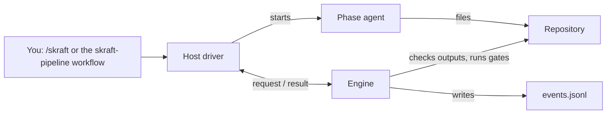

# SKRAFT — The Handbook

SKRAFT takes a story through four phases: **RESEARCH → DESIGN → DISTILL → DELIVER**.
In V2, a single **engine** decides everything — phase order, expected outputs, retries, verdicts,
gates — and it is the same under Claude Code, GitHub Copilot CLI and, soon, VS Code.
**Host drivers** carry out what the engine asks and are the only ones that start agents; no agent
starts another, and no command hook slows down your tool calls.

> « The only way to go fast is to go well. »
> — Martin, R. C., *Clean Architecture*, 2017.

## First visit

Follow the [Getting started tutorial]({{ "/en/tutorials/getting-started" | relative_url }}): you
install the plugin, describe your repository in `skraft-config.json`, and run one story from
RESEARCH to its pull request description, on a small repository.

## Available today, and what comes next

SKRAFT V2 is built in **lots**. Each lot is compared with v1 on the same sample projects; a
regression blocks the lot.

| Lot | Capability | State |
| --- | --- | --- |
| 0 – 2 | **RESEARCH** phase end to end (pre-created document, retry when missing, stop at the cap), hash-chained journal, resume, component-based `skraft-config.json`, detection (`skraft init`), `skraft doctor`, per-repository base, gates run by hand (`skraft gate`) | Available |
| 3 | DESIGN, DISTILL and DELIVER driven by the engine on a DOT workflow; write scope by git diff; gates as pipeline steps | Available |
| 4 | Code review through isolated lenses, refuter, computed verdict, incremental re-review | Available |
| 5 | Human decisions (`skraft decide`, dialogs, pane buttons), ADR ratification | Available |
| 6 | v1 agents and skills pruned | Available |
| 7 | Mutation closing loop (100 % core, 80 % boundary) | Available |
| 8 | Pane view, run and QA reports, end-of-run pull request, screenshot publishing, issue progress | Available; the Copilot Canvas's display in the app is to be checked by hand |
| 9 | `skraft-brownfield` plugin | Available |
| 10 | VS Code: Copilot SDK driver, then the `skraft next` / `skraft record` fallback | Available |
| 11 | `skraft migrate`, `skraft review --pr`, V2 documentation; final v1/V2 comparison and version 2.0.0 | `migrate` and `review --pr` available; the final comparison is pending |

Hosts available today: **Claude Code** (`/skraft` command, "Skraft" pane), **GitHub Copilot
CLI** (`skraft-pipeline` and `skraft-review` workflows) and **VS Code** (Copilot SDK, or the
`skraft-orchestrator` agent loop).

## How to read this handbook

The documentation follows **Diátaxis**: four doors depending on what you are looking for.

| Door | For… | Pages |
| --- | --- | --- |
| **Learn** (tutorial) | a first guided run | [Getting started]({{ "/en/tutorials/getting-started" | relative_url }}) |
| **Do** (how-to) | completing a precise task | [Configure components]({{ "/en/how-to/configure-components" | relative_url }}), [Run the gates]({{ "/en/how-to/run-gates" | relative_url }}), [Resume or unblock a run]({{ "/en/how-to/resume-a-run" | relative_url }}), [Customisation]({{ "/en/how-to/customisation" | relative_url }}), [Evaluate a skill]({{ "/en/how-to/evaluation" | relative_url }}), [Contributing]({{ "/en/how-to/contributing" | relative_url }}) |
| **Look up** (reference) | finding an exact fact | [Hosts]({{ "/en/reference/hosts" | relative_url }}), [The `skraft` command line]({{ "/en/reference/cli" | relative_url }}), [DOT workflow]({{ "/en/reference/workflow-dot" | relative_url }}), [Phases]({{ "/en/reference/phases" | relative_url }}), [`skraft-config.json`]({{ "/en/reference/skraft-config" | relative_url }}), [Run journal]({{ "/en/reference/run-journal" | relative_url }}), [Glossary]({{ "/en/reference/glossary" | relative_url }}), [Agent and skill catalogue]({{ "/en/dashboard/" | relative_url }}), [Gates]({{ "/en/reference/gates" | relative_url }}) |
| **Understand** (explanation) | knowing *why* it is built this way | [For executives]({{ "/en/explanation/for-executives" | relative_url }}), [Architecture]({{ "/en/explanation/architecture" | relative_url }}), [Zero hooks]({{ "/en/explanation/hooks" | relative_url }}), [State and resume]({{ "/en/explanation/hve-core" | relative_url }}), [The phases]({{ "/en/explanation/pipeline/" | relative_url }}), [Concepts]({{ "/en/explanation/concepts" | relative_url }}), [Clean Architecture]({{ "/en/explanation/clean-architecture" | relative_url }}), [Outside-In TDD]({{ "/en/explanation/deep-dive/outside-in-tdd" | relative_url }}), [Brownfield]({{ "/en/explanation/brownfield" | relative_url }}) |

## Where to go by role

- **Executive** — the problem V2 solves and the targets it aims for:
  [For executives]({{ "/en/explanation/for-executives" | relative_url }}).
- **Developer** — first the [tutorial]({{ "/en/tutorials/getting-started" | relative_url }}),
  then the guides: [configure components]({{ "/en/how-to/configure-components" | relative_url }}),
  [run the gates]({{ "/en/how-to/run-gates" | relative_url }}),
  [resume or unblock a run]({{ "/en/how-to/resume-a-run" | relative_url }}).
- **Architect** — engine, host drivers, depth 1:
  [Architecture]({{ "/en/explanation/architecture" | relative_url }}).
- **Quality assurance** — where the evidence lives and how to read it:
  [Run the gates]({{ "/en/how-to/run-gates" | relative_url }}),
  [Run journal]({{ "/en/reference/run-journal" | relative_url }}).

## SKRAFT V2 in one picture

The engine never starts an agent; it tells the driver what to start, checks what the agent wrote,
then records each step in `.copilot-tracking/skraft-plans/<slug>/events.jsonl`.
