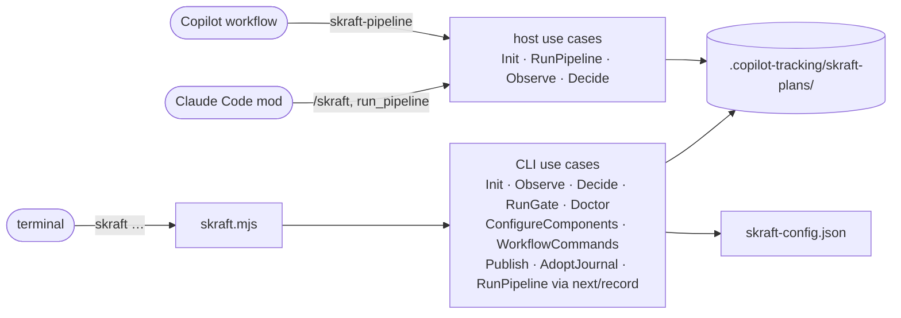
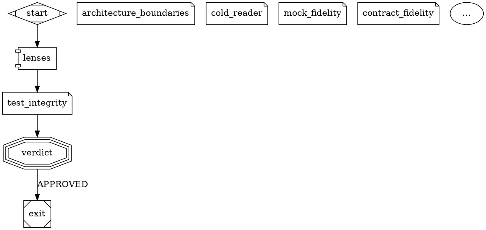

# The skraft command line

> `skraft` is the command-line entry point to the engine: each command calls one use case and prints what it returns, deciding nothing itself.

## Why — the problem it solves

In v1, run state, gates and environment checks went through agent prose, hooks and bash
scripts. The result changed with the host and the operating system. V2 puts these decisions
in a **use-case engine** (the code that decides phase order, expected outputs, retries and
gates). The `skraft` command line reaches that engine from any terminal, under sh as under
PowerShell, with the same output and the same exit codes.

## Key concepts — how it works

### Calling skraft

The entry point is a Node script shipped in the plugin. Replace `<plugin folder>` with the
folder where your host installed the skraft plugin:

```
node "<plugin folder>/engine/drivers/cli/skraft.mjs" <command>
```

The same form works under sh and PowerShell. Run it **from the root of the working copy**:
`skraft-config.json` and `.copilot-tracking/` are read and written there. The rest of this
page writes `skraft <command>` for that full line. Prerequisites: Node 22 or later, Git.

The command line, the Claude Code mod and the Copilot workflow call use cases of the same
engine, not all the same ones. The CLI starts no agent itself: it calls `RunPipeline` only
through `next` and `record`, the agent loop that `skraft-orchestrator` conducts under VS Code.
The mod and the workflow call `Init`, `RunPipeline`, `Observe` and `Decide`.



### Synopsis

```
usage: skraft --version
       skraft init [--add <folder>]...                                   detect the components into skraft-config.json
       skraft init <slug> [--issue <number>] [--title <text>] [--base <ref>] [--from-artifacts]   start or resume a pipeline
       skraft status [--json]
       skraft report [--json]                                            time, cost and retries of each step of the active pipeline
       skraft decide [<key>] <answer> [--reason <text>]                answer the question the active pipeline waits on
       skraft publish                                                    push the branch and open or update the pull request of the completed run
       skraft journal adopt                                              sign a journal this machine cannot verify with a key of this machine
       skraft next [--json]                                              run the active pipeline until it needs agents or a human
       skraft record [--json]                                            hand the saved agent replies to the run, then go on
       skraft gate [--all] [--json]                                      run the gates of the changed components (all with --all)
       skraft doctor [--run] [--base <ref>] [--json]                     check every command can run (--run: run each once)
       skraft workflow eject [review]                                    copy the plugin pipeline into .skraft/ (review: the review alone)
       skraft workflow check [--json]                                    validate the workflow a run follows
       skraft workflow diff [--json]                                     compare the repository workflow with the plugin one
```

Option rules shared by every command:

- an option with a value is written `--name value`; a value that starts with `--` is not a
  value;
- an unknown option, or one repeated without being repeatable, makes the line malformed;
  only `--add` repeats;
- a malformed line prints the usage above on stderr and exits with code **2**.

### Exit codes

| Command | 0 | 1 | 2 |
| --- | --- | --- | --- |
| `--version` | always | — | — |
| `init` (no slug) | components written or already listed | invalid config, `--add` refused | malformed line |
| `init <slug>` | the slug is the active pipeline | refusal (`invalid-slug`, `invalid-base`, `config-invalid`, `base-unresolved`, `source-control-unavailable`, `journal-tampered`) | malformed line, `--issue` not a positive integer |
| `status`, `report` | any status but `tampered` | status `tampered` | argument other than `--json` |
| `decide` | answer recorded | refusal or not confirmed (below) | no answer, more than two words, option other than `--reason` |
| `publish` | pull request opened, updated or up to date | refusal (below) | any argument |
| `journal adopt` | journal adopted | refusal or not confirmed (below) | other than `adopt` |
| `next`, `record` | `dispatch`, `waiting` or `done` | `blocked` or `refused` | argument other than `--json` |
| `gate` | gates `passed` (including no component changed) | `failed`, `refused`, `blocked` | malformed line |
| `doctor` | no `FAIL` check (warnings allowed) | at least one `FAIL` check | malformed line |
| `workflow eject`, `check`, `diff` | copied, valid, compared | copy exists, invalid, nothing ejected | unknown action or option |
| unknown command | — | — | always |

The `refused` and `blocked` codes are detailed in
[Tracking folder and journal]({{ "/en/reference/run-journal" | relative_url }}).

### `skraft --version`

Prints the version read from the plugin's `plugin.json`. Output: one line. Code 0.

### `skraft init [--add <folder>]...`

**Effect.** Detects one component per project found in the working copy and in each
`--add` folder, and adds them to `skraft-config.json` (created when missing). Components
already listed and every other key of the file stay as written. Detection rules and stack
defaults: [skraft-config.json]({{ "/en/reference/skraft-config" | relative_url }}).

| Option | Value | Rule |
| --- | --- | --- |
| `--add <folder>` | folder relative to the working copy (`../payment-web`) | repeatable; refused when absolute or not a folder |

**Output (stdout, code 0)** — one of these lines:

| Case | Line |
| --- | --- |
| components added | `skraft-config.json: <name> (<stack>, <root>), …` |
| nothing new, the file already has a `components` key (even empty) | `skraft-config.json already lists every project found (N components)` |
| no project found, file missing or without a `components` key (the file is written with `"components": []`) | `no project found; skraft-config.json lists no component` |

**Errors (stderr, code 1).**

| Case | Message |
| --- | --- |
| invalid config | `skraft-config.json is invalid: <error>; <error>…` |
| absolute `--add` | `--add <folder> is not relative to the working copy` |
| `--add` not a folder | `--add <folder> is not a folder` |

### `skraft init <slug> [--issue <number>] [--title <text>] [--base <ref>] [--from-artifacts]`

**Effect.** Makes `<slug>` the active pipeline of the working copy (writes
`.copilot-tracking/skraft-plans/.active-slug`) and opens its journal. On the **first** init
of a slug, the engine reads `skraft-config.json`, computes the base of each repository and
writes the `run.started` event. An init on a slug that already has a journal resumes it: the
config is not read again, and the story and `--base` are ignored (the journaled base stays).

| Argument / option | Value | Rule |
| --- | --- | --- |
| `<slug>` | kebab-case (`checkout-by-card`) | otherwise refused `invalid-slug` |
| `--issue <number>` | positive integer with no leading zero | otherwise malformed line (code 2) |
| `--title <text>` | a single argument; quote it if it has blanks | — |
| `--base <ref>` | git ref: no blank, does not start with `-` | read only at the slug's first init: otherwise refused `invalid-base`; wins over any `baseBranch`. On a slug that already has a journal it is ignored, even when invalid |
| `--from-artifacts` | flag | starts a new run in DESIGN from the DISCUSS stories already in `<slug>/plans/<date>/stories-<milestone>.md`; refused `no-artifacts` without them, `already-started` on a slug that has a journal |

**Output.** Success: `<slug> is the active pipeline` on stdout, code 0. Refusal: the engine's
message on stderr, code 1, for example:

| Code | Message |
| --- | --- |
| `invalid-slug` | `slug must be kebab-case, got "<slug>"` |
| `invalid-base` | `--base must be a git ref, got "<ref>"` |
| `config-invalid` | `skraft-config.json is invalid: <errors>` |
| `base-unresolved` | `the working copy (<repository>) has no merge base with <ref>` or `component <name> (<repository>) has no merge base with <ref>`, one per repository without a base, joined by `; `, then `; set baseBranch in skraft-config.json or pass --base <ref>` |
| `source-control-unavailable` | `<error>; the components of skraft-config.json need Git for their base` |
| `journal-tampered` | `journal tampered: events.jsonl line N …; restore the file or start a new slug` |

`init <slug>` starts no agent: the mod, the workflow, the Copilot SDK driver or `skraft next`
runs the pipeline.

### `skraft status [--json]`

**Effect.** Reads the active pipeline and its journal, writes nothing.

**Text output** — in this order, each line only when it applies:

```
skraft <slug>: <status>
RESEARCH  pending|open|closed
agent: <agent> (<step>, attempt <n>)
answer: skraft decide <key> <A>|<B> (--reason <text> with <refusal>)
cost: <amount> USD
<reason>
```

With no active pipeline, the first line is `skraft: idle`. The `agent:` line becomes
`gates: <gates> (<step>)` on a gate node and `question: <kind> (<step>)` on an ask node;
`, pass <n>` follows the step from the second visit on. The `answer:` line shows only while
the run waits on a question. A run waiting on ADR ratification, for example:

```
skraft checkout-by-card: waiting
…
question: adr-ratification (adr)
answer: skraft decide adr-1 RATIFIED|REJECTED (--reason <text> with REJECTED)
Ratify the Proposed ADRs docs/adr/adr-001-card-provider.md? RATIFIED marks them Accepted; REJECTED sends DESIGN back with your reason.
```

**`--json` output** — the pipeline view object:

| Field | Type | Content |
| --- | --- | --- |
| `slug` | string or null | active pipeline, `null` when none |
| `status` | string | `idle`, `not-initialised`, `running`, `waiting`, `done`, `blocked`, `tampered` |
| `reason` | string | reason for the status (the question text while `waiting`), empty when none |
| `phases` | `[{ phase, state }]` | one entry per phase; `state` = `pending`, `open` or `closed` |
| `current` | `{ step, phase, agent, gates, question, visit, attempt }` or null | the node in progress, `null` otherwise; `question` is the question kind on an ask node, `null` elsewhere |
| `question` | `{ key, kind, text, options, refusals, header }` or null | the question the run waits on, `null` when nothing waits; `header` = the short label a dialog or the pane shows beside it (`ADR`, `Reporting`, `Pull request`, `Environment`) |
| `attempts` | number | number of attempts started |
| `costUsd` | number or null | sum of journaled costs, `null` when none |
| `graph` | `{ nodes, edges }` | the graph of the workflow the run follows (default or `.skraft/`); with no readable workflow, the steps the journal names and no edge |
| `graph.nodes` | `[{ id, kind, phase, what, state, outcome, visits, attempts, retries, durationMs, costUsd }]` | one entry per step (neither `start` nor `exit`) in workflow order; `what` = the agent, gates, lenses, question or publication; `state` = `pending`, `open` or `done`; `outcome` = what the last attempt recorded, `null` while an attempt is open; `costUsd` = the step's cost, `null` when none |
| `graph.edges` | `[{ from, to, label, taken }]` | the edges between those steps; `taken` = how many times the run took it |
| `reviews` | `[{ step, visit, verdict, lenses: [{ lens, verdict, findings }] }]` | the last pass of each review step; `verdict` = `approved`, `needs-rework` or `blocked`, `null` until the pass is recorded; `findings` = how many findings the lens gave |
| `gates` | `[{ component, gate, command, status, durationMs, evidence, survivors }]` | the last result of each gate of each component (the tests among them); `survivors` only for `mutation` |

What each status means:
[Tracking folder and journal]({{ "/en/reference/run-journal" | relative_url }}). Code 1 only
for `tampered`.

### `skraft decide [<key>] <answer> [--reason <text>]`

**Effect.** Records a human's answer to the question the active pipeline waits on (one
`question.answered` event, `by: "cli-tty"`), once the person confirms it at the terminal:
`skraft decide: record <answer> for <key>? [y/N]`. Only `y` records. It runs nothing: the next run of the pipeline
acts on the answer, without starting again an agent that already finished.

| Argument / option | Value | Rule |
| --- | --- | --- |
| `<key>` | question key (`adr-1`, `gates-2`) | optional; without it, the question the run waits on |
| `<answer>` | one of the question's options (`RATIFIED`, `REJECTED`, `RETRY`, `ABORT`…) | case does not matter |
| `--reason <text>` | the reason, sent back to the agent | required with a refusal (`REJECTED`); kept on one line, at most 500 characters |

The questions, their options and their refusals:

| Kind | Key | Options | Refusal |
| --- | --- | --- | --- |
| `adr-ratification` | `<node>-<n>` (`adr-1`) | `RATIFIED`, `REJECTED` | `REJECTED` |
| `publish-consent` | `<node>-<n>` | `ACCEPTED`, `DECLINED` | — |
| `reporting-consent` | `<node>-<n>` | `ACCEPTED`, `DECLINED` | — |
| `environment` | `<node>-<n>`, the node that cannot run (`gates-1`) | `RETRY`, `ABORT` | — |

A key names the node that asks the question, then the question's rank among those that node
asked in the run, whatever their kind: `adr-1`, then `adr-2` after a rejection or when Git
cannot commit the ratification.

**Output.** Recorded: `<slug>: <key> answered <answer>; run the pipeline again to go on` on
stdout, code 0. Refusal: the message on stderr, code 1.

| Code | Message |
| --- | --- |
| `no-active-pipeline`, `slug-mismatch` | see [Tracking folder and journal]({{ "/en/reference/run-journal" | relative_url }}) |
| `no-question` | `no question adr-2; waiting: adr-1`, or `no question to answer; no question is waiting` |
| `already-answered` | `adr-1 was already answered RATIFIED` |
| `invalid-answer` | `the answer must be one of RATIFIED, REJECTED, got "yes"`; `REJECTED needs the reason, which goes back to the agent` |
| `no-terminal` | `skraft decide records a person's answer: run it yourself in an interactive terminal; nothing was recorded` |
| `not-confirmed` | `not confirmed; nothing was recorded` |

### `skraft gate [--all] [--json]`

**Effect.** Runs the gates of the active pipeline: the commands named `build`, `format`,
`lint`, `test`, `architecture`, `coverage`, `mutation` of each component, in that order,
from the component's root. Each gate writes evidence and one `gate.ran` event. A component
stops at its first failing gate; the other components go on.

| Option | Effect |
| --- | --- |
| (none) | scope `touched`: only the components changed since their base |
| `--all` | scope `all`: every component |
| `--json` | JSON output instead of text |

**Text output** — one line per gate run, then a summary line:

```
pass  web/lint
fail (environment)  web/test: <reason>
skraft <slug>: gates <status> — <reason>
```

On a refusal or a block, the summary carries the code: `skraft <slug>: gates refused
(<code>) — <reason>`.

**`--json` output**:

| Field | Type | Content |
| --- | --- | --- |
| `status` | string | `passed`, `failed`, `refused`, `blocked` |
| `slug` | string or null | active pipeline |
| `scope` | string | `touched` or `all` |
| `components` | string[] | components selected |
| `gates` | `GateResult[]` | see below |
| `failure` | string or null | `environment` when at least one environment failure, otherwise `deterministic` on failure, `null` with no failure |
| `code` | string or null | refusal or block code |
| `reason` | string | summary |
| `phase` | null | present only on a refusal or block coming from the active pipeline |

Each `GateResult`: `component`, `gate` (`none` for a component with no gate command),
`status` (`pass`, `fail`), `failure` (`environment`, `deterministic`, `null`), `reason`,
`evidence` (absolute path of the evidence file; for the `none` gate, the `gates/<component>`
folder, where no file is written).

| Result | Summary `reason` |
| --- | --- |
| everything passes | `N gates passed on <components>` |
| no component changed | `no component changed since its base; no gate to run` |
| at least one failure | `<component>/<gate>: <reason>; …` |

Possible codes: `no-active-pipeline`, `not-initialised`, `config-invalid`, `no-components`
(refused); `journal-tampered`, `journal-changed` (blocked). Failure reasons, failure classes
and evidence format:
[skraft-config.json]({{ "/en/reference/skraft-config" | relative_url }}) and
[Tracking folder and journal]({{ "/en/reference/run-journal" | relative_url }}).

### `skraft report [--json]`

**Effect.** Reads the active pipeline's journal and prints the time, cost and retries of each
step; writes nothing. The engine writes the same table to `run-report.md` after each step.

**Text output**:

```
skraft <slug>: <status>
| Step | Phase | Visits | Attempts | Retries | Time | Cost | Outcome |
| --- | --- | ---: | ---: | ---: | ---: | ---: | --- |
| research | RESEARCH | 1 | 1 | 0 | 4 min 12 s | 0.85 USD | done |
| Total | | | 1 | 0 | 4 min 12 s | 0.85 USD | |
<reason>
```

Steps come in the order they first started. A step started again (a retry, or a new visit a
gate, a review or a human sent back) counts one retry. `Cost` is `-` when nothing was
journaled; `Outcome` is `in progress` while an attempt is open. With no active pipeline, no
journal or a tampered one, only the first line and the reason are printed (`idle`,
`not-initialised`, `tampered`).

**`--json` output**: `{ slug, status, reason, steps: [{ step, phase, visits, attempts, retries,
durationMs, costUsd, outcome }], totals: { attempts, retries, durationMs, costUsd }, startedAt,
elapsedMs }`. Code 1 only for `tampered`.

### `skraft publish`

**Effect.** Opens or updates the pull request of the active pipeline's **completed** run, as
its `publish` node would have, once what stopped it there is fixed (no remote, `gh` missing,
no consent…). Typed by the developer, it consents for this publication whatever
`publish.pullRequest` says in `skraft-config.json`; the setting is not changed and the journal
records `publish.requested`. No argument.

**Output.** Success (stdout, code 0), one of:

```
pull request #<n> opened as a draft: <url>
pull request #<n> updated: <url>
pull request #<n> is up to date: <url>
```

(`opened: <url>` without `as a draft` when `publish.draft` is `false`.) Refusal (stderr,
code 1):

| Code | Message |
| --- | --- |
| `no-active-pipeline`, `journal-tampered`, `journal-unverifiable` | see [Tracking folder and journal]({{ "/en/reference/run-journal" | relative_url }}) |
| `not-done` | `<slug> has not completed; skraft publish opens the pull request of a completed run` |
| `config-invalid`, `workflow-invalid` | the invalid file and its errors |
| `not-published` | `pull request not opened: <reason>; pull-request.md holds its description, and skraft publish opens it once that is fixed` |
| `journal-changed` | another writer appended to the journal meanwhile |

The `<reason>` of `not-published` names what is missing: `gh, the GitHub CLI, is not
installed`, `HEAD is detached, on no branch to push`, `HEAD is on <branch>, the branch the
pull request would merge into`, a base that names no branch, and so on.

### `skraft journal adopt`

**Effect.** Signs the active pipeline's journal on from here with a new key of this machine,
when this machine cannot verify it (`journal-unverifiable`): the run was started on another
machine, or before journals were signed. It writes one `journal.adopted` line; the lines
before it stay as they are, unverified. It asks first, at the terminal:

```
skraft journal adopt: sign the journal of <slug> on from here with a key of this machine, leaving unverified <lines>? [y/N]
```

`<lines>` names the line ranges and their event types. Only `y` adopts.

**Output.** Success (stdout, code 0): `<slug>: journal adopted with a new key of this machine;
its <n> earlier lines stay unverified`. Refusal (stderr, code 1):

| Case | Message |
| --- | --- |
| no interactive terminal | `skraft journal adopt takes a person's yes: run it yourself in an interactive terminal; nothing was adopted` |
| answer other than `y` | `not confirmed; nothing was adopted` |
| nothing to adopt | `<slug>: this machine verifies every line of the journal; there is nothing to adopt` |
| the journal is tampered | the `journal-tampered` message: a broken chain or a forged signature is never adopted |
| the journal changed after the question | `<slug>: the journal changed since you were shown what adopting it leaves unverified; run skraft journal adopt again` |
| no active pipeline | `no-active-pipeline` |

An argument other than `adopt` is a malformed line (code 2).

### `skraft next [--json]` and `skraft record [--json]`

**Effect.** The agent loop, the VS Code driver when the Copilot SDK is missing: the
`skraft-orchestrator` agent conducts it. `next` runs the active pipeline until it needs agents
or a human. For each agent it needs, it writes a brief and an empty reply file under
`.copilot-tracking/skraft-plans/<slug>/results/loop/` (`dispatch-<n>.brief.md`,
`dispatch-<n>.reply.md`), lists them in `pending.json`, leaves the run's lease for the time the
agents take, and stops. `record` reads the reply files, hands them to the run, takes the lease
back and goes on as `next` does. Lenses run one after the other. The journal is the one the
Copilot workflow writes, without the models and costs the loop cannot know.

Each brief ends with a one-time token the reply must end with: a reply without it is no
answer. A `next` while agents are handed over and not recorded is refused.

**Text output** — the first line, then the agents, then the command to run:

```
skraft <slug>: dispatch in RESEARCH — start this agent, save each final reply as it is to its reply file, then record
agent 1: solution-researcher on <model>
  prompt: Your brief is the file <absolute path>. Read it whole and do what it asks. Your last message is the reply it asks for.
  reply: <absolute path of the reply file>
then: node "<absolute path of skraft.mjs>" record
```

`on the session's model` replaces `on <model>` when the configuration gives no Copilot model.
An agent is named by its bare id (`solution-researcher`, `consistency-lens`). `in <phase>` names
the phase the run stands in; a refusal of the loop itself carries none, and a waiting line
carries the question kind as its code (`waiting (adr-ratification) in DESIGN`).

| First line | When | `then:` | Code |
| --- | --- | --- | --- |
| `skraft <slug>: dispatch in <phase> — …` | agents handed over | `… record` | 0 |
| `skraft <slug>: waiting (<question kind>) in <phase> — <question> Options: <A>, <B>. Stop here and ask the human to answer it with skraft decide in their own terminal; then run next.` | a question waits | `… next` | 0 |
| `skraft <slug>: done in PUBLISH — PUBLISH closed` | the run ended | none | 0 |
| `skraft <slug>: blocked (<code>) in <phase> — <reason>` | the run stopped | none | 1 |
| `skraft <slug>: refused (not-recorded) — N handed over agents are not recorded yet: start each one, save its reply, then record` | `next` with agents pending; the agents are listed again | `… record` | 1 |
| `skraft <slug>: refused (nothing-to-record) — no agent was handed over; run next` | `record` with nothing pending | none | 1 |
| `skraft <slug>: refused (loop-file-unreadable) — <file> is not what skraft wrote; remove <pending.json>, then run next to hand the agents over again` | a loop file was edited | none | 1 |

Any other refusal of the run (`no-active-pipeline`, `pipeline-locked`…) prints `refused
(<code>)` with its reason, code 1. The run's progress (`phase <PHASE>`…) goes to stderr.

**`--json` output**: `{ status, slug, phase, code, reason, dispatches: [{ agent, model, prompt,
brief, reply }], then }`, `status` = `dispatch`, `waiting`, `done`, `blocked` or `refused`,
`then` = `null` when the loop ends.

### `skraft workflow eject [review]`, `check [--json]`, `diff [--json]`

**`skraft workflow eject`** copies the plugin's `workflows/pipeline.skraft.dot` into
`.skraft/pipeline.skraft.dot`, stamped with the plugin version (`skraft_version`); the run then
follows the copy. `skraft workflow eject review` copies `review.skraft.dot` alone into
`.skraft/review.skraft.dot`; every call to `review` runs it. Neither overwrites a copy.

| Case | Output | Code |
| --- | --- | --- |
| copied | `.skraft/pipeline.skraft.dot holds the skraft <version> pipeline; the run follows it` (review: `… holds the skraft <version> review; every call to review runs it`) on stdout | 0 |
| the copy exists | `<path> already exists; edit it, or remove it` on stderr | 1 |

**`skraft workflow check`** validates the workflow a run would follow (the repository copy when
there is one, else the plugin's) and the workflows it calls, against `skraft-config.json`: one
start and an exit, every node reachable, `max_visits` on every loop, known shapes and
attributes, agents that exist, locked nodes kept or `unlock="<reason>"`, mandatory nodes kept.

| Case | Output | Code |
| --- | --- | --- |
| valid | `warning: <warning>` lines (a model family the configuration masks), then `<file> is valid: phases RESEARCH, DESIGN, …`, followed by `; <node> is unlocked and skipped: <reason>` for each unlocked node | 0 |
| invalid | `skraft-config.json is invalid: …` or the workflow's errors, on stderr | 1 |

**`skraft workflow diff`** compares the repository copies with the plugin's workflows without
writing anything: one line per change, then the summary.

| Case | Output | Code |
| --- | --- | --- |
| compared | the changes (`skraft_version <from> → <version>` first when the copy is older), then `<file>: N changes from the skraft <version> workflow` | 0 |
| nothing ejected | `the working copy has neither .skraft/pipeline.skraft.dot nor .skraft/review.skraft.dot; the plugin's run as shipped (skraft workflow eject [review] copies them)` on stderr | 1 |
| invalid copy | `<file> is invalid: <errors>` on stderr | 1 |

With `--json`, `check` prints `{ ok, name, errors, unlocked: [{ node, reason }], warnings,
reason }` and `diff` prints `{ ok, name, changes, reason }`. `eject` takes no option.

### `skraft doctor [--run] [--base <ref>] [--json]`

**Effect.** Checks that every command of every component can run on this machine. Writes
nothing to the journal.

| Option | Effect |
| --- | --- |
| `--run` | runs each command once from its component's root, with the computed base |
| `--base <ref>` | base ref for `--run`; without `--run` it is not read |
| `--json` | JSON output |

Checks, in order:

| Subject | Passes when | Detail on failure |
| --- | --- | --- |
| `node` | Node 22 or later | `Node <version>; skraft needs Node 22 or later` |
| `config` | file present, valid, at least one component | `skraft-config.json is invalid: …`; `no skraft-config.json; run skraft init to detect the components`; `skraft-config.json lists no component; run skraft init to detect them` |
| `base` (with `--run`) | the base can be computed | the `invalid-base`, `base-unresolved` or `source-control-unavailable` message |
| `<component>` | the root is a folder | `root <root> is not a folder` (its commands are not checked) |
| `<component>` | at least one gate command | `no gate command; give it at least one of build, format, lint, test, architecture, coverage, mutation in skraft-config.json` |
| `<component>/<command>` | the line splits and its program is found (PATH, and PATHEXT under Windows) | `"<line>" <reason>`; `command not found: <program> (from <root>); install it or change commands.<name> in skraft-config.json` (for `python`, `(from <root>; looked for .venv/bin/python, .venv/Scripts/python.exe, python, python3)`) |
| `<component>/<command>` with `--run` | the command exits with 0 | `<command run> exited <code>` (base substituted, interpreter chosen) |
| `docker` | `docker info` answers, when a component mocks with Microcks | `Docker does not answer, and Microcks, the mocking of <components>, needs it; start Docker, or set "mocking": { "strategy": "inprocess" } on the component` |
| `vscode` | always `ok` | names the VS Code driver: `Copilot SDK <version> (<path>): under VS Code, run the pipeline through it with engine/drivers/copilot-sdk/skraft-run.mjs`, or `no Copilot SDK under <folder>: under VS Code, the Skraft - Orchestrator agent conducts skraft next and skraft record; …` |
| `models` | every agent `assign.agents` names exists in the plugin or the working copy | `assign.agents.<id>: no agent <id> in the plugin, .claude/agents/ or .github/agents/; did you mean <closest>?` |
| `models/<host>` (`claude-code`, `copilot`) | every family the workflow's agents run on has a model on that host; otherwise a warning with the dispatches that fall back to the host | warnings: `no model on <host> for <family> (<n> dispatches)…`; `CLAUDE_CODE_EFFORT_LEVEL is set…`; `max effort on <agent> (<model>)…` for a Copilot model whose name has no `claude`; `~/.copilot/settings.json sets subagents.agents for <agent>…` when skraft passes its own model or effort |

A component's commands are checked gates first (in gate order), then `e2e`. The doctor stops after `config` when the config is invalid, missing or empty.
Without `--run`, `{baseSha}` is replaced with `HEAD` for splitting only.

**Text output**:

```
ok    node: Node v22.…
FAIL  web/test: command not found: npx (from ../payment-web); install it or change commands.test in skraft-config.json
models on claude-code:
  step      agent                type   family      tier      model   effort  source (family/model/effort)
  research  solution-researcher  phase  researcher  standard  sonnet  -       agent/tier/host
  …
models on copilot:
  …
skraft doctor: 1 checks failed
```

Once the configuration and the workflow read, one table per host lists each agent the workflow dispatches (a review node's lenses, then its refuter as it checks the node's strongest lens): family, tier, model (a list tried in order), effort, and where each comes from; `-` where the host decides.

The last line is `skraft doctor: every check passed`, `skraft doctor: no check failed, N with a warning` or `skraft doctor: N checks failed`.

**`--json` output**: `{ "ok": boolean, "checks": [{ "subject", "status": "ok"|"warn"|"fail", "detail" }], "assignments": { "<host>": [{ "step", "agent", "type", "family", "tier", "model", "effort", "source": { "family", "model", "effort" } }] } | null }`.

### Review: fan-out, lens nodes, fan-in

The workflow is a DOT graph: the plugin's `workflows/pipeline.skraft.dot`, or the repository's
`.skraft/pipeline.skraft.dot` written by `skraft workflow eject`. A review runs lenses, read-only
agents, on what the run changed, and the engine computes its verdict from their findings. It is
written as a fan-out (`shape=component`), one lens node per branch (`shape=note`), and a fan-in
(`shape=tripleoctagon`): the fan-in refutes the findings, computes the verdict and carries the
`APPROVED` and `NEEDS_REWORK` edges. The journal names the review step after the fan-in
(`distill_review`). The plugin's workflow groups the DESIGN and DISTILL reviews in
`subgraph cluster_design_review { … }` and `subgraph cluster_distill_review { … }`: a named
subgraph only draws its nodes together, its attributes (`label`) change nothing, and a subgraph
inside another is refused.

```dot
distill_review_lenses [shape=component]
distill_review_coverage    [shape=note, lens="coverage"]
distill_review_testability [shape=note, lens="testability", when="mock"]
distill_review [shape=tripleoctagon]
distill -> distill_review_lenses
distill_review_lenses -> distill_review_coverage -> distill_review
distill_review_lenses -> distill_review_testability -> distill_review
distill_review -> distill [label="NEEDS_REWORK", max_visits=3]
distill_review -> deliver [label="APPROVED"]
```

Adding a lens is one node and one edge chain (two edges). The engine starts the lenses of a
review together, in the order of the fan-out's edges, where the host allows it.

| Rule | Detail |
| --- | --- |
| Fan-out (`shape=component`) | no attribute of its own; every edge leaving it is a branch that holds exactly one lens node, and every branch ends in the same fan-in. It takes no label: a verdict edge leaves the fan-in only |
| Lens node (`shape=note`) | `lens="<name>"` required, a kebab-case name, at most once per review; `model="<family>"` and `when="mock"` or `when="contract"` optional. Entered by one edge from its fan-out, it leaves by one edge to its fan-in |
| Fan-in (`shape=tripleoctagon`) | entered only by the lens nodes of one fan-out; `model=` (the family of its lenses that name none) and `refuter=` optional |
| `lenses="…"` | the former form, refused: `skraft workflow check` names each such node and writes out, as DOT, the nodes and edges that replace it: ids included (`<review>_lenses`, `<review>_<lens>`), `when` for `mock-fidelity` and `contract-fidelity`, the node's `label`, `phase`, `model` and `refuter` on the fan-in, its incoming edges sent to the fan-out |
| Model | a family is a tier (`economy`, `standard`, `frontier`), a role (`reviewer`, `researcher`, `implementer`, `planner`) or a free family with a `tier` (`gpt-codex`). In a workflow in force, a lens node's `model=`, else the fan-in's `model=`, names its family, `refuter=` the refuter's, `model=` an agent node's; an `assign.agents` rule still wins, and `skraft workflow check` warns of it. The plugin's workflows name none: the configuration's `assign` decides ([Customise SKRAFT]({{ "/en/how-to/customisation" | relative_url }}#models-and-effort)). `finding-refuter` runs one tier above the strongest lens of its group, `frontier` at most, unless a rule names its family. Each host gets the family's model and effort from `models`; the Copilot driver tries the next model while Copilot refuses one, asks again without the effort when Copilot refuses the effort, and runs on the session's model at the end. The journal records what each agent was assigned (`assignment`) and the model it ran on (`model`, null for the session's) |
| Lens agent | the lens `<name>` is the agent `<name>-lens`, looked for in the plugin, then in `.claude/agents/` (Claude Code) or `.github/agents/` (Copilot); `finding-refuter` must be found too, or the workflow is refused |
| `APPROVED` edge | exactly one; an unlabeled edge counts as `APPROVED` |
| `NEEDS_REWORK` edge | at most one; without it, a `NEEDS_REWORK` stops the run with `review-rejected`; past its `max_visits`, with `loop-ceiling` |
| Driver | the host driver starts the lenses and the refuter (depth 1); no agent starts another one |

### Call node and `review.skraft.dot`

The DELIVER review is not written in `pipeline.skraft.dot`: `deliver_review` **calls** the
workflow `review`, the review a pull request gets too, and leaves by the verdict it returns.

```dot
deliver_review [shape=house, workflow="review", mandatory=true]
mutation -> deliver_review [label="PASS"]
deliver_review -> deliver [label="NEEDS_REWORK", max_visits=3]
deliver_review -> visuals [label="APPROVED"]
```

| Rule | Detail |
| --- | --- |
| Call node (`shape=house`) | `workflow="<name>"` required: the base name of a workflow, kebab-case (`review`); `mandatory`, `label`, `phase` and `with_<input>` optional, nothing else (no `model=` or `refuter=`: the called fan-in names them). Its edges are those of a fan-in: one `APPROVED`, at most one `NEEDS_REWORK`, with `max_visits` |
| Where the file is read | `.skraft/<name>.skraft.dot` in the working copy, else the plugin's `workflows/<name>.skraft.dot`; nothing else is read, and found nowhere the workflow is refused |
| Called workflow | runs one review and nothing else: start → fan-out → one lens node per branch → fan-in → exit, without a `NEEDS_REWORK` edge (the call carries it). Its nodes take the call's phase. A call inside it is refused: a called workflow calls no other |
| Inputs | each one a graph attribute of the called workflow, `input_<name>="required"` or `"optional"`. The call binds each one by name to what the run holds: `base` and `head` (the changes the review reads), `story`, `documents` (what the agents filled or wrote, by phase), `components` (each component with the gates that passed on it). `with_<name>="<value>"` binds it to another of these. A required input left unbound, a `with_` that binds no input, or a called workflow that binds nothing to `base` or `head` is refused |
| Run | the call runs the lenses and the refuter as a fan-in does; the journal is the same: `step.started` and `step.recorded` under the call's id (`deliver_review`), `review.lens`, `review.refuted`. `NEEDS_REWORK` sends the work back to the agent with the findings (`sentBy: review`) |
| Unbound input | a lens gets nothing from it: without `documents`, no `context.md` and no document of the run; without `story`, the brief says `Story: none`; without `components`, no `components.json` |

`review.skraft.dot` reads only its inputs, never the journal of a run:



**Ejected workflows.** A repository keeps its copies in `.skraft/` at its root, each
`<name>.skraft.dot`, and the engine reads only those paths: `skraft workflow eject` writes
`.skraft/pipeline.skraft.dot`, which the run then follows, and `skraft workflow eject review`
writes `.skraft/review.skraft.dot` alone, which every call to `review` then runs, the plugin's
pipeline included. Each copy is stamped with the plugin version; an eject never overwrites a copy
already there, and `skraft-config.json` names no workflow (a `workflow` key is refused). No agent
may write in `.skraft/`. `skraft workflow check` checks every file in force and names the copies
(`skraft and .skraft/review.skraft.dot are valid: …`); `skraft workflow diff` lists the changes of
each copy, those of a called one prefixed with its path
(`.skraft/review.skraft.dot: + node acme_security (lens acme-security)`). A family a copy names
(`model=`, `@<family>`, `refuter=`) counts whichever copies are ejected.

**Mandatory nodes.** The plugin's workflows mark nodes `mandatory=true`: in `pipeline.skraft.dot`, the
fan-ins of the DESIGN, DISTILL and mutation reviews and the call `deliver_review`; in
`review.skraft.dot`, its fan-in `verdict` and the lenses `test-integrity` and `architecture-boundaries`. Unlike `locked=true`, nothing lets a repository skip one: no `unlock`,
no CLI option, no setting in `skraft-config.json`. The plugin's workflow decides: removing the
attribute from the copy, or writing `mandatory=false`, changes nothing (`mandatory=false` is
refused). `skraft workflow check`, `skraft init` and `skraft run` refuse a copy that breaks one;
a run never starts on it.

| Mandatory node | Kept when |
| --- | --- |
| Review fan-in | it is still a fan-in with the same id; its `NEEDS_REWORK` edge goes back to an agent of its phase in the plugin's workflow (renaming that phase is refused); no path reaches the exit without it from the start, from that agent, or from an agent of its phase the run reaches only through the review (one added after it). A path the plugin's workflow has too is kept: the run reaches the exit around `mutation_review` from the start when mutation passes |
| Call | it is still a call (`shape=house`) with the same id, under the same rules as a review fan-in. It may call another workflow: that one must keep the mandatory nodes of the plugin's `review.skraft.dot` |
| Lens node | it keeps its id, its lens (its `model=` may change), its fan-out and its fan-in, and carries no `when`. Those of `review.skraft.dot` are checked in the file the call reads, ejected or not |
| Fan-in of `review.skraft.dot` | it keeps its id (`verdict`), in whatever workflow the mandatory call calls |

Each refusal names the node and the rule it breaks, and ends with `this node is mandatory and
cannot be removed`. Adding stays free: lenses, agents, questions, gates. `skraft workflow diff`
marks `(mandatory)` each mandatory node it lists as removed or changed.

**What each lens reads.** Every lens but `cold-reader` also reads the review's
`context.md` (story, project rules, who wrote which document), written only when the review is
bound to the run's documents (every review of `pipeline.skraft.dot`, and `review` called by it). The files sit in
`reviews/<node>-<visit>/` ([Tracking folder and journal]({{ "/en/reference/run-journal" | relative_url }})).

| Lens | Reads |
| --- | --- |
| `fitness`, `business-alignment` | documents of the phase, of the story and of the other phases |
| `architecture-compliance`, `testability`, `boundary-enforcement` | documents of the phase, patch, changed paths |
| `architecture-boundaries` | documents of the story and of the other phases, patch, changed paths, `components.json` |
| `cold-reader` | patch and changed paths only: no story, no feature scope, no context |
| `mock-fidelity`, `contract-fidelity` | patch, changed paths, `components.json` |
| any other lens (`consistency`, `coverage`, `test-integrity`, a repository's own) | everything above |

The patch holds every change since the base of the run, the tracking folder left out. When the run changed nothing outside the tracking folder, a lens that reads the changes gets neither file and its brief says so (`Changes since the base of the run: none outside the tracking folder`). A
changed path with no section in the patch is a new untracked file: the lens opens it.

**Conditional lenses.** A lens node with `when=` runs only when a changed path or a line the
patch adds or keeps matches its trigger; otherwise the review runs without it. A lens node
without `when` always runs, whatever the lens. The plugin's workflow puts `when="mock"` on
`mock-fidelity` and `when="contract"` on `contract-fidelity`.

| `when` | Path | Line |
| --- | --- | --- |
| `mock` | a file name holding `mock`, `stub` or `fake` | `WireMock…`, `MockServer`, `Microcks…`, `Mountebank`, `HttpMessageHandler`, `nock`, `msw` |
| `contract` | a file name holding `contract`, `.apiexamples`, `.apimetadata`, `openapi….yaml/json` | `VerifyAsync`, `Pact…`, `ProviderVerifier`, `ContractTest` |

In `components.json`, a component without `mocking` uses Microcks; a component without
`contractTesting: true` asks for no contract test; `gates` lists the gates that passed on it in this
run, in gate order (a passed `architecture` gate already checked its dependency direction).

**Skills.** The brief gives each lens the `SKILL.md` of every skill its descriptor lists under
`metadata.skills`, from the plugin, then `.claude/skills/` or `.github/skills/`. A skill a lens
or `finding-refuter` lists and that is found nowhere refuses the workflow, naming the node, the
agent and the skill. The lens reads them before any other input.

**Answer.** A lens ends its last message with one YAML document in a fenced block; the engine
reads the last fenced block of the message.

```yaml
lens: test-integrity
verdict: fail            # pass | fail | inconclusive
findings:                # [] when it finds none
  - id: F1
    gate: G9             # the gate of the lens's table
    severity: blocker    # blocker | high | medium | low
    location: "tests/Orders.UnitTest/RefundTests.cs:42"
    description: "the expected amount 90 became Assert.NotNull"
    suggestion: "restore Assert.Equal(90, refund.Amount)"   # optional
```

| Rule | Detail |
| --- | --- |
| Keys | only `lens`, `verdict`, `findings`; per finding `id`, `gate`, `severity`, `location`, `description`, `suggestion`; any other key refuses the answer |
| Required | `gate` and `description`; a missing `id` becomes the first free `F<n>` |
| Values | free texts in double quotes or a literal block scalar; no anchor, alias or tag; case of `verdict` and `severity` normalized |
| Ceiling | at most 20 findings; a `pass` with a blocker, high or medium finding is refused |
| Texts | brought onto one line and cut (description: 500 characters); `location` made relative to the working copy, `/`-separated, `./` dropped, its `:line` kept (a path outside the working copy stays absolute) |
| Refused answer | the lens is asked once more with the reason; a second unreadable answer stops the run with `lens-unreadable`; a resume asks again only the lenses whose answer could not be read |

**G9 in code.** When `test-integrity` reviews the changes, the engine also reads the patch of
the test files (source files under a `test`, `tests`, `spec` or `__tests__` folder, or named like
`test_*.py`, `*.test.ts`, `*_test.go`, `*Tests.cs`, `*IT.java`; fixtures, snapshots and testdata
left out) and journals what it finds as the lens `test-integrity#patch` (agent `skraft-engine`):
a skip or a focus added (`[Fact(Skip = …)]`, `[Ignore]`, `.skip`, `.only`, `.todo`, `xit(`, `fit(`,
`@pytest.mark.skip`/`skipif`/`xfail`, `@Disabled`, `t.Skip(`…, blocker at `path:line`), a test
file deleted (blocker), assertion lines removed with fewer added back (high). The brief of
`test-integrity` lists them so that the lens does not report them again; they go to the refuter
like a lens's.

**Refutation.** Findings of different lenses at the same `path:line` (the path normalized as the
patch's: `./src\Checkout.cs:12` is `src/Checkout.cs:12`) with the same severity form one group.
Each group of blocker, high or medium findings goes once to `finding-refuter`, its label and brief naming
every lens of the group, with the inputs and skills of those lenses. It answers `confirmed`,
`refuted` (its `reason` cites the `path:line` it read) or `unverifiable`, and the answer applies
to every finding of the group. A refuted finding does not count; an unverifiable one does, and
so does a finding whose check was unreadable twice.

**Verdict.** A lens that answers `inconclusive`, or `fail` without a blocker, high or medium
finding, blocks the review with `lens-inconclusive`, naming each such lens and what it noted:
the work is not sent back and no finding is checked. Otherwise `NEEDS_REWORK` when a blocker,
high or medium finding counts, else `APPROVED` (low findings are notes). The findings that count
go to the next brief of the phase agent, a group on one line citing each of its lenses.
The summary gives the status, then the refuted findings and the notes it set aside, each cited
(`APPROVED: no finding counts; 2 refuted (consistency F1, fitness F1); 1 note (coverage F3)`,
`APPROVED: every lens passed` when no lens found anything); the progress (pane, Canvas) lists
under it each refuted finding with the refuter's reason and each note, then where `verdict.yaml`
is, so that a human can still have them fixed.

**Incremental re-review.** On a later pass, a lens whose previous result was `pass` with no
finding, and whose fingerprint has not changed, is not started again: its result is journaled
again with `reused: true`. The fingerprint covers its inputs, the content of each `SKILL.md` it
reads (by skill name: moving the working copy or the plugin changes nothing), the project rule
files and the content of each changed path it reads.

### Equivalents in the Claude Code mod

The Claude Code mod (the Claude Code host driver) calls `Init`, `RunPipeline`, `Observe` and
`Decide`, without Node: it runs git through `$.process.run`. Every `/skraft` opens the **Skraft** pane.

| In the conversation | Effect | Answer |
| --- | --- | --- |
| `/skraft <slug> [#issue] [title…] [--base <ref>]` | Init of the slug, then a background run | `skraft <slug> started — progress in the Skraft pane.` |
| `/skraft`, `/skraft status`, `/skraft help` | view of the active pipeline | `skraft <slug> — <status>`, one line per phase (`✓` closed, `▶` open, `·` pending), reason, agent, `cost: $<amount>` |
| `/skraft decide [<key>] <answer> [reason…]` | records the answer (same rules and refusals as `skraft decide`), then resumes the active pipeline | `<slug>: <key> answered <answer>; run the pipeline again to go on`, then the start line; refused: `skraft: not recorded — <reason>` |

In `/skraft <slug> …`, `#<number>` right after the slug gives the issue; the remaining words
form the title; `--base <ref>` may go anywhere after the slug. Other answers:

| Case | Answer |
| --- | --- |
| Init refused | `skraft <slug>: not started — <reason>` |
| a run is already going | `skraft is already running <slug>; see the Skraft pane.` |
| end of the run (notification) | `skraft <slug>: <status> (<code>) — <reason>` |

In `/skraft decide`, a first word shaped like a key (`adr-1`) names the question; without
it, the answer goes to the question the run waits on. The words after the answer are the
reason.

When the engine asks a question, the mod opens a `$.ui.ask` dialog with the question, its
options and a header (`ADR`, `Reporting`, `Environment`):

| In the dialog | Effect |
| --- | --- |
| an option that is not a refusal | recorded as the answer; the run goes on |
| a refusal (`REJECTED`) | a second dialog: `Why REJECTED? Type the reason under Other; it goes back to the agent.`; the text typed under Other is the reason; `Not now` or `Answer later` give no answer |
| text typed under Other in the first dialog | an option typed in any case is that option; other text is a refusal with that text as its reason when the question has one (`adr-ratification`), and is refused as an answer otherwise (the run waits) |
| dialog dismissed | no answer: the run waits |

The **Skraft** pane shows the phases, each followed by its steps of the workflow graph
(`  ✓ design — solution-architect: done, pass 2, $1.00`: `✓` done, `▶` in progress, `·` to
come; what the step runs, its outcome, its pass from the second on, its cost), the current
agent, the last pass of each review (`review design_review: needs-rework — consistency fail
(1), fitness pass`), the last result of each gate by component (`gates api: test pass,
mutation fail (3 survivors)`), the cost and the latest lines of the progress log, as many as
the pane's height allows. `/skraft` prints the same view without the steps. While the run
waits, the pane and `/skraft` show the question and `answer: /skraft decide adr-1
RATIFIED|REJECTED (with your reason after REJECTED)`.

The pane also shows one button per option of the question the run waits on. A press is the
person's answer, recorded as `/skraft decide` records it (same refusals), journaled
`by: "host"`, then the run resumes; the outcome goes to the transcript. A refusal (`REJECTED`)
first asks its reason in the dialog described above; without a reason nothing is recorded.
A press comes from the person on the pane (a click, its hotkey or Enter: `ui.press`, Claude
Code 2.1.304 mod API); no tool of the model raises one.
While a run of the session drives the pipeline, its own dialog asks and the pane shows no
button; a press then is refused (`skraft is running; answer in its dialog`). A press that fails
for another reason says `skraft: the answer could not be recorded; answer with /skraft decide`.

**Tool `mcp__skraft__run_pipeline`** (called by the model): starts or resumes the pipeline
and returns at once; the run goes on in the background.

| Field | Type | Rule |
| --- | --- | --- |
| `slug` | string | kebab-case; absent or empty → resumes the active pipeline; the tool never picks a slug |
| `issue` | integer | taken only when positive |
| `title` | string | story title |
| `base` | string | git ref; only for a new slug |
| `fromArtifacts` | boolean | start in DESIGN from the DISCUSS stories, as `--from-artifacts` |

### Equivalents in the Copilot CLI workflow

The `skraft-pipeline` dynamic workflow starts agents through `ctx.agent`.

| Arg | Type | Rule |
| --- | --- | --- |
| `slug` | string | present → Init then run; absent → resume the active pipeline |
| `issue` | integer | issue number |
| `title` | string | story title |
| `base` | string | git ref; only for a new slug |
| `fromArtifacts` | boolean | start in DESIGN from the DISCUSS stories, as `--from-artifacts` |
| `agentIds` | object | `{ "<agent file id>": "<session agent id>" }` |

Any other key is refused (`invalid-args`) and nothing starts.

The workflow returns `{ status, slug, phase, code, reason }` (`status` = `done`, `blocked`,
`waiting` or `refused`) and logs `<slug>: <status> (<code>): <reason>`. A resume does not
restart an agent whose outputs are already filled.

When the engine asks a question, the workflow logs it, then pauses durably with
`ctx.pause(<key>)`:

```
Waiting for you — <question>
Answer adr-1 with RATIFIED or REJECTED (a reason with REJECTED): Copilot asks you to confirm it, or type skraft decide in a terminal; then resume this run.
```

**Tool `skraft_decide`** { `key`, `answer`, `reason` }: records the answer through the same
use case as `skraft decide` (same rules and refusals; `reason` required with a refusal), but
only once Copilot asked the person to confirm it (`session.ui.confirm`) and they did; the
answer is journaled `by: "host-confirmed"`. Without that confirmation (no dialog, `autopilot`
mode), nothing is recorded and the person answers with `skraft decide` in a terminal. It
answers `Recorded: <slug>: <key> answered <answer>; run the pipeline again to go on. Resume the
paused skraft-pipeline run (/workflows).`, or `Refused: <reason>; nothing was recorded.`
Resuming the run acts on the answer; agents already done are not run again.

### Under VS Code

With the Copilot CLI installed, `node "<plugin folder>/engine/drivers/copilot-sdk/skraft-run.mjs"
[<slug>] [--issue <number>] [--title <text>] [--base <ref>] [--from-artifacts] [--allow-all-tools]`
starts the Copilot CLI headless and follows the `skraft-pipeline` workflow to its end, from a
VS Code terminal or task. Each permission an agent asks for is put to you (`y` approves it
once; `--allow-all-tools` approves all). Exit code 0 when the run is done or waiting, 1
otherwise, 2 on a malformed line. Without the SDK, ask `skraft-orchestrator`: it conducts
`skraft next` / `skraft record`. `skraft doctor` says which of the two applies.

## Why this practice

> « Good architecture makes the system easy to understand, easy to develop, easy to maintain, and easy to deploy. »
> — Martin, R. C., *Clean Architecture*, 2017.

The command line, the mod and the workflow are only host drivers. They turn a command into a
use-case call and print the result. A rule changed in the engine therefore changes
everywhere at once, and a behaviour seen under one host reproduces at the terminal.

## Pitfalls & anti-patterns

- **Running skraft outside the root**: the config and the tracking folder are read from the
  current folder. Elsewhere, `status` answers `idle` and `gate` refuses.
- **Reading `status` exit code 1 as a run error**: only `tampered` exits with 1. A `blocked`
  run exits with 0; read the status.
- **Passing `--base` for an existing slug**: the base is fixed at the first init. Start a new
  slug to change it.
- **Scripting against the text output**: use `--json`, whose fields are listed here.
- **Rejecting without a reason**: `REJECTED` alone is refused; the reason is what the agent
  reworks from.
- **Answering by editing `events.jsonl`**: the chain breaks. Answer with `skraft decide`.

## Going further

- [Getting started]({{ "/en/tutorials/getting-started" | relative_url }})
- [Run the gates and read their evidence]({{ "/en/how-to/run-gates" | relative_url }})
- [Resume or unblock a run]({{ "/en/how-to/resume-a-run" | relative_url }})
- [skraft-config.json]({{ "/en/reference/skraft-config" | relative_url }})
- [Tracking folder and journal]({{ "/en/reference/run-journal" | relative_url }})
- [Engine, drivers, depth 1]({{ "/en/explanation/architecture" | relative_url }})

## Sources

- Martin, R. C. *Clean Architecture*, 2017.

Terms to know: **engine**, **host driver**, **slug**, **gate** — see the
[glossary]({{ "/en/reference/glossary" | relative_url }}).
