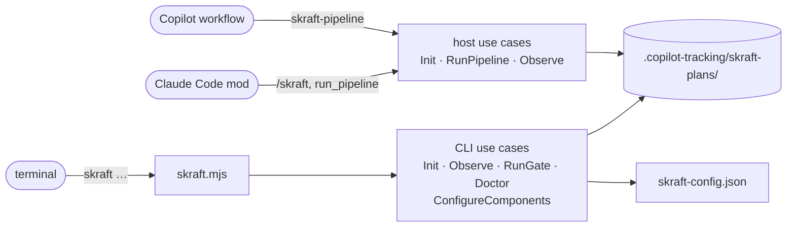

# The skraft command line

> `skraft` is the command-line entry point to the engine: each command calls one use case and prints what it returns, deciding nothing itself.

## Why — the problem it solves

In v1, run state, gates and environment checks went through agent prose, hooks and bash
scripts. The result changed with the host and the operating system. V2 puts these decisions
in a **use-case engine** (the code that decides phase order, expected outputs, retries and
gates). The `skraft` command line reaches that engine from any terminal, under sh as under
PowerShell, with the same output and the same exit codes.

## Key concepts — how it works

### Calling skraft

The entry point is a Node script shipped in the plugin. Replace `<plugin folder>` with the
folder where your host installed the skraft plugin:

```
node "<plugin folder>/engine/drivers/cli/skraft.mjs" <command>
```

The same form works under sh and PowerShell. Run it **from the root of the working copy**:
`skraft-config.json` and `.copilot-tracking/` are read and written there. The rest of this
page writes `skraft <command>` for that full line. Prerequisites: Node 22 or later, Git.

The command line, the Claude Code mod and the Copilot workflow call use cases of the same
engine, not all the same ones: the CLI does not call `RunPipeline` (it starts no agent); the
mod and the workflow call `Init`, `RunPipeline` and `Observe`.



### Synopsis

```
usage: skraft --version
       skraft init [--add <folder>]...                                   detect the components into skraft-config.json
       skraft init <slug> [--issue <number>] [--title <text>] [--base <ref>]   start or resume a pipeline
       skraft status [--json]
       skraft gate [--all] [--json]                                      run the gates of the changed components (all with --all)
       skraft doctor [--run] [--base <ref>] [--json]                     check every command can run (--run: run each once)
```

Option rules shared by every command:

- an option with a value is written `--name value`; a value that starts with `--` is not a
  value;
- an unknown option, or one repeated without being repeatable, makes the line malformed;
  only `--add` repeats;
- a malformed line prints the usage above on stderr and exits with code **2**.

### Exit codes

| Command | 0 | 1 | 2 |
| --- | --- | --- | --- |
| `--version` | always | — | — |
| `init` (no slug) | components written or already listed | invalid config, `--add` refused | malformed line |
| `init <slug>` | the slug is the active pipeline | refusal (`invalid-slug`, `invalid-base`, `config-invalid`, `base-unresolved`, `source-control-unavailable`, `journal-tampered`) | malformed line, `--issue` not a positive integer |
| `status` | any status but `tampered` | status `tampered` | argument other than `--json` |
| `gate` | gates `passed` (including no component changed) | `failed`, `refused`, `blocked` | malformed line |
| `doctor` | every check `ok` | at least one `FAIL` check | malformed line |
| unknown command | — | — | always |

The `refused` and `blocked` codes are detailed in
[Tracking folder and journal]({{ "/en/reference/run-journal" | relative_url }}).

### `skraft --version`

Prints the version read from the plugin's `plugin.json`. Output: one line. Code 0.

### `skraft init [--add <folder>]...`

**Effect.** Detects one component per project found in the working copy and in each
`--add` folder, and adds them to `skraft-config.json` (created when missing). Components
already listed and every other key of the file stay as written. Detection rules and stack
defaults: [skraft-config.json]({{ "/en/reference/skraft-config" | relative_url }}).

| Option | Value | Rule |
| --- | --- | --- |
| `--add <folder>` | folder relative to the working copy (`../payment-web`) | repeatable; refused when absolute or not a folder |

**Output (stdout, code 0)** — one of these lines:

| Case | Line |
| --- | --- |
| components added | `skraft-config.json: <name> (<stack>, <root>), …` |
| nothing new, the file already has a `components` key (even empty) | `skraft-config.json already lists every project found (N components)` |
| no project found, file missing or without a `components` key (the file is written with `"components": []`) | `no project found; skraft-config.json lists no component` |

**Errors (stderr, code 1).**

| Case | Message |
| --- | --- |
| invalid config | `skraft-config.json is invalid: <error>; <error>…` |
| absolute `--add` | `--add <folder> is not relative to the working copy` |
| `--add` not a folder | `--add <folder> is not a folder` |

### `skraft init <slug> [--issue <number>] [--title <text>] [--base <ref>]`

**Effect.** Makes `<slug>` the active pipeline of the working copy (writes
`.copilot-tracking/skraft-plans/.active-slug`) and opens its journal. On the **first** init
of a slug, the engine reads `skraft-config.json`, computes the base of each repository and
writes the `run.started` event. An init on a slug that already has a journal resumes it: the
config is not read again, and the story and `--base` are ignored (the journaled base stays).

| Argument / option | Value | Rule |
| --- | --- | --- |
| `<slug>` | kebab-case (`checkout-by-card`) | otherwise refused `invalid-slug` |
| `--issue <number>` | positive integer with no leading zero | otherwise malformed line (code 2) |
| `--title <text>` | a single argument; quote it if it has blanks | — |
| `--base <ref>` | git ref: no blank, does not start with `-` | read only at the slug's first init: otherwise refused `invalid-base`; wins over any `baseBranch`. On a slug that already has a journal it is ignored, even when invalid |

**Output.** Success: `<slug> is the active pipeline` on stdout, code 0. Refusal: the engine's
message on stderr, code 1, for example:

| Code | Message |
| --- | --- |
| `invalid-slug` | `slug must be kebab-case, got "<slug>"` |
| `invalid-base` | `--base must be a git ref, got "<ref>"` |
| `config-invalid` | `skraft-config.json is invalid: <errors>` |
| `base-unresolved` | `the working copy (<repository>) has no merge base with <ref>` or `component <name> (<repository>) has no merge base with <ref>`, one per repository without a base, joined by `; `, then `; set baseBranch in skraft-config.json or pass --base <ref>` |
| `source-control-unavailable` | `<error>; the components of skraft-config.json need Git for their base` |
| `journal-tampered` | `journal tampered: events.jsonl line N …; restore the file or start a new slug` |

`init <slug>` starts no agent from the terminal: the mod or the workflow runs the pipeline.

### `skraft status [--json]`

**Effect.** Reads the active pipeline and its journal, writes nothing.

**Text output** — in this order, each line only when it applies:

```
skraft <slug>: <status>
RESEARCH  pending|open|closed
agent: <agent> (<step>, attempt <n>)
cost: <amount> USD
<reason>
```

With no active pipeline, the first line is `skraft: idle`.

**`--json` output** — the pipeline view object:

| Field | Type | Content |
| --- | --- | --- |
| `slug` | string or null | active pipeline, `null` when none |
| `status` | string | `idle`, `not-initialised`, `running`, `done`, `blocked`, `tampered` |
| `reason` | string | reason for the status, empty when none |
| `phases` | `[{ phase, state }]` | one entry per phase; `state` = `pending`, `open` or `closed` |
| `current` | `{ step, phase, agent, attempt }` or null | the attempt in progress, `null` otherwise |
| `attempts` | number | number of attempts started |
| `costUsd` | number or null | sum of journaled costs, `null` when none |

What each status means:
[Tracking folder and journal]({{ "/en/reference/run-journal" | relative_url }}). Code 1 only
for `tampered`.

> **Coming next.** Only the RESEARCH phase appears in `phases` today. DESIGN, DISTILL and
> DELIVER join it in lot 3.

### `skraft gate [--all] [--json]`

**Effect.** Runs the gates of the active pipeline: the commands named `build`, `format`,
`lint`, `test`, `architecture`, `coverage`, `mutation` of each component, in that order,
from the component's root. Each gate writes evidence and one `gate.ran` event. A component
stops at its first failing gate; the other components go on.

| Option | Effect |
| --- | --- |
| (none) | scope `touched`: only the components changed since their base |
| `--all` | scope `all`: every component |
| `--json` | JSON output instead of text |

**Text output** — one line per gate run, then a summary line:

```
pass  web/lint
fail (environment)  web/test: <reason>
skraft <slug>: gates <status> — <reason>
```

On a refusal or a block, the summary carries the code: `skraft <slug>: gates refused
(<code>) — <reason>`.

**`--json` output**:

| Field | Type | Content |
| --- | --- | --- |
| `status` | string | `passed`, `failed`, `refused`, `blocked` |
| `slug` | string or null | active pipeline |
| `scope` | string | `touched` or `all` |
| `components` | string[] | components selected |
| `gates` | `GateResult[]` | see below |
| `failure` | string or null | `environment` when at least one environment failure, otherwise `deterministic` on failure, `null` with no failure |
| `code` | string or null | refusal or block code |
| `reason` | string | summary |
| `phase` | null | present only on a refusal or block coming from the active pipeline |

Each `GateResult`: `component`, `gate` (`none` for a component with no gate command),
`status` (`pass`, `fail`), `failure` (`environment`, `deterministic`, `null`), `reason`,
`evidence` (absolute path of the evidence file; for the `none` gate, the `gates/<component>`
folder, where no file is written).

| Result | Summary `reason` |
| --- | --- |
| everything passes | `N gates passed on <components>` |
| no component changed | `no component changed since its base; no gate to run` |
| at least one failure | `<component>/<gate>: <reason>; …` |

Possible codes: `no-active-pipeline`, `not-initialised`, `config-invalid`, `no-components`
(refused); `journal-tampered`, `journal-changed` (blocked). Failure reasons, failure classes
and evidence format:
[skraft-config.json]({{ "/en/reference/skraft-config" | relative_url }}) and
[Tracking folder and journal]({{ "/en/reference/run-journal" | relative_url }}).

### `skraft doctor [--run] [--base <ref>] [--json]`

**Effect.** Checks that every command of every component can run on this machine. Writes
nothing to the journal.

| Option | Effect |
| --- | --- |
| `--run` | runs each command once from its component's root, with the computed base |
| `--base <ref>` | base ref for `--run`; without `--run` it is not read |
| `--json` | JSON output |

Checks, in order:

| Subject | Passes when | Detail on failure |
| --- | --- | --- |
| `node` | Node 22 or later | `Node <version>; skraft needs Node 22 or later` |
| `config` | file present, valid, at least one component | `skraft-config.json is invalid: …`; `no skraft-config.json; run skraft init to detect the components`; `skraft-config.json lists no component; run skraft init to detect them` |
| `base` (with `--run`) | the base can be computed | the `invalid-base`, `base-unresolved` or `source-control-unavailable` message |
| `<component>` | the root is a folder | `root <root> is not a folder` (its commands are not checked) |
| `<component>` | at least one gate command | `no gate command; give it at least one of build, format, lint, test, architecture, coverage, mutation in skraft-config.json` |
| `<component>/<command>` | the line splits and its program is found (PATH, and PATHEXT under Windows) | `"<line>" <reason>`; `command not found: <program> (from <root>); install it or change commands.<name> in skraft-config.json` (for `python`, `(from <root>; looked for .venv/bin/python, .venv/Scripts/python.exe, python, python3)`) |
| `<component>/<command>` with `--run` | the command exits with 0 | `<command run> exited <code>` (base substituted, interpreter chosen) |
| `docker` | `docker info` answers, when a component mocks with Microcks | `Docker does not answer, and Microcks, the mocking of <components>, needs it; start Docker, or set "mocking": { "strategy": "inprocess" } on the component` |

A component's commands are checked gates first (in gate order), then `e2e`. The doctor stops after `config` when the config is invalid, missing or empty.
Without `--run`, `{baseSha}` is replaced with `HEAD` for splitting only.

**Text output**:

```
ok    node: Node v22.…
FAIL  web/test: command not found: npx (from ../payment-web); install it or change commands.test in skraft-config.json
skraft doctor: 1 checks failed
```

The last line is `skraft doctor: every check passed` or `skraft doctor: N checks failed`.

**`--json` output**: `{ "ok": boolean, "checks": [{ "subject", "status": "ok"|"fail", "detail" }] }`.

### Review node (`shape=component`)

The workflow is a DOT graph: the plugin's `workflows/skraft.dot`, or the repository's
`skraft-workflow.dot` written by `skraft workflow eject`. A review node runs lenses, read-only
agents, on what the run changed, and the engine computes its verdict from their findings.

```dot
deliver_review [shape=component, lenses="test-integrity:2,architecture-boundaries,cold-reader,mock-fidelity,contract-fidelity"]
deliver_review -> deliver [label="NEEDS_REWORK", max_visits=3]
deliver_review -> exit    [label="APPROVED"]
```

| Rule | Detail |
| --- | --- |
| `lenses` | required; kebab-case names separated by commas, each once, written `<name>` or `<name>:<n>` (n from 1 to 9), optionally followed by `@haiku`, `@sonnet` or `@opus` (`cold-reader@sonnet`, `test-integrity:2@sonnet`) |
| Instances | `<name>:<n>` runs n independent instances of the lens, journaled and cited as `<name>#1` … `<name>#n`; two instances giving the same finding at the same line form one group |
| Model | the driver starts each lens on the family its spec names, `haiku` when it names none, and `finding-refuter` one family above the strongest lens of the group it checks (`opus` at most); a phase agent runs on the model of its own file |
| Lens agent | the lens `<name>` is the agent `<name>-lens`, looked for in the plugin, then in `.claude/agents/` (Claude Code) or `.github/agents/` (Copilot); `finding-refuter` must be found too, or the workflow is refused |
| `APPROVED` edge | exactly one; an unlabeled edge counts as `APPROVED` |
| `NEEDS_REWORK` edge | at most one; without it, a `NEEDS_REWORK` stops the run with `review-rejected`; past its `max_visits`, with `loop-ceiling` |
| Driver | the host driver starts the lenses and the refuter (depth 1); no agent starts another one |

**What each lens reads.** Every lens but `cold-reader` also reads the review's
`context.md` (story, project rules, who wrote which document). The files sit in
`reviews/<node>-<visit>/` ([Tracking folder and journal]({{ "/en/reference/run-journal" | relative_url }})).

| Lens | Reads |
| --- | --- |
| `fitness`, `business-alignment` | documents of the phase, of the story and of the other phases |
| `architecture-compliance`, `testability`, `boundary-enforcement` | documents of the phase, patch, changed paths |
| `architecture-boundaries` | documents of the story and of the other phases, patch, changed paths, `components.json` |
| `cold-reader` | patch and changed paths only: no story, no feature scope, no context |
| `mock-fidelity`, `contract-fidelity` | patch, changed paths, `components.json` |
| any other lens (`consistency`, `coverage`, `test-integrity`, a repository's own) | everything above |

The patch holds every change since the base of the run, the tracking folder left out. A
changed path with no section in the patch is a new untracked file: the lens opens it.

**Conditional lenses.** A lens with a trigger runs only when a changed path or a line the patch
adds or keeps matches it; otherwise the review runs without it.

| Lens | Path | Line |
| --- | --- | --- |
| `mock-fidelity` | a file name holding `mock`, `stub` or `fake` | `WireMock…`, `MockServer`, `Microcks…`, `Mountebank`, `HttpMessageHandler`, `nock`, `msw` |
| `contract-fidelity` | a file name holding `contract`, `.apiexamples`, `.apimetadata`, `openapi….yaml/json` | `VerifyAsync`, `Pact…`, `ProviderVerifier`, `ContractTest` |

In `components.json`, a component without `mocking` uses Microcks; a component without
`contractTesting: true` asks for no contract test; `gates` lists the gate commands it has, in
gate order (an `architecture` gate already checked its dependency direction).

**Skills.** The brief gives each lens the `SKILL.md` of every skill its descriptor lists under
`metadata.skills`, from the plugin, then `.claude/skills/` or `.github/skills/`. A skill a lens
or `finding-refuter` lists and that is found nowhere refuses the workflow, naming the node, the
agent and the skill. The lens reads them before any other input.

**Answer.** A lens ends its last message with one YAML document in a fenced block; the engine
reads the last fenced block of the message.

```yaml
lens: test-integrity
verdict: fail            # pass | fail | inconclusive
findings:                # [] when it finds none
  - id: F1
    gate: G9             # the gate of the lens's table
    severity: blocker    # blocker | high | medium | low
    location: "tests/Orders.UnitTest/RefundTests.cs:42"
    description: "the expected amount 90 became Assert.NotNull"
    suggestion: "restore Assert.Equal(90, refund.Amount)"   # optional
```

| Rule | Detail |
| --- | --- |
| Keys | only `lens`, `verdict`, `findings`; per finding `id`, `gate`, `severity`, `location`, `description`, `suggestion`; any other key refuses the answer |
| Required | `gate` and `description`; a missing `id` becomes the first free `F<n>` |
| Values | free texts in double quotes or a literal block scalar; no anchor, alias or tag; case of `verdict` and `severity` normalized |
| Ceiling | at most 20 findings; a `pass` with a blocker, high or medium finding is refused |
| Texts | brought onto one line and cut (description: 500 characters) |
| Refused answer | the lens is asked once more with the reason; a second unreadable answer stops the run with `lens-unreadable`; a resume asks again only the lenses whose answer could not be read |

**Refutation.** Findings of different lenses at the same `path:line` (the path normalized as the
patch's: `./src\Checkout.cs:12` is `src/Checkout.cs:12`) with the same severity form one group.
Each group of blocker, high or medium findings goes once to `finding-refuter`, its label and brief naming
every lens of the group, with the inputs and skills of those lenses. It answers `confirmed`,
`refuted` (its `reason` cites the `path:line` it read) or `unverifiable`, and the answer applies
to every finding of the group. A refuted finding does not count; an unverifiable one does, and
so does a finding whose check was unreadable twice.

**Verdict.** A lens that answers `inconclusive`, or `fail` without a blocker, high or medium
finding, blocks the review with `lens-inconclusive`, naming each such lens and what it noted:
the work is not sent back and no finding is checked. Otherwise `NEEDS_REWORK` when a blocker,
high or medium finding counts, else `APPROVED` (low findings are notes). The findings that count
go to the next brief of the phase agent, a group on one line citing each of its lenses.

**Incremental re-review.** On a later pass, a lens whose previous result was `pass` with no
finding, and whose fingerprint has not changed, is not started again: its result is journaled
again with `reused: true`. The fingerprint covers its inputs, the content of each `SKILL.md` it
reads (by skill name: moving the working copy or the plugin changes nothing), the project rule
files and the content of each changed path it reads.

### Equivalents in the Claude Code mod

The Claude Code mod (the Claude Code host driver) calls `Init`, `RunPipeline` and `Observe`,
without Node: it runs git through `$.process.run`. Every `/skraft` opens the **Skraft** pane.

| In the conversation | Effect | Answer |
| --- | --- | --- |
| `/skraft <slug> [#issue] [title…] [--base <ref>]` | Init of the slug, then a background run | `skraft <slug> started — progress in the Skraft pane.` |
| `/skraft`, `/skraft status`, `/skraft help` | view of the active pipeline | `skraft <slug> — <status>`, one line per phase (`✓` closed, `▶` open, `·` pending), reason, agent, `cost: $<amount>` |
| `/skraft decide …` | no question before lot 5 | `skraft: no question is pending for <slug>; nothing to decide.` |

In `/skraft <slug> …`, `#<number>` right after the slug gives the issue; the remaining words
form the title; `--base <ref>` may go anywhere after the slug. Other answers:

| Case | Answer |
| --- | --- |
| Init refused | `skraft <slug>: not started — <reason>` |
| a run is already going | `skraft is already running <slug>; see the Skraft pane.` |
| end of the run (notification) | `skraft <slug>: <status> (<code>) — <reason>` |

The **Skraft** pane shows the phases, the current agent, the cost and the latest lines of
the progress log, as many as the pane's height allows.

**Tool `mcp__skraft__run_pipeline`** (called by the model): starts or resumes the pipeline
and returns at once; the run goes on in the background.

| Field | Type | Rule |
| --- | --- | --- |
| `slug` | string | kebab-case; absent or empty → resumes the active pipeline; the tool never picks a slug |
| `issue` | integer | taken only when positive |
| `title` | string | story title |
| `base` | string | git ref; only for a new slug |

### Equivalents in the Copilot CLI workflow

The `skraft-pipeline` dynamic workflow starts agents through `ctx.agent`.

| Arg | Type | Rule |
| --- | --- | --- |
| `slug` | string | present → Init then run; absent → resume the active pipeline |
| `issue` | integer | issue number |
| `title` | string | story title |
| `base` | string | git ref; only for a new slug |
| `agentIds` | object | `{ "<agent file id>": "<session agent id>" }` |

The workflow returns `{ status, slug, phase, code, reason }` (`status` = `done`, `blocked` or
`refused`) and logs `<slug>: <status> (<code>): <reason>`. A resume does not restart an agent
whose outputs are already filled.

**Tool `skraft_decide`** { `key`, `answer` }: no question is pending before lot 5. It answers
`Refused: <slug> has no pending question; nothing was recorded.`, or `Refused: <reason>`
with no active pipeline.

> **Coming next.** `skraft decide` and questions to humans arrive in lot 5. Under VS Code, the
> Copilot SDK driver and the `skraft next` / `skraft record` fallback are planned for lot 10.

## Why this practice

> « Good architecture makes the system easy to understand, easy to develop, easy to maintain, and easy to deploy. »
> — Martin, R. C., *Clean Architecture*, 2017.

The command line, the mod and the workflow are only host drivers. They turn a command into a
use-case call and print the result. A rule changed in the engine therefore changes
everywhere at once, and a behaviour seen under one host reproduces at the terminal.

## Pitfalls & anti-patterns

- **Running skraft outside the root**: the config and the tracking folder are read from the
  current folder. Elsewhere, `status` answers `idle` and `gate` refuses.
- **Reading `status` exit code 1 as a run error**: only `tampered` exits with 1. A `blocked`
  run exits with 0; read the status.
- **Passing `--base` for an existing slug**: the base is fixed at the first init. Start a new
  slug to change it.
- **Scripting against the text output**: use `--json`, whose fields are listed here.

## Going further

- [Getting started]({{ "/en/tutorials/getting-started" | relative_url }})
- [Run the gates and read their evidence]({{ "/en/how-to/run-gates" | relative_url }})
- [Resume or unblock a run]({{ "/en/how-to/resume-a-run" | relative_url }})
- [skraft-config.json]({{ "/en/reference/skraft-config" | relative_url }})
- [Tracking folder and journal]({{ "/en/reference/run-journal" | relative_url }})
- [Engine, drivers, depth 1]({{ "/en/explanation/architecture" | relative_url }})

## Sources

- Martin, R. C. *Clean Architecture*, 2017.

Terms to know: **engine**, **host driver**, **slug**, **gate** — see the
[glossary]({{ "/en/reference/glossary" | relative_url }}).
