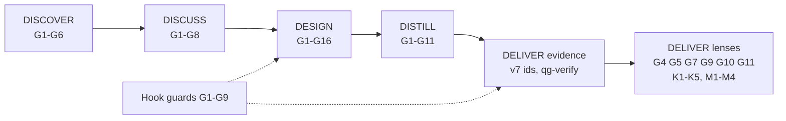

# Review gates

> A *gate* is an explicit, binary criterion: the reviewer declares it PASS or FAIL
> before the pipeline moves to the next phase. Nothing implicit, nothing "by feel".

## Why — the problem it solves

Without written criteria, a review depends on the reviewer's mood and memory. Gates
make the review **reproducible**: every verdict rests on a checklist known in advance,
shared by the producer and the verifier. A failing gate blocks the transition (BLOCKER)
or flags a risk (HIGH/MEDIUM) — never a vague feeling.

## Key concepts — how it works

A `G<N>` id is **scoped to its family**: DESIGN G5, DISCOVER G5, the DELIVER lens G5 and
hook guard G5 are four different gates. Read every id together with its family.

| Family | Phase | Ids | Producer | Verifier | Source |
| --- | --- | --- | --- | --- | --- |
| DISCOVER review | DISCOVER (skraft-backlog) | G1–G6 | `backlog-discoverer` | 3 `discovery-*-lens` + `review-verdict.mjs` | `discovery-review-criteria` |
| DISCUSS review | DISCUSS (skraft-backlog) | G1–G8 | `backlog-planner` | 4 `planning-*-lens` + `review-verdict.mjs` | `planning-review-criteria` |
| DESIGN review | DESIGN | G1–G16 | `solution-architect` | `solution-architect-reviewer` | `architecture-review-criteria` |
| DISTILL review | DISTILL | G1–G11 | `acceptance-designer` | `acceptance-designer-reviewer` | `acceptance-review-criteria` |
| DELIVER evidence | DELIVER | `test.acceptance` … `evidence.screenshots` | `software-engineer` | `qg-verify`, reported by `quality-gates-lens` | `quality-gates-evidence-contract` |
| DELIVER lenses | DELIVER | G4, G5, G7, G9, G10, G11 | `software-engineer` | `architecture-boundaries-lens`, `test-integrity-lens`, `cold-reader-lens` | lens descriptors |
| Contract fidelity | DELIVER, conditional | K1–K5 | `contract-testing-worker` | `contract-fidelity-lens` | lens descriptor |
| Mock fidelity | DELIVER, conditional | M1–M4 | `mock-integration-worker` | `mock-fidelity-lens` | lens descriptor |
| Runtime guardrails | every engineering phase | G1–G9 | — | hooks and the state CLI | `plugins/skraft-framework/src/domain/` |

**Review gates: 49** — DISCOVER 6, DISCUSS 8, DESIGN 16, DISTILL 11, DELIVER evidence 8.
The lens gates, fidelity gates and runtime guardrails come on top.

**Ids in 1.17.2.** Only the DELIVER evidence gates changed id (evidence schema v7). Every
other family keeps its `G<N>` ids; renaming them is deferred to v2.

**Severity.** The four artefact-review phases attach a severity to every gate:

| Severity | Meaning | Effect on verdict |
| --- | --- | --- |
| **BLOCKER** | Fundamental violation invalidating the artefact. | Forces `rejected` (`REJECTED` on skraft-backlog). |
| **HIGH** | Significant flaw, source of downstream rework. | Forces `changes_requested` (`NEEDS_REWORK`). |
| **MEDIUM** | Design smell, sub-optimal choice. | Forces `changes_requested` (`NEEDS_REWORK`). |
| **LOW** | Style or consistency detail. | `approved` with a note. |

DELIVER evidence gates carry no severity: **every evidence gate blocks**. The
`skraft-quality-bar` skill owns the enforcement level of every gate and the value of every
threshold.

---

## DISCOVER — G1 to G6

Producer: `backlog-discoverer` (skraft-backlog plugin). Verifier: 3 lenses dispatched by
`backlog-review-lenses`, verdict computed by `review-verdict.mjs`. Checks the triage report
and the sprint proposal. Status: active, ids unchanged.

| ID | Lens | What the gate checks | Pass condition | Severity |
| --- | --- | --- | --- | --- |
| **G1** | Completeness | All 3 discovery modes were considered, or the triage report explicitly documents why a mode was skipped. | All modes accounted for in the report. | HIGH |
| **G2** | Completeness | No P0 or P1 issues exist in the repository but are absent from the triage report, verified by sampling the 5 most recent. | Zero critical issues absent from triage. | BLOCKER |
| **G3** | Prioritization | All P0 issues have a written justification; P1–P3 follows descending business value order; no priority inversions. | No priority inversions. All P0 justified. | HIGH |
| **G4** | Prioritization | Sprint proposal respects declared capacity (team-days × 0.7); no P2/P3 issue occupies a slot while a P0/P1 is excluded; no issue above 8 points is in the sprint. | Capacity respected; estimates above 8 excluded. | HIGH |
| **G5** | Duplicate Detection | No two issues in the triage report describe the same problem (normalized title similarity > 80%). | Zero undetected exact or near-duplicate pairs. | HIGH |
| **G6** | Duplicate Detection | All issue pairs with 40–80% normalized title similarity are noted with a recommendation (merge, link, or keep separate). | All similar pairs flagged with recommendation. | MEDIUM |

---

## DISCUSS — G1 to G8

Producer: `backlog-planner` (skraft-backlog plugin). Verifier: 4 lenses dispatched by
`backlog-review-lenses`, verdict computed by `review-verdict.mjs`. Checks stories,
acceptance criteria and the sprint plan. Status: active, ids unchanged.

| ID | Lens | What the gate checks | Pass condition | Severity |
| --- | --- | --- | --- | --- |
| **G1** | invest | INVEST compliance: each story satisfies all 6 INVEST criteria (Independent, Negotiable, Valuable, Estimable, Small, Testable). | All criteria pass for every story. | HIGH |
| **G2** | invest | Sprint independence: all stories are independently deliverable; no circular dependencies. | Dependency graph is a valid DAG. | HIGH |
| **G3** | ac-quality | AC completeness: every story has ≥ 3 ACs in Given/When/Then or bullet-list format; zero ACs are implementation steps. | 3+ ACs per story, correct format, no implementation prescriptions. | HIGH |
| **G4** | ac-quality | AC unambiguity: no AC has two valid interpretations by a domain expert with no code knowledge. | Every AC resolves to a single unambiguous outcome. | BLOCKER |
| **G5** | planning-coherence | Milestone scope: stories fit the milestone theme; no story spans multiple sprint themes without decomposition. | Every story aligns with the milestone's stated theme and time-box. | HIGH |
| **G6** | planning-coherence | Dependency DAG: no circular dependencies; delivery sequence respects topological order. | Dependency graph is a DAG. | BLOCKER |
| **G7** | dor-compliance | DoR 8-item gate: problem statement, specific persona, 3+ domain examples, UAT scenarios, AC derived from UAT, right-sized, technical notes, dependencies. | 8/8 items pass for every story. | BLOCKER |
| **G8** | dor-compliance | Antipattern absence: zero CRITICAL antipatterns (Implement-X, Giant Stories, No Examples), zero HIGH antipatterns (Technical AC, Generic Data, Tests After Code, Vague Persona, Missing Dependencies). | No CRITICAL nor HIGH antipattern detected. | BLOCKER (CRITICAL) / HIGH |

---

## DESIGN — G1 to G16

Producer: `solution-architect`. Verifier: `solution-architect-reviewer`, 3 lenses + 1
cross-cutting escalation gate. Checks ADRs, the supersession registry, diagrams, contracts,
consistency matrices and the structural scan. Status: active, ids unchanged.

Ratification timing: the review runs before human ADR ratification. A `Proposed` ADR of the
pass under review satisfies a gate that requires an `Accepted` ADR, and a gate that forbids an
`Accepted` ADR forbids a `Proposed` ADR of that pass too.

| ID | Lens | What the gate checks | Pass condition | Severity |
| --- | --- | --- | --- | --- |
| **G1** | consistency | Every structural commitment — visible in a diagram or detected by `structural-scan.mjs` (command/query bus, event store, saga; cross-context ACL by manual review) — has a traceable ADR justification. | Every structural element references ≥ 1 `Accepted` ADR or `Proposed` ADR of the pass under review. | BLOCKER |
| **G2** | consistency | No two ADRs contradict each other; every supersession is recorded in the new ADR's body AND in the append-only `docs/adr/supersessions.md` registry. | Zero contradicting decisions; both registry row and body line exist. | BLOCKER |
| **G3** | architecture-compliance | Dependency rule: Domain and Application layers have no dependencies on Infrastructure or API layers. | Zero Infrastructure/API imports in Domain or Application contracts. | BLOCKER |
| **G4** | architecture-compliance | All application interfaces (repositories, gateways, event publishers) are defined in the Domain or Application layer the aggregate's ADR records, never in Infrastructure. | Zero infrastructure-defined interfaces in contracts. | BLOCKER |
| **G5** | architecture-compliance | Each aggregate enforces its own invariants, not another aggregate's. | Zero cross-aggregate invariant references. | HIGH |
| **G6** | architecture-compliance | The context map declares every inter-context relationship with an explicit pattern (ACL, Conformist, Shared Kernel, Partnership, Open Host Service, Published Language) and every label is admissible. | Zero unlabelled arrows and zero inadmissible labels. | HIGH |
| **G7** | fitness | Every story from DISCUSS maps to at least one trigger (Command or Query) in the event model. | All story IDs appear in a slice. | HIGH |
| **G8** | fitness | Every **Command** has at least one corresponding domain event; Queries are exempt. | Zero Commands without a domain event. | HIGH |
| **G9** | fitness | No aggregate, bounded context, Event Sourcing adoption, or Saga is introduced without a traceable story justification. | Zero unjustified architectural elements. | MEDIUM |
| **G10** | consistency | A `consistency-matrix-{story}.md` exists for every story and its `consistency-gate` line is `PASS`; the back-propagation journal explains every rewrite. | One matrix per story, all PASS. | BLOCKER |
| **G11** | fitness | Every ADR adopting a complexity-adding pattern (CQRS, Event Sourcing, Saga, eventual consistency, micro-service split, ACL) cites an admissible force and evaluates the "do without the pattern" option. | Admissible force + "do without" alternative per complexity-adding ADR. | HIGH |
| **G12** | consistency | Every row in a `supersession-plan-{story}.md` is realised: ADR body line, registry row, no artefact still citing the superseded ADR as its source of truth. | All three conditions hold for every planned supersession. | BLOCKER |
| **G13** | escalation (cross-cutting) | Every `decision-drift-*` blocker file has a sibling `-resolution.md` holding the human's answer. | A resolution file for every blocker. | BLOCKER (short-circuit) |
| **G14** | consistency | No ADR encodes the verdict in the filename; the verdict lives in the `Status:` frontmatter. A `Status: Rejected` ADR traces to a triggering story and names the adopted alternative. | Zero verdict-bearing filenames; every rejection traced. | BLOCKER |
| **G15** | fitness | No ADR ratifies a constraint that is the project's enforced baseline (CQS at method level, Clean Architecture layer boundaries, convention-based DI handler registration, repository pattern as such). | Zero `Accepted` ADR, and zero `Proposed` ADR of the pass under review, restating an enforced baseline. | HIGH |
| **G16** | consistency | Comparable interfaces or hooks in `contracts-{story}.md` follow the same state/return/error shape convention unless an ADR justifies the divergence. | Same convention for every comparable pair, or divergence covered by an `Accepted` or current-pass `Proposed` ADR. | HIGH |

> If G13 fails, the reviewer returns `REJECTED` immediately **without** evaluating
> other gates: the next action is human escalation, not a retry.

---

## DISTILL — G1 to G11

Producer: `acceptance-designer`. Verifier: `acceptance-designer-reviewer`, 4 lenses. Checks
Gherkin scenarios, the test plan and the implementation plan. Status: active, ids unchanged.

| ID | Lens | What the gate checks | Pass condition | Severity |
| --- | --- | --- | --- | --- |
| **G1** | coverage | AC–Scenario bijection: every AC in `ac-draft-{story}.md` maps to ≥ 1 scenario; no scenario exists without a traceable AC. | All ACs covered, no orphan scenarios. | BLOCKER |
| **G2** | coverage | Edge case representation: boundary conditions and negative cases from the domain examples are represented as scenarios. | ≥ 1 edge case or boundary condition scenario per business rule. | HIGH |
| **G3** | business-alignment | Business vocabulary: Given/When/Then steps use the domain vocabulary; no class names, method names, HTTP verbs, or framework names. | Zero technical identifiers in `.feature` files. | HIGH |
| **G4** | business-alignment | No technical jargon: steps contain no HTTP status codes, ORM terms, database language, or DI container references. | Zero implementation leaks. | BLOCKER |
| **G5** | testability | Step unambiguity: every step can be implemented without asking the designer for clarification. | Every step maps uniquely to a domain action or state. | HIGH |
| **G6** | testability | Implementation plan completeness: every scenario has an entry in `impl-plan-{story}.md` with a file path and a use case boundary. | Bijection feature scenarios ↔ impl-plan entries. | HIGH |
| **G7** | boundary-enforcement | Layer boundary compliance: each coverage-matrix row targets an Application layer use case named in `contracts-{story}.md`, never an Infrastructure adapter as primary entry point. | All entries reference a use case boundary from the contracts. | BLOCKER |
| **G8** | boundary-enforcement | Walking skeleton coverage: at least one walking skeleton scenario per major feature flow (tagged `@smoke` or marked in the matrix). | ≥ 1 walking skeleton entry per feature flow. | HIGH |
| **G9** | boundary-enforcement | Visual AC evidence: every `@visual` scenario has ≥ 1 Playwright E2E spec in `tests/e2e/` per `impl-plan-{story}.md`; a jsdom/unit entry is invalid. | Bijection `@visual` scenarios ↔ Playwright E2E spec entries. | HIGH |
| **G10** | boundary-enforcement | Comparable contract consistency: a planned hook/adapter/client comparable to one of a prior story matches its state/return/error convention, unless the plan notes a justified divergence. | Every comparable pair shares its convention, or the divergence is justified in the impl-plan. | HIGH |
| **G11** | testability | Inner-loop boundary presence: every use case NEW to this story has its outer acceptance test at the Application layer (`<Context>.UnitTest`), not solely an Integration/HTTP test, and that test file exists on disk. | No NEW use case covered only by `<Context>.IntegrationTest`. | BLOCKER |

---

## DELIVER — evidence gates (schema v7)

Producer: `software-engineer`, which writes `qg-{story}.json` once, after the story's last
work commit. Verifier: `qg-verify`, which re-resolves every claim against the files and the
Git tree — nobody re-runs a gate. The producer runs it before handing over, the
`software-engineer-reviewer` runs it again, and `quality-gates-lens` reports its result.
Schema: `quality-gates-evidence/v7`. Every gate below blocks.

| v7 id | Before v7 | Label | What it attests | Status |
| --- | --- | --- | --- | --- |
| `test.acceptance` | G1 | Acceptance test(s) pass | The BDD/acceptance scenario for the active story is green. | active |
| `test.unit` | G2 | All unit tests pass | The full unit suite is green; on .NET it includes the architecture tests. | active |
| `build.compile` | G3 | Build passes | Compilation / static type-check succeeded. | active |
| `build.lint` | G4 | Static analysis pass | Linter / analyzer reported no blocking issue; carries the boundary rules of the stack (ESLint `boundaries/*`, Python `import-linter`). | active |
| `test.no-mocks-core` | G7 | No mocks in Domain/Application core | The adapter's scan of the Domain/Application projects and their unit tests printed nothing. | active |
| `commit.convention` | G8 | Conventional commit policy | Each covered commit's full Git message satisfies feature scope, optional issue reference and sign-off. | active |
| `test.integrity` | G9 | No test tampering (RED→GREEN integrity) | For every cycle, each test file changed only by ADDITION between its RED and GREEN commits, read with `git show`. | active |
| `evidence.screenshots` | — | Frontend screenshots captured | The story's frontend outcome is shown by at least one hashed screenshot. | new in v7, required for a frontend story |

### Retired gates

| Before v7 | Would-be id | Reason | Replacement | Future check |
| --- | --- | --- | --- | --- |
| G5 | `arch.boundaries` | Architecture is not a pipeline gate. | `test.unit` on .NET (architecture tests); `build.lint` on TypeScript (ESLint `boundaries/*`) and Python (`import-linter`). | v2 `skraft doctor` checks the prerequisite. |
| G6 | `ci.mutation` | The pipeline never runs mutation. | The project's CI, as its own step; `/skraft-mutation` stays a manual tool. | v2 `skraft doctor`. |
| G11 | `ci.coverage` | The pipeline never runs coverage. | The project's CI, with a minimal bar and no exclusion. | v2 `skraft doctor`. |
| ~~G10~~ | — | Removed in evidence v6: the scenario's RED `test` commit is the proof, no RED run is captured. | — | — |

A v7 log never carries `arch.boundaries`, `ci.coverage`, `ci.mutation` nor any `G<N>` id:
`qg-verify` reports an unknown id as `inconclusive` (`GATE_UNKNOWN`). v1–v6 logs still verify
with their `G<N>` ids, snapshots and evidence-only commit.

The 100% line coverage on Domain and Application and the mutation bar remain the craft rule
of `skraft-quality-bar`; they are executed by the project's CI, never by the pipeline.

### Where the evidence lives

| Item | Value |
| --- | --- |
| Directory | `.copilot-tracking/skraft-plans/{projectSlug}/evidence/{date}/{story}/` — one per story |
| Content | `qg-{story}.json`, every capture (`.stdout`, `.exit`, `.stdout.sha256`) and `screenshots/` |
| Consumer `.gitignore` | `.copilot-tracking/skraft-plans/*/evidence/` |
| Committed | Nothing: no evidence commit, no snapshot. `repo_root_rev` is `HEAD`. |
| `qg-verify` exit | `0` pass, `1` fail, `2` inconclusive |
| `EVIDENCE_COMMITTED` | `fail`: a file of the evidence directory is tracked by Git |
| `SCREENSHOTS_MISSING` | `fail`: a frontend story records no screenshot |

A story is **frontend** when its covered commits touch a `.feature` file holding a `@visual`
scenario, a path under `tests/e2e/`, a `package.json` declaring `react`, or a
`playwright.config.*` file.

A genuinely irrelevant gate is marked `not_applicable` **with a rationale** — never as a
substitute for `fail` or missing evidence. A non-frontend story omits `evidence.screenshots`
or records it `not_applicable` with a rationale.

### `commit.convention` policy

- **Message:** `type(feature): subject` (optional `!` before `:`), with the approved feature
  scope. Use `git commit -s` for the `Signed-off-by` trailer.
- **Issue:** for a known issue, end the body with `Refs: #N` for intermediate work or
  `Closes #N` only when the whole issue is genuinely finished and all required gates pass.
  Omit the issue line when unknown.
- **Verification:** `qg-verify` checks the syntax, the sign-off and that the declared subject
  is the actual one; `quality-gates-lens` checks the feature scope and the issue line.

---

## DELIVER — review lens gates

Producer: `software-engineer`. Verifier: `software-engineer-reviewer`, which dispatches 4
core lenses (`quality-gates`, `architecture-boundaries`, `test-integrity`, `cold-reader`) on
the patch since the DELIVER base. These lens ids judge the diff; they are not evidence gates.
`quality-gates-lens` reports the `qg-verify` verdict on the evidence gates above.
Status: active, ids unchanged.

| ID | Lens | What the gate checks | Severity |
| --- | --- | --- | --- |
| **G4** | [architecture-boundaries]({{ "/en/dashboard/" | relative_url }}#lens-architecture-boundaries-lens) | No mock in Domain/Application tests: `A.Fake<>`, `Mock<>`, `Substitute.For<>` on Domain/Application types; a fake of a driven port is allowed. | blocker |
| **G5** | [architecture-boundaries]({{ "/en/dashboard/" | relative_url }}#lens-architecture-boundaries-lens) | Clean Architecture dependencies inward: Domain → nothing, Application → Domain only. No ADR overrides it. | blocker |
| **G7** | [test-integrity]({{ "/en/dashboard/" | relative_url }}#lens-test-integrity-lens) | No test theater pattern: tautological, mock-dominated, circular verification, implementation mirroring, fixture theater. | blocker |
| **G9** | [test-integrity]({{ "/en/dashboard/" | relative_url }}#lens-test-integrity-lens) | No test modified to pass (Iron Rule): no weakened assertion, deleted test or added `[Skip]`. | blocker |
| **G10** | [architecture-boundaries]({{ "/en/dashboard/" | relative_url }}#lens-architecture-boundaries-lens) | Object Calisthenics on Domain: the 9 rules on Domain layer code. | medium |
| **G11** | [cold-reader]({{ "/en/dashboard/" | relative_url }}#lens-cold-reader-lens) | Business language in tests: test names, variables, assertion messages and production method names express domain intent. | medium |

## DELIVER — fidelity gates (conditional lenses)

A fidelity lens joins the panel only when the reviewed diff touches its capability, and feeds
the same severity matrix as the core lenses. Status: active.

| ID | Lens | Producer | What the gate checks | Severity |
| --- | --- | --- | --- | --- |
| **K1** | [contract-fidelity]({{ "/en/dashboard/" | relative_url }}#worker-contract-fidelity-lens) | `contract-testing-worker` | Baseline WAF+HttpClient present: a `WebApplicationFactory` + `HttpClient` integration test, whether or not Microcks is enabled. | blocker |
| **K2** | contract-fidelity | `contract-testing-worker` | Microcks layer matches the opt-in (`testing.contract.microcks` or a prompt request). | high |
| **K3** | contract-fidelity | `contract-testing-worker` | Contract test result not suppressed when opt-in: `TestResult.Success` is asserted. | blocker |
| **K4** | contract-fidelity | `contract-testing-worker` | Response contract actually asserted: status code, content type, `ProblemDetails` shape on error paths. | high |
| **K5** | contract-fidelity | `contract-testing-worker` | No real downstream call leaks. | blocker |
| **M1** | [mock-fidelity]({{ "/en/dashboard/" | relative_url }}#worker-mock-fidelity-lens) | `mock-integration-worker` | Resolved strategy honored (`inprocess` double or Microcks container). | high |
| **M2** | mock-fidelity | `mock-integration-worker` | Mock is actually wired into the test host. | blocker |
| **M3** | mock-fidelity | `mock-integration-worker` | No real downstream call leaks. | blocker |
| **M4** | mock-fidelity | `mock-integration-worker` | Mocks the downstream, not the SUT. | high |

---

## Runtime guardrails — G1 to G9

Hooks and the state CLI enforce these guards on every engineering phase; no agent produces
them. Status: active, ids unchanged. Details:
[Guardrails (hooks)]({{ "/en/explanation/hooks" | relative_url }}) and
[Hooks reference]({{ "/en/reference/infrastructure/hooks" | relative_url }}).

| ID | Guard | Enforced by | Failure mode |
| --- | --- | --- | --- |
| **G1** | Dispatch order | `PreToolUse` hook | Fail closed for a phase agent |
| **G2** | Mandatory skills injected | `SubagentStart` hook | Fail open |
| **G3** | Skill loads traced and required | `PostToolUse` and `SubagentStop` hooks | Fail open |
| **G4** | Phase artifacts recorded and present | State CLI, when a phase closes | Fail closed |
| **G5** | Review verdict matches, and a closing DELIVER phase has a commit | State CLI, when a phase closes | Fail closed |
| **G6** | Continuation: what to record and dispatch next | `PostToolUse` hook | Fail open |
| **G7** | Tracked state protected from direct writes | `PreToolUse` hook | Fail closed |
| **G8** | Orchestrator never writes `src/` or `tests/` | `PreToolUse` hook | Fail open on an unnamed caller |
| **G9** | Dispatch handoff names every recorded input | `PreToolUse` hook | Fail open on unreadable state or internal error |

---

## Verdict logic

On the four artefact-review phases, gates aggregate with a deterministic rule:

| Finding | Verdict |
| --- | --- |
| ≥ 1 **BLOCKER** gate failed (or G13 open in DESIGN) | `rejected` / `REJECTED` |
| ≥ 1 **HIGH** gate, no BLOCKER | `changes_requested` / `NEEDS_REWORK` |
| **MEDIUM** gates only | `changes_requested` / `NEEDS_REWORK` |
| **LOW** gates only, or everything passes | `approved` / `APPROVED` |

On DELIVER evidence (`qg-verify`), the rule is flat:

| Finding | Verdict |
| --- | --- |
| ≥ 1 gate `fail`, a violated commit policy, a RED→GREEN line removed, `EVIDENCE_COMMITTED` or `SCREENSHOTS_MISSING` | `fail` |
| Log missing or malformed, unknown gate id, referenced file unreachable, sha256 mismatch, `repo_root_rev` not `HEAD` | `inconclusive` |
| Every applicable gate is `pass` and every reference resolves | `pass` |

On the DELIVER review, any `blocker`, `high` or `medium` finding, or any `inconclusive` lens,
yields `NEEDS_REWORK`; `low` only or all pass yields `APPROVED`. `inconclusive` is never
equivalent to `pass`.

## Why this practice

> « A software inspection is a rigorous review with explicit entry and exit criteria. »
> — Wiegers, K., *Peer Reviews in Software*, 2002.

Explicit entry/exit criteria are exactly what a gate materialises: the phase is only
"done" once its gates are crossed.

## Pitfalls & anti-patterns

- **Id without family**: "G5 failed" means nothing until you say which family — read DESIGN
  G5, DELIVER lens G5 and hook guard G5 as three different gates.
- **Cosmetic gate**: a criterion too vague ("the code is clean") is not a gate — you
  need a verifiable binary test.
- **Complacent reviewer**: if the producer and the reviewer are the same person, the
  gate loses its power. SKRAFT mandates an *independent* reviewer.
- **Short-circuit**: DESIGN G13 short-circuits the whole review while an unresolved human
  blocker remains — do not bypass it.
- **Committed evidence**: a v7 evidence file tracked by Git fails `qg-verify`; keep the
  evidence directory in `.gitignore`.
- **Negotiated bar**: a DELIVER gate cannot be talked down — a gate that did not pass has
  not passed.

## Going further

- [Agentic catalogue — lenses and reviewers]({{ "/en/dashboard/" | relative_url }})
- [Quality gates evidence contract]({{ "/en/dashboard/" | relative_url }}#skill-quality-gates-evidence-contract)
- [Review before review]({{ "/en/explanation/why-review-before-review" | relative_url }})
- [The review-before-review deep dive]({{ "/en/explanation/deep-dive/review-before-review" | relative_url }})

## Sources

- Wiegers, K. *Peer Reviews in Software*, 2002.

Terms to know: **gate**, **reviewer**, **BLOCKER**, **INVEST**, **walking skeleton**
— see the [glossary]({{ "/en/reference/glossary" | relative_url }}).
