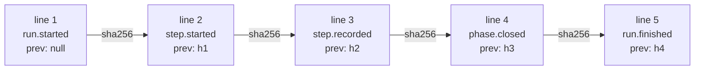

# Tracking folder and journal

> Everything a run knows sits in one repository folder and one hash-chained journal, from which the engine recomputes the state on every read and stores nothing else.

## Why — the problem it solves

In v1, the state of a run lived in a `state.json` rewritten at every step. A rewritten file
loses its history, and nothing tells an engine write from a hand edit. V2 replaces it with
`events.jsonl`: a **journal** where each fact is appended at the end and each line carries
the fingerprint of the one before. The state (current phase, attempts, cost, block) is
recomputed from that journal. An edit breaks the chain and the engine sees it.

## Key concepts — how it works

### Layout

The tracking folder lives **in the working copy that starts the run**:

```
.copilot-tracking/skraft-plans/
├── .active-slug                                   active pipeline of the working copy
└── <slug>/
    ├── events.jsonl                               hash-chained journal
    ├── research/<YYYY-MM-DD>/<slug>-research.md   research document
    ├── results/
    │   ├── <node>-<visit>-<attempt>.json          result an agent writes for one attempt
    │   └── <node>-<visit>-<attempt>.documents.json   the tracking folder as that attempt found it
    ├── reviews/<node>-<visit>/                    what the lenses of one review pass read
    │   ├── changes.patch                          changes since the base of the run
    │   ├── changed-files.txt                      paths those changes touch
    │   ├── context.md                             story, project rules, who wrote which document
    │   ├── components.json                        stack, mocking strategy, contract testing
    │   └── verdict.yaml                           the verdict of the pass, written by the engine
    └── gates/<component>/<gate>-<n>.log           evidence of each gate run
```

`results/` and `reviews/` belong to the engine: they are not documents of the run, and a
review never hands them to a lens as one.

`verdict.yaml` is written at the end of each review pass, every text double-quoted:

```yaml
status: "NEEDS_REWORK"          # APPROVED | NEEDS_REWORK | BLOCKED
code: null                      # lens-inconclusive when BLOCKED
summary: "NEEDS_REWORK: 1 reason to address"
findings:                       # the blocker, high and medium findings that count
  - lens: "consistency"
    id: "F2"
    gate: "G1"
    severity: "high"
    location: "docs/adr/adr-001-card-payment.md:3"
    description: "two contexts own payments"
    suggestion: null
notes: []                       # the low findings, same keys
refutations:                    # every check of this pass
  - lens: "consistency"
    finding: "F1"
    verdict: "refuted"          # confirmed | refuted | unverifiable
    reason: "docs/adr/adr-001-card-payment.md:3 names Acme Pay"
reused:                         # the lenses taken over from the previous pass
  - lens: "fitness"
```

The **slug** is the kebab-case name of a pipeline (`checkout-by-card`). One slug = one
pipeline = one folder.

### `.active-slug`

| Rule | Detail |
| --- | --- |
| Content | the slug followed by a line break, written by `skraft init <slug>` (and by Init in the mod and the workflow) |
| Reading | blanks trimmed; content that is not kebab-case means "no active pipeline" |
| Mandatory | every command that acts on a run reads this file; the engine never guesses a slug |
| Scope | one working copy; a Git worktree therefore has its own |

### `events.jsonl`

One JSON object per line, in UTF-8. Blank lines are skipped; `\n` and `\r\n` are both
accepted. Every event carries three shared fields:

| Field | Content |
| --- | --- |
| `type` | event type (table below) |
| `at` | ISO-8601 instant in UTC |
| `prev` | lowercase hex SHA-256 of the previous line (its UTF-8 bytes, without the line break); `null` on the first line |



**Chain check.** Each time it opens the journal, the engine checks every line. The first
break gives `journal-tampered` with this message:
`journal tampered: events.jsonl line N <detail>; restore the file or start a new slug`.

| `<detail>` | Cause |
| --- | --- |
| `is not JSON` | the line is not a JSON object |
| `does not open the chain` | line 1 has a non-null `prev` |
| `does not chain to line N-1` | `prev` is not the fingerprint of the previous line |

**Concurrent writes.** Before each append, the engine reads the journal again. If another
write arrived since it was opened, it stops with `journal-changed`:
`<slug>: another run wrote events.jsonl meanwhile; run again once it stops`.

### Events

| `type` | Written by | Fields |
| --- | --- | --- |
| `run.started` | Init, at the first init of the slug | `slug`; `story` (`{ issue, title }` or `null`); `workflow` (`skraft`); `base` (list, see below) |
| `step.started` | the pipeline, before starting an agent | `step` (`research`); `phase` (`RESEARCH`); `agent` (`solution-researcher`); `attempt` (1, 2…); `outputs` (expected paths, relative to the slug folder); `missing` (paths missing at the previous attempt, empty on the first) |
| `step.recorded` | the pipeline, after the agent | `step`; `attempt`; `outcome` (`outputs-complete` or `missing-outputs`); `missing`; `durationMs`; `cost` (absent when the host reports none) |
| `phase.closed` | the pipeline | `phase` |
| `run.finished` | the pipeline | `status` (`incomplete` when RESEARCH is closed, `blocked` when outputs are missing after the last attempt); `reason` |
| `run.stopped` | the pipeline, when the agent does not start or stops, or a lens answers twice without a readable verdict | `code` (`agent-unavailable`, `agent-failed` or `lens-unreadable`); `reason` |
| `review.lens` | a review node, once per lens | `step`; `visit`; `lens` (`consistency`); `agent` (`consistency-lens`); `fingerprint` (hash of the lens's inputs); `verdict` (`pass`, `fail` or `inconclusive`); `findings` (`{ id, gate, severity, location, description, suggestion }`, `gate` being the id of the lens's table: `G7`, `M2`…); `cost` (absent when unknown); `reused` (`true` when kept from the previous pass: same inputs, nothing found) |
| `review.refuted` | a review node, once per blocker or high finding checked by `finding-refuter`; a group checked once gives one per finding, its `cost` on the first | `step`; `visit`; `lens`; `finding` (its id); `verdict` (`confirmed`, `refuted` or `unverifiable`); `reason`; `cost` |
| `review.cost` | a review node, once per batch the host costs as a whole (the Claude Code mod) | `step`; `visit`; `cost` |
| `gate.ran` | `skraft gate`, once per gate | `component`; `gate` (`build`… or `none`); `scope` (`touched` or `all`); `command` (`null` for `none`); `status` (`pass` or `fail`); `failure` (`environment`, `deterministic` or `null`); `exitCode` (`null` when nothing ran); `durationMs`; `evidence` (path relative to the slug folder, `null` for `none`) |

Each entry of `run.started.base`: `{ component, root, repository, ref, source, sha }`.
`component` is `null` for the working copy; `ref` is the ref actually used (`main` or
`origin/main`); `source` is `flag`, `component`, `config` or `default`. How it is computed:
[skraft-config.json]({{ "/en/reference/skraft-config" | relative_url }}).

The cost comes from the host: the Claude Code mod journals the session's cost difference in
USD; the Copilot workflow reports none (Copilot counts in credits, not USD).

This journal follows the contract written in `eng/regression/README.md`, which compares a V2
run with a v1 run on the same fixtures.

A review node's `step.started` carries `lenses` instead of `agent`; its `step.recorded` has
`outcome` `approved`, `needs-rework` or `blocked` (`code` `lens-inconclusive` when a lens answered
`inconclusive` or failed with no blocker, high or medium finding: a final stop of the node, which
a new run of the same slug finds blocked too; `reason` names each such lens and what it noted),
`failures` (the findings that count, which the next brief of
the phase agent lists) and `cost` (its lenses, checks and batches of this pass, resumed or not). An agent sent back by the
gates or by a review has `sentBy` (`gate` or `review`) on its `step.started`.
An agent's `step.recorded` lists in `documents` the files of the tracking folder its attempt
created or changed (the engine's own files left out); a review gives each lens these documents
by phase, and writes `reviews/<node>-<visit>/context.md`: the story, the project rule files
found (`AGENTS.md`, `CLAUDE.md`, `CONTRIBUTING.md`, `.github/copilot-instructions.md`,
`docs/adr/decisions-index.md`) and which agent wrote which document.

> **Coming next.** The comparison contract also plans `decision.recorded`, written with human
> decisions (lot 5).

### Research document

| Rule | Detail |
| --- | --- |
| Path | `<slug>/research/<YYYY-MM-DD>/<slug>-research.md`; the date is the UTC day of the first attempt, reused by the retry |
| Pre-creation | before the attempt, the engine writes it from the plugin's `research.template.md` template when it does not exist |
| Filled | the file exists, is not empty, differs from the template and holds no `{{…}}` any more |
| Retry | not filled after attempt 1: attempt 2 of 2, with the list of missing paths |
| Stop | not filled after attempt 2: `run.finished` `blocked`, code `missing-outputs` |
| Resume | an open attempt whose outputs are already filled is recorded without restarting the agent |

### Gate evidence

Each gate run writes `<slug>/gates/<component>/<gate>-<n>.log`, where `<n>` is 1 plus the
number of `gate.ran` already journaled for that component and gate. Format:

```
$ <command run>
cwd: <component root>
result: pass: exited 0
--- stdout
<standard output>
--- stderr
<error output>
```

The first line shows the command as it started: `{baseSha}` substituted, Python interpreter
chosen, quoted so that it reads back as the same arguments. The `command` field of `gate.ran`
keeps the line written in `skraft-config.json`.

On failure, the `result` line reads `fail (<class>): <reason>`. The `stdout` and `stderr`
sections are missing when nothing ran (line refused, Docker missing). A component with no
gate command writes no evidence.

### Statuses and codes

The commands, the mod and the workflow return a **status** and, when they stop, a **code**:
`refused` (nothing was done), `blocked` (the run cannot move on), `done`.

| Status | Code | When | Typical message | Action |
| --- | --- | --- | --- | --- |
| `refused` | `invalid-slug` | slug not in kebab-case | `slug must be kebab-case, got "<slug>"` | pick a kebab-case slug |
| `refused` | `invalid-base` | `--base` is not a git ref | `--base must be a git ref, got "<ref>"` | pass a ref with no blank and no leading `-` |
| `refused` | `config-invalid` | invalid `skraft-config.json` | `skraft-config.json is invalid: <every error>` | fix each listed error |
| `refused` | `base-unresolved` | no merge base with the ref in a repository | `… has no merge base with <ref>; set baseBranch in skraft-config.json or pass --base <ref>` | set `baseBranch` or pass `--base` |
| `refused` | `source-control-unavailable` | Git does not start while the config lists components | `<error>; the components of skraft-config.json need Git for their base` | install Git, put it on the PATH |
| `refused` | `no-active-pipeline` | no valid `.active-slug` | `no active pipeline in this working copy (.copilot-tracking/skraft-plans/.active-slug); start one with an explicit slug` | `skraft init <slug>` or `/skraft <slug>` |
| `refused` | `slug-mismatch` | the call names a slug other than the active pipeline | `the active pipeline of this working copy is <active>, not <requested>; switch with an explicit init` | explicit init of the wanted slug |
| `refused` | `not-initialised` | the active slug has no journal | `<slug> has no journal (events.jsonl); start it with an explicit init` | explicit init of the slug |
| `refused` | `no-components` | `skraft gate` with no component | `skraft-config.json lists no component; run skraft init to detect them` | `skraft init` |
| `blocked` | `journal-tampered` | broken chain | `journal tampered: events.jsonl line N …; restore the file or start a new slug` | restore the file or start a new slug |
| `blocked` | `journal-changed` | another run writes during this one | `<slug>: another run wrote events.jsonl meanwhile; run again once it stops` | wait for the other run to end, run again |
| `blocked` | `missing-outputs` | outputs missing after the last attempt | `solution-researcher left required outputs missing after 2 attempts: <paths>` | a resume returns the same block; fix the cause and start a new slug |
| `blocked` | `agent-unavailable` | the host cannot start the agent | Claude Code: `skraft:solution-researcher could not be started: …`; Copilot: `agent "solution-researcher" is not available in this Copilot session (agents: …); install or enable the skraft plugin, or pass agentIds` | install or enable the plugin, then resume; the attempt is not consumed |
| `blocked` | `agent-failed` | the agent stops without finishing and its outputs are missing | `<agent> stopped without finishing: <error>` | resume: the step stays open and the same attempt restarts |
| `blocked` | `review-rejected` | a review answers `NEEDS_REWORK` and its node has no `NEEDS_REWORK` edge | `<node> asked for rework and the workflow has no NEEDS_REWORK edge out of it; <findings>` | fix the findings in a new slug, or add the edge to the workflow |
| `blocked` | `lens-inconclusive` | a lens answered `inconclusive`, or `fail` with no blocker, high or medium finding | `<lens>: inconclusive: <notes>` or `<lens>: failed without naming a blocker, high or medium finding: <notes>`, one per lens, separated by `; ` | final: a new run of the slug stays blocked; give the lens what it lacked and start a new slug |
| `blocked` | `lens-unreadable` | a lens answered twice without a readable verdict (`run.stopped`) | `<lens>-lens answered 2 times without a readable verdict: <error>` | resume: the lenses this pass already journaled are kept, the unreadable ones are asked again |
| `done` | — | RESEARCH closed, or nothing left to run | `RESEARCH closed` or `nothing to run` | — |

Gates also have their own `passed` and `failed` statuses:
[The skraft command line]({{ "/en/reference/cli" | relative_url }}).

### `skraft status` statuses

| Status | Condition | `reason` |
| --- | --- | --- |
| `idle` | no active pipeline | the `no-active-pipeline` message |
| `not-initialised` | the active slug has no event | `<slug> has no journal (events.jsonl)` |
| `tampered` | the chain is broken (exit code 1) | the `journal-tampered` message |
| `running` | journal open, run neither finished nor stopped; it is also the status right after `skraft init <slug>`, before the host starts anything | empty |
| `done` | `run.finished` with a status other than `blocked` | the `run.finished` reason |
| `blocked` | `run.finished` `blocked`, or last event `run.stopped` | the event's reason |

A `step.started` or a `phase.closed` written after a `run.finished` reopens the run.

## Why this practice

> « At its heart is the notion that you can use a different model to update information than the model you use to read information. »
> — Fowler, M., *Bliki: CQRS*, 2011.

The journal is the write model: facts are only ever appended to it. The status, the phases
and the cost are a read model recomputed every time. Neither can silently drift from the
other, and the fingerprint chain makes any edit visible.

## Pitfalls & anti-patterns

- **Fixing `events.jsonl` by hand**: the chain breaks and the run is `tampered`. Start a new
  slug.
- **Guessing the slug**: a host or an agent never picks the slug; only an explicit init
  changes `.active-slug`.
- **Running two runs on the same slug**: the second one stops with `journal-changed`.
- **Reading `done` as "delivered"**: today `done` means RESEARCH is closed (`run.finished`
  `incomplete`).

## Going further

- [Resume or unblock a run]({{ "/en/how-to/resume-a-run" | relative_url }})
- [Run the gates and read their evidence]({{ "/en/how-to/run-gates" | relative_url }})
- [The skraft command line]({{ "/en/reference/cli" | relative_url }})
- [skraft-config.json]({{ "/en/reference/skraft-config" | relative_url }})
- [State and resume (hash-chained journal)]({{ "/en/explanation/hve-core" | relative_url }})
- [Zero hooks, checks in the engine]({{ "/en/explanation/hooks" | relative_url }})

## Sources

- Fowler, M. *Bliki: CQRS*, 2011.

Terms to know: **slug**, **journal**, **active pipeline**, **gate** — see the
[glossary]({{ "/en/reference/glossary" | relative_url }}).
