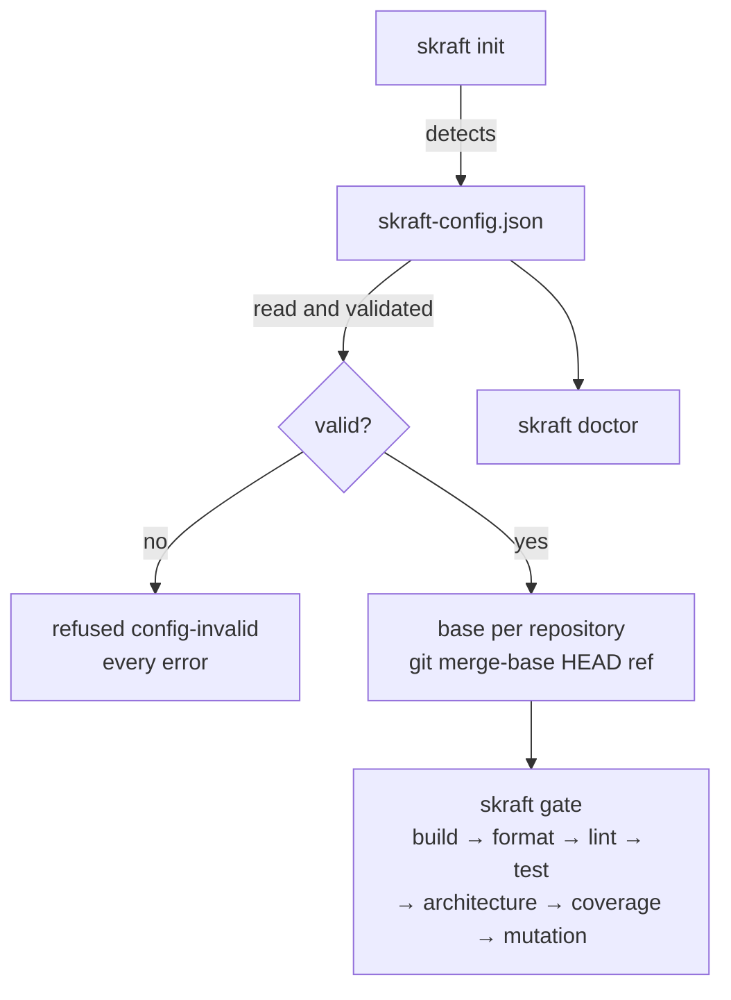

# skraft-config.json

> `skraft-config.json` tells the engine which components make up the repository and which commands, always those the developer wrote, build and test them.

## Why — the problem it solves

In v1, build and test commands were guessed by agents or written in bash recipes. A recipe
that worked on one machine failed on another, PowerShell in particular. V2 describes each
**component** (a buildable project: a .NET API, a React front end…) in a versioned file. The
engine runs exactly those commands, with no shell, from the component's root. A developer
whose script does not work on their machine replaces the command in the file; nothing else
redefines it.

## Key concepts — how it works

### Location

The file sits **at the root of the repository that starts the run** (the working copy), next
to `.copilot-tracking/`. A missing file is not an error: it counts as a config with no
component. `skraft init` without a slug creates or completes it.



### Example

```json
{
  "baseBranch": "main",
  "components": [
    { "name": "api", "root": "services/payment-api", "stack": "dotnet",
      "paths": { "src": ["src/"], "tests": ["tests/"] },
      "commands": { "build": "dotnet build --nologo", "test": "dotnet test --nologo",
                    "format": "dotnet format --verify-no-changes",
                    "mutation": "dotnet stryker --since:{baseSha}" } },
    { "name": "web", "root": "../payment-web", "stack": "react", "baseBranch": "develop",
      "mocking": { "strategy": "inprocess" },
      "commands": { "build": "npm run build", "lint": "npm run lint", "test": "npm test" } }
  ]
}
```

### Schema — top level

| Key | Type | Default | Rule |
| --- | --- | --- | --- |
| `baseBranch` | string | absent (the base falls back to `main`) | git ref: no blank, does not start with `-`; `null` counts as absent |
| `forge` | string | absent (deduced from the Git remote, see [Forge](#forge)) | `github` or `azure-devops`; `null` counts as absent. A value you write always wins over the remote |
| `components` | array of objects | `[]` | each entry is a component (below) |
| `publish` | object | absent (`visuals` unanswered) | `{ "visuals": true }` or `{ "visuals": false }`; `{}` counts as absent. Written by the engine when a human answers the `reporting-consent` question, every other key of the file kept; once set, the question is not asked again. `{ "reviewComment": true }` or `false`, written by hand in the team's file: whether `skraft review --pr --publish` may keep one comment on the pull request it reviews; it wins over each developer's answer, which the engine keeps in their own `~/.skraft/config.json` (`reviewComments`), never here. |
| `models` | object | the plugin's Claude Code aliases per tier | model family → `tier` and, per host (`claude-code`, `copilot`), `{ "model": name or list, "effort": level }`; see [Customise SKRAFT]({{ "/en/how-to/customisation" | relative_url }}#models-and-effort) |
| `assign` | object | lenses `reviewer`, workers `implementer`, `solution-researcher` `researcher`, `solution-architect` `planner`, default `implementer` | `{ "default", "types", "agents" }`: a family, `inherit`, or `{ "family", "<host>": { "effort" } }`; also read from `~/.skraft/config.json` and `skraft-config.local.json` |
| `configurationConfirmed` | boolean | `false` | in `skraft-config.local.json` only (refused in this file and in `~/.skraft/config.json`). Written `true` by the engine when you answer START to *Start this run with the configuration of this working copy?*, which a Copilot run asks before its first phase while it is absent, and again with `configure: true`. The Configuration tab of the skraft canvas edits the forge, the components and the consents of this file and the `assign` and `models` of `skraft-config.local.json`, checked as a run loads them |
| any other key | any | — | kept as is, never read or rewritten |

### Schema — one component

Any key outside this list is refused.

| Key | Type | Default | Rule |
| --- | --- | --- | --- |
| `name` | string | required | kebab-case (`api`, `payment-web`); unique in the file |
| `root` | string | required | path relative to the working copy, not empty, never absolute (`/x`, `\x`, `C:x`); may point to a neighbour repository (`../payment-web`); normalised (`./api/` becomes `api`) |
| `stack` | string | required | `dotnet`, `java`, `python`, `typescript`, `javascript` or `react` |
| `commands` | object | `{}` | name → command line; name among `build`, `format`, `lint`, `test`, `architecture`, `coverage`, `mutation`, `e2e`; non-empty line |
| `baseBranch` | string | absent (falls back to the global `baseBranch`) | git ref; `null` counts as absent |
| `mocking` | object | `inprocess` for `typescript`, `javascript` and `react`, `microcks` otherwise | `strategy` is `microcks`, `inprocess` or `null`; absent or `null` means the stack's default. The engine passes it in the brief and picks the matching mocking skill |
| `paths` | object | `["."]` for each key, the whole root | `{ "src": […], "tests": […] }`, folders relative to the component root, never absolute nor starting with `..`; `skraft init` writes them. In DELIVER, the software engineer may write only there (write scope) |
| `contractTesting` | boolean | `false` | `true` makes the software engineer read the contract testing skills of its stack; the review lenses see the setting among the component settings |
| `mutationReport` | string | absent: the report the stack's tool writes, relative to the root: `StrykerOutput/reports/mutation-report.json` (.NET), `reports/mutation/mutation.json` (TypeScript, JavaScript, React), `mutation-report.json` (Python), `target/pit-reports/mutations.xml` (Java; `build/reports/pitest/mutations.xml` when the mutation command names Gradle) | the file the `mutation` command writes its report to, relative to the component root, never absolute nor outside it. The mutation gate reads its surviving mutants there and judges the 100 % / 80 % bar |

Quality thresholds (coverage, mutation…) are **not** configurable: no key carries them.

### Forge

The forge is where the engine reads the story's issue, keeps the run's comment on it, opens
the pull request and reads the pull request a review comments on. The `forge` key names it;
without it, the engine reads the URL of the working copy's remote (`origin`, else the first
remote Git lists):

| Host of the remote | Forge |
| --- | --- |
| `dev.azure.com`, `ssh.dev.azure.com`, any `*.visualstudio.com` | `azure-devops` |
| any other host (GitHub, GitHub Enterprise…), or no remote | `github` |

On `github`, the engine goes through the host's GitHub MCP server, else `gh` (see below), and the pull request's body opens with
`Closes #<issue>` when it targets the default branch, `Refs #<issue>` otherwise. On
`azure-devops`, the engine opens the pull request on Azure Repos through `az` (the Azure CLI
with its `azure-devops` extension): its body opens with `AB#<work item>`, and the pull request
is linked to the story's work item when it is created. skraft does not read Azure DevOps work
items, comment on them or review its pull requests yet: on `azure-devops`, the run starts
without the body of its issue and keeps nothing on it, `skraft review --pr` stops with
`forge-unavailable`, each with the reason
`skraft cannot reach the forge azure-devops yet (forge in skraft-config.json, else the host of the Git remote, chooses it)`.
`gh` is never run on an Azure DevOps remote. `skraft review --pr` reads `forge` only in your
own files (`~/.skraft/config.json`, `skraft-config.local.json`), else from the remote: the
`skraft-config.json` of the pull request under review, which its author wrote, chooses no forge.

Under Copilot, the **Configuration** tab of the skraft canvas chooses it: its first choice, *From the Git remote: <forge>*, leaves `forge` out of `skraft-config.json` and names the forge the remote gives; *GitHub* or *Azure DevOps* writes it. `skraft doctor` says which forge a run uses and what chose it, on its `forge` line.

#### GitHub MCP server first, gh as fallback

When the host has a known GitHub MCP server connected and the repository is on `github.com`,
the engine reads the issue, keeps its comment, finds, opens and edits the pull request, and
reads and comments the pull request under review through that server's tools (`issue_read`,
`add_issue_comment`, `update_issue_comment`, `get_me`, `list_pull_requests`,
`create_pull_request`, `update_pull_request`, `pull_request_read`, as github/github-mcp-server
v2.0.3 names them). The known servers, by exact name, in this order: `github-mcp-server`
(Copilot CLI's built-in one), `github`, `claude_ai_Github` (the claude.ai connector); a server
of any other name is never used. Issues are read on the repository `gh` reads them on (its
default, else `upstream`, else `origin`); pull requests and the issue comment go to `origin`.

Each operation falls back to `gh` when the server is absent or not connected, a read is
refused, the tool is missing or fails, the server answers what the engine cannot read (a page
outside the repository in use included), or the conversation holds 100 comments or more. A
write you or the host refuse (in Claude Code, a tool you have not allowed) is not retried with
`gh`: the run says it wrote nothing. The guarantees stay those of `gh`: the pull request is
found before one is opened, only your own comment is rewritten, the reasons are fixed by the
engine. The journal says which way served each operation: `via` (`mcp` or `gh`) and, when
`gh` served after the server could not, `fallback` with a fixed code (`mcp-unavailable`,
`mcp-tool-missing`, `mcp-refused`, `mcp-failed`, `mcp-unreadable`); `run.started` keeps it as
`issueRoute`. Reading the issue and keeping its comment need no `gh`; opening the pull request
still asks `gh` for the repository's default branch, and the push stays `git`. `skraft next`
(the VS Code agent loop) and the `skraft` CLI reach no MCP server and always use `gh`.

### Validation and messages

The engine validates the whole file and returns **every** error at once, joined with `; `,
as `skraft-config.json is invalid: <error>; <error>…` (code `config-invalid`). In the
messages, `<label>` is `component <name>` when the name is a string, `components[<index>]`
otherwise.

| Case | Exact message |
| --- | --- |
| not JSON | `skraft-config.json is not JSON` (never the parser's message, which quotes the file) |
| not an object | `skraft-config.json must hold a JSON object` |
| global `baseBranch` | `baseBranch must be a git ref, got <JSON value>` |
| `forge` | `forge must be "github" or "azure-devops"` |
| `publish` | `publish must be { "visuals": true or false }` |
| `configurationConfirmed` | `configurationConfirmed belongs in skraft-config.local.json, never in <file>`; `configurationConfirmed must be true or false` |
| `components` not an array | `components must be an array` |
| entry not an object | `components[<index>] must be an object` |
| name | `components[<index>].name must be kebab-case, got <JSON value>` |
| duplicate name | `component name <name> is used twice` |
| unknown key | `<label>: unknown key <key> (allowed: name, root, stack, paths, commands, baseBranch, mocking, contractTesting)` |
| root | `<label>: root must be a path relative to the working copy` |
| stack | `<label>: stack must be one of dotnet, java, python, typescript, javascript, react` |
| `commands` not an object | `<label>: commands must be an object of command lines` |
| command name | `<label>: unknown command <name> (allowed: build, format, lint, test, architecture, coverage, mutation, e2e)` |
| empty line | `<label>: command <name> must be a non-empty command line` |
| component `baseBranch` | `<label>: baseBranch must be a git ref, got <JSON value>` |
| `mocking` | `<label>: mocking must be { "strategy": "microcks" or "inprocess" }` |
| `paths` | `<label>: paths must be { "src": [...], "tests": [...] }`; `<label>: paths.<key> must list folders inside the component root` |
| `contractTesting` | `<label>: contractTesting must be true or false` |
| `mutationReport` | `<label>: mutationReport must be a file inside the component root` |

### Command lines

A `commands` line runs **with no shell**, from the component's root. The same line therefore
behaves the same way under sh, PowerShell and cmd.

| Rule | Detail |
| --- | --- |
| Splitting | on blanks; the first word is the program |
| Quotes | `"…"` and `'…'` keep blanks inside one argument; no escape character |
| `{baseSha}` | replaced, before splitting, with the base SHA of the component's repository |
| Shell syntax | a word written with no quotes that contains <code>&#124;</code>, `&`, `;`, `<` or `>` is refused |
| Nothing interpreted | no variable, wildcard or redirection: each word goes to the program as is |
| Program | looked up on the PATH (and PATHEXT under Windows); a path with `/` or `\` starts from the component's root |
| Windows | a `.cmd` or `.bat` (npm, npx, gradlew.bat) goes through cmd.exe, arguments escaped |

Messages refusing a line (prefixed with `command "<line>"` in a gate, with `"<line>"` in the
doctor):

| Case | Message |
| --- | --- |
| shell syntax | `uses shell syntax (<word>); put the steps in a script and call the script` |
| unclosed quote | `has an unclosed <quote> quote` |
| `{baseSha}` with no base | `uses {baseSha} but the run has no base for this repository` |

To chain steps (`a && b`), write them in a script of the repository and call the script.

### Gates

A **gate** is a command whose name is one of the seven names below. They run in this order,
whatever the order in the file:

| Order | Name |
| --- | --- |
| 1 | `build` |
| 2 | `format` |
| 3 | `lint` |
| 4 | `test` |
| 5 | `architecture` |
| 6 | `coverage` |
| 7 | `mutation` |

`e2e`, the only other name allowed, is not a gate: `skraft gate` does not run it, but
`skraft doctor` checks it. A misspelt name (`tset`) makes the configuration invalid instead
of silently skipping the gate. A component with no gate command fails (gate `none`, class `environment`):
`no gate command; give it at least one of build, format, lint, test, architecture, coverage,
mutation in skraft-config.json`. A component stops at its first failing gate.

A line that starts with `python` starts the first interpreter found from the component's
root: `.venv/bin/python`, `.venv/Scripts/python.exe`, then `python` and `python3` on the
PATH. The file keeps `python` and stays the same on Windows, macOS and Linux. Any other
program starts as written.

With Microcks (the default outside TypeScript, JavaScript and React), the tests that use it run
Microcks in a container, Docker or Podman. The engine does not look for one: such a test fails when
no container answers, like any failing test.

### Failure classes

| Class | Case | Reason shown | Who acts |
| --- | --- | --- | --- |
| `environment` | program or folder not found, program cannot start | `<error>; install it or change the command in skraft-config.json` | a human, on the machine or the config |
| `environment` | exit code 127 (sh) or 9009 (cmd) | `exited <code>` | same |
| `environment` | program stopped by a signal | `<program> was stopped by <signal>; run it again` | same |
| `environment` | line refused (shell syntax, quote, `{baseSha}`) | `command "<line>" <reason>` | same |
| `environment` | component with no gate command | `no gate command` message above | same |
| `deterministic` | any other non-zero exit code | `exited <code>` | the code must change |

Under the CLI and Copilot, a command's output is kept up to 64 MiB per stream. Past that, the evidence keeps its head and
its tail around `… output cut …`, the command still runs to its end, and its exit code still
judges the gate; its reason, pass or fail, ends with `; its output passed the runner's limit:
the evidence keeps only its head and its tail`.

### Changed components

Without `--all`, `skraft gate` runs only the components **changed since their base**: files
changed since the base SHA (commits, index, working tree) and untracked files, under the
component's root. These do not count: files under `.copilot-tracking/` and files of a
component nested inside this one. A component with no base (root outside any Git
repository), or whose changes Git cannot list, counts as changed. `skraft gate --all` runs
them all. In DELIVER, a gate node runs the changed components first; once they pass, a goal
gate (`goal_gate=true`) runs the others too, so DELIVER closes on every component.

### Base rule

The **base** of a repository is the commit it is compared from: `git merge-base HEAD <ref>`,
computed in each component's repository and in the working copy's.

| Priority | Source of `<ref>` | Journaled `source` |
| --- | --- | --- |
| 1 | `--base <ref>` | `flag` |
| 2 | component `baseBranch` | `component` |
| 3 | global `baseBranch` | `config` |
| 4 | `main` | `default` |

- When the ref has no local merge base, the engine tries `origin/<ref>`.
- A folder outside any repository has no base; that is not an error.
- With no merge base even with `origin/<ref>`: refused `base-unresolved`, one part per
  repository without a base (`the working copy (<repository>) has no merge base with <ref>`
  or `component <name> (<repository>) has no merge base with <ref>`), joined by `; `, then
  `; set baseBranch in skraft-config.json or pass --base <ref>`.
- When the config lists components and Git does not start: refused
  `source-control-unavailable`.
- The base is journaled in `run.started.base` at the **first** init of the slug. A resume
  keeps the journaled base.

### Detection (`skraft init` without a slug)

The engine looks for projects in the working copy and in each `--add` folder, down to
**3 levels**, skipping hidden folders and `node_modules`. A project under a project of the
**same family** is not a component (a `.csproj` under a solution); a project of **another
family** is one (a React front end under a .NET solution). Families: `dotnet`, `java`,
`python`, `js` (typescript, javascript, react).

In one folder, the first marker found in this order decides the stack:

| Stack | Markers | `build` | `test` | Other commands |
| --- | --- | --- | --- | --- |
| `dotnet` | `*.sln`, `*.slnx`, `*.csproj`, `*.fsproj`, `*.vbproj` | `dotnet build --nologo` | `dotnet test --nologo` | `format`: `dotnet format --verify-no-changes`; `mutation`: `dotnet stryker --since:{baseSha}` |
| `java` (Maven) | `pom.xml` | `mvn -B -q -DskipTests package` (`./mvnw` when present) | `mvn -B -q test` (`./mvnw` when present) | — |
| `java` (Gradle) | `build.gradle`, `build.gradle.kts` | `gradle build -x test` (`./gradlew` when present) | `gradle test` (`./gradlew` when present) | — |
| `python` | `pyproject.toml`, `setup.py`, `setup.cfg`, `requirements.txt` | `python -m compileall -q src` (`.` with no `src` folder) | `python -m pytest -q -p no:cacheprovider` | — |
| `react` / `typescript` / `javascript` | `package.json` | `npm run build` when a `build` script exists, otherwise `npx tsc --noEmit` (not for javascript) | `npm test` when a `test` script exists, otherwise `npx vitest run` with a vitest dependency, otherwise `npx jest` with a jest dependency | `lint`: `npm run lint` when a `lint` script exists |

For `package.json`: `react` with a `react` dependency, otherwise `typescript` when
`tsconfig.json` exists or with a `typescript` dependency, otherwise `javascript`. The
dependencies read are `dependencies` and `devDependencies`.

Proposed `paths`:

| Stack | `src` | `tests` |
| --- | --- | --- |
| `dotnet`, `python` | `src/` when it exists, otherwise `./` | `tests/` and/or `test/` when they exist |
| `java` without modules | `src/main/` | `src/test/` |
| `java` Maven with modules | the `pom.xml` `<module>`s other than test modules | the modules whose name holds the word `test`, `tests` or `it` (alone or separated by `-`) |
| JS / TS / React | `src/` when it exists, otherwise `./` | `tests/`, `test/`, `__tests__/` when they exist, otherwise as `src` |

**Name**: the folder name in kebab-case (`PaymentApi` becomes `payment-api`), the working
copy's folder name for the root, `app` when nothing is left; `-2`, `-3`… when the name is
taken. A root already listed is not proposed again. The engine writes neither `mocking` nor
`baseBranch`: the defaults apply.

## Why this practice

> « Don't Assume It—Prove It. »
> — Hunt, A. & Thomas, D., *The Pragmatic Programmer, 20th anniversary ed.*, 2019.

A gate does not assume the code works: it proves it with a command. Written in a versioned file and run by the engine with no
shell, they give the same result on every machine and under every host. What differs from
one machine to another is settled in the config, not in an agent's prose.

## Pitfalls & anti-patterns

- **A shell chain in `commands`** (`npm ci && npm test`): refused. Put the steps in a script
  and call it.
- **Relying on an environment variable** (`$HOME`, `%PATH%`) in a line: it goes to the
  program as is.
- **A misspelt gate name** (`Test`, `unit-test`): it is not a gate and never runs in
  `skraft gate`.
- **An absolute root**: refused; a neighbour repository is written `../name`.
- **Forgetting Docker or Podman with Microcks**: start one before the tests, or switch the
  component to `inprocess` when it does not mock with Microcks.

## Going further

- [Configure the components]({{ "/en/how-to/configure-components" | relative_url }})
- [Run the gates and read their evidence]({{ "/en/how-to/run-gates" | relative_url }})
- [What you can adapt, and the risk]({{ "/en/how-to/customisation" | relative_url }})
- [The skraft command line]({{ "/en/reference/cli" | relative_url }})
- [Tracking folder and journal]({{ "/en/reference/run-journal" | relative_url }})

## Sources

- Hunt, A. & Thomas, D. *The Pragmatic Programmer, 20th anniversary ed.*, 2019.

Terms to know: **component**, **gate**, **base**, **Microcks** — see the
[glossary]({{ "/en/reference/glossary" | relative_url }}).
