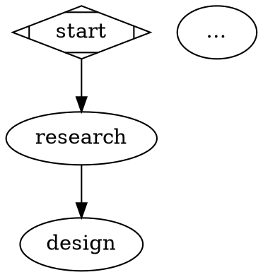
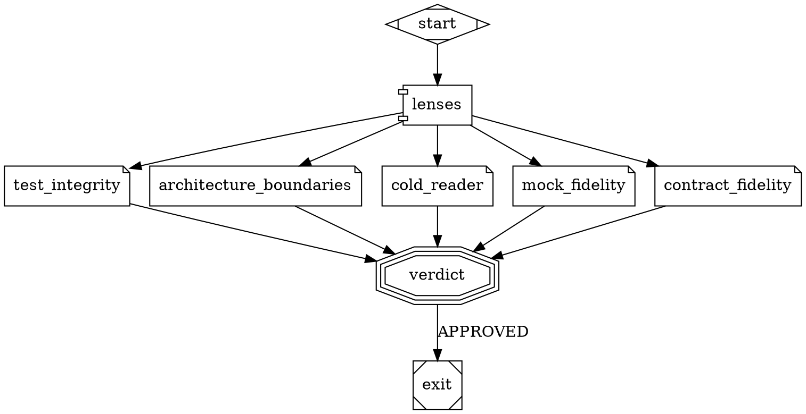

# The DOT workflow

> The pipeline and the DELIVER review are two DOT graphs the engine reads, validates and then runs; this page gives their full syntax.

Why a pipeline is described by a graph rather than hard-coded:
[Architecture]({{ "/en/explanation/architecture" | relative_url }}). The commands that copy,
validate and compare a workflow: [`skraft workflow`]({{ "/en/reference/cli" | relative_url }}).
What each phase of the shipped workflow produces:
[Phases]({{ "/en/reference/phases" | relative_url }}).

## Files {#files}

| File | Role | Read from |
| --- | --- | --- |
| `pipeline.skraft.dot` | the pipeline of a run (`digraph skraft`) | the working copy's `.skraft/pipeline.skraft.dot` when it exists, else the plugin's `workflows/pipeline.skraft.dot` |
| `review.skraft.dot` | the review the `deliver_review` node calls and `skraft review --pr` runs (`digraph review`) | `.skraft/review.skraft.dot` when it exists, else the plugin's `workflows/review.skraft.dot` |
| `<name>.skraft.dot` | any workflow a call node names (`workflow="<name>"`) | `.skraft/<name>.skraft.dot`, else the plugin's `workflows/<name>.skraft.dot`; found nowhere: workflow refused |

| Rule | Detail |
| --- | --- |
| Copy | `skraft workflow eject` writes `.skraft/pipeline.skraft.dot`, `skraft workflow eject review` writes `.skraft/review.skraft.dot`; an existing copy is never overwritten |
| Version | each copy gets `skraft_version="<plugin version>"` in its `graph [...]` |
| Configuration | `skraft-config.json` names no workflow: a `workflow` key is refused (`workflow is no key: …`) |
| Writing | no agent may write in `.skraft/` |
| Families | a model family a copy names (`model=`, `@<family>`, `refuter=`) counts whichever copies are ejected |

## Graph {#graph}



| Element | Rule |
| --- | --- |
| `digraph <name> { … }` | one directed graph per file |
| `graph [ … ]` | graph attributes: `version`, `goal`, `skraft_version` (written by `eject`), `input_<name>` |
| `input_<name>` | `"required"` or `"optional"`; `<name>` in lower-case letters, digits and `_`; declares an input of a called workflow |
| Comments | `// …` |
| Edge chain | `a -> b -> c` declares two edges |
| Subgraph | `subgraph cluster_<x> { … }` groups its nodes in a drawing; its attributes (`label`) change nothing; a subgraph inside another is refused |
| Node id | letters, digits, `_` and `-`, starting with a letter or `_`: it names the node's files in the tracking folder |

## Node shapes {#node-shapes}

| Shape | Kind | Required attributes | Optional attributes | Outgoing edges |
| --- | --- | --- | --- | --- |
| `Mdiamond` | start | — | — | —; exactly one per workflow; no edge enters it |
| `Msquare` | exit | — | — | none; at least one per workflow |
| `box` | agent | `agent` | `model`, `outputs`, `writes`, `max_attempts`, `each`, `proposal` | exactly one, unlabeled |
| `parallelogram` | command gate | `gate` | `goal_gate`, `locked`, `unlock` | one `PASS` (an unlabeled edge is `PASS`), at most one `FAIL` |
| `parallelogram` + `publish=` | publication | `publish` | `when` | exactly one, unlabeled |
| `component` | review fan-out | — | — | one per lens node |
| `note` | lens node | `lens` | `model`, `when`, `mandatory` | exactly one, to the fan-in |
| `tripleoctagon` | review fan-in | — | `model`, `refuter`, `mandatory` | one `APPROVED` (an unlabeled edge is `APPROVED`), at most one `NEEDS_REWORK` |
| `hexagon` | question to a human | `question` | — | one per answer; at most one unlabeled, which stands for every answer but a refusal; a refusal has its own edge; `STOP` of a question that takes an instruction has no edge (it ends the run), and an instruction takes the edge of the first option |
| `house` | workflow call | `workflow` | `mandatory`, `with_<input>` | as a fan-in: one `APPROVED`, at most one `NEEDS_REWORK` |

Attributes common to every shape: `label`, `shape`, `phase`. Any other attribute is refused
(`attribute <key> is not supported on a <shape> node (supported: …)`).

## Node attributes {#node-attributes}

| Attribute | Value | Rule |
| --- | --- | --- |
| `phase` | an upper-case word (`DESIGN`) | absent: the phase of the first predecessor in the walk order from the start; a working node with no phase is refused |
| `agent` | kebab-case agent id | looked for in the plugin, then `.claude/agents/` (Claude Code) or `.github/agents/` (Copilot); found nowhere: refused |
| `model` | model family (`reviewer`, `planner`, `gpt-codex`) | on an agent: its family; on a lens: its own; on a fan-in: that of its lenses that name none; an `assign.agents` rule wins |
| `refuter` | model family | the family of `finding-refuter` for this fan-in |
| `outputs` | paths separated by `,`, relative to the tracking folder, without `..` | replaces the outputs of the agent's role; `{date}` and `{slug}` filled at dispatch |
| `writes` | paths separated by `,`, relative to the working copy | added to the paths the agent's role may write |
| `max_attempts` | positive integer | attempts per pass; default **3** |
| `each` | `survivor-file` | reached by the mutation gate's `FAIL` edge: one dispatch per file holding surviving mutants; reached by another edge: one dispatch, with what that edge brings |
| `proposal` | `true` or `false` | with `each="survivor-file"` (required): the agent writes one proposal per file in the file the engine creates (`proposals/<node>-<visit>-g<n>.md`) and changes no code |
| `gate` | a list among `build`, `format`, `lint`, `test`, `architecture`, `coverage`, `mutation` | run in that order, whatever the written order |
| `goal_gate` | `true` or `false` | once the changed components pass, runs the other components too |
| `locked` | `true` or `false` | see [Locked nodes](#locked-nodes) |
| `unlock` | non-empty text | why a locked node is skipped |
| `publish` | `pull-request` or `playwright-visuals` | what the node publishes |
| `when` (publication) | `frontend` | skips the node when no component is a front end |
| `lens` | kebab-case name | the lens `<name>` is the agent `<name>-lens`; at most once per review |
| `when` (lens) | `mock` or `contract` | see [Conditional lenses](#conditional-lenses) |
| `question` | `adr-ratification`, `reporting-consent`, `publish-consent` or `mutation-plan` | see [Phases]({{ "/en/reference/phases" | relative_url }}#human-questions) |
| `workflow` | kebab-case base name (`review`) | the called workflow |
| `with_<input>` | `base`, `head`, `story`, `documents` or `components` | binds the called workflow's input `<input>` to this value of the run |
| `mandatory` | `true` | see [Mandatory nodes](#mandatory-nodes); `mandatory=false` is refused |

## Edges {#edges}

| Attribute | Value | Rule |
| --- | --- | --- |
| `label` | depends on the node it leaves | gate: `PASS`, `FAIL`; fan-in and call: `APPROVED`, `NEEDS_REWORK`; question: an answer of the question; any other edge takes none |
| `max_visits` | positive integer | how many times the run may take the edge; required on every loop |

## Validity rules {#validity}

`skraft workflow check`, `skraft init` and every driver validate the workflow before any run and
return every error. A workflow is refused when:

| Rule | Sample message |
| --- | --- |
| no start node, or several | `the workflow needs exactly one start node (shape=Mdiamond), has N` |
| no exit node | `the workflow needs at least one exit node (shape=Msquare)` |
| unreachable node | `node <id> is unreachable from start` |
| node that reaches no exit | `node <id> never reaches an exit` |
| loop without `max_visits` | `loop a -> b -> a has no max_visits` |
| edge entering the start | `edge <a> -> <b>: no edge may enter the start node` |
| edge going back to an earlier phase (except to an exit) | `edge <a> -> <b> goes back from <PHASE> to <PHASE>` |
| working node with no phase | `node <id> has no phase; set phase="<PHASE>" on it or on a node before it` |
| missing or unknown shape | `node <id> has no shape; …`, `node <id>: shape <shape> is not supported (supported: …)` |
| missing required attribute | `node <id>: a <shape> node needs <key>="…"` |
| wrong number of outgoing edges | `node <id>: gate node needs exactly one PASS edge, has N`, and so on |
| label on an edge that takes none | `edge <a> -> <b>: only an edge leaving a gate, a review's fan-in (shape=tripleoctagon), a call (shape=house) or an ask node takes a label` |
| agent, lens, `finding-refuter` or a skill a lens lists found nowhere | the node, the agent and the skill named |
| `proposal=true` without `each` | `node <id>: proposal=true needs each="survivor-file", the mutants it proposes for` |
| `lenses="…"` form (former) | refused; the message writes out, as DOT, the nodes and edges that replace it |

When valid, `skraft workflow check` prints `<file> is valid: phases RESEARCH, DESIGN, …` and, for
each unlocked node, `; <node> is unlocked and skipped: <reason>`.

## Locked nodes {#locked-nodes}

The DELIVER gates of the plugin's workflow (`gates`, `mutation`) carry `locked=true`. A copy that
removes or changes them is refused, unless it skips them with `unlock="<reason>"`, which the
journal and the pull request repeat.

| A copy is refused when the locked node… | Message |
| --- | --- |
| is missing | `locked node <id> is missing; keep it with unlock="<reason>" to skip it` |
| loses one of its gates | `locked node <id> drops <gates>; keep them, or skip the node with unlock="<reason>"` |
| loses `goal_gate=true` | `locked node <id> must stay goal_gate=true; skip it with unlock="<reason>" instead` |
| has no `FAIL` edge back to an agent of its phase | `locked node <id> has no FAIL edge back to an agent of <PHASE>` |
| is bypassed | `<node> reaches the exit without passing <id>; keep the run going through <id>, or skip <id> with unlock="<reason>"` |

A gate node that runs every gate of a locked node (its `goal_gate` included) and is not unlocked
stands in for it in this check: in the plugin's workflow, `mutation_gates` stands in for `gates`
on the path `kill_mutants -> … -> mutation`.

## Mandatory nodes {#mandatory-nodes}

The plugin's workflows mark `mandatory=true`:

- in `pipeline.skraft.dot`: the fan-ins `design_review`, `distill_review`, `mutation_review`
  and the call `deliver_review`;
- in `review.skraft.dot`: the fan-in `verdict` and the lenses `test_integrity` and
  `architecture_boundaries`.

Nothing lets a repository skip one: no `unlock`, no CLI option, no setting in
`skraft-config.json`. The plugin's workflow decides: removing the attribute from the copy
changes nothing, and `mandatory=false` is refused.

| Mandatory node | Kept when |
| --- | --- |
| Review fan-in | it is still a fan-in with the same id; its `NEEDS_REWORK` edge goes back to an agent of its phase in the plugin's workflow (renaming that phase is refused); no path reaches the exit without it from the start, from that agent, or from an agent of its phase the run reaches only through the review. A path the plugin's workflow has too is kept: the run reaches the exit around `mutation_review` from the start when mutation passes |
| Call | it is still a call (`shape=house`) with the same id, under the same rules as a review fan-in. It may call another workflow: that one must keep the mandatory nodes of the plugin's `review.skraft.dot` |
| Lens node | it keeps its id, its lens (its `model=` may change), its fan-out and its fan-in, and carries no `when`. Those of `review.skraft.dot` are checked in the file the call reads, ejected or not |
| Fan-in of `review.skraft.dot` | it keeps its id (`verdict`), in whatever workflow the mandatory call calls |

Each refusal names the node and the rule it breaks, and ends with `this node is mandatory and
cannot be removed`. `skraft workflow diff` marks `(mandatory)` each mandatory node it lists as
removed or changed.

## Review: fan-out, lens nodes, fan-in {#reviews}

A review is written as a fan-out (`shape=component`), one lens node per branch (`shape=note`)
and a fan-in (`shape=tripleoctagon`). The journal names the review step after the fan-in
(`distill_review`). The engine starts the lenses of a review together, in the order of the
fan-out's edges, where the host allows it. What a review then computes (lens answers,
refutation, verdict): [Gates]({{ "/en/reference/gates" | relative_url }}).

```dot
distill_review_lenses [shape=component]
distill_review_coverage    [shape=note, lens="coverage"]
distill_review_testability [shape=note, lens="testability", when="mock"]
distill_review [shape=tripleoctagon]
distill -> distill_review_lenses
distill_review_lenses -> distill_review_coverage -> distill_review
distill_review_lenses -> distill_review_testability -> distill_review
distill_review -> distill [label="NEEDS_REWORK", max_visits=3]
distill_review -> deliver [label="APPROVED"]
```

| Rule | Detail |
| --- | --- |
| Fan-out (`shape=component`) | no attribute of its own; every edge leaving it is a branch that holds exactly one lens node, and every branch ends in the same fan-in. It takes no label |
| Lens node (`shape=note`) | `lens="<name>"` required, kebab-case, at most once per review; `model="<family>"` and `when="mock"` or `when="contract"` optional. Entered by one edge from its fan-out, it leaves by one edge to its fan-in |
| Fan-in (`shape=tripleoctagon`) | entered only by the lens nodes of one fan-out; `model=` (the family of its lenses that name none) and `refuter=` optional |
| `lenses="…"` | the former form, refused: `skraft workflow check` names each such node and writes out, as DOT, the nodes and edges that replace it: ids included (`<review>_lenses`, `<review>_<lens>`), `when` for `mock-fidelity` and `contract-fidelity`, the node's `label`, `phase`, `model` and `refuter` on the fan-in, its incoming edges sent to the fan-out |
| Model | a family is a tier (`economy`, `standard`, `frontier`), a role (`reviewer`, `researcher`, `implementer`, `planner`) or a free family with a `tier` (`gpt-codex`). A lens node's `model=`, else the fan-in's, names its family; an `assign.agents` rule still wins, and `skraft workflow check` warns of it. The plugin's workflows name none: the configuration's `assign` decides ([Choose the agents' models]({{ "/en/how-to/choose-models" | relative_url }})). `finding-refuter` runs one tier above the strongest lens of its group, `frontier` at most, unless a rule names its family. The journal records what each agent was assigned (`assignment`) and the model it ran on (`model`, null for the session's) |
| Lens agent | the lens `<name>` is the agent `<name>-lens`, looked for in the plugin, then in `.claude/agents/` (Claude Code) or `.github/agents/` (Copilot); `finding-refuter` must be found too, or the workflow is refused |
| `APPROVED` edge | exactly one; an unlabeled edge counts as `APPROVED` |
| `NEEDS_REWORK` edge | at most one; without it, a `NEEDS_REWORK` stops the run with `review-rejected`; past its `max_visits`, with `loop-ceiling` |
| Driver | the host driver starts the lenses and the refuter (depth 1); no agent starts another one |

## Call node and `review.skraft.dot` {#call-node}

```dot
deliver_review [shape=house, workflow="review", mandatory=true]
gates -> deliver_review [label="PASS"]
deliver_review -> deliver [label="NEEDS_REWORK", max_visits=3]
deliver_review -> mutation [label="APPROVED"]
```

| Rule | Detail |
| --- | --- |
| Call node (`shape=house`) | `workflow="<name>"` required: the base name of a workflow, kebab-case (`review`); `mandatory`, `label`, `phase` and `with_<input>` optional, nothing else (no `model=` or `refuter=`: the called fan-in names them). Its edges are those of a fan-in: one `APPROVED`, at most one `NEEDS_REWORK`, with `max_visits` |
| Called workflow | runs one review and nothing else: start → fan-out → one lens node per branch → fan-in → exit, without a `NEEDS_REWORK` edge (the call carries it). Its nodes take the call's phase. A call inside it is refused |
| Inputs | each one a graph attribute of the called workflow, `input_<name>="required"` or `"optional"`. The call binds each one by name to what the run holds: `base` and `head` (the changes the review reads), `story`, `documents` (what the agents filled or wrote, by phase), `components` (each component with the gates that passed on it). `with_<name>="<value>"` binds it to another of these. A required input left unbound, a `with_` that binds no input, or a called workflow that binds nothing to `base` or `head` is refused |
| Journal | that of a fan-in: `step.started` and `step.recorded` under the call's id (`deliver_review`), `review.lens`, `review.refuted`. `NEEDS_REWORK` sends the work back to the agent with the findings (`sentBy: review`) |
| Unbound input | a lens gets nothing from it: without `documents`, no `context.md` and no document of the run; without `story`, the brief says `Story: none`; without `components`, no `components.json` |

The plugin's `review.skraft.dot` reads only its inputs, never the journal of a run:



## Lens inputs {#lens-inputs}

Every lens but `cold-reader` also reads the review's `context.md` (story, project rules, who
wrote which document), written only when the review is bound to the run's documents (every
review of `pipeline.skraft.dot`, and `review` called by it). The files sit in
`reviews/<node>-<visit>/` ([Tracking folder and journal]({{ "/en/reference/run-journal" | relative_url }})).

| Lens | Reads |
| --- | --- |
| `fitness`, `business-alignment` | documents of the phase, of the story and of the other phases |
| `architecture-compliance`, `testability`, `boundary-enforcement` | documents of the phase, patch, changed paths |
| `architecture-boundaries` | documents of the story and of the other phases, patch, changed paths, `components.json` |
| `cold-reader` | patch and changed paths only: no story, no feature scope, no context |
| `mock-fidelity`, `contract-fidelity` | patch, changed paths, `components.json` |
| any other lens (`consistency`, `coverage`, `test-integrity`, a repository's own) | everything above |

The patch holds every change since the base of the run, the tracking folder left out. When the
run changed nothing outside the tracking folder, a lens that reads the changes gets neither file
and its brief says so (`Changes since the base of the run: none outside the tracking folder`). A
changed path with no section in the patch is a new untracked file: the lens opens it.

`components.json` lists each component with `name`, `root`, `stack`, `mocking` (the resolved
strategy, stack default included), `contractTesting` and `gates` (the gates that passed on it in
this run, in gate order).

**Skills.** The brief gives each lens the `SKILL.md` of every skill its descriptor lists under
`metadata.skills`, from the plugin, then `.claude/skills/` or `.github/skills/`. A skill a lens
or `finding-refuter` lists and that is found nowhere refuses the workflow, naming the node, the
agent and the skill.

## Conditional lenses {#conditional-lenses}

A lens node with `when=` runs only when a changed path or a line the patch adds or keeps matches
its trigger; otherwise the review runs without it. A lens node without `when` always runs.

| `when` | Path | Line |
| --- | --- | --- |
| `mock` | a file name holding `mock`, `stub` or `fake` | `WireMock…`, `MockServer`, `Microcks…`, `Mountebank`, `HttpMessageHandler`, `nock`, `msw` |
| `contract` | a file name holding `contract`, `.apiexamples`, `.apimetadata`, `openapi….yaml/json` | `VerifyAsync`, `Pact…`, `ProviderVerifier`, `ContractTest` |

## The plugin's workflow {#plugin-workflow}

The nodes of `workflows/pipeline.skraft.dot`, in file order. A phase in brackets is inherited
from the predecessor.

| Node | Shape | Attributes | Phase |
| --- | --- | --- | --- |
| `start` | `Mdiamond` | — | — |
| `publish_consent` | `hexagon` | `question="publish-consent"` | RESEARCH |
| `visuals_consent` | `hexagon` | `question="reporting-consent"` | (RESEARCH) |
| `research` | `box` | `agent="solution-researcher"` | RESEARCH |
| `design` | `box` | `agent="solution-architect"` | DESIGN |
| `design_review_lenses` → `design_review` | review | lenses `consistency`, `architecture-compliance`, `fitness`; fan-in `mandatory=true` | (DESIGN) |
| `adr` | `hexagon` | `question="adr-ratification"` | (DESIGN) |
| `distill` | `box` | `agent="acceptance-designer"` | DISTILL |
| `distill_review_lenses` → `distill_review` | review | lenses `coverage`, `business-alignment`, `testability`, `boundary-enforcement`; fan-in `mandatory=true` | (DISTILL) |
| `deliver` | `box` | `agent="software-engineer"` | DELIVER |
| `gates` | `parallelogram` | `gate="build,format,lint,test,architecture,coverage"`, `goal_gate=true`, `locked=true` | DELIVER |
| `deliver_review` | `house` | `workflow="review"`, `mandatory=true` | (DELIVER) |
| `mutation` | `parallelogram` | `gate="mutation"`, `goal_gate=true`, `locked=true` | (DELIVER) |
| `kill_proposal` | `box` | `agent="software-engineer"`, `each="survivor-file"`, `proposal=true` | (DELIVER) |
| `mutation_plan` | `hexagon` | `question="mutation-plan"` | (DELIVER) |
| `kill_mutants` | `box` | `agent="software-engineer"`, `each="survivor-file"` | (DELIVER) |
| `mutation_review_lenses` → `mutation_review` | review | lens `test-integrity`; fan-in `mandatory=true` | (DELIVER) |
| `mutation_gates` | `parallelogram` | `gate="build,format,lint,test,architecture,coverage"`, `goal_gate=true` | (DELIVER) |
| `visuals` | `parallelogram` | `publish="playwright-visuals"`, `when="frontend"` | (DELIVER) |
| `pr_writer` | `box` | `agent="pr-writer"` | PUBLISH |
| `publish` | `parallelogram` | `publish="pull-request"` | (PUBLISH) |
| `exit` | `Msquare` | — | — |

| Edge | Label | `max_visits` |
| --- | --- | --- |
| `design_review -> design` | `NEEDS_REWORK` | 3 |
| `design_review -> adr` | `APPROVED` | — |
| `adr -> distill` | `RATIFIED` | — |
| `adr -> design` | `REJECTED` | 3 |
| `distill_review -> distill` | `NEEDS_REWORK` | 3 |
| `distill_review -> deliver` | `APPROVED` | — |
| `gates -> deliver` | `FAIL` | 3 |
| `gates -> deliver_review` | `PASS` | — |
| `deliver_review -> deliver` | `NEEDS_REWORK` | 3 |
| `deliver_review -> mutation` | `APPROVED` | — |
| `mutation -> visuals` | `PASS` | — |
| `mutation -> kill_proposal` | `FAIL` | 5 |
| `mutation_plan -> kill_mutants` | `APPLY` | — |
| `mutation_review -> kill_mutants` | `NEEDS_REWORK` | 3 |
| `mutation_review -> mutation_gates` | `APPROVED` | — |
| `mutation_gates -> kill_mutants` | `FAIL` | 3 |
| `mutation_gates -> mutation` | `PASS` | — |

The other edges carry neither label nor ceiling: `start -> publish_consent -> visuals_consent
-> research -> design`, `distill -> distill_review_lenses`, `deliver -> gates`,
`kill_proposal -> mutation_plan`, `kill_mutants -> mutation_review_lenses`, `visuals -> pr_writer -> publish -> exit`, and those of
each review.

## See also {#see-also}

- [The skraft command line]({{ "/en/reference/cli" | relative_url }}) — `skraft workflow eject|check|diff`
- [Phases]({{ "/en/reference/phases" | relative_url }})
- [Gates]({{ "/en/reference/gates" | relative_url }})
- [Adapting skraft: what each setting costs]({{ "/en/explanation/customisation-trade-offs" | relative_url }})
- [Architecture]({{ "/en/explanation/architecture" | relative_url }})

Terms to know: **workflow**, **lens**, **fan-out**, **fan-in**, **gate** — see the
[glossary]({{ "/en/reference/glossary" | relative_url }}).
