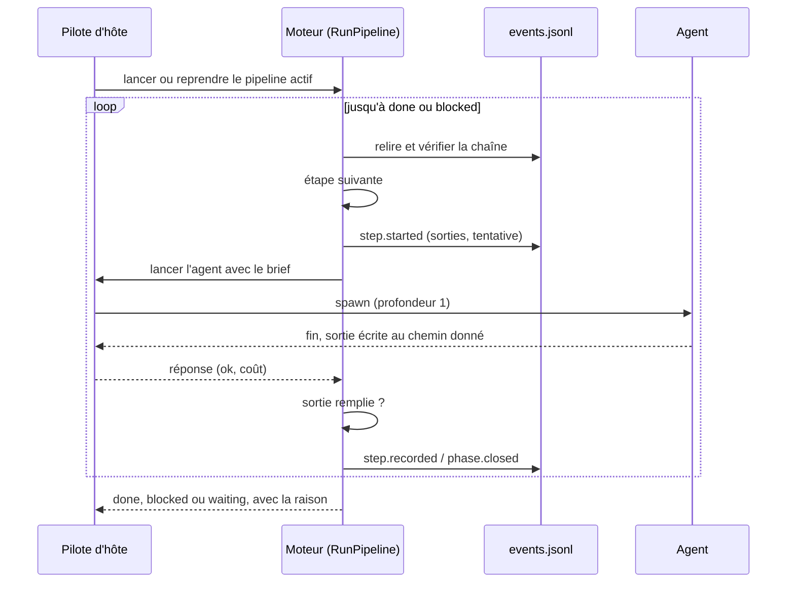

# Architecture

> Un seul moteur décide de tout ; chaque hôte le fait tourner avec ce qu'il sait faire. Seul
> le pilote lance des agents, et aucun agent n'en lance un autre.

## Le problème à résoudre

SKRAFT doit faire le même pipeline sous Claude Code, GitHub Copilot CLI et VS Code, sur
Windows et macOS. Ces hôtes n'offrent pas les mêmes moyens : l'un lance un agent par
`$.agent.spawn`, l'autre par `ctx.agent`, le troisième n'a ni l'un ni l'autre.

En v1, l'ordre des phases et les verdicts vivaient dans la prose d'un agent orchestrateur.
Chaque hôte et chaque modèle la suivaient à leur façon. La V2 sort ces décisions de la prose
et les met dans du code testé, le même partout.

## Le moteur à cas d'usage

Le **moteur** (`plugins/skraft-framework/engine/`) est découpé en quatre couches.

| Couche | Contenu | Ce qu'elle peut importer |
| --- | --- | --- |
| `domain/` | Règles pures : étape suivante, sorties attendues, état dérivé du journal, configuration, gates | `domain/` seulement |
| `application/` | Cas d'usage : `Init`, `RunPipeline`, `Observe`, `RunGate`, `Doctor`… et leurs contrats (lancer un agent, montrer la progression, lire et écrire le journal) | `domain/` et `application/` |
| `infrastructure/` | Fichiers, git, processus, horloge, empreintes | `domain/`, `infrastructure/` et les contrats de `application/ports/` ; jamais un pilote ni un cas d'usage |
| `drivers/` | Un pilote par hôte : `claude-mod/`, `copilot-workflow/`, `copilot-sdk/`, `cli/` | Ce qu'il assemble ; jamais un autre pilote |

Un **cas d'usage** est une action complète du point de vue de l'utilisateur : démarrer un
pipeline, le faire avancer, observer son état, lancer les gates. Il décide ; il ne fait
aucune entrée-sortie lui-même.

`domain/` et `application/` n'utilisent ni modules `node:`, ni `process`, ni
`child_process`, ni `$`. C'est la condition pour que le même code soit chargé par le module
du mod Claude Code, qui n'a pas Node, et par le workflow Copilot, qui l'a. Une règle
d'architecture testée l'impose.

> « Good architecture makes the system easy to understand, easy to develop, easy to maintain, and easy to deploy. »
> — Martin, R. C., *Clean Architecture*, 2017.

## Les pilotes d'hôte

Un **pilote d'hôte** relie le moteur à un hôte. Il fournit au moteur de quoi lancer un agent
et montrer la progression, puis appelle le cas d'usage. Il ne décide ni de l'ordre, ni du
verdict, ni de l'avancement.

| Pilote | Lance les agents par | Montre le run | Point d'entrée | Disponible |
| --- | --- | --- | --- | --- |
| Mod Claude Code | `$.agent.spawn` | Panneau « Skraft » | `/skraft …`, `/skraft decide …`, outil `mcp__skraft__run_pipeline` | Oui |
| Workflow dynamique Copilot CLI | `ctx.agent`, rejoué à la reprise | Journal du workflow (`ctx.log`) | workflow `skraft-pipeline`, outil `skraft_decide` | Oui |
| VS Code, SDK Copilot | Le CLI Copilot lancé sans interface, qui fait tourner le même workflow | Le terminal | `engine/drivers/copilot-sdk/skraft-run.mjs` | Oui |
| VS Code, repli | L'agent orchestrateur, sur l'étape rendue par `skraft next` | `WORKFLOW.md`, `skraft status` | `skraft next` / `skraft record` | Oui |
| Ligne de commande `skraft` | — (ne lance pas d'agent ; `next` les confie à l'orchestrateur) | Texte ou JSON | `init`, `status`, `report`, `decide`, `gate`, `doctor`, `workflow`, `journal adopt`, `publish` | Oui |

Dans le mod, chaque appel à `$` reste une fonction d'une ligne dans le module enregistré.
Le reste du pilote reçoit ces fonctions et se teste sans Claude Code.

Comme [Skwad](https://github.com/Kochava-Studios/skwad), le run montre l'agent au travail :
`skraft status` et le panneau Skraft affichent l'étape ouverte, son agent et sa tentative ; le
panneau dessine aussi le graphe du workflow avec verdicts, gates et coût, et répond à une
question en attente par un bouton. `skraft doctor` dit lequel des deux pilotes VS Code tourne
et pourquoi.

Quand le moteur a besoin d'un humain (ratifier les ADR, consentir à la publication des
visuels, réparer la machine), il le demande au pilote. Le mod ouvre une boîte de dialogue
`$.ui.ask` ; le workflow Copilot écrit la question dans son journal et se met en pause
durable par `ctx.pause`. La réponse est journalisée, quel que soit l'hôte. Sans réponse, le
run **attend** (fail closed) ; `skraft decide`, `/skraft decide` ou l'outil `skraft_decide`
enregistrent la réponse plus tard, et le run suivant l'applique sans relancer d'agent. Le
moteur décide de la question à poser et de l'effet de la réponse ; le pilote ne fait que la
transmettre.

> **À venir.** Un Canvas Copilot qui dessine la même vue : pas encore livré.

## La boucle pilote ↔ moteur

Le pilote appelle `RunPipeline`. Le moteur relit le journal, calcule l'étape suivante,
pré-crée la sortie attendue depuis son template, journalise le lancement, puis demande au
pilote de lancer l'agent. Quand l'agent rend la main, le moteur vérifie lui-même la sortie
et journalise le résultat avant de décider de la suite.

Une sortie absente déclenche une nouvelle tentative avec la liste des chemins manquants,
jusqu'à trois, puis un arrêt nommé `missing-outputs` ; le même échec deux fois arrête le run
plus tôt. Un agent que l'hôte ne peut pas lancer arrête le run sur
`agent-unavailable` sans consommer la tentative. Une étape que la machine ne peut pas
exécuter (programme introuvable, Git en échec) n'arrête pas le run : le moteur demande à un
humain de la réparer puis `RETRY`, ou `ABORT`.

## Profondeur 1

Seul le pilote lance des agents. Aucun agent ne lance un autre agent, lentilles de revue
comprises. En v1, le reviewer de DELIVER lançait ses lentilles (profondeur 2) : un coût de
contexte en plus, des contrôles dupliqués, et un comportement qui dépendait de l'hôte.

À profondeur 1, le pilote peut lancer plusieurs agents en parallèle quand l'hôte le permet,
et le moteur voit chaque lancement dans son journal.

Un nœud de revue suit ce chemin. Le pilote lance les lentilles du nœud en parallèle ; chacune
répond par des findings typés. Le pilote lance ensuite `finding-refuter` sur chaque finding
blocker, high et medium, sur les entrées de sa lentille. Quand une seule lentille trouve de
quoi renvoyer le travail, le réfuteur juge ses findings avec toutes les entrées de la revue et
les lentilles qui ont passé (la Dissent Rule de la V1) : il retient ou écarte chacun et dit
pourquoi. Le moteur calcule le verdict sur ce qui reste : `APPROVED`
poursuit, `NEEDS_REWORK` renvoie les findings à l'agent de la phase, une lentille sans
réponse exploitable bloque la revue.

## Les contrôles dans le code

Ce qu'un agent pourrait oublier, le moteur le vérifie.

| Contrôle | Où | Disponible |
| --- | --- | --- |
| Ordre des phases | Domaine du moteur, depuis le graphe du workflow | Oui |
| Sorties attendues pré-créées et vérifiées | `RunPipeline` | Oui |
| Intégrité du journal | Chaîne de hachage, vérifiée à chaque lecture | Oui |
| Gates (build, format, lint, test, architecture, coverage, mutation) | `RunGate`, commandes de `skraft-config.json` | Oui, comme étapes de DELIVER et par `skraft gate` |
| Droits d'écriture | Diff git après chaque étape | Oui |
| Commits rouges et verts du TDD | Chaque commit rouge rejoué après l'étape | Oui |
| ADR non publiés modifiés sur place, ratifiés seulement par un humain | Contrôle des ADR après chaque tentative (`adr-lifecycle`), nœud question `adr` | Oui |
| Verdict de revue | Findings typés, réfutation, verdict calculé | Oui (DESIGN, DISTILL, DELIVER) |

## Alternatives écartées

**Un moteur autonome, serveur ou binaire.** Un exécuteur hors de l'hôte piloterait les
agents de l'extérieur. Il lui faudrait ses propres accès aux fournisseurs de modèles, et
SKRAFT ne vivrait plus dans l'hôte du développeur. La V2 garde l'exécution dans l'hôte et
met dans le moteur ce qu'un tel exécuteur apporterait : nœuds typés, « fini » prouvé par une
commande, boucles plafonnées, classes d'échec, journal d'événements.

**Une boucle conduite par l'agent comme pilote principal.** Un agent appelle `skraft next`,
fait l'étape, appelle `skraft record`. Cela marche partout, mais coûte un aller-retour par
étape, met les lentilles en séquence et laisse l'avancement à un modèle qui peut s'écarter
de la boucle. Elle reste seulement comme repli sous VS Code, où le moteur refuse tout
`next` tant que l'étape précédente n'est pas enregistrée.

**Garder les hooks.** Voir [Garde-fous : du hook au moteur]({{ "/fr/explanation/hooks" | relative_url }}).

## Pour aller plus loin

- [État et reprise]({{ "/fr/explanation/hve-core" | relative_url }}) — le journal chaîné.
- [Clean Architecture]({{ "/fr/explanation/clean-architecture" | relative_url }}) — la règle de dépendance appliquée au moteur.
- [Référence : la ligne de commande skraft]({{ "/fr/reference/cli" | relative_url }}).
- [Référence : dossier de suivi et journal]({{ "/fr/reference/run-journal" | relative_url }}).

## Sources

- Martin, R. C., *Clean Architecture*, 2017.
