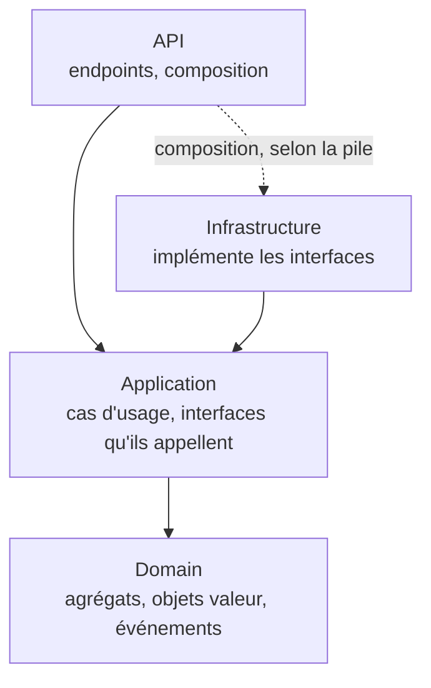
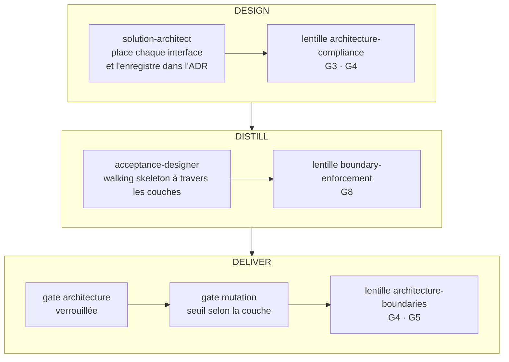



# Clean Architecture et architecture hexagonale

> Le métier au centre, les détails techniques à la périphérie, et des dépendances qui pointent
> toujours vers l'intérieur. skraft ne se contente pas de le recommander : une gate le vérifie.

## Le problème : un métier otage de ses outils

Quand une règle métier importe le client HTTP, l'ORM ou le framework web, elle ne peut plus
être testée sans eux, ni changer sans eux. Changer de base de données devient une réécriture ;
tester une règle de remise demande de démarrer un serveur. Pire, la logique fuit dans les
contrôleurs et les requêtes SQL, et personne ne sait plus où elle vit.

Deux réponses, nées à dix ans d'écart, disent la même chose avec des mots différents.

## L'architecture hexagonale : des ports et des adaptateurs

Alistair Cockburn propose de placer l'application au centre d'un hexagone et de la faire
communiquer avec le monde extérieur uniquement par des **ports** — des interfaces définies par
l'application, selon ses besoins — sur lesquels se branchent des **adaptateurs** propres à
chaque technologie ([Cockburn, 2005]({{ cites }}#cite-cockburn-hexagonal-2005)). Il distingue
deux côtés : celui qui **pilote** l'application (une interface utilisateur, un test
automatisé) et celui qu'elle **pilote** (une base de données, un service externe). L'objectif
annoncé est de pouvoir faire tourner l'application aussi bien par un utilisateur que par des
tests, sans interface ni base réelles.

Le mot *adaptateur* reprend le patron Adapter du « Gang of Four » : convertir une interface en
celle qu'attend le client ([Gamma et al., 1994]({{ cites }}#cite-gamma-patterns-1994)).

## La Clean Architecture : la règle de dépendance

Robert C. Martin présente la Clean Architecture comme une synthèse de plusieurs architectures
antérieures, dont l'hexagonale, qui partagent un même objectif : séparer les préoccupations et
rendre le cœur indépendant des frameworks, de l'interface, de la base de données et de tout
agent externe ([Martin, 2017]({{ cites }}#cite-martin-cleanarch-2017)). Il en tire une seule
règle, la **règle de dépendance** : les dépendances du code source pointent uniquement vers
l'intérieur. Un cercle intérieur ne connaît aucun nom déclaré dans un cercle extérieur. Quand
le flux d'exécution doit sortir — un cas d'usage qui enregistre —, il passe par une interface
déclarée à l'intérieur et implémentée à l'extérieur : c'est l'inversion de dépendance.

skraft adopte ce vocabulaire. Les skills `clean-architecture-<stack>` qu'il applique aux projets
interdisent même les dossiers `ports` ou `adapters` : le code se range par couche et par
fonctionnalité. L'idée hexagonale reste entière ; seuls les noms changent.

| Idée hexagonale | Dans un projet livré par skraft |
| --- | --- |
| L'application au centre | Domain (agrégats, objets valeur, événements) et Application (cas d'usage) |
| Port côté piloté | Interface déclarée par Application, ou par Domain pour le repository d'un agrégat |
| Adaptateur côté piloté | Implémentation dans Infrastructure (base, broker, client HTTP) |
| Adaptateur côté pilotant | API : l'endpoint traduit une requête en appel de cas d'usage |
| Test sans base ni interface | Test d'acceptation au niveau du cas d'usage, doublures sur les seules passerelles sortantes |

## Les couches de skraft

*Figure 1 — La règle de dépendance appliquée aux quatre couches de skraft : chaque flèche est
une dépendance autorisée, et aucune ne sort de Domain ; la flèche pointillée est la composition
de l'application, qui passe par l'Infrastructure selon la pile. Adapté des cercles concentriques de
Martin (2017) ; les noms de couches sont ceux du skill `architecture-patterns`.*

- **Domain** ne dépend de rien. Les règles métier y vivent, et rien n'y importe un framework.
- **Application** dépend de Domain. Elle orchestre les cas d'usage et déclare les interfaces
  qu'elle appelle (repository, passerelle, publication), sans type de framework comme
  `DbContext` ou `IQueryable`.
- **Infrastructure** implémente ces interfaces. C'est là que vit l'entrée-sortie réelle.
- **API** reçoit les requêtes et les traduit en cas d'usage ; un contrôleur ne touche jamais un
  objet du domaine ni un repository. La composition de l'application (qui construit quoi) se fait
  à la racine du programme, différemment selon la pile.

Le cas d'usage est la seule porte d'entrée : il rejoint la *Service Layer* de Fowler, qui
définit la frontière d'une application et ses opérations disponibles
([Fowler, 2002]({{ cites }}#cite-fowler-peaa-2002)). Les règles précises par pile sont dans les
skills `clean-architecture-<stack>` et dans [la référence des patterns]({{ "/fr/reference/patterns" | relative_url }}).

## Comment skraft fait respecter la règle

*Figure 2 — Les points de contrôle de la règle de dépendance dans le pipeline, d'après
`pipeline.skraft.dot`, `review.skraft.dot` et les lentilles citées.*

**En DESIGN, on décide où vit chaque interface.** Le `solution-architect` place l'interface d'un
repository dans Domain quand elle rend l'agrégat et garde ses invariants, dans Application pour
une entité sans invariant ou un contrat de lecture, jamais dans Infrastructure ; l'ADR de
l'agrégat note ce choix et sa raison. La lentille `architecture-compliance` refuse un contrat de
Domain ou d'Application qui nomme un type d'Infrastructure ou d'API (G3) et une interface rangée
dans Infrastructure (G4). C'est la même lentille qui vérifie le modèle de
[Domain-Driven Design]({{ "/fr/explanation/domain-driven-design" | relative_url }}).

**En DISTILL, on trace le chemin complet.** L'`acceptance-designer` écrit pour chaque scénario
sa frontière de cas d'usage, sa couche et son type de doublure, et commite des tests
d'acceptation rouges avec le squelette qu'ils appellent. La lentille `boundary-enforcement`
exige au moins un walking skeleton par flux (G8) : la plus fine tranche qui traverse toutes les
couches et prouve que le câblage existe ([Freeman & Pryce, 2009]({{ cites }}#cite-freeman-goos-2009)).
Voir [Walking Skeleton]({{ "/fr/explanation/deep-dive/walking-skeleton" | relative_url }}).

**En DELIVER, une gate le vérifie à chaque passage.** `architecture` est l'une des gates du nœud
verrouillé de DELIVER, entre `test` et `coverage`. Sa commande, déclarée par composant dans
`skraft-config.json`, lance les tests d'architecture du projet : un filtre `ArchitectureTests`
en .NET, `import-linter` en Python, un script `architecture-gate.mjs` en TypeScript, selon le
skill `quality-gates-<stack>` du composant. En revue, la lentille `architecture-boundaries`,
obligatoire dans `review.skraft.dot`, contrôle que les dépendances pointent vers l'intérieur
(G5).

**Les doublures se posent aux frontières, pas au centre.** Gerard Meszaros a donné son nom à la
*doublure de test* et en distingue les formes, dont le *fake* — une implémentation simplifiée,
en mémoire ([Meszaros, 2007]({{ cites }}#cite-meszaros-xunit-2007)). skraft n'en accepte que
sur les interfaces sortantes : aucune doublure d'un type Domain ou Application dans un test
unitaire (lentille `architecture-boundaries`, G4) ; des mocks ou des fakes en mémoire écrits à
la main sur les passerelles sortantes — repository, service externe — (skill
`clean-architecture-testing`) ; des conteneurs réels ou des mocks de contrat pour tester
l'Infrastructure.

**Le seuil de mutation suit la couche.** La gate `mutation` classe chaque fichier par le nom de
ses dossiers : un dossier qui finit par `domain` ou `application` est le cœur, jugé à 100 % ;
tout le reste — API, Infrastructure — est la frontière, jugée à 80 % (skill
`skraft-quality-bar`). La règle de dépendance décide donc aussi de l'exigence de test.

## skraft s'applique la règle à lui-même

Le moteur de skraft est construit de la même façon : `domain/` n'importe que `domain/`,
`application/` déclare ses contrats dans `application/ports/`, `infrastructure/` les implémente,
et chaque pilote d'hôte joue le rôle d'un adaptateur côté pilotant. Un test d'architecture du
dépôt fait échouer toute dépendance interdite. Là, le mot *port* est resté. Voir
[Architecture]({{ "/fr/explanation/architecture" | relative_url }}).

## Les compromis

- **Plus d'indirection.** Une interface et sa traduction entre couches coûtent du code. skraft
  le limite : Application ne déclare une interface que là où elle appelle l'extérieur.
- **Un investissement initial.** Le walking skeleton et les tests d'architecture précèdent la
  première fonctionnalité ; ils évitent que la structure se dégrade sans que personne le voie.
- **Des tests rapides au centre, réels à la périphérie.** Le cœur se teste en mémoire, en
  millisecondes ; l'Infrastructure se teste contre de vrais conteneurs ou des mocks de contrat,
  plus lentement mais sans illusion.

## Pièges et contresens

- **Ranger par type technique** (`Repositories`, `Services`) : chaque couche se range par
  fonctionnalité, et une fonctionnalité n'importe pas le code applicatif d'une autre.
- **Laisser fuir un type de framework** dans une interface d'Application : le cœur redevient
  dépendant de l'outil qu'il devait ignorer.
- **Croire qu'une revue suffit** : le skill `clean-architecture-testing` le dit sans détour,
  la discipline des couches s'impose par la CI, pas par la relecture.

## Pour aller plus loin

- [Domain-Driven Design]({{ "/fr/explanation/domain-driven-design" | relative_url }}) — ce qui
  vit dans Domain.
- [Software craftsmanship]({{ "/fr/explanation/software-craftsmanship" | relative_url }}) — pourquoi
  les gates ne se négocient pas.
- [Outside-In TDD]({{ "/fr/explanation/deep-dive/outside-in-tdd" | relative_url }}),
  [la phase DELIVER]({{ "/fr/explanation/pipeline/deliver" | relative_url }}),
  [les gates]({{ "/fr/reference/gates" | relative_url }}) et
  [le glossaire]({{ "/fr/reference/glossary" | relative_url }}).

## Sources

- [Cockburn, A. *Hexagonal Architecture*, 2005.]({{ cites }}#cite-cockburn-hexagonal-2005)
- [Fowler, M. *Patterns of Enterprise Application Architecture*, 2002.]({{ cites }}#cite-fowler-peaa-2002)
- [Freeman, S. & Pryce, N. *Growing Object-Oriented Software, Guided by Tests*, 2009.]({{ cites }}#cite-freeman-goos-2009)
- [Gamma, E., Helm, R., Johnson, R. & Vlissides, J. *Design Patterns*, 1994.]({{ cites }}#cite-gamma-patterns-1994)
- [Martin, R. C. *Clean Architecture*, 2017.]({{ cites }}#cite-martin-cleanarch-2017)
- [Meszaros, G. *xUnit Test Patterns*, 2007.]({{ cites }}#cite-meszaros-xunit-2007)
