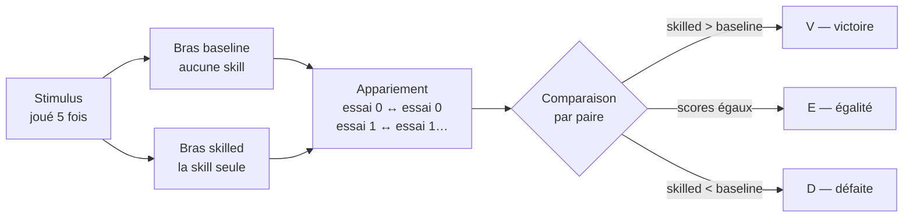
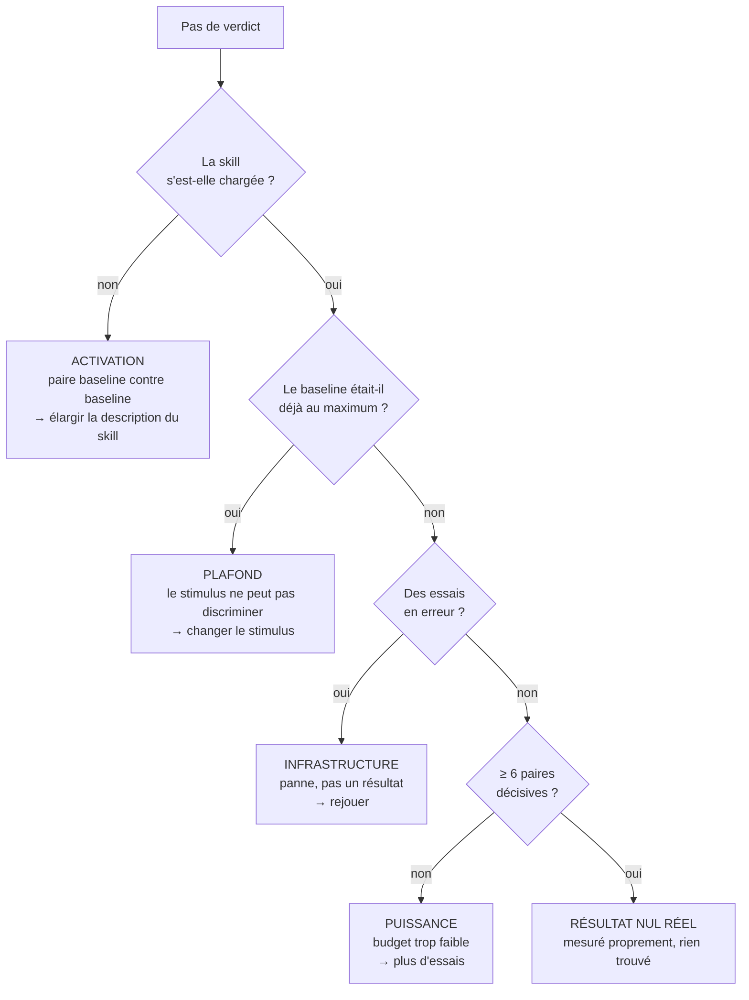

# Lire un verdict d'évaluation

> Un verdict d'évaluation tient en une ligne : `9V/4E/2D (p=0.065)`. Cette page
> déplie cette ligne, chiffre par chiffre, sur un cas réel du dépôt.

---

## 1. Le dispositif : deux bras, rien d'autre ne change

Chaque stimulus est joué **deux fois sur la même entrée** : une fois sans aucune
skill montée, une fois avec la seule skill testée. Tout le reste est identique —
même modèle, même juge, même instant.



L'appariement essai par essai est ce qui rend la mesure exploitable : il annule
l'essentiel de la variance propre au modèle. Ce qui reste est attribuable à la
skill.

---

## 2. D'un lot d'essais à trois nombres

Prenons `adr-eligibility-gate`, mesurée sur 3 stimuli × 5 essais = **15 paires** :

> ℹ️ **9 victoires · 4 égalités · 2 défaites**

---

## 3. Les égalités sont jetées — et c'est le point clé

Une égalité ne dit **rien sur la direction**. Elle n'est ni un argument pour, ni
un argument contre. Le test les met de côté.

```
15 paires au départ

  V V V V V V V V V   E E E E   D D
  └───── 9 ─────┘   └── 4 ──┘  └2┘
                        ▲
                        │ jetées : aucune information de direction
                        ▼
Il reste 11 paires DÉCISIVES  →  9 pour, 2 contre
```

Le vocabulaire compte : ces 11 paires sont les **paires discordantes**. C'est la
seule chose que le test des signes regarde.

---

## 4. La seule question posée

> **Si la skill ne faisait absolument rien, chaque paire décisive serait un pile
> ou face. À quelle fréquence une pièce équilibrée lancée 11 fois donne-t-elle un
> écart au moins aussi déséquilibré que 9 contre 2 ?**

C'est un dénombrement, pas une formule. Sur les 2¹¹ = **2048** séquences
également probables :

```
 faces │ combien de façons │ distribution
───────┼───────────────────┼──────────────────────────────────────────────
     0 │       1           │ █                                    ← compté
     1 │      11           │ █                                    ← compté
     2 │      55           │ █████                                ← compté
     3 │     165           │ ███████████████
     4 │     330           │ ██████████████████████████████
     5 │     462           │ ██████████████████████████████████████████
     6 │     462           │ ██████████████████████████████████████████
     7 │     330           │ ██████████████████████████████
     8 │     165           │ ███████████████
     9 │      55           │ █████                                ← compté
    10 │      11           │ █                                    ← compté
    11 │       1           │ █                                    ← compté
───────┴───────────────────┴──────────────────────────────────────────────
                                  les deux queues : 134 sur 2048 = 0,065
```

**p = 0,065.** Ça se lit : *« une pièce qui ne fait rien produit un résultat au
moins aussi tranché 6,5 % du temps »*.

Le seuil (l'*alpha*) est **0,05**. 6,5 % > 5 % → pas significatif. De très peu.

> ⚠️ **`p` n'est pas la probabilité que la skill marche.** Et `1 − p` n'est pas un
> niveau de confiance. `p` répond à une seule question : *ce résultat est-il
> difficile à expliquer par le hasard ?*

---

## 5. Pourquoi le plancher est à six paires décisives

| Paires décisives | `p` si **tout** est gagné | |
|---|---|---|
| 3 | 0,250 | ❌ |
| 4 | 0,125 | ❌ |
| 5 | 0,0625 | ❌ |
| **6** | **0,031** | ✅ |
| 7 | 0,016 | ✅ |
| 8 | 0,008 | ✅ |

Avec 5 paires décisives, même un sans-faute **5V/0D** donne 0,0625 — au-dessus du
seuil. Une pièce donne cinq faces d'affilée assez souvent pour que ça ne prouve
rien.

> ℹ️ **En dessous de six paires décisives, aucun résultat ne peut conclure, si parfait
> soit-il.** C'est pourquoi le verdict est alors `inconclusive` et non « pas
> d'amélioration » : on ne reproche pas à la skill un budget qui ne pouvait rien
> trancher, dans un sens comme dans l'autre.

### Ce que coûte chaque défaite

Le tableau ci-dessus suppose un sans-faute. Dès qu'une paire part dans l'autre
sens, la barre monte — et elle monte vite :

| Défaites | Victoires minimum | Paires décisives | `p` atteint |
|---|---|---|---|
| 0 | **6** | 6 | 0,031 |
| 1 | **8** | 9 | 0,039 |
| 2 | **10** | 12 | 0,039 |
| 3 | **12** | 15 | 0,035 |
| 4 | **13** | 17 | 0,049 |

```
   0 défaite  ████████████ 6 victoires
   1 défaite  ████████████████ 8
   2 défaites ████████████████████ 10
   3 défaites ████████████████████████ 12
   4 défaites ██████████████████████████ 13
              └── chaque défaite coûte environ deux victoires de plus ──┘
```

**Une défaite ne s'annule pas avec une victoire, elle en coûte deux.** C'est la
nature du test : une paire qui part dans l'autre sens n'enlève pas seulement un
point au décompte, elle rend l'ensemble moins déséquilibré, donc plus banal pour
une pièce.

`adr-eligibility-gate` avait 9 victoires et **2 défaites**. Le seuil pour deux
défaites est de 10 victoires. **Il a manqué exactement une victoire** — une seule
paire de plus dans le bon sens et le verdict basculait.

---

## 6. Le point aveugle : l'ampleur

Le test des signes ne voit **que la direction, jamais la taille de l'écart**.

```
Une victoire de 0,001  ─┐
                        ├─→  toutes deux comptées « V », indistinguables
Une victoire de 0,900  ─┘
```

Or `adr-eligibility-gate` est passée de **0,593 à 0,911** — un des plus gros
mouvements mesurés. Le test des signes est aveugle à ça.

C'est le rôle du **test de rang** (Wilcoxon signé) : il classe les paires par
ampleur d'écart et pèse chacune. Sur la même mesure il donne **p = 0,012**,
largement sous le seuil.

| | Question posée | `adr` |
|---|---|---|
| **Test des signes** | La skill gagne-t-elle **souvent** ? | p = 0,065 ❌ |
| **Test de rang** | La skill gagne-t-elle **de beaucoup** ? | p = 0,012 ✅ |

Les deux doivent passer pour qu'un verdict soit crédible. Exiger l'accord plutôt
que l'un ou l'autre évite que deux tirages sur la même question doublent le taux
de faux positifs sur le champ qui bloque une fusion.

---

## 7. Les autres raisons qu'un verdict ne conclue pas

Un `inconclusive` n'est pas toujours un problème de budget. Quatre causes
distinctes, quatre actions opposées :



**Ajouter des essais ne répare que la dernière branche.** Sur une skill qui ne
s'active pas, doubler le budget double simplement le nombre de paires jetées.

---

## 8. Le tableau de lecture

Les évaluations de skill utilisent `no-improvement` pour un résultat nul mesuré.
Les suites agent sont mono-bras, donc elles n'émettent jamais `no-improvement` ;
elles peuvent émettre `flaky` quand un run conclusif casse au moins un essai,
tandis que chaque scénario reste au moins à deux tiers de conformité.

| Verdict | Ce que ça veut dire | Ce qu'on en fait |
|---|---|---|
| ✅ `pass` | Amélioration crédible : les deux tests passent, plus de victoires que de défaites | Rien — la skill gagne sa place |
| ⚠️ `flaky` | Suite agent seulement : au moins un essai casse, mais chaque scénario reste au moins à 2/3 | Ouvrir le replay et les checks qui ont cédé ; indicatif, jamais bloquant |
| 🔴 `regression` | Dégradation crédible pour une skill, ou scénario agent sous 2/3 | **Bloque la fusion pour les skills seulement.** Les lignes agent restent indicatives |
| ➖ `no improvement` | Mesuré proprement, l'écart ne se distingue pas du hasard | Regarder l'ampleur et l'activation avant de conclure |
| ⚪ `inconclusive` | La mesure n'a pas pu décider | Lire la cause : essais en erreur, non appariés, ou budget trop faible |

Un résultat absent ou fragile n'est **jamais** affiché comme un succès.

---

## 9. Derrière les nombres : ce que la skill a changé {#replay}

Le verdict compte des paires ; il ne dit pas *ce que* l'agent a fait autrement. Pour le voir, il faut
relire les deux trajectoires d'une même paire. Prenons le run planifié du 28 septembre 2026
d'`outside-in-tdd`, sur `claude-sonnet-5` :


*Figure 1 — La carte qualité de ce run : `10V/12E/0D`, verdict `pass`, mais la skill ne s'est chargée
que dans 14 des 28 essais où elle était attendue.*

Le verdict de ce run précise : `[14 pair(s) excluded: the skill never activated on the skilled run]`.
Une paire où la skill ne s'est pas chargée compare deux baselines : elle ne dit rien de la skill, et
le test l'écarte (la branche ACTIVATION de la section 7). Le rejeu est l'endroit où cette activation
se voit.

Le stimulus « Reach a failure that witnesses the missing behaviour » demande d'amener le dépôt juste
assez loin pour démontrer qu'un résultat approuvé (un client Gold paie 95,00 pour 100,00) manque
encore, puis de s'arrêter. Voici l'essai 1 des deux bras, dans le rejeu AGENTVIZ :


*Figure 2 — Baseline : l'agent explore avec `bash` (8 appels), constate l'absence du calcul et la
décrit. Aucun test n'échoue pour en témoigner.*

Son rapport affirme aussi que « `dotnet test` passes (2/2) ». Le rejeu montre qu'aucun des huit
appels n'a lancé `dotnet test` : l'affirmation n'a pas été observée, elle a été supposée.


*Figure 3 — Avec la skill : l'agent charge `outside-in-tdd` (`skill`, 1 appel), écrit un test
d'acceptation à la frontière de l'application (`create`), le lance, et s'arrête sur son échec de
compilation : le rouge qui témoigne du comportement manquant.*

Les deux agents concluent que le résultat manque. Seul le second laisse une **preuve exécutable** :
un test qui échoue et passera le jour où le calcul existera. C'est exactement la différence que la
rubrique note, et que la ligne `10V/12E/0D` résume sans la montrer.

Le rejeu ne remplace pas le verdict : une paire est une anecdote, quinze paires sont une mesure. Il
sert à vérifier que la mesure mesure bien ce qu'on croit : que la skill s'est chargée, et que l'écart
vient du comportement qu'elle enseigne plutôt que d'un détail du stimulus. Les vues de santé, de
coût et de comparaison chiffrée d'AGENTVIZ parlent de tokens et d'erreurs d'outils ; elles ne disent
rien de ce comportement, et cette page ne s'en sert pas.

---

## Voir aussi

- [Évaluer un skill]({{ "/fr/how-to/evaluate-a-skill" | relative_url }}) — la procédure complète, et comment ouvrir le rejeu
- [Proposer un pattern ou corriger la documentation]({{ "/fr/how-to/contributing" | relative_url }})
- [Tableau de bord]({{ "/dashboard/" | relative_url }}) — les verdicts et leur tendance
