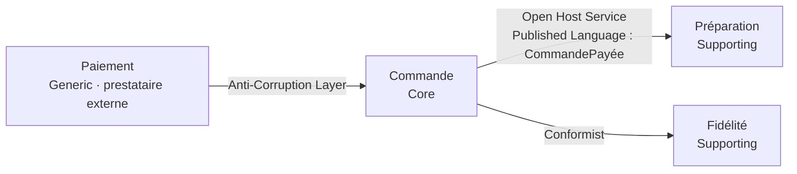
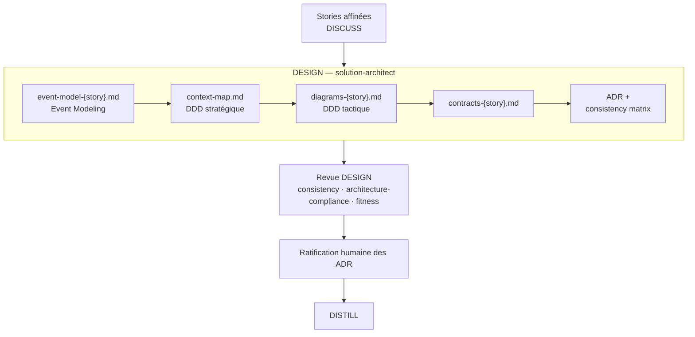



# Domain-Driven Design — du langage du métier au code

> Le logiciel vaut ce que vaut sa compréhension du métier. Le DDD donne les outils pour garder
> cette compréhension intacte, de la story jusqu'au code ; skraft vérifie qu'elle ne se perd
> pas en route.

## Le problème : le modèle se perd en traduction

Le métier parle de « commande payée », la story de « commande validée », le code de
`OrderStatus = 2`. Chaque traduction est une occasion de se tromper, et l'erreur ne se voit
qu'en production. Eric Evans situe la complexité d'un logiciel d'abord dans son **domaine** : la
technique se maîtrise, le modèle du métier se découvre et doit rester partagé entre experts et
développeurs ([Evans, 2003]({{ cites }}#cite-evans-ddd-2003)).

Avec des agents, le risque grandit : chaque agent travaille dans son propre contexte et peut
renommer un concept sans que personne ne le remarque. skraft répond en faisant du DDD un fil
qui traverse les phases, avec un contrôle à chaque passage.

## Le langage omniprésent

Le premier outil d'Evans est le **langage omniprésent** (*ubiquitous language*) : un seul
vocabulaire, celui des experts du métier, employé tel quel dans les conversations, les
documents, les tests et le code. Dans skraft, ce langage est écrit tôt puis contrôlé à chaque
phase.

- **DISCUSS** l'écrit. Les stories sont affinées selon INVEST
  ([Wake, 2003]({{ cites }}#cite-wake-invest-2003) ; lentille `planning-invest-lens`, G1) ; la
  Definition of Ready exige au moins trois exemples du domaine avec des valeurs réelles
  (`planning-dor-lens`, G7), et aucun critère d'acceptation ne doit admettre deux lectures par
  un expert du métier (`planning-ac-quality-lens`, G4).
- **DESIGN** le fige. Le modèle d'événements, la context map, les diagrammes et les contrats
  doivent nommer les mêmes contextes, agrégats, commandes, événements et champs que la story
  (lentille `consistency`, C1).
- **DISTILL** le rend exécutable. Chaque terme d'un Given/When/Then vient du vocabulaire de la
  story, sans nom de classe ni de framework (lentille `business-alignment`, G3) ; quand le
  projet tient un lexique métier, il sert de référence.
- **DELIVER** le garde dans le code. Le `software-engineer` vérifie que ses tests parlent le
  langage du métier (skill `craft-discipline`, C7), et la lentille `cold-reader` le contrôle
  dans le code et les tests (G11).

## Le bounded context : une frontière de langage

Un même mot change de sens d'un sous-ensemble du métier à l'autre. Plutôt que de forcer un
modèle unique, Evans délimite des **bounded contexts** : à l'intérieur, chaque terme a un seul
sens ; à la frontière, on traduit ([Evans, 2003]({{ cites }}#cite-evans-ddd-2003)). Le skill
`architecture-patterns` en tire les signaux qu'utilise le `solution-architect` : même mot, sens
différent ; terme qui doit être traduit en passant d'un module à l'autre ; équipes, rythmes de
changement ou stockages différents. La frontière est linguistique, pas technique : un contexte
peut couvrir plusieurs services, mais un service ne couvre jamais plusieurs contextes — c'est
dans les bounded contexts que Sam Newman recommande lui aussi de chercher les frontières des
microservices ([Newman, 2021]({{ cites }}#cite-newman-microservices-2021)).

Chaque contexte reçoit une classe de sous-domaine : **Core** (l'avantage concurrentiel),
**Supporting** (nécessaire sans être différenciant) ou **Generic** (une commodité qu'on achète
ou réutilise). Vlad Khononov fait de cette classification le point de départ des choix de
conception ([Khononov, 2021]({{ cites }}#cite-khononov-lddd-2021)) ; skraft en fait la mesure
de la profondeur de DDD à appliquer : modèle riche pour le Core, patterns standards ailleurs.

Le `solution-architect` écrit tout cela dans `context-map.md`, la sortie que le moteur attend de
lui en DESIGN (`details/{date}/context-map.md`). Scinder ou fusionner un contexte exige un ADR,
et la lentille `fitness` refuse un contexte qu'aucune story ne demande (G9).

## La context map : nommer chaque relation

Deux contextes qui échangent ont une relation, et cette relation a un prix. Evans en nomme les
formes — Conformist, Anti-Corruption Layer, Shared Kernel, Open Host Service, Published
Language — et sa *DDD Reference* y ajoute Partnership
([Evans, 2003]({{ cites }}#cite-evans-ddd-2003) ;
[Evans, 2015]({{ cites }}#cite-evans-dddref-2015)). La context map les rend visibles.

skraft ajoute trois règles de choix, dans le skill `architecture-patterns`, à appliquer avant
d'étiqueter une flèche :

1. un aval **Core** n'est jamais Conformist : il se protège par une Anti-Corruption Layer ;
2. consommer un contrat publié et stable n'est pas Conformist : c'est Open Host Service +
   Published Language ;
3. une copie ou une traduction locale est une Anti-Corruption Layer, aussi simple soit-elle.

*Figure 1 — Une context map d'illustration sur le [fil rouge]({{ "/fr/explanation/pipeline/fil-rouge" | relative_url }})
(commande Starbucks) ; chaque flèche va du contexte amont au contexte aval. Les noms de
relations viennent d'Evans (2003, 2015) ; le choix de chacune suit les trois règles du skill
`architecture-patterns` : la Commande, Core, se protège du prestataire de paiement par une ACL, la Préparation consomme un événement publié, la Fidélité,
Supporting, peut se conformer.*

La lentille `architecture-compliance` de la revue DESIGN exige que chaque relation entre
contextes porte un pattern explicite et qu'aucune dépendance ne reste non déclarée (G6). Une
ACL exige toujours un ADR, et cet ADR doit citer une force admissible et évaluer l'option « sans
le pattern » (lentille `fitness`, G11).

## Du stratégique au tactique

La conception **stratégique** trace les frontières ; la conception **tactique** modèle
l'intérieur d'un contexte. skraft impose l'ordre : on ne conçoit tactiquement qu'à l'intérieur
d'un contexte déjà défini. Le skill `architecture-patterns` compose les patterns de l'extérieur
vers l'intérieur : Event Modeling, DDD stratégique, DDD tactique, Clean Architecture, puis CQRS,
Event Sourcing et sagas seulement si une force le demande.

*Figure 2 — Le chemin des artefacts de DESIGN, dans l'ordre où le `solution-architect` les écrit
(`com.github.copilot/agents/solution-architect.agent.md`) et où le workflow les fait revoir puis
ratifier (`pipeline.skraft.dot`).*

**Event Modeling d'abord.** Avant de dessiner des agrégats, le `solution-architect` modélise le
comportement sur une ligne de temps : une commande (une intention, qui peut être refusée), un
événement (un fait passé), un modèle de lecture (ce que l'utilisateur voit)
([Dymitruk, 2019]({{ cites }}#cite-dymitruk-eventmodeling-2019)). skraft appelle **tranche** une
commande, ses événements et son modèle de lecture : la plus petite unité de valeur livrable. La
lentille `fitness` exige que chaque story ait au moins une commande ou une requête (G7) et que
chaque commande ait un événement pour son succès (G8).

**Puis les blocs tactiques d'Evans**, dans `diagrams-{story}.md` :

- l'**agrégat** est une frontière de cohérence : une racine, des invariants garantis à
  l'intérieur, jamais à cheval sur deux agrégats ([Evans, 2003]({{ cites }}#cite-evans-ddd-2003)).
  Vaughn Vernon en tire des règles pratiques — des agrégats petits, référencés par leur
  identifiant, cohérents entre eux à terme par des événements
  ([Vernon, 2013]({{ cites }}#cite-vernon-iddd-2013)) ; la lentille `architecture-compliance`
  vérifie qu'un agrégat ne garantit que ses propres invariants et ne référence les autres que
  par identifiant (G5) ;
- l'**entité** a une identité qui dure ; l'**objet valeur** est immuable, égal par sa valeur et
  se valide lui-même ;
- l'**événement de domaine** est un fait au passé, levé par la racine de l'agrégat après le
  changement d'état ;
- le **repository**, un par agrégat, donne l'illusion d'une collection en mémoire
  ([Evans, 2003]({{ cites }}#cite-evans-ddd-2003) ;
  [Fowler, 2002]({{ cites }}#cite-fowler-peaa-2002)). Son interface vit dans Domain ou dans
  Application, jamais dans Infrastructure, et l'ADR de l'agrégat note ce choix (lentille
  `architecture-compliance`, G4).

**CQRS et Event Sourcing restent des options.** Séparer commandes et requêtes
([Fowler, 2011]({{ cites }}#cite-fowler-cqrs-2011)) ou dériver l'état de l'historique des
événements ([Fowler, 2005]({{ cites }}#cite-fowler-eventsourcing-2005)) exige un ADR qui cite une
force admissible — asymétrie lecture/écriture, piste d'audit demandée par une story, transaction
entre services, point de contention mesuré, séparation réglementaire (lentille `fitness`, G11).
Avant chaque tentative de l'architecte, le moteur cherche dans le code les signatures d'un bus
CQRS, d'un event store ou d'une saga (`structural-scan.json`) pour qu'un engagement déjà présent
ne reste pas sans ADR.

## La cohérence entre artefacts

Quatre artefacts décrivent le même modèle ; ils divergent facilement. Le `solution-architect`
tient une **consistency matrix** par story : une ligne par concept qu'un ADR nomme, une colonne
par artefact, un verdict par ligne. Les ADR sont la source de vérité ; sur une divergence de
libellé ou de classification, l'artefact descriptif est réécrit pour reprendre le libellé de
l'ADR, et la réécriture est journalisée. Le moteur relit ces enregistrements à chaque tentative, et l'humain ratifie les ADR avant que DISTILL ne s'appuie dessus. Le détail
de la phase est dans [DESIGN]({{ "/fr/explanation/pipeline/design" | relative_url }}).

## Les compromis

- **Pas de DDD complet partout.** Un CRUD sans règle se contente de Clean Architecture et d'un
  repository ; la profondeur suit la classe du sous-domaine.
- **Trop de contextes coûte autant que pas assez.** Vingt contextes pour un domaine, ou « un
  microservice = un contexte », multiplient les traductions ; le skill
  `architecture-patterns` recommande de fusionner les contextes qui partagent langage et équipe.
- **Une ACL est une traduction à maintenir.** C'est le prix de l'indépendance du Core, et c'est
  pourquoi elle passe par un ADR.

## Pièges et contresens

Le skill `architecture-patterns` range ces erreurs parmi ses anti-patterns.

- **Le modèle anémique** : des objets du domaine qui ne sont que des sacs de données, la logique
  dans des services. Les invariants vont dans les agrégats.
- **Découper par couche technique** : un contexte se nomme d'après son langage
  (`EligibilityContext`), jamais d'après une couche.
- **Un agrégat par table** : un agrégat se définit par les invariants qu'il garantit, pas par
  les données qu'il porte.

## Pour aller plus loin

- [Clean Architecture et architecture hexagonale]({{ "/fr/explanation/clean-architecture" | relative_url }})
  — où vivent les agrégats et les repositories une fois le modèle conçu.
- [Software craftsmanship]({{ "/fr/explanation/software-craftsmanship" | relative_url }}) — la
  discipline qui garde ce modèle propre.
- [Les patterns]({{ "/fr/reference/patterns" | relative_url }}), [les gates]({{ "/fr/reference/gates" | relative_url }})
  et [le glossaire]({{ "/fr/reference/glossary" | relative_url }}).

## Sources

- [Dymitruk, A. *Event Modeling: What is it?*, 2019.]({{ cites }}#cite-dymitruk-eventmodeling-2019)
- [Evans, E. *Domain-Driven Design*, 2003.]({{ cites }}#cite-evans-ddd-2003)
- [Evans, E. *Domain-Driven Design Reference*, 2015.]({{ cites }}#cite-evans-dddref-2015)
- [Fowler, M. *Patterns of Enterprise Application Architecture*, 2002.]({{ cites }}#cite-fowler-peaa-2002)
- [Fowler, M. *Event Sourcing*, 2005.]({{ cites }}#cite-fowler-eventsourcing-2005)
- [Fowler, M. *Bliki: CQRS*, 2011.]({{ cites }}#cite-fowler-cqrs-2011)
- [Khononov, V. *Learning Domain-Driven Design*, 2021.]({{ cites }}#cite-khononov-lddd-2021)
- [Newman, S. *Building Microservices*, 2nd ed., 2021.]({{ cites }}#cite-newman-microservices-2021)
- [Vernon, V. *Implementing Domain-Driven Design*, 2013.]({{ cites }}#cite-vernon-iddd-2013)
- [Wake, B. *INVEST in Good Stories, and SMART Tasks*, 2003.]({{ cites }}#cite-wake-invest-2003)
