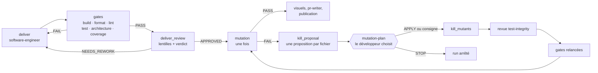



# DELIVER



> Faire passer le contrat au vert en petits pas prouvés, faire relire le code, puis tester les
> tests — une fois, en dernier.

## Pourquoi cette phase existe

Le code est le seul artefact qui part en production. DELIVER le fait naître du contrat que
DISTILL a laissé en échec : le `software-engineer` avance en **Outside-In TDD**, du test
d'acceptation vers les tests unitaires, puis vers le code
([Freeman & Pryce, 2009]({{ cites }}#cite-freeman-goos-2009)). Chaque pas est un commit : un
`test(…)` rouge, un `feat(…)` ou `fix(…)` vert, un `refactor(…)`.

Le moteur ne croit pas l'agent sur parole. Il lit ces commits, rejoue chaque rouge pour
vérifier qu'il échoue, et refuse un vert qui n'a pas de rouge avant lui. Le test d'abord
([Beck, 2003]({{ cites }}#cite-beck-tdd-2003)) devient un fait dans l'historique git, pas une
promesse.

☕ Fil rouge — Starbucks <em>(exemple illustratif)</em>

Le scénario entre. DELIVER implémente le calcul du total et l'attribution des points en cycles
**rouge → vert**, la revue relit le code, puis la **mutation** atteste que les tests protègent
réellement la règle de fidélité. Le code part en pull request.

## L'ordre : gates, revue, puis mutation

*Figure 1 — La boucle de DELIVER selon `workflows/pipeline.skraft.dot` (2.0.0-alpha.19),
simplifiée : la mutation ne juge que du code déjà revu, et ses survivants passent par une
décision humaine.*

Les gates de commandes passent d'abord : elles sont rapides, déterministes, et un build rouge
n'a pas besoin d'un relecteur. Viennent ensuite les lentilles de la revue DELIVER : intégrité des
tests, frontières d'architecture, lisibilité à froid, et, quand le changement en touche, fidélité
des mocks et des contrats. Une reprise demandée par la revue repart par `deliver` et les gates,
jamais par la mutation.

### Pourquoi la mutation passe en dernier

Le mutation testing injecte de petites fautes dans le code et mesure la part que les tests
attrapent ([Jia & Harman, 2011]({{ cites }}#cite-jia-mutation-2011)). C'est la seule mesure qui
dit si une suite verte détecterait une erreur, et c'est aussi l'étape la plus coûteuse du
pipeline.

Jusqu'à la version 2.0.0-alpha.18, elle passait juste après les gates, avant la revue. Elle
tournait donc plusieurs fois : après chaque passe de correction des survivants, puis de nouveau
après chaque reprise demandée par la revue — et elle jugeait un code que cette revue pouvait
encore faire changer. Depuis 2.0.0-alpha.19, elle passe **une fois, en dernier**, sur le code
que la revue a approuvé. Sur le chemin normal, la mesure la plus chère ne tourne qu'une fois, et
elle mesure le code qui partira réellement.

### Pourquoi c'est le développeur qui choisit

Un mutant survivant n'a pas une seule bonne réponse. Il finit de l'une de trois façons :

1. **un test plus précis le tue**, parce qu'une entrée que la story autorise distingue le mutant
   du code ;
2. **le code est supprimé**, parce qu'aucun comportement de la story ne le demande ;
3. **le mutant est déclaré équivalent**, parce qu'aucune entrée ne peut le distinguer du code.

Ces trois issues n'ont pas les mêmes conséquences : la première ajoute une protection, la
deuxième retire du code, la troisième accepte un écart. Distinguer un mutant équivalent est un
problème connu pour être difficile, qu'aucun outil ne tranche seul
([Jia & Harman, 2011]({{ cites }}#cite-jia-mutation-2011)). Laisser un agent « tuer les mutants »
à sa guise l'invite à écrire des tests taillés pour le mutant plutôt que pour un comportement.

Alors la décision est partagée. Pour chaque fichier qui garde des survivants, le
`software-engineer` écrit une **proposition** dans un fichier que le moteur crée, une issue par
mutant, sans toucher au code. La question `mutation-plan` montre ces propositions au développeur,
qui répond `APPLY`, donne sa propre consigne, ou `STOP`. Le `software-engineer` applique ensuite
ce choix, mutant par mutant ; la lentille `test-integrity` relit les tests ajoutés, les gates
repassent, puis la mutation de nouveau.

Le seuil, lui, ne bouge pas : la gate `mutation` reste verrouillée et sa barre fixe. Le
développeur choisit **comment** l'atteindre, jamais **s'il** faut l'atteindre.

## Les tests câblés par le même agent

Le `software-engineer` câble lui-même ses tests d'intégration, dans ses propres cycles rouge /
vert : le brief que compose le moteur nomme les skills de mocking de chaque composant, et ceux
de contract testing quand le composant l'active. Il ne lance aucun sous-agent. Quand le
changement touche un mock ou un contrat, la lentille de fidélité correspondante rejoint la
revue. Le pourquoi : [Mocking avec Microcks]({{ "/fr/explanation/deep-dive/mocking-microcks" | relative_url }})
et [Contract testing]({{ "/fr/explanation/deep-dive/contract-testing" | relative_url }}).

## Les compromis

- **Un humain peut être sollicité en fin de run.** Quand la mutation échoue, le run attend la
  réponse à `mutation-plan`. C'est le prix d'une décision qui engage le code.
- **Une reprise de revue ne remesure pas la mutation.** Elle repasse par les gates, plus
  rapides ; la mutation juge une fois le code stabilisé.
- **Pas de seuil négociable.** 100 % sur le cœur, 80 % sur la frontière, quel que soit le dépôt :
  voir [Software craftsmanship]({{ "/fr/explanation/software-craftsmanship" | relative_url }}).

## Pour aller plus loin

- [Référence : DELIVER]({{ "/fr/reference/phases" | relative_url }}#deliver) — nœuds, propositions, réponses à `mutation-plan`, arêtes.
- [Référence : critères de revue de DELIVER]({{ "/fr/reference/gates" | relative_url }}#deliver).
- [La revue avant la revue]({{ "/fr/explanation/deep-dive/review-before-review" | relative_url }}).
- [Lancer les gates]({{ "/fr/how-to/run-gates" | relative_url }}).

## Sources

- [Beck, K. *Test-Driven Development by Example*, 2003.]({{ cites }}#cite-beck-tdd-2003)
- [Freeman, S. & Pryce, N. *Growing Object-Oriented Software, Guided by Tests*, 2009.]({{ cites }}#cite-freeman-goos-2009)
- [Jia, Y. & Harman, M. *An Analysis and Survey of the Development of Mutation Testing*, 2011.]({{ cites }}#cite-jia-mutation-2011)
