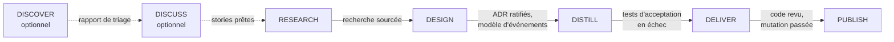



# Le pipeline SKRAFT

> SKRAFT n'impose pas une chaîne unique : il propose des parcours, et dans chacun la sortie
> d'une étape devient l'entrée de la suivante.

## Pourquoi plusieurs parcours

Une équipe n'arrive pas toujours au même endroit. Tantôt la story est prête, tantôt le backlog
est un tas d'issues brutes, tantôt il n'y a que du code hérité sans intention écrite. Un seul
pipeline pour ces trois cas forcerait soit à inventer une story là où il n'y en a pas, soit à
sauter des contrôles là où elle existe déjà.

SKRAFT sépare donc trois choses :

- **la préparation produit** — DISCOVER puis DISCUSS, dans le plugin `skraft-backlog`. Elle est
  optionnelle et le développeur la lance lui-même ; voir [Le backlog]({{ "/fr/explanation/backlog" | relative_url }}) ;
- **le pipeline d'ingénierie** — RESEARCH, DESIGN, DISTILL, DELIVER puis la publication, que le
  moteur conduit pour une story affinée ; l'agent `skraft-orchestrator` ne fait que le démarrer
  ou le reprendre ;
- **le parcours Brownfield** — un parcours frère pour reprendre un existant, pas une phase
  préliminaire ; voir [Reprendre un existant]({{ "/fr/explanation/brownfield" | relative_url }}).

Les deux plugins partagent des fichiers, jamais du code : les stories que DISCUSS écrit dans le
dossier de suivi sont celles que le moteur sait lire. Chacun s'installe et tourne sans l'autre.

## Le flux d'artefacts

Dans le parcours principal, le fil conducteur n'est pas un agent mais un **artefact** : chaque
phase lit ce que la précédente a écrit, et le moteur vérifie que la sortie attendue est bien là
avant d'avancer.

*Figure 1 — Le flux d'artefacts du parcours principal : en pointillé, la préparation produit
optionnelle ; en trait plein, les phases que conduit le moteur.*

Ce choix a une conséquence : une phase ne peut pas « se souvenir » d'une décision qu'elle n'a
pas écrite. Ce qui n'est pas dans un artefact n'existe pas pour la phase suivante, ce qui rend
chaque relais relisible par un humain. Quand les stories viennent déjà de DISCUSS,
`skraft init <slug> --from-artifacts` démarre le run en DESIGN : la recherche a eu lieu en amont.

☕ Fil rouge — Starbucks <em>(exemple illustratif)</em>

Pour voir ce flux en action, suivez une même demande — « commander et payer une boisson dans
l'app Starbucks » — de l'idée au code, phase par phase :
[Suivez un exemple de bout en bout]({{ "/fr/explanation/pipeline/fil-rouge" | relative_url }}).

## Ce que chaque phase apporte

- [DISCOVER]({{ "/fr/explanation/pipeline/discover" | relative_url }}) — trier avant de choisir :
  savoir ce qui mérite d'être travaillé.
- [DISCUSS]({{ "/fr/explanation/pipeline/discuss" | relative_url }}) — préciser avant de
  concevoir : une story que le métier et le code comprennent de la même façon.
- [RESEARCH]({{ "/fr/explanation/pipeline/research" | relative_url }}) — chercher des preuves
  avant de décider.
- [DESIGN]({{ "/fr/explanation/pipeline/design" | relative_url }}) — décider l'architecture et la
  faire ratifier par un humain.
- [DISTILL]({{ "/fr/explanation/pipeline/distill" | relative_url }}) — écrire le contrat
  exécutable, en échec, avant le code.
- [DELIVER]({{ "/fr/explanation/pipeline/deliver" | relative_url }}) — faire passer ce contrat au
  vert en petits pas prouvés, puis tester les tests.

Les entrées, sorties, chemins, agents, lentilles et arêtes de retour de chaque phase sont dans la
référence [Phases]({{ "/fr/reference/phases" | relative_url }}) ; ce que vérifie chaque gate,
dans [Gates]({{ "/fr/reference/gates" | relative_url }}).

## Pourquoi chaque phase a sa revue

Celui qui produit un artefact n'est pas celui qui le juge. DESIGN, DISTILL et DELIVER passent
devant des lentilles de revue en lecture seule ; DISCOVER et DISCUSS ont leurs propres lentilles
dans `skraft-backlog`. RESEARCH n'a pas de revue : le moteur vérifie seulement que son document
est rempli, et DESIGN, qui le lit, en reste juge. C'est l'idée de la revue par les pairs
appliquée à chaque relais : un défaut attrapé à la phase qui l'a introduit coûte moins qu'à la
suivante ([Wiegers, 2002]({{ cites }}#cite-wiegers-peer-reviews-2002)). Le raisonnement complet :
[La revue avant la revue]({{ "/fr/explanation/deep-dive/review-before-review" | relative_url }}).

## Les pages d'explication

**Orientation et parcours**

- [Le fil rouge]({{ "/fr/explanation/pipeline/fil-rouge" | relative_url }}) — un exemple suivi de bout en bout.
- [L'équipe et les relais]({{ "/fr/explanation/pipeline/team" | relative_url }}) — qui produit, qui juge, qui lance.
- [Le backlog]({{ "/fr/explanation/backlog" | relative_url }}) — le plugin `skraft-backlog` et ses automatisations.
- [Reprendre un existant]({{ "/fr/explanation/brownfield" | relative_url }}) — le parcours Brownfield.

**Comprendre le système**

- [Architecture]({{ "/fr/explanation/architecture" | relative_url }}) — un moteur neutre, des pilotes par hôte.
- [Le journal d'événements]({{ "/fr/explanation/event-journal" | relative_url }}) — pourquoi `events.jsonl` a remplacé l'état écrit.
- [Garde-fous]({{ "/fr/explanation/guardrails" | relative_url }}) — pourquoi les contrôles vivent dans le moteur et non dans des hooks.
- [Économie de tokens]({{ "/fr/explanation/token-economy" | relative_url }}) — pourquoi le coût se décide au design.

**Fondations du craft**

- [Software craftsmanship]({{ "/fr/explanation/software-craftsmanship" | relative_url }}),
  [Domain-Driven Design]({{ "/fr/explanation/domain-driven-design" | relative_url }}),
  [Clean Architecture]({{ "/fr/explanation/clean-architecture" | relative_url }}).

**Approfondissements**

- [La revue avant la revue]({{ "/fr/explanation/deep-dive/review-before-review" | relative_url }}),
  [Outside-In TDD]({{ "/fr/explanation/deep-dive/outside-in-tdd" | relative_url }}),
  [Walking Skeleton]({{ "/fr/explanation/deep-dive/walking-skeleton" | relative_url }}),
  [Mocking avec Microcks]({{ "/fr/explanation/deep-dive/mocking-microcks" | relative_url }}),
  [Contract testing]({{ "/fr/explanation/deep-dive/contract-testing" | relative_url }}),
  [Lire un verdict d'évaluation]({{ "/fr/explanation/deep-dive/reading-a-verdict" | relative_url }}).

**Pour décideurs**

- [Pour décideurs]({{ "/fr/explanation/for-executives" | relative_url }}).

## Sources

- [Wiegers, K. *Peer Reviews in Software*, 2002.]({{ cites }}#cite-wiegers-peer-reviews-2002)
