# L'équipe — le pipeline comme une course de relais

> Six exécuteurs, dont cinq contrôlés par leurs propres lentilles de revue, répartis entre deux racines produit autonomes et un orchestrateur d'ingénierie.

SKRAFT n'est pas un agent monolithique. DISCOVER et DISCUSS sont deux workflows
produit que le développeur sélectionne directement. `skraft-orchestrator` prend
ensuite une story affinée et séquence les agents d'ingénierie. Aucun orchestrateur
global ne pilote les six étapes.

## Le relais en un coup d'œil

```mermaid
graph LR
    H((humain)) --> D[backlog-discoverer]
    D -->|triage| H
    H --> DI[backlog-planner]
    DI -->|story affinée| H
    H --> O[skraft-orchestrator]
    O -->|si nécessaire| R[solution-researcher]
    R -->|recherche| DE[solution-architect]
    O -.séquence.-> DE
    DE -->|architecture| DIS[acceptance-designer]
    DIS -->|scénarios| DEL[software-engineer]
    style H fill:#102016,stroke:#6f8478
    style O fill:#102016,stroke:#6f8478
    style D fill:#1a3a2a,stroke:#4ed58a
    style DI fill:#1a3a2a,stroke:#4ed58a
    style DE fill:#1a3a2a,stroke:#4ed58a
    style DIS fill:#1a3a2a,stroke:#4ed58a
    style DEL fill:#1a3a2a,stroke:#4ed58a
```

## L'orchestrateur — `skraft-orchestrator`

Le chef d'orchestre de l'ingénierie uniquement. Il ne produit aucun artefact
métier : il **séquence** RESEARCH → DESIGN → DISTILL → DELIVER, vérifie les
pré-conditions, fait tourner les lentilles de chaque revue et applique le verdict
calculé sur leurs findings. Il
ne lance ni `backlog-discoverer` ni `backlog-planner`. C'est lui qui tient le
`state.json` (voir [le substrat HVE-Core]({{ "/fr/explanation/hve-core" | relative_url }})).

## Les deux racines produit autonomes

### 1. `backlog-discoverer` — le trieur (DISCOVER)

- **Mission :** transformer un flux brut d'issues en un rapport de triage priorisé.
- **Reçoit :** des issues, un milestone.
- **Passe le relais :** un rapport de triage.
- **Contrôlé par :** sa propre revue — 3 lentilles, verdict calculé par `review-verdict.mjs` (gates G1–G6).
- **Invoqué par :** le développeur, hors `skraft-orchestrator`.

### 2. `backlog-planner` — le raffineur (DISCUSS)

- **Mission :** faire d'une issue triée une story INVEST avec critères d'acceptation.
- **Reçoit :** le rapport de triage.
- **Passe le relais :** une story prête, sans ambiguïté.
- **Contrôlé par :** sa propre revue — 4 lentilles, verdict calculé par `review-verdict.mjs` (gates G1–G8).
- **Invoqué par :** le développeur, hors `skraft-orchestrator`.

## Les quatre exécuteurs d'ingénierie

### 3. `solution-researcher` — le chercheur (RESEARCH)

- **Mission :** réduire les inconnues par une investigation sourcée en l'absence d'artefacts de handoff amont.
- **Reçoit :** la story affinée et le contexte du dépôt.
- **Passe le relais :** une recommandation sourcée.
- **Contrôlé par :** aucun reviewer de phase déclaré. `skraft-orchestrator` vérifie le contrat de sortie avant de fermer la phase.

### 4. `solution-architect` — l'architecte (DESIGN)

- **Mission :** modéliser l'architecture (Event Modeling, DDD) et tracer les décisions en ADR.
- **Reçoit :** la story INVEST.
- **Passe le relais :** un ADR + un modèle d'événements + des contrats.
- **Contrôlé par :** la revue DESIGN — lentilles `consistency`, `architecture-compliance` et `fitness` (gates G1–G16), verdict calculé par le moteur.

### 5. `acceptance-designer` — le spécificateur (DISTILL)

- **Mission :** traduire l'architecture en scénarios Gherkin exécutables.
- **Reçoit :** l'ADR et le modèle d'événements.
- **Passe le relais :** des `.feature` + un plan d'implémentation.
- **Contrôlé par :** la revue DISTILL — lentilles `coverage`, `business-alignment`, `testability` et `boundary-enforcement`, verdict calculé par le moteur.

### 6. `software-engineer` — l'artisan (DELIVER)

- **Mission :** implémenter le code en Outside-In TDD, prouvé par le score de mutation.
- **Reçoit :** les scénarios Gherkin.
- **Passe le relais :** du code testé + l'évidence qualité, vers la Pull Request.
- **Contrôlé par :** les quality gates que lance le moteur, puis la revue DELIVER — lentilles `test-integrity`, `architecture-boundaries` et `cold-reader`, verdict calculé par le moteur.
- **Câble ses propres tests :** il charge les skills de mocking et de contract testing que son brief nomme — `mocking-<stratégie>-<stack>` pour chaque composant qu'il écrit, et `contract-testing` avec l'adaptateur de sa stack seulement quand ce composant active le contract testing dans `skraft-config.json`. Il ne lance aucun sous-agent. Quand le changement touche un mock ou un contrat, sa lentille de fidélité (`mock-fidelity-lens` / `contract-fidelity-lens`) rejoint la revue DELIVER.

## Pourquoi cinq revues pour six exécuteurs

> « Peer reviews are the single most effective quality practice a software organization can employ. »
> — Wiegers, K., *Peer Reviews in Software*, 2002.

DISCOVER, DISCUSS, DESIGN, DISTILL et DELIVER ont chacun leur propre revue : des
lentilles qui ne modifient jamais le travail jugé, chacune dans un contexte neuf, et
un verdict calculé sur leurs findings. RESEARCH fait exception : il n'a pas de revue,
son contrat de sortie est vérifié avant de fermer la phase. Personne ne valide son
propre artefact dans les cinq boucles avec revue.

## Pour aller plus loin

- [Le fil rouge : une commande Starbucks de bout en bout]({{ "/fr/explanation/pipeline/fil-rouge" | relative_url }})
- [Le catalogue des agents]({{ "/fr/dashboard/" | relative_url }})
- [Le détail des gates]({{ "/fr/reference/gates" | relative_url }})
- [La revue avant la revue]({{ "/fr/explanation/why-review-before-review" | relative_url }})
