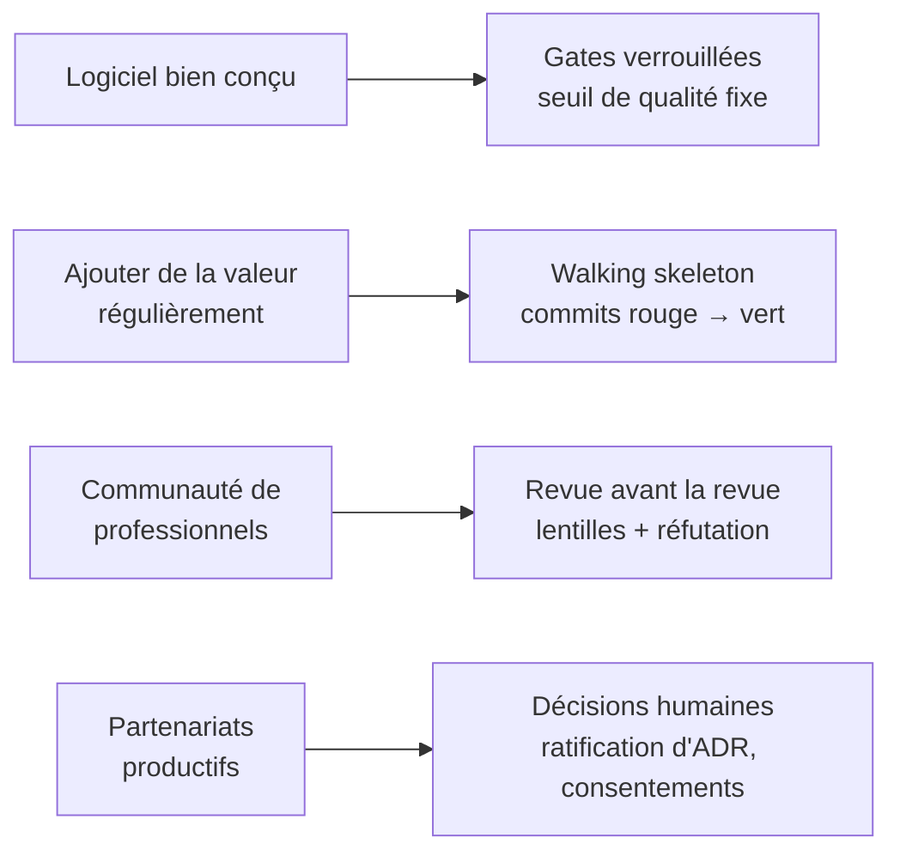
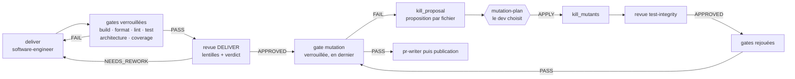



# Software craftsmanship — pourquoi skraft en fait une règle

> Le craft n'est pas un style d'écriture : c'est un engagement sur la qualité. skraft le prend
> au mot et le confie au moteur, pour qu'il tienne même quand c'est un agent qui écrit le code.

## Le problème : « ça marche » ne suffit pas

Un assistant de code produit en quelques minutes ce qui demandait une journée. La vitesse
change, la question reste la même : ce code sera-t-il encore modifiable dans six mois ? Un code
qui passe la démo mais que personne n'ose toucher est une dette, et un agent la creuse aussi vite
qu'il écrit.

Le mouvement du *software craftsmanship* est né de ce constat bien avant l'IA. Pete McBreen
propose de voir le développement comme un métier d'artisan plutôt que comme une chaîne
d'ingénierie : la qualité vient de praticiens qui maîtrisent leur métier et en répondent, pas
d'un processus qui les remplacerait
([McBreen, 2001]({{ cites }}#cite-mcbreen-craftsmanship-2001)).

## Ce que le craft demande

En 2009, le [Manifeste pour le software craftsmanship]({{ cites }}#cite-manifesto-craftsmanship-2009)
prolonge le Manifeste agile par quatre valeurs : pas seulement un logiciel qui fonctionne, mais
un logiciel **bien conçu** ; pas seulement répondre au changement, mais **ajouter de la valeur
de façon régulière** ; pas seulement des individus et des interactions, mais une **communauté de
professionnels** ; pas seulement la collaboration avec le client, mais des **partenariats
productifs**.

Sandro Mancuso résume l'attitude en trois mots — professionnalisme, pragmatisme, fierté — et
insiste sur un point : un professionnel ne sacrifie pas la qualité de son travail à la
pression du délai ; il sait dire non et proposer une autre option
([Mancuso, 2014]({{ cites }}#cite-mancuso-craftsman-2014)). Les pratiques viennent pour
l'essentiel d'Extreme Programming : le test d'abord, le refactoring continu, la conception
simple, les petits incréments
([Beck, 2004]({{ cites }}#cite-beck-xp-2004)).

Ces idées ont un point faible connu : elles reposent sur la discipline de chacun. Un humain
pressé saute le test « juste cette fois » ; un agent qui optimise pour « la tâche est finie » le
saute sans même le dire. skraft part de là : **une règle de craft n'existe que si un contrôle
l'exécute**.

## Comment skraft rend chaque valeur opposable

*Figure 1 — Les quatre valeurs du Manifeste pour le software craftsmanship (2009), à gauche,
et le mécanisme skraft qui rend chacune vérifiable, à droite. Adaptation : la colonne de gauche
reprend le manifeste, la colonne de droite est propre à skraft.*

### Un logiciel bien conçu : un seuil qui ne se négocie pas

Le skill `skraft-quality-bar` est l'unique endroit où un seuil est écrit : 100 % de score de
mutation et de couverture de lignes sur Domain et Application, 80 % de score de mutation sur
API et Infrastructure. Il n'y a ni niveau « conseil », ni dérogation, ni réglage par dépôt ;
la configuration `skraft-config.json` choisit les **commandes** des gates, jamais leurs seuils.
Dans `pipeline.skraft.dot`, les nœuds `gates` et `mutation` de DELIVER sont `locked` : les
retirer d'une copie du workflow exige une raison écrite (`unlock="<raison>"`).

C'est la réponse de skraft à l'idée de Mancuso : la qualité n'est pas une variable
d'ajustement. Le détail des gates est dans la [référence des gates]({{ "/fr/reference/gates" | relative_url }}).

### Ajouter de la valeur régulièrement : de petits pas vérifiés

Le craft avance par petits incréments qui marchent. Dans skraft, cela prend deux formes.

- **Le walking skeleton.** En DISTILL, l'`acceptance-designer` commite des tests d'acceptation
  qui échouent et le squelette qu'ils appellent ; la lentille `boundary-enforcement` exige au
  moins un scénario walking skeleton par flux (son G8). Voir
  [Walking Skeleton]({{ "/fr/explanation/deep-dive/walking-skeleton" | relative_url }}).
- **Le cycle rouge → vert → refactor.** En DELIVER, le moteur lit les commits du
  `software-engineer` : un `test(…)` est le rouge, un `feat(…)` ou `fix(…)` le vert, un
  `refactor(…)` le nettoyage. Il rejoue la commande de test à chaque commit rouge et refuse un
  vert qui n'a pas de rouge avant lui. Le test d'abord de Beck
  ([Beck, 2003]({{ cites }}#cite-beck-tdd-2003)) devient un fait vérifié dans l'historique git,
  pas une promesse. Voir [Outside-In TDD]({{ "/fr/explanation/deep-dive/outside-in-tdd" | relative_url }}).

### Tester les tests : le mutation testing

Une suite verte ne prouve pas qu'elle détecterait une erreur. Le mutation testing injecte de
petites fautes dans le code et mesure la part que les tests attrapent
([Jia & Harman, 2011]({{ cites }}#cite-jia-mutation-2011)). Dans skraft, la gate `mutation`
juge le rapport contre le seuil de `skraft-quality-bar` ; elle tourne en dernier, après que la revue DELIVER a
approuvé le code, puis de nouveau après chaque cycle de kill (un rapport en échec retourne à
`kill_proposal`, 5 passages au plus). Pour chaque fichier qui garde un mutant survivant, le
`software-engineer` propose comment le tuer (`kill_proposal`) ; le développeur choisit
(question `mutation-plan` : appliquer, donner sa propre consigne, ou arrêter le run), puis
`kill_mutants` applique ce choix. La lentille
`test-integrity` vérifie que les tests ajoutés peuvent réellement échouer (son G7) et qu'aucun test
n'a été affaibli pour passer (son G9).

### Une communauté de professionnels : la revue avant la revue

Les revues entre pairs trouvent des défauts tôt, quand ils coûtent peu
([Wiegers, 2002]({{ cites }}#cite-wiegers-peer-reviews-2002)). skraft fait passer chaque
production d'agent devant des lentilles de revue, chacune dans un contexte neuf ; l'agent
`finding-refuter` confirme ou réfute chaque finding, puis le moteur calcule le verdict. La
revue humaine reçoit un travail déjà débarrassé du bruit mécanique. Le raisonnement complet est
dans [Pourquoi une revue avant la revue ?]({{ "/fr/explanation/why-review-before-review" | relative_url }}).

La lisibilité fait partie de ce respect des pairs. Un code se lit bien plus souvent qu'il ne
s'écrit, et des noms qui révèlent l'intention en sont la première condition
([Martin, 2008]({{ cites }}#cite-martin-cleancode-2008)). La lentille `cold-reader` lit le code
et les tests sans aucun contexte et vérifie qu'ils parlent le langage du métier (son G11) ; la
lentille `architecture-boundaries` applique les règles d'Object Calisthenics au code Domain
(son G10, [Bay, 2008]({{ cites }}#cite-bay-calisthenics-2008)).

### Des partenariats productifs : l'humain garde les décisions

Un artisan ne décide pas seul de ce qui engage son client. Dans le workflow, un hexagone est
une question posée à un humain : `adr-ratification` fait ratifier les ADR avant DISTILL,
`publish-consent` demande l'accord avant de pousser une branche. Sans réponse, le run attend ;
aucun agent ne peut répondre à la place de l'humain. Voir
[Architecture]({{ "/fr/explanation/architecture" | relative_url }}).

## Où le craft se joue dans DELIVER

*Figure 2 — La boucle de DELIVER telle que la décrit `plugins/skraft-framework/workflows/pipeline.skraft.dot`,
simplifiée : chaque flèche de retour est un refus exécuté par le moteur, pas un conseil.*

## Les compromis

Le craft opposable a un coût, et skraft l'assume.

- **La première tranche est plus lente.** Un walking skeleton et des tests rouges avant le
  code retardent la première démo ; ils évitent d'avoir à reconstruire la structure ensuite.
- **100 % de mutation sur le cœur est exigeant.** Certains mutants ne changent rien
  d'observable ; le skill `quality-gates-<stack>` du composant dit comment en exclure un, ligne
  par ligne et avec sa raison, plutôt que d'abaisser le seuil pour tous.
- **Pas de mode « prototype ».** Un seuil qu'on peut baisser cesse d'être un seuil ; il n'y a
  donc aucun réglage pour l'assouplir.

## Pièges et contresens

- **Confondre craft et sur-ingénierie.** Le craft demande la conception la plus simple qui
  marche. La lentille `fitness` refuse tout agrégat, contexte ou pattern qu'aucune story ne
  justifie (son G9), et le `solution-architect` n'introduit aucun pattern sans story ou force
  mesurable.
- **Le théâtre de test.** Un test sans assertion, ignoré ou réécrit pour passer donne une
  couverture flatteuse et ne prouve rien ; c'est précisément ce que visent le skill
  `craft-discipline` (C5) et la lentille `test-integrity`.
- **Croire que le moteur remplace le jugement.** Les gates prouvent ce qui se mesure ; les
  choix de conception restent ratifiés par un humain.

## Pour aller plus loin

- [Domain-Driven Design]({{ "/fr/explanation/domain-driven-design" | relative_url }}) — le
  modèle métier que le craft protège.
- [Clean Architecture et architecture hexagonale]({{ "/fr/explanation/clean-architecture" | relative_url }})
  — la règle de dépendance vérifiée par la gate `architecture`.
- [La phase DELIVER]({{ "/fr/explanation/pipeline/deliver" | relative_url }}) et
  [le glossaire]({{ "/fr/reference/glossary" | relative_url }}).

## Sources

- [Bay, J. *Object Calisthenics*, 2008.]({{ cites }}#cite-bay-calisthenics-2008)
- [Beck, K. *Test-Driven Development by Example*, 2003.]({{ cites }}#cite-beck-tdd-2003)
- [Beck, K. *Extreme Programming Explained*, 2nd ed., 2004.]({{ cites }}#cite-beck-xp-2004)
- [Jia, Y. & Harman, M. *An Analysis and Survey of the Development of Mutation Testing*, 2011.]({{ cites }}#cite-jia-mutation-2011)
- [Mancuso, S. *The Software Craftsman: Professionalism, Pragmatism, Pride*, 2014.]({{ cites }}#cite-mancuso-craftsman-2014)
- [*Manifesto for Software Craftsmanship*, 2009.]({{ cites }}#cite-manifesto-craftsmanship-2009)
- [Martin, R. C. *Clean Code*, 2008.]({{ cites }}#cite-martin-cleancode-2008)
- [McBreen, P. *Software Craftsmanship: The New Imperative*, 2001.]({{ cites }}#cite-mcbreen-craftsmanship-2001)
- [Wiegers, K. *Peer Reviews in Software*, 2002.]({{ cites }}#cite-wiegers-peer-reviews-2002)
