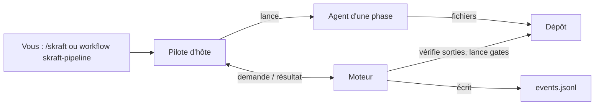

# SKRAFT — Le Handbook

SKRAFT conduit une story à travers quatre phases : **RESEARCH → DESIGN → DISTILL → DELIVER**.
En V2, un **moteur** unique décide de tout — ordre des phases, sorties attendues, relances,
verdicts, gates — et c'est le même sous Claude Code, GitHub Copilot CLI et, bientôt, VS Code.
Les **pilotes d'hôte** exécutent ce que le moteur demande et sont les seuls à lancer des agents ;
aucun agent n'en lance un autre, et aucun hook de commande ne ralentit vos appels d'outils.

> « The only way to go fast is to go well. »
> — Martin, R. C., *Clean Architecture*, 2017.

## Première visite

Suivez le [tutoriel Premiers pas]({{ "/fr/tutorials/getting-started" | relative_url }}) : vous
installez le plugin, décrivez votre dépôt dans `skraft-config.json`, lancez la phase RESEARCH d'une
story et passez les gates, sur un petit dépôt, en une séance.

## Disponible aujourd'hui, et ce qui arrive

SKRAFT V2 se construit par **lots**. Chaque lot est comparé à la v1 sur les mêmes projets
d'exemple ; une régression bloque le lot.

| Lot | Capacité | État |
| --- | --- | --- |
| 0 – 2 | Phase **RESEARCH** de bout en bout (document pré-créé, relance si manquant, arrêt au plafond), journal chaîné, reprise, `skraft-config.json` à composants, détection (`skraft init`), `skraft doctor`, base par dépôt, gates lancées à la main (`skraft gate`) | Disponible |
| 3 | DESIGN, DISTILL et DELIVER conduits par le moteur ; gates étapes du pipeline | Prévu |
| 4 | Revue du code par lentilles | Prévu |
| 5 | Décisions humaines (`skraft decide`) | Prévu |
| 6 | Agents et skills de la v1 élagués | Prévu |
| 7 | Boucle de clôture mutation | Prévu |
| 8 | Vues Canvas et panneau complètes, publication des captures | Prévu |
| 9 | Brownfield | Prévu |
| 10 | VS Code : pilote SDK Copilot, puis repli `skraft next` / `skraft record` | Prévu |
| 11 | Version 2.0.0 | Prévu |

Hôtes disponibles aujourd'hui : **Claude Code** (commande `/skraft`, panneau « Skraft ») et
**GitHub Copilot CLI** (workflow `skraft-pipeline`).

## Comment lire ce handbook

La documentation suit **Diátaxis** : quatre portes selon ce que vous cherchez.

| Porte | Pour… | Pages |
| --- | --- | --- |
| **Apprendre** (tutoriel) | faire un premier parcours guidé | [Premiers pas]({{ "/fr/tutorials/getting-started" | relative_url }}) |
| **Faire** (guide pratique) | réussir une tâche précise | [Configurer les composants]({{ "/fr/how-to/configure-components" | relative_url }}), [Lancer les gates]({{ "/fr/how-to/run-gates" | relative_url }}), [Reprendre ou débloquer un run]({{ "/fr/how-to/resume-a-run" | relative_url }}), [Customisation]({{ "/fr/how-to/customisation" | relative_url }}), [Évaluer un skill]({{ "/fr/how-to/evaluation" | relative_url }}), [Contribuer]({{ "/fr/how-to/contributing" | relative_url }}) |
| **Consulter** (référence) | retrouver un fait exact | [La ligne de commande `skraft`]({{ "/fr/reference/cli" | relative_url }}), [`skraft-config.json`]({{ "/fr/reference/skraft-config" | relative_url }}), [Journal du run]({{ "/fr/reference/run-journal" | relative_url }}), [Glossaire]({{ "/fr/reference/glossary" | relative_url }}), [Catalogue des agents et skills]({{ "/fr/dashboard/" | relative_url }}), [Gates de revue des skills (v1)]({{ "/fr/reference/gates" | relative_url }}) |
| **Comprendre** (explication) | savoir *pourquoi* c'est construit ainsi | [Pour décideurs]({{ "/fr/explanation/for-executives" | relative_url }}), [Architecture]({{ "/fr/explanation/architecture" | relative_url }}), [Zéro hook]({{ "/fr/explanation/hooks" | relative_url }}), [État et reprise]({{ "/fr/explanation/hve-core" | relative_url }}), [Les phases]({{ "/fr/explanation/pipeline/" | relative_url }}), [Concepts]({{ "/fr/explanation/concepts" | relative_url }}), [Clean Architecture]({{ "/fr/explanation/clean-architecture" | relative_url }}), [Outside-In TDD]({{ "/fr/explanation/deep-dive/outside-in-tdd" | relative_url }}), [Brownfield]({{ "/fr/explanation/brownfield" | relative_url }}) |

## Où aller selon votre rôle

- **Décideur** — le problème que la V2 résout et les objectifs visés :
  [Pour décideurs]({{ "/fr/explanation/for-executives" | relative_url }}).
- **Développeur** — d'abord le [tutoriel]({{ "/fr/tutorials/getting-started" | relative_url }}),
  puis les guides : [configurer les composants]({{ "/fr/how-to/configure-components" | relative_url }}),
  [lancer les gates]({{ "/fr/how-to/run-gates" | relative_url }}),
  [reprendre ou débloquer un run]({{ "/fr/how-to/resume-a-run" | relative_url }}).
- **Architecte** — moteur, pilotes d'hôte, profondeur 1 :
  [Architecture]({{ "/fr/explanation/architecture" | relative_url }}).
- **Qualification** — où sont les preuves et comment les lire :
  [Lancer les gates]({{ "/fr/how-to/run-gates" | relative_url }}),
  [Journal du run]({{ "/fr/reference/run-journal" | relative_url }}).

## SKRAFT V2 en une image

Le moteur ne lance jamais d'agent ; il dit au pilote quoi lancer, vérifie ce que l'agent a écrit,
puis journalise chaque étape dans `.copilot-tracking/skraft-plans/<slug>/events.jsonl`.
