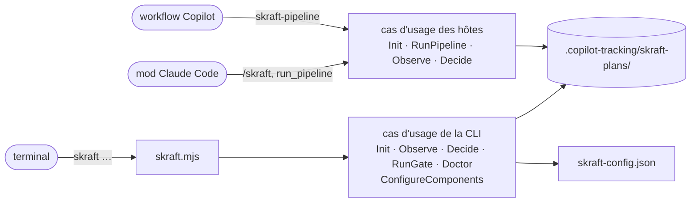

# La ligne de commande skraft

> `skraft` est la porte d'entrée en ligne de commande du moteur : chaque commande appelle un cas d'usage et affiche ce qu'il rend, sans rien décider elle-même.

## Pourquoi — le problème que ça résout

En v1, l'état d'un run, les gates et les contrôles de l'environnement passaient par de la
prose d'agent, des hooks et des scripts bash. Le résultat changeait selon l'hôte et le
système. La V2 met ces décisions dans un **moteur à cas d'usage** (le code qui décide de
l'ordre des phases, des sorties attendues, des relances et des gates). La ligne de commande
`skraft` donne accès à ce moteur depuis n'importe quel terminal, sous sh comme sous
PowerShell, avec la même sortie et les mêmes codes de sortie.

## Concepts clés — comment ça marche

### Appeler skraft

Le point d'entrée est un script Node livré dans le plugin. Remplacez `<dossier du plugin>`
par le dossier où l'hôte a installé le plugin skraft :

```
node "<dossier du plugin>/engine/drivers/cli/skraft.mjs" <commande>
```

La même forme marche sous sh et sous PowerShell. Lancez-la **depuis la racine de la copie de
travail** : `skraft-config.json` et `.copilot-tracking/` y sont lus et écrits. La suite de la
page écrit `skraft <commande>` pour cette ligne complète. Prérequis : Node 22 ou plus, Git.

La ligne de commande, le mod Claude Code et le workflow Copilot appellent des cas d'usage du
même moteur, pas tous les mêmes : la CLI n'appelle pas `RunPipeline` (elle ne lance aucun
agent) ; le mod et le workflow appellent `Init`, `RunPipeline`, `Observe` et `Decide`.



### Synopsis

```
usage: skraft --version
       skraft init [--add <folder>]...                                   detect the components into skraft-config.json
       skraft init <slug> [--issue <number>] [--title <text>] [--base <ref>]   start or resume a pipeline
       skraft status [--json]
       skraft decide [<key>] <answer> [--reason <text>]                answer the question the active pipeline waits on
       skraft gate [--all] [--json]                                      run the gates of the changed components (all with --all)
       skraft doctor [--run] [--base <ref>] [--json]                     check every command can run (--run: run each once)
```

Règles communes des options :

- une option à valeur s'écrit `--nom valeur` ; une valeur qui commence par `--` n'est pas une
  valeur ;
- une option inconnue, ou répétée sans être répétable, rend la ligne mal formée ; seule
  `--add` se répète ;
- une ligne mal formée affiche l'usage ci-dessus sur stderr et sort avec le code **2**.

### Codes de sortie

| Commande | 0 | 1 | 2 |
| --- | --- | --- | --- |
| `--version` | toujours | — | — |
| `init` (sans slug) | composants écrits ou déjà listés | config invalide, `--add` refusé | ligne mal formée |
| `init <slug>` | le slug est le pipeline actif | refus (`invalid-slug`, `invalid-base`, `config-invalid`, `base-unresolved`, `source-control-unavailable`, `journal-tampered`) | ligne mal formée, `--issue` pas un entier positif |
| `status` | tout statut sauf `tampered` | statut `tampered` | argument autre que `--json` |
| `decide` | réponse enregistrée | refus (ci-dessous) | pas de réponse, plus de deux mots, option autre que `--reason` |
| `gate` | gates `passed` (y compris aucun composant modifié) | `failed`, `refused`, `blocked` | ligne mal formée |
| `doctor` | tous les contrôles `ok` | au moins un contrôle `FAIL` | ligne mal formée |
| commande inconnue | — | — | toujours |

Les codes `refused` et `blocked` sont détaillés dans
[Dossier de suivi et journal]({{ "/fr/reference/run-journal" | relative_url }}).

### `skraft --version`

Affiche la version lue dans le `plugin.json` du plugin. Sortie : une ligne. Code 0.

### `skraft init [--add <folder>]...`

**Effet.** Détecte un composant par projet trouvé dans la copie de travail et dans chaque
dossier `--add`, et les ajoute à `skraft-config.json` (créé s'il manque). Les composants déjà
listés et toutes les autres clés du fichier restent tels qu'écrits. Règles de détection et
défauts par stack : [skraft-config.json]({{ "/fr/reference/skraft-config" | relative_url }}).

| Option | Valeur | Règle |
| --- | --- | --- |
| `--add <folder>` | dossier relatif à la copie de travail (`../payment-web`) | répétable ; refusé s'il est absolu ou si ce n'est pas un dossier |

**Sortie (stdout, code 0)** — une de ces lignes :

| Cas | Ligne |
| --- | --- |
| composants ajoutés | `skraft-config.json: <nom> (<stack>, <racine>), …` |
| rien de nouveau, le fichier a déjà une clé `components` (même vide) | `skraft-config.json already lists every project found (N components)` |
| aucun projet trouvé, fichier absent ou sans clé `components` (le fichier est écrit avec `"components": []`) | `no project found; skraft-config.json lists no component` |

**Erreurs (stderr, code 1).**

| Cas | Message |
| --- | --- |
| config invalide | `skraft-config.json is invalid: <erreur>; <erreur>…` |
| `--add` absolu | `--add <folder> is not relative to the working copy` |
| `--add` pas un dossier | `--add <folder> is not a folder` |

### `skraft init <slug> [--issue <number>] [--title <text>] [--base <ref>]`

**Effet.** Fait de `<slug>` le pipeline actif de la copie de travail (écrit
`.copilot-tracking/skraft-plans/.active-slug`) et ouvre son journal. Au **premier** init d'un
slug, le moteur lit `skraft-config.json`, calcule la base de chaque dépôt et écrit
l'événement `run.started`. Un init sur un slug qui a déjà un journal le reprend : la config
n'est pas relue, et la story et `--base` sont ignorés (la base journalisée reste).

| Argument / option | Valeur | Règle |
| --- | --- | --- |
| `<slug>` | kebab-case (`checkout-by-card`) | sinon refus `invalid-slug` |
| `--issue <number>` | entier positif sans zéro initial | sinon ligne mal formée (code 2) |
| `--title <text>` | un seul argument ; mettez-le entre guillemets s'il a des blancs | — |
| `--base <ref>` | ref git : sans blanc, ne commence pas par `-` | lu seulement au premier init du slug : sinon refus `invalid-base` ; prioritaire sur tout `baseBranch`. Sur un slug qui a déjà un journal, il est ignoré, même invalide |

**Sortie.** Succès : `<slug> is the active pipeline` sur stdout, code 0. Refus : le message
du moteur sur stderr, code 1, par exemple :

| Code | Message |
| --- | --- |
| `invalid-slug` | `slug must be kebab-case, got "<slug>"` |
| `invalid-base` | `--base must be a git ref, got "<ref>"` |
| `config-invalid` | `skraft-config.json is invalid: <erreurs>` |
| `base-unresolved` | `the working copy (<dépôt>) has no merge base with <ref>` ou `component <nom> (<dépôt>) has no merge base with <ref>`, un par dépôt sans base, joints par `; `, puis `; set baseBranch in skraft-config.json or pass --base <ref>` |
| `source-control-unavailable` | `<erreur>; the components of skraft-config.json need Git for their base` |
| `journal-tampered` | `journal tampered: events.jsonl line N …; restore the file or start a new slug` |

`init <slug>` ne lance aucun agent depuis le terminal : c'est le mod ou le workflow qui
déroule le pipeline.

### `skraft status [--json]`

**Effet.** Lit le pipeline actif et son journal, sans rien écrire.

**Sortie texte** — dans cet ordre, chaque ligne seulement si elle s'applique :

```
skraft <slug>: <status>
RESEARCH  pending|open|closed
agent: <agent> (<step>, attempt <n>)
answer: skraft decide <clé> <A>|<B> (--reason <text> with <refus>)
cost: <montant> USD
<raison>
```

Sans pipeline actif, la première ligne est `skraft: idle`. La ligne `agent:` devient
`gates: <gates> (<step>)` sur un nœud de gates et `question: <type> (<step>)` sur un nœud
question ; `, pass <n>` suit l'étape à partir du deuxième passage. La ligne `answer:`
n'apparaît que tant que le run attend une réponse. Un run qui attend la ratification des
ADR, par exemple :

```
skraft checkout-by-card: waiting
…
question: adr-ratification (adr)
answer: skraft decide adr-1 RATIFIED|REJECTED (--reason <text> with REJECTED)
Ratify the Proposed ADRs docs/adr/adr-001-card-provider.md? RATIFIED marks them Accepted; REJECTED sends DESIGN back with your reason.
```

**Sortie `--json`** — l'objet de vue du pipeline :

| Champ | Type | Contenu |
| --- | --- | --- |
| `slug` | string ou null | pipeline actif, `null` si aucun |
| `status` | string | `idle`, `not-initialised`, `running`, `waiting`, `done`, `blocked`, `tampered` |
| `reason` | string | raison du statut (le texte de la question en `waiting`), vide si aucune |
| `phases` | `[{ phase, state }]` | une entrée par phase ; `state` = `pending`, `open` ou `closed` |
| `current` | `{ step, phase, agent, gates, question, visit, attempt }` ou null | nœud en cours, `null` sinon ; `question` est le type de question sur un nœud question, `null` ailleurs |
| `question` | `{ key, kind, text, options, refusals }` ou null | la question que le run attend, `null` si rien n'attend |
| `attempts` | number | nombre de tentatives démarrées |
| `costUsd` | number ou null | somme des coûts journalisés, `null` si aucun |

Signification de chaque statut :
[Dossier de suivi et journal]({{ "/fr/reference/run-journal" | relative_url }}). Code 1
seulement pour `tampered`.

> **À venir.** Seule la phase RESEARCH figure dans `phases` aujourd'hui. DESIGN, DISTILL et
> DELIVER s'y ajoutent au lot 3.

### `skraft decide [<key>] <answer> [--reason <text>]`

**Effet.** Enregistre la réponse d'un humain à la question que le pipeline actif attend (un
événement `question.answered`, `by: "decide"`). Il ne lance rien : le prochain run du
pipeline agit selon la réponse, sans relancer un agent qui a déjà fini.

| Argument / option | Valeur | Règle |
| --- | --- | --- |
| `<key>` | clé de la question (`adr-1`, `gates-2`) | facultative ; sans elle, la question que le run attend |
| `<answer>` | une des options de la question (`RATIFIED`, `REJECTED`, `RETRY`, `ABORT`…) | la casse ne compte pas |
| `--reason <text>` | la raison, renvoyée à l'agent | obligatoire avec un refus (`REJECTED`) ; gardée sur une ligne, 500 caractères au plus |

Les questions, leurs options et leurs refus :

| Type | Clé | Options | Refus |
| --- | --- | --- | --- |
| `adr-ratification` | `<nœud>-<n>` (`adr-1`) | `RATIFIED`, `REJECTED` | `REJECTED` |
| `reporting-consent` | `<nœud>-<n>` | `ACCEPTED`, `DECLINED` | — |
| `environment` | `<nœud>-<n>`, le nœud qui ne peut pas tourner (`gates-1`) | `RETRY`, `ABORT` | — |

Une clé nomme le nœud qui pose la question, puis le rang de la question parmi celles que ce
nœud a posées dans le run, tous types confondus : `adr-1`, puis `adr-2` après un rejet ou
quand Git ne peut pas commiter la ratification.

**Sortie.** Enregistrée : `<slug>: <key> answered <answer>; run the pipeline again to go on`
sur stdout, code 0. Refus : le message sur stderr, code 1.

| Code | Message |
| --- | --- |
| `no-active-pipeline`, `slug-mismatch` | voir [Dossier de suivi et journal]({{ "/fr/reference/run-journal" | relative_url }}) |
| `no-question` | `no question adr-2; waiting: adr-1`, ou `no question to answer; no question is waiting` |
| `already-answered` | `adr-1 was already answered RATIFIED` |
| `invalid-answer` | `the answer must be one of RATIFIED, REJECTED, got "yes"` ; `REJECTED needs the reason, which goes back to the agent` |

### `skraft gate [--all] [--json]`

**Effet.** Lance les gates du pipeline actif : les commandes nommées `build`, `format`,
`lint`, `test`, `architecture`, `coverage`, `mutation` de chaque composant, dans cet ordre,
depuis la racine du composant. Chaque gate écrit une preuve et un événement `gate.ran`. Un
composant s'arrête à sa première gate en échec ; les autres composants continuent.

| Option | Effet |
| --- | --- |
| (aucune) | portée `touched` : seulement les composants modifiés depuis leur base |
| `--all` | portée `all` : tous les composants |
| `--json` | sortie JSON au lieu du texte |

**Sortie texte** — une ligne par gate lancée, puis une ligne de synthèse :

```
pass  web/lint
fail (environment)  web/test: <raison>
skraft <slug>: gates <status> — <raison>
```

Pour un refus ou un blocage, la synthèse porte le code : `skraft <slug>: gates refused
(<code>) — <raison>`.

**Sortie `--json`** :

| Champ | Type | Contenu |
| --- | --- | --- |
| `status` | string | `passed`, `failed`, `refused`, `blocked` |
| `slug` | string ou null | pipeline actif |
| `scope` | string | `touched` ou `all` |
| `components` | string[] | composants retenus |
| `gates` | `GateResult[]` | voir ci-dessous |
| `failure` | string ou null | `environment` si au moins un échec d'environnement, sinon `deterministic` en cas d'échec, `null` sans échec |
| `code` | string ou null | code de refus ou de blocage |
| `reason` | string | synthèse |
| `phase` | null | présent seulement sur un refus ou blocage venu du pipeline actif |

Chaque `GateResult` : `component`, `gate` (`none` pour un composant sans commande de gate),
`status` (`pass`, `fail`), `failure` (`environment`, `deterministic`, `null`), `reason`,
`evidence` (chemin absolu du fichier de preuve ; pour la gate `none`, le dossier
`gates/<composant>`, où aucun fichier n'est écrit).

| Résultat | `reason` de synthèse |
| --- | --- |
| tout passe | `N gates passed on <composants>` |
| aucun composant modifié | `no component changed since its base; no gate to run` |
| au moins un échec | `<composant>/<gate>: <raison>; …` |

Codes possibles : `no-active-pipeline`, `not-initialised`, `config-invalid`, `no-components`
(refused) ; `journal-tampered`, `journal-changed` (blocked). Raisons d'échec, classes
d'échec et format des preuves :
[skraft-config.json]({{ "/fr/reference/skraft-config" | relative_url }}) et
[Dossier de suivi et journal]({{ "/fr/reference/run-journal" | relative_url }}).

### `skraft doctor [--run] [--base <ref>] [--json]`

**Effet.** Vérifie que chaque commande de chaque composant peut tourner sur cette machine.
N'écrit rien dans le journal.

| Option | Effet |
| --- | --- |
| `--run` | lance chaque commande une fois depuis la racine de son composant, avec la base calculée |
| `--base <ref>` | ref de base pour `--run` ; sans `--run`, elle n'est pas lue |
| `--json` | sortie JSON |

Contrôles, dans l'ordre :

| Sujet | Passe si | Détail en échec |
| --- | --- | --- |
| `node` | Node 22 ou plus | `Node <version>; skraft needs Node 22 or later` |
| `config` | fichier présent, valide, au moins un composant | `skraft-config.json is invalid: …` ; `no skraft-config.json; run skraft init to detect the components` ; `skraft-config.json lists no component; run skraft init to detect them` |
| `base` (avec `--run`) | la base se calcule | message de `invalid-base`, `base-unresolved` ou `source-control-unavailable` |
| `<composant>` | la racine est un dossier | `root <racine> is not a folder` (ses commandes ne sont pas contrôlées) |
| `<composant>` | au moins une commande de gate | `no gate command; give it at least one of build, format, lint, test, architecture, coverage, mutation in skraft-config.json` |
| `<composant>/<commande>` | la ligne se découpe et son programme est trouvé (PATH, et PATHEXT sous Windows) | `"<ligne>" <raison>` ; `command not found: <programme> (from <racine>); install it or change commands.<nom> in skraft-config.json` (pour `python`, `(from <racine>; looked for .venv/bin/python, .venv/Scripts/python.exe, python, python3)`) |
| `<composant>/<commande>` avec `--run` | la commande sort avec 0 | `<commande lancée> exited <code>` (base remplacée, interpréteur choisi) |
| `docker` | `docker info` répond, si un composant mocke avec Microcks | `Docker does not answer, and Microcks, the mocking of <composants>, needs it; start Docker, or set "mocking": { "strategy": "inprocess" } on the component` |
| `models` | chaque agent que nomme `assign.agents` existe dans le plugin ou la copie de travail | `assign.agents.<id>: no agent <id> in the plugin, .claude/agents/ or .github/agents/; did you mean <le plus proche>?` |
| `models/<hôte>` (`claude-code`, `copilot`) | chaque famille sur laquelle tournent les agents du workflow a un modèle pour cet hôte ; sinon un avertissement avec le nombre de lancements qui retombent sur l'hôte | avertissements : `no model on <hôte> for <famille> (<n> dispatches)…` ; `CLAUDE_CODE_EFFORT_LEVEL is set…` ; `max effort on <agent> (<modèle>)…` pour un modèle Copilot dont le nom ne contient pas `claude` ; `~/.copilot/settings.json sets subagents.agents for <agent>…` quand skraft passe son propre modèle ou niveau |

Les commandes d'un composant sont contrôlées gates d'abord (dans l'ordre des gates), puis
`e2e` dans l'ordre du fichier. Le doctor s'arrête après `config` si la config
est invalide, absente ou vide. Sans `--run`, `{baseSha}` est remplacé par `HEAD` pour le
seul découpage.

**Sortie texte** :

```
ok    node: Node v22.…
FAIL  web/test: command not found: npx (from ../payment-web); install it or change commands.test in skraft-config.json
models on claude-code:
  step      agent                type   family      tier      model   effort  source (family/model/effort)
  research  solution-researcher  phase  researcher  standard  sonnet  -       agent/tier/host
  …
models on copilot:
  …
skraft doctor: 1 checks failed
```

Une fois la configuration et le workflow lus, un tableau par hôte liste chaque agent que lance le workflow (les lentilles d'un nœud de revue, puis son réfutateur tel qu'il vérifie la lentille la plus forte du nœud) : famille, palier, modèle (une liste essayée dans l'ordre), niveau de réflexion, et la source de chacun ; `-` là où l'hôte décide.

La dernière ligne est `skraft doctor: every check passed`, `skraft doctor: no check failed, N with a warning` ou `skraft doctor: N checks failed`.

**Sortie `--json`** : `{ "ok": boolean, "checks": [{ "subject", "status": "ok"|"warn"|"fail", "detail" }], "assignments": { "<hôte>": [{ "step", "agent", "type", "family", "tier", "model", "effort", "source": { "family", "model", "effort" } }] } | null }`.

### Revue : fan-out, nœuds lentille, fan-in

Le workflow est un graphe DOT : le `workflows/skraft.dot` du plugin, ou le
`skraft-workflow.dot` du dépôt écrit par `skraft workflow eject`. Une revue lance des
lentilles, des agents en lecture seule, sur ce que le run a changé, et le moteur calcule son
verdict à partir de leurs findings. Elle s'écrit en un fan-out (`shape=component`), un nœud
lentille par branche (`shape=note`) et un fan-in (`shape=tripleoctagon`) : le fan-in réfute les
findings, calcule le verdict et porte les arêtes `APPROVED` et `NEEDS_REWORK`. Le journal nomme
l'étape de revue d'après le fan-in (`deliver_review`).

```dot
deliver_review_lenses [shape=component]
deliver_review_test_integrity [shape=note, lens="test-integrity"]
deliver_review_mock_fidelity  [shape=note, lens="mock-fidelity", when="mock"]
deliver_review [shape=tripleoctagon]
mutation -> deliver_review_lenses [label="PASS"]
deliver_review_lenses -> deliver_review_test_integrity -> deliver_review
deliver_review_lenses -> deliver_review_mock_fidelity -> deliver_review
deliver_review -> deliver [label="NEEDS_REWORK", max_visits=3]
deliver_review -> exit    [label="APPROVED"]
```

Ajouter une lentille, c'est un nœud et une chaîne d'arêtes (deux arêtes). Le moteur lance les
lentilles d'une revue ensemble, dans l'ordre des arêtes du fan-out, là où l'hôte le permet.

| Règle | Détail |
| --- | --- |
| Fan-out (`shape=component`) | aucun attribut propre ; chaque arête qui en part est une branche qui porte exactement un nœud lentille, et toutes les branches aboutissent au même fan-in. Il ne prend aucune étiquette : une arête de verdict ne sort que du fan-in |
| Nœud lentille (`shape=note`) | `lens="<nom>"` obligatoire, un nom kebab-case, une fois au plus par revue ; `model="<famille>"` et `when="mock"` ou `when="contract"` facultatifs. Entré par une arête venue de son fan-out, il sort par une arête vers son fan-in |
| Fan-in (`shape=tripleoctagon`) | entré seulement par les nœuds lentille d'un même fan-out ; `model=` (la famille de ses lentilles qui n'en nomment aucune) et `refuter=` facultatifs |
| `lenses="…"` | l'ancienne forme, refusée : `skraft workflow check` nomme chaque nœud qui l'utilise et écrit, en DOT, les nœuds et arêtes qui le remplacent : identifiants compris (`<revue>_lenses`, `<revue>_<lentille>`), `when` pour `mock-fidelity` et `contract-fidelity`, `label`, `phase`, `model` et `refuter` du nœud sur le fan-in, ses arêtes entrantes envoyées au fan-out |
| Modèle | une famille est un palier (`economy`, `standard`, `frontier`), un rôle (`reviewer`, `researcher`, `implementer`, `planner`) ou une famille libre avec un `tier` (`gpt-codex`). Dans le workflow d'un dépôt, le `model=` d'un nœud lentille, sinon le `model=` du fan-in, nomme sa famille, `refuter=` celle du réfutateur, `model=` celle d'un nœud agent ; une règle `assign.agents` l'emporte quand même, et `skraft workflow check` le signale. Le workflow du plugin n'en nomme aucune : c'est `assign` de la configuration qui décide ([Personnaliser SKRAFT]({{ "/fr/how-to/customisation" | relative_url }}#models-and-effort)). `finding-refuter` tourne un palier au-dessus de la lentille la plus forte de son groupe, `frontier` au plus, sauf si une règle nomme sa famille. Chaque hôte reçoit le modèle et le niveau de réflexion de la famille depuis `models` ; le pilote Copilot essaie le modèle suivant tant que Copilot en refuse un, redemande sans niveau quand Copilot refuse le niveau, et tourne sur le modèle de la session en dernier. Le journal enregistre l'affectation de chaque agent (`assignment`) et le modèle sur lequel il a tourné (`model`, null pour celui de la session) |
| Agent d'une lentille | la lentille `<nom>` est l'agent `<nom>-lens`, cherché dans le plugin, puis dans `.claude/agents/` (Claude Code) ou `.github/agents/` (Copilot) ; `finding-refuter` doit aussi être trouvé, sinon le workflow est refusé |
| Arête `APPROVED` | exactement une ; une arête sans étiquette compte comme `APPROVED` |
| Arête `NEEDS_REWORK` | au plus une ; sans elle, un `NEEDS_REWORK` arrête le run avec `review-rejected` ; au-delà de son `max_visits`, avec `loop-ceiling` |
| Pilote | le pilote d'hôte lance les lentilles et le réfuteur (profondeur 1) ; aucun agent n'en lance un autre |

**Nœuds obligatoires.** Le workflow du plugin marque des nœuds `mandatory=true` : les fan-in
des revues DESIGN, DISTILL, DELIVER et de mutation, et les lentilles DELIVER `test-integrity` et
`architecture-boundaries`. Contrairement à `locked=true`, rien ne permet à un dépôt d'en sauter
un : pas d'`unlock`, pas d'option CLI, pas de réglage dans `skraft-config.json`. Le workflow du
plugin décide : retirer l'attribut de la copie, ou écrire `mandatory=false`, ne change rien
(`mandatory=false` est refusé). `skraft workflow check`, `skraft init` et `skraft run` refusent une
copie qui en casse un ; un run ne démarre jamais dessus.

| Nœud obligatoire | Gardé quand |
| --- | --- |
| Fan-in d'une revue | il reste un fan-in de même id ; son arête `NEEDS_REWORK` revient vers un agent de sa phase dans le workflow du plugin (renommer cette phase est refusé) ; aucun chemin n'atteint la sortie sans lui depuis le départ, depuis cet agent, ou depuis un agent de sa phase que le run n'atteint qu'à travers la revue (un agent ajouté après elle). Un chemin que le workflow du plugin a aussi est gardé : le run atteint la sortie autour de `mutation_review` depuis le départ quand la mutation passe |
| Nœud lentille | il garde son id, sa lentille (son `model=` peut changer), son fan-out et son fan-in, et ne porte aucun `when` |

Chaque refus nomme le nœud et la règle violée, et finit par `this node is mandatory and cannot be
removed`. Ajouter reste libre : lentilles, agents, questions, gates. `skraft workflow diff` marque
`(mandatory)` chaque nœud obligatoire qu'il liste comme retiré ou modifié.

**Ce que lit chaque lentille.** Toutes les lentilles sauf `cold-reader` lisent aussi le
`context.md` de la revue (story, règles du projet, qui a écrit quel document). Les fichiers sont
dans `reviews/<nœud>-<visite>/` ([Dossier de suivi et journal]({{ "/fr/reference/run-journal" | relative_url }})).

| Lentille | Lit |
| --- | --- |
| `fitness`, `business-alignment` | documents de la phase, de la story et des autres phases |
| `architecture-compliance`, `testability`, `boundary-enforcement` | documents de la phase, patch, chemins changés |
| `architecture-boundaries` | documents de la story et des autres phases, patch, chemins changés, `components.json` |
| `cold-reader` | patch et chemins changés seulement : ni story, ni périmètre, ni contexte |
| `mock-fidelity`, `contract-fidelity` | patch, chemins changés, `components.json` |
| toute autre lentille (`consistency`, `coverage`, `test-integrity`, une lentille du dépôt) | tout ce qui précède |

Le patch contient tous les changements depuis la base du run, hors dossier de suivi. Quand le run n'a rien changé hors du dossier de suivi, une lentille qui lit les changements ne reçoit aucun des deux fichiers et son brief le dit (`Changes since the base of the run: none outside the tracking folder`). Un chemin
changé sans section dans le patch est un fichier nouveau non suivi : la lentille l'ouvre.

**Lentilles conditionnelles.** Un nœud lentille avec `when=` ne tourne que si un chemin changé
ou une ligne que le patch ajoute ou garde correspond à son déclencheur ; sinon la revue tourne
sans lui. Un nœud lentille sans `when` tourne toujours, quelle que soit la lentille. Le workflow
du plugin met `when="mock"` sur `mock-fidelity` et `when="contract"` sur `contract-fidelity`.

| `when` | Chemin | Ligne |
| --- | --- | --- |
| `mock` | un nom de fichier contenant `mock`, `stub` ou `fake` | `WireMock…`, `MockServer`, `Microcks…`, `Mountebank`, `HttpMessageHandler`, `nock`, `msw` |
| `contract` | un nom de fichier contenant `contract`, `.apiexamples`, `.apimetadata`, `openapi….yaml/json` | `VerifyAsync`, `Pact…`, `ProviderVerifier`, `ContractTest` |

Dans `components.json`, un composant sans `mocking` utilise Microcks ; un composant sans
`contractTesting: true` ne demande aucun test de contrat ; `gates` liste les gates passées sur lui
dans ce run, dans l'ordre des gates (une gate `architecture` passée a déjà vérifié le sens de ses dépendances).

**Skills.** Le brief donne à chaque lentille le `SKILL.md` de chaque skill que son descripteur
liste sous `metadata.skills`, pris dans le plugin, puis dans `.claude/skills/` ou
`.github/skills/`. Une skill qu'une lentille ou `finding-refuter` liste et qui est introuvable
refuse le workflow, en nommant le nœud, l'agent et la skill. La lentille les lit avant toute
autre entrée.

**Réponse.** Une lentille termine son dernier message par un document YAML dans un bloc
clôturé ; le moteur lit le dernier bloc clôturé du message.

```yaml
lens: test-integrity
verdict: fail            # pass | fail | inconclusive
findings:                # [] quand elle ne trouve rien
  - id: F1
    gate: G9             # la gate de la table de la lentille
    severity: blocker    # blocker | high | medium | low
    location: "tests/Orders.UnitTest/RefundTests.cs:42"
    description: "le montant attendu 90 est devenu Assert.NotNull"
    suggestion: "rétablir Assert.Equal(90, refund.Amount)"   # facultatif
```

| Règle | Détail |
| --- | --- |
| Clés | seulement `lens`, `verdict`, `findings` ; par finding `id`, `gate`, `severity`, `location`, `description`, `suggestion` ; toute autre clé refuse la réponse |
| Obligatoire | `gate` et `description` ; un `id` absent devient le premier `F<n>` libre |
| Valeurs | textes libres entre guillemets doubles ou en bloc littéral ; ni ancre, ni alias, ni tag ; casse de `verdict` et `severity` normalisée |
| Plafond | au plus 20 findings ; un `pass` avec un finding blocker, high ou medium est refusé |
| Textes | ramenés sur une ligne et tronqués (description : 500 caractères) ; `location` rendue relative à la copie de travail, séparée par `/`, sans `./`, son `:ligne` gardé (un chemin hors de la copie de travail reste absolu) |
| Réponse refusée | la lentille est relancée une fois avec la raison ; une seconde réponse illisible arrête le run avec `lens-unreadable` ; une reprise ne relance que les lentilles dont la réponse était illisible |

**G9 en code.** Quand `test-integrity` relit les changements, le moteur lit aussi le patch des
fichiers de test (fichiers source sous un dossier `test`, `tests`, `spec` ou `__tests__`, ou
nommés comme `test_*.py`, `*.test.ts`, `*_test.go`, `*Tests.cs`, `*IT.java` ; fixtures, snapshots
et testdata exclus) et journalise ce qu'il trouve sous la lentille `test-integrity#patch` (agent
`skraft-engine`) : un skip ou un focus ajouté (`[Fact(Skip = …)]`, `[Ignore]`, `.skip`, `.only`,
`.todo`, `xit(`, `fit(`, `@pytest.mark.skip`/`skipif`/`xfail`, `@Disabled`, `t.Skip(`…, blocker à
`chemin:ligne`), un fichier de test supprimé (blocker), des lignes d'assertion retirées avec
moins de lignes ajoutées (high). Le brief de `test-integrity` les liste pour que la lentille ne
les signale pas une seconde fois ; ils partent au réfuteur comme ceux d'une lentille.

**Réfutation.** Les findings de lentilles différentes au même `chemin:ligne` (le chemin normalisé
comme ceux du patch : `./src\Checkout.cs:12` est `src/Checkout.cs:12`) et de même sévérité
forment un groupe. Chaque groupe de findings blocker, high ou medium part une fois chez
`finding-refuter`, son libellé et son brief nommant chaque lentille du groupe, avec les entrées et
les skills de ces lentilles. Il répond `confirmed`, `refuted` (sa `reason` cite le `chemin:ligne`
lu) ou `unverifiable`, et la réponse vaut pour chaque finding du groupe. Un finding réfuté ne
compte pas ; un finding invérifiable compte, comme celui dont la vérification a été illisible
deux fois.

**Verdict.** Une lentille qui répond `inconclusive`, ou `fail` sans finding blocker, high ou
medium, bloque la revue avec `lens-inconclusive`, en nommant chacune de ces lentilles et ce
qu'elle a noté : le travail n'est pas renvoyé et aucun finding n'est vérifié. Sinon
`NEEDS_REWORK` quand un finding blocker, high ou medium compte, sinon `APPROVED` (les findings
low sont des notes). Les findings retenus vont dans le brief suivant de l'agent de la phase, un
groupe sur une ligne qui cite chacune de ses lentilles.
Le résumé donne le statut, puis les findings réfutés et les notes mis de côté, chacun cité
(`APPROVED: no finding counts; 2 refuted (consistency F1, fitness F1); 1 note (coverage F3)`,
`APPROVED: every lens passed` quand aucune lentille n'a rien trouvé) ; la progression (panneau,
Canvas) liste dessous chaque finding réfuté avec la raison du réfuteur et chaque note, puis
l'emplacement de `verdict.yaml`, pour qu'un humain puisse quand même les faire corriger.

**Re-revue incrémentale.** À une passe suivante, une lentille dont le résultat précédent était
`pass` sans finding, et dont l'empreinte n'a pas changé, n'est pas relancée : son résultat est
journalisé de nouveau avec `reused: true`. L'empreinte couvre ses entrées, le contenu de chaque
`SKILL.md` qu'elle lit (par nom de skill : déplacer la copie de travail ou le plugin n'y change
rien), les fichiers de règles du projet et le contenu de chaque chemin changé qu'elle lit.

### Équivalents dans le mod Claude Code

Le mod Claude Code (le pilote d'hôte de Claude Code) appelle `Init`, `RunPipeline`,
`Observe` et `Decide`, sans Node : il lance git par `$.process.run`. Chaque `/skraft` ouvre le panneau
**Skraft**.

| Dans la conversation | Effet | Réponse |
| --- | --- | --- |
| `/skraft <slug> [#issue] [titre…] [--base <ref>]` | Init du slug, puis run en arrière-plan | `skraft <slug> started — progress in the Skraft pane.` |
| `/skraft`, `/skraft status`, `/skraft help` | vue du pipeline actif | `skraft <slug> — <status>`, une ligne par phase (`✓` closed, `▶` open, `·` pending), raison, agent, `cost: $<montant>` |
| `/skraft decide [<clé>] <réponse> [raison…]` | enregistre la réponse (mêmes règles et refus que `skraft decide`), puis reprend le pipeline actif | `<slug>: <key> answered <answer>; run the pipeline again to go on`, puis la ligne de démarrage ; refus : `skraft: not recorded — <raison>` |

Dans `/skraft <slug> …`, `#<nombre>` placé juste après le slug donne l'issue ; le reste des
mots forme le titre ; `--base <ref>` peut se placer n'importe où après le slug. Autres
réponses :

| Cas | Réponse |
| --- | --- |
| Init refusé | `skraft <slug>: not started — <raison>` |
| un run tourne déjà | `skraft is already running <slug>; see the Skraft pane.` |
| fin du run (notification) | `skraft <slug>: <status> (<code>) — <raison>` |

Dans `/skraft decide`, un premier mot en forme de clé (`adr-1`) nomme la question ; sans
lui, la réponse va à la question que le run attend. Les mots après la réponse forment la
raison.

Quand le moteur pose une question, le mod ouvre une boîte de dialogue `$.ui.ask` avec la
question, ses options et un en-tête (`ADR`, `Reporting`, `Environment`) :

| Dans la boîte de dialogue | Effet |
| --- | --- |
| une option qui n'est pas un refus | enregistrée comme réponse ; le run continue |
| un refus (`REJECTED`) | une deuxième boîte : `Why REJECTED? Type the reason under Other; it goes back to the agent.` ; le texte tapé sous Other est la raison ; `Not now` ou `Answer later` ne donnent pas de réponse |
| du texte tapé sous Other dans la première boîte | une option tapée, quelle que soit la casse, vaut cette option ; un autre texte est un refus avec ce texte pour raison quand la question en a un (`adr-ratification`), et sinon une réponse refusée (le run attend) |
| boîte fermée | pas de réponse : le run attend |

Le panneau **Skraft** montre les phases, l'agent en cours, le coût et les dernières
lignes du journal de progression, autant que la hauteur du panneau en laisse. Tant que le run
attend, le panneau et `/skraft` montrent la question et `answer: /skraft decide adr-1
RATIFIED|REJECTED (with your reason after REJECTED)`.

**Outil `mcp__skraft__run_pipeline`** (appelé par le modèle) : démarre ou reprend le
pipeline et rend la main tout de suite ; le run continue en arrière-plan.

| Champ | Type | Règle |
| --- | --- | --- |
| `slug` | string | kebab-case ; absent ou vide → reprend le pipeline actif ; l'outil ne choisit jamais de slug |
| `issue` | integer | pris seulement s'il est positif |
| `title` | string | titre de la story |
| `base` | string | ref git ; seulement pour un nouveau slug |

### Équivalents dans le workflow Copilot CLI

Le workflow dynamique `skraft-pipeline` lance les agents par `ctx.agent`.

| Arg | Type | Règle |
| --- | --- | --- |
| `slug` | string | présent → Init puis run ; absent → reprise du pipeline actif |
| `issue` | integer | numéro de l'issue |
| `title` | string | titre de la story |
| `base` | string | ref git ; seulement pour un nouveau slug |
| `agentIds` | object | `{ "<id du fichier agent>": "<id de l'agent dans la session>" }` |

Le workflow rend `{ status, slug, phase, code, reason }` (`status` = `done`, `blocked`,
`waiting` ou `refused`) et journalise `<slug>: <status> (<code>): <raison>`. Une reprise ne
relance pas un agent dont les sorties sont déjà remplies.

Quand le moteur pose une question, le workflow l'écrit dans son journal, puis se met en pause
durable par `ctx.pause(<clé>)` :

```
Waiting for you — <question>
Answer with the skraft_decide tool (key "adr-1", answer RATIFIED or REJECTED, a reason with REJECTED), then resume this run.
```

**Outil `skraft_decide`** { `key`, `answer`, `reason` } : enregistre la réponse par le même
cas d'usage que `skraft decide` (mêmes règles et refus ; `reason` obligatoire avec un refus).
Il répond `Recorded: <slug>: <key> answered <answer>; run the pipeline again to go on. Resume
the paused skraft-pipeline run (/workflows).`, ou `Refused: <raison>; nothing was recorded.`
Reprendre le run applique la réponse ; les agents déjà passés ne sont pas relancés.

> **À venir.** Sous VS Code, le pilote SDK Copilot et le repli `skraft next` /
> `skraft record` sont prévus au lot 10.

## Pourquoi cette pratique

> « Good architecture makes the system easy to understand, easy to develop, easy to maintain, and easy to deploy. »
> — Martin, R. C., *Clean Architecture*, 2017.

La ligne de commande, le mod et le workflow ne sont que des pilotes d'hôte. Ils traduisent
une commande en appel de cas d'usage et affichent le résultat. Une règle changée dans le
moteur change donc partout à la fois, et un comportement observé sous un hôte se reproduit
au terminal.

## Pièges & anti-patterns

- **Lancer skraft hors de la racine** : la config et le dossier de suivi sont lus depuis le
  dossier courant. Ailleurs, `status` répond `idle` et `gate` refuse.
- **Lire le code 1 de `status` comme une erreur de run** : seul `tampered` sort avec 1. Un
  run `blocked` sort avec 0 ; lisez le statut.
- **Passer `--base` pour un slug existant** : la base est fixée au premier init. Démarrez un
  nouveau slug pour en changer.
- **Scripter sur la sortie texte** : utilisez `--json`, dont les champs sont listés ici.
- **Refuser sans raison** : `REJECTED` seul est refusé ; la raison est ce sur quoi l'agent
  retravaille.
- **Répondre en modifiant `events.jsonl`** : la chaîne casse. Répondez par `skraft decide`.

## Pour aller plus loin

- [Premiers pas]({{ "/fr/tutorials/getting-started" | relative_url }})
- [Lancer les gates et lire leurs preuves]({{ "/fr/how-to/run-gates" | relative_url }})
- [Reprendre ou débloquer un run]({{ "/fr/how-to/resume-a-run" | relative_url }})
- [skraft-config.json]({{ "/fr/reference/skraft-config" | relative_url }})
- [Dossier de suivi et journal]({{ "/fr/reference/run-journal" | relative_url }})
- [Moteur, pilotes, profondeur 1]({{ "/fr/explanation/architecture" | relative_url }})

## Sources

- Martin, R. C. *Clean Architecture*, 2017.

Termes à connaître : **moteur**, **pilote d'hôte**, **slug**, **gate** — voir le
[glossaire]({{ "/fr/reference/glossary" | relative_url }}).
