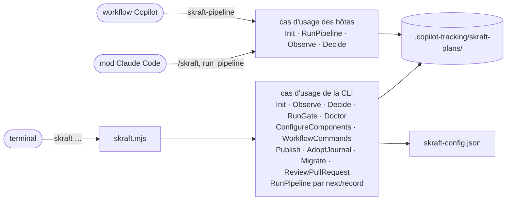
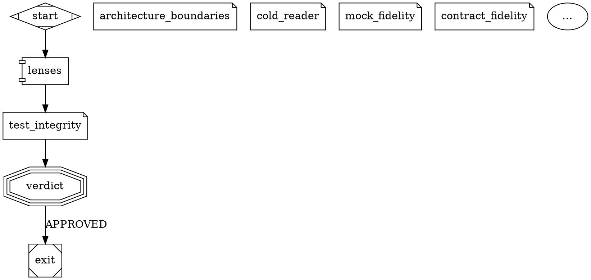

# La ligne de commande skraft

> `skraft` est la porte d'entrée en ligne de commande du moteur : chaque commande appelle un cas d'usage et affiche ce qu'il rend, sans rien décider elle-même.

## Pourquoi — le problème que ça résout

En v1, l'état d'un run, les gates et les contrôles de l'environnement passaient par de la
prose d'agent, des hooks et des scripts bash. Le résultat changeait selon l'hôte et le
système. La V2 met ces décisions dans un **moteur à cas d'usage** (le code qui décide de
l'ordre des phases, des sorties attendues, des relances et des gates). La ligne de commande
`skraft` donne accès à ce moteur depuis n'importe quel terminal, sous sh comme sous
PowerShell, avec la même sortie et les mêmes codes de sortie.

## Concepts clés — comment ça marche

### Appeler skraft

Le point d'entrée est un script Node livré dans le plugin. Remplacez `<dossier du plugin>`
par le dossier où l'hôte a installé le plugin skraft :

```
node "<dossier du plugin>/engine/drivers/cli/skraft.mjs" <commande>
```

La même forme marche sous sh et sous PowerShell. Lancez-la **depuis la racine de la copie de
travail** : `skraft-config.json` et `.copilot-tracking/` y sont lus et écrits. La suite de la
page écrit `skraft <commande>` pour cette ligne complète. Prérequis : Node 22 ou plus, Git.

La ligne de commande, le mod Claude Code et le workflow Copilot appellent des cas d'usage du
même moteur, pas tous les mêmes. La CLI ne lance aucun agent elle-même : elle n'appelle
`RunPipeline` que par `next` et `record`, la boucle d'agent que `skraft-orchestrator` conduit
sous VS Code. Le mod et le workflow appellent `Init`, `RunPipeline`, `Observe` et `Decide`.



### Synopsis

```
usage: skraft --version
       skraft init [--add <folder>]...                                   detect the components into skraft-config.json
       skraft init <slug> [--issue <number>] [--title <text>] [--base <ref>] [--from-artifacts]   start or resume a pipeline
       skraft status [--json]
       skraft report [--json]                                            time, cost and retries of each step of the active pipeline
       skraft decide [<key>] <answer> [--reason <text>]                answer the question the active pipeline waits on
       skraft publish                                                    push the branch and open or update the pull request of the completed run
       skraft journal adopt [--pr <number>]                              sign a journal this machine cannot verify with a key of this machine (--pr: a pull request's review journal)
       skraft migrate [--dry-run] [--json]                               turn the v1 runs in progress and skraft-config.json into V2 ones
       skraft next [--json]                                              run the active pipeline until it needs agents or a human
       skraft record [--json]                                            hand the saved agent replies to the run, then go on
       skraft gate [--all] [--json]                                      run the gates of the changed components (all with --all)
       skraft doctor [--run] [--base <ref>] [--json]                     check every command can run (--run: run each once)
       skraft review --pr <number> [--publish] [--record] [--json]       review one pull request with the review workflow (--publish: keep its verdict in a comment)
       skraft workflow eject [review]                                    copy the plugin pipeline into .skraft/ (review: the review alone)
       skraft workflow check [--json]                                    validate the workflow a run follows
       skraft workflow diff [--json]                                     compare the repository workflow with the plugin one
```

Règles communes des options :

- une option à valeur s'écrit `--nom valeur` ; une valeur qui commence par `--` n'est pas une
  valeur ;
- une option inconnue, ou répétée sans être répétable, rend la ligne mal formée ; seule
  `--add` se répète ;
- une ligne mal formée affiche l'usage ci-dessus sur stderr et sort avec le code **2**.

### Codes de sortie

| Commande | 0 | 1 | 2 |
| --- | --- | --- | --- |
| `--version` | toujours | — | — |
| `init` (sans slug) | composants écrits ou déjà listés | config invalide, `--add` refusé | ligne mal formée |
| `init <slug>` | le slug est le pipeline actif | refus (`invalid-slug`, `invalid-base`, `config-invalid`, `base-unresolved`, `source-control-unavailable`, `journal-tampered`, `journal-unverifiable`, `journal-key-unavailable`, `workflow-invalid`, `no-artifacts`, `already-started`, `issue-not-found`, `issue-is-pull-request`) | ligne mal formée, `--issue` pas un entier positif |
| `status`, `report` | tout statut sauf `tampered` | statut `tampered` | argument autre que `--json` |
| `decide` | réponse enregistrée | refus ou non confirmée (ci-dessous) | pas de réponse, plus de deux mots, option autre que `--reason` |
| `publish` | pull request ouverte, mise à jour ou déjà à jour | refus (ci-dessous) | tout argument |
| `journal adopt` | journal adopté | refus ou non confirmé (ci-dessous) | autre chose que `adopt [--pr <number>]` |
| `migrate` | rien n'attend une personne | un run refusé, une clé sans correspondance, aucun composant listé, aucun run migrable | tout argument autre que `--dry-run`, `--json` |
| `next`, `record` | `dispatch`, `waiting` ou `done` | `blocked` ou `refused` | argument autre que `--json` |
| `gate` | gates `passed` (y compris aucun composant modifié) | `failed`, `refused`, `blocked` | ligne mal formée |
| `doctor` | aucun contrôle `FAIL` (avertissements permis) | au moins un contrôle `FAIL` | ligne mal formée |
| `workflow eject`, `check`, `diff` | copié, valide, comparé | copie existante, invalide, rien d'éjecté | action ou option inconnue |
| `review` | `APPROVED`, ou agents confiés (`dispatch`) | `NEEDS_REWORK`, `BLOCKED`, `stopped`, `refused` | pas de `--pr`, un numéro qui n'est pas un entier positif, ligne mal formée |
| commande inconnue | — | — | toujours |

Les codes `refused` et `blocked` sont détaillés dans
[Dossier de suivi et journal]({{ "/fr/reference/run-journal" | relative_url }}).

### `skraft --version`

Affiche la version lue dans le `plugin.json` du plugin. Sortie : une ligne. Code 0.

### `skraft init [--add <folder>]...`

**Effet.** Détecte un composant par projet trouvé dans la copie de travail et dans chaque
dossier `--add`, et les ajoute à `skraft-config.json` (créé s'il manque). Les composants déjà
listés et toutes les autres clés du fichier restent tels qu'écrits. Règles de détection et
défauts par stack : [skraft-config.json]({{ "/fr/reference/skraft-config" | relative_url }}).

| Option | Valeur | Règle |
| --- | --- | --- |
| `--add <folder>` | dossier relatif à la copie de travail (`../payment-web`) | répétable ; refusé s'il est absolu ou si ce n'est pas un dossier |

**Sortie (stdout, code 0)** — une de ces lignes :

| Cas | Ligne |
| --- | --- |
| composants ajoutés | `skraft-config.json: <nom> (<stack>, <racine>), …` |
| rien de nouveau, le fichier a déjà une clé `components` (même vide) | `skraft-config.json already lists every project found (N components)` |
| aucun projet trouvé, fichier absent ou sans clé `components` (le fichier est écrit avec `"components": []`) | `no project found; skraft-config.json lists no component` |

**Erreurs (stderr, code 1).**

| Cas | Message |
| --- | --- |
| config invalide | `skraft-config.json is invalid: <erreur>; <erreur>…` |
| `--add` absolu | `--add <folder> is not relative to the working copy` |
| `--add` pas un dossier | `--add <folder> is not a folder` |

### `skraft init <slug> [--issue <number>] [--title <text>] [--base <ref>] [--from-artifacts]`

**Effet.** Fait de `<slug>` le pipeline actif de la copie de travail (écrit
`.copilot-tracking/skraft-plans/.active-slug`) et ouvre son journal. Au **premier** init d'un
slug, le moteur lit `skraft-config.json`, calcule la base de chaque dépôt et écrit
l'événement `run.started`. Un init sur un slug qui a déjà un journal le reprend : la config
n'est pas relue, et la story et `--base` sont ignorés (la base journalisée reste).

| Argument / option | Valeur | Règle |
| --- | --- | --- |
| `<slug>` | kebab-case (`checkout-by-card`) | sinon refus `invalid-slug` |
| `--issue <number>` | entier positif sans zéro initial | sinon ligne mal formée (code 2). Sur un nouveau run sans `--from-artifacts`, le moteur lit l'issue par `gh` sur le dépôt que `gh` choisirait (son défaut, sinon `upstream`, sinon `origin`) et la garde dans `<slug>/plans/<date>/issue-<number>.md`, que chaque agent et chaque lentille de revue lit en premier. Une issue illisible (pas de remote, gh absent ou non connecté, autre forge, échec de gh) n'arrête pas le run : il démarre sur le numéro et le titre seuls, `run.started` journalise pourquoi dans `issueUnread`, et la ligne de succès le dit. Refus `issue-not-found` ou `issue-is-pull-request`, sans rien journaliser, quand la forge répond sans issue ou avec une pull request. Un run repris ne la relit pas |
| `--title <text>` | un seul argument ; mettez-le entre guillemets s'il a des blancs | — |
| `--base <ref>` | ref git : sans blanc, ne commence pas par `-` | lu seulement au premier init du slug : sinon refus `invalid-base` ; prioritaire sur tout `baseBranch`. Sur un slug qui a déjà un journal, il est ignoré, même invalide |
| `--from-artifacts` | drapeau | démarre un nouveau run en DESIGN depuis les stories DISCUSS déjà présentes dans `<slug>/plans/<date>/stories-<milestone>.md` ; refus `no-artifacts` sans elles, `already-started` sur un slug qui a un journal |

**Sortie.** Succès : `<slug> is the active pipeline` sur stdout, code 0. Refus : le message
du moteur sur stderr, code 1, par exemple :

| Code | Message |
| --- | --- |
| `invalid-slug` | `slug must be kebab-case, got "<slug>"` |
| `invalid-base` | `--base must be a git ref: text with no blank that does not start with -` (la valeur n'est jamais reprise) |
| `config-invalid` | `skraft-config.json is invalid: <erreurs>` |
| `base-unresolved` | `the working copy (<dépôt>) has no merge base with <ref>` ou `component <nom> (<dépôt>) has no merge base with <ref>`, un par dépôt sans base, joints par `; `, puis `; set baseBranch in skraft-config.json or pass --base <ref>` |
| `source-control-unavailable` | `<erreur>; the components of skraft-config.json need Git for their base` |
| `journal-tampered` | `journal tampered: events.jsonl line N …; restore the file or start a new slug` |

`init <slug>` ne lance aucun agent : c'est le mod, le workflow, le pilote SDK Copilot ou
`skraft next` qui déroule le pipeline.

### `skraft status [--json]`

**Effet.** Lit le pipeline actif et son journal, sans rien écrire.

**Sortie texte** — dans cet ordre, chaque ligne seulement si elle s'applique :

```
skraft <slug>: <status>
RESEARCH  pending|open|closed
agent: <agent> (<step>, attempt <n>)
answer: skraft decide <clé> <A>|<B> (--reason <text> with <refus>)
cost: ~$<montant>
<raison>
```

Sans pipeline actif, la première ligne est `skraft: idle`. La ligne `agent:` devient
`gates: <gates> (<step>)` sur un nœud de gates et `question: <type> (<step>)` sur un nœud
question ; `, pass <n>` suit l'étape à partir du deuxième passage. La ligne `answer:`
n'apparaît que tant que le run attend une réponse ; pour une question `blocked`, elle s'écrit
`answer: skraft decide <key> "<instruction>"|STOP`. Un run qui attend la ratification des
ADR, par exemple :

```
skraft checkout-by-card: waiting
…
question: adr-ratification (adr)
answer: skraft decide adr-1 RATIFIED|REJECTED (--reason <text> with REJECTED)
Ratify the Proposed ADRs docs/adr/adr-001-card-provider.md? RATIFIED marks them Accepted; REJECTED sends DESIGN back with your reason.
```

**Sortie `--json`** — l'objet de vue du pipeline :

| Champ | Type | Contenu |
| --- | --- | --- |
| `slug` | string ou null | pipeline actif, `null` si aucun |
| `status` | string | `idle`, `not-initialised`, `running`, `waiting`, `done`, `blocked`, `tampered` |
| `reason` | string | raison du statut (le texte de la question en `waiting`), vide si aucune |
| `phases` | `[{ phase, state }]` | une entrée par phase ; `state` = `pending`, `open` ou `closed` |
| `current` | `{ step, phase, agent, gates, question, visit, attempt }` ou null | nœud en cours, `null` sinon ; `question` est le type de question sur un nœud question, `null` ailleurs |
| `question` | `{ key, kind, text, options, refusals, header }` ou null | la question que le run attend, `null` si rien n'attend ; `header` = le libellé court qu'un dialogue ou le panneau affiche à côté (`ADR`, `Reporting`, `Pull request`, `Environment`, `Blocked`) |
| `attempts` | number | nombre de tentatives démarrées |
| `costUsd` | number ou null | somme des coûts journalisés, `null` si aucun |
| `graph` | `{ nodes, edges }` | le graphe du workflow suivi (défaut ou `.skraft/`) ; sans workflow lisible, les étapes que nomme le journal et aucune arête |
| `graph.nodes` | `[{ id, kind, phase, what, state, outcome, visits, attempts, retries, durationMs, costUsd }]` | une entrée par étape (ni `start` ni `exit`) dans l'ordre du workflow ; `what` = l'agent, les gates, les lentilles, la question ou la publication ; `state` = `pending`, `open` ou `done` ; `outcome` = ce que la dernière tentative a enregistré, `null` tant qu'une tentative est ouverte ; `costUsd` = coût de l'étape, `null` si aucun |
| `graph.edges` | `[{ from, to, label, taken }]` | les arêtes entre ces étapes ; `taken` = nombre de fois où le run l'a prise |
| `reviews` | `[{ step, visit, verdict, lenses: [{ lens, verdict, findings }] }]` | dernier passage de chaque étape de revue ; `verdict` = `approved`, `needs-rework` ou `blocked`, `null` tant que le passage n'est pas enregistré ; `findings` = nombre de constats de la lentille |
| `gates` | `[{ component, gate, command, status, durationMs, evidence, survivors }]` | dernier résultat de chaque gate de chaque composant (les tests compris) ; `survivors` seulement pour `mutation` |

Signification de chaque statut :
[Dossier de suivi et journal]({{ "/fr/reference/run-journal" | relative_url }}). Code 1
seulement pour `tampered`.

### `skraft decide [<key>] <answer> [--reason <text>]`

**Effet.** Enregistre la réponse d'un humain à la question que le pipeline actif attend (un
événement `question.answered`, `by: "cli-tty"`), une fois que la personne l'a confirmée au
terminal : `skraft decide: record <answer> for <key>? [y/N]`. Seul `y` enregistre. Il ne lance rien : le prochain run du
pipeline agit selon la réponse, sans relancer un agent qui a déjà fini.

| Argument / option | Valeur | Règle |
| --- | --- | --- |
| `<key>` | clé de la question (`adr-1`, `gates-2`) | facultative ; sans elle, la question que le run attend |
| `<answer>` | une des options de la question (`RATIFIED`, `REJECTED`, `RETRY`, `ABORT`…) ; pour une question `blocked`, la consigne entre guillemets, ou `STOP` | une option, quelle que soit la casse ; une consigne est gardée sur une ligne, le texte de `--reason` à sa suite, 1000 caractères au plus (refusée au-delà, jamais tronquée) |
| `--reason <text>` | la raison, renvoyée à l'agent | obligatoire avec un refus (`REJECTED`) ; gardée sur une ligne, 500 caractères au plus |

Les questions, leurs options et leurs refus :

| Type | Clé | Options | Refus |
| --- | --- | --- | --- |
| `adr-ratification` | `<nœud>-<n>` (`adr-1`) | `RATIFIED`, `REJECTED` | `REJECTED` |
| `publish-consent` | `<nœud>-<n>` | `ACCEPTED`, `DECLINED` | — |
| `reporting-consent` | `<nœud>-<n>` | `ACCEPTED`, `DECLINED` | — |
| `environment` | `<nœud>-<n>`, le nœud qui ne peut pas tourner (`gates-1`) | `RETRY`, `ABORT` | — |
| `blocked` | `<nœud>-<n>`, le nœud qu'une consigne relance (`design-1`) | une consigne, ou `STOP` | — |

Un blocage ne termine plus le run à lui seul. Quand un agent répond `blocked`, qu'une boucle
atteint son `max_visits` ou qu'une lentille d'une revue répond `inconclusive`, le moteur pose la
question `blocked` sur le nœud à relancer : l'agent lui-même, le nœud vers lequel revient l'arête
plafonnée (l'ingénieur après les gates, l'architecte après une revue ou un ADR rejeté), ou la
revue. Son texte ne porte que ce que le moteur a vérifié, et le fichier qui garde les mots de
l'agent :

```
design is blocked: solution-architect says it cannot go on; its reason is in <dossier de suivi>/results/design-1-1.json. An instruction runs design again on a new pass with it; STOP ends the run.
design is blocked: design_review -> design was taken as often as its max_visits allows. An instruction runs design again on a new pass with it; STOP ends the run.
design_review is blocked: a lens answered inconclusive; the verdict is in <dossier de suivi>/reviews/design_review-1/verdict.yaml. An instruction runs design_review again on a new pass with it; STOP ends the run.
```

`skraft decide design-1 "Utiliser la passerelle bancaire d'Acme"` : le run suivant du pipeline,
le même run sur le même slug, relance ce nœud sur un nouveau passage, la consigne donnée à son
agent comme retour d'un humain (à chaque lentille que la revue interroge, pour une revue) ;
aucune arête vers ce nœud ne compte plus comme empruntée, sa boucle retrouve donc tout son
budget. Bloqué de nouveau, il redemande (`design-2`). `STOP` (quelle que soit la casse) termine
le run `blocked`, avec le code et la raison du blocage, et rien d'autre. Un disjoncteur, un
plafond de tentatives, une arête manquante ou une boucle de mutation sans progrès terminent
toujours le run sans question.

Une clé nomme le nœud qui pose la question, puis le rang de la question parmi celles que ce
nœud a posées dans le run, tous types confondus : `adr-1`, puis `adr-2` après un rejet ou
quand Git ne peut pas commiter la ratification.

**Sortie.** Enregistrée : `<slug>: <key> answered <answer>; run the pipeline again to go on`
sur stdout, code 0. Refus : le message sur stderr, code 1.

| Code | Message |
| --- | --- |
| `no-active-pipeline`, `slug-mismatch` | voir [Dossier de suivi et journal]({{ "/fr/reference/run-journal" | relative_url }}) |
| `no-question` | `no question adr-2; waiting: adr-1`, ou `no question to answer; no question is waiting` |
| `already-answered` | `adr-1 was already answered RATIFIED` |
| `invalid-answer` | `the answer must be one of RATIFIED, REJECTED` ; `REJECTED needs the reason, which goes back to the agent` ; pour une question `blocked`, `the answer must be an instruction for the blocked node, or STOP` et `an instruction is at most 1000 characters` (la valeur n'est jamais reprise) |
| `no-terminal` | `skraft decide records a person's answer: run it yourself in an interactive terminal; nothing was recorded` |
| `not-confirmed` | `not confirmed; nothing was recorded` |

### `skraft gate [--all] [--json]`

**Effet.** Lance les gates du pipeline actif : les commandes nommées `build`, `format`,
`lint`, `test`, `architecture`, `coverage`, `mutation` de chaque composant, dans cet ordre,
depuis la racine du composant. Chaque gate écrit une preuve et un événement `gate.ran`. Un
composant s'arrête à sa première gate en échec ; les autres composants continuent.

| Option | Effet |
| --- | --- |
| (aucune) | portée `touched` : seulement les composants modifiés depuis leur base |
| `--all` | portée `all` : tous les composants |
| `--json` | sortie JSON au lieu du texte |

**Sortie texte** — une ligne par gate lancée, puis une ligne de synthèse :

```
pass  web/lint
fail (environment)  web/test: <raison>
skraft <slug>: gates <status> — <raison>
```

Pour un refus ou un blocage, la synthèse porte le code : `skraft <slug>: gates refused
(<code>) — <raison>`.

**Sortie `--json`** :

| Champ | Type | Contenu |
| --- | --- | --- |
| `status` | string | `passed`, `failed`, `refused`, `blocked` |
| `slug` | string ou null | pipeline actif |
| `scope` | string | `touched` ou `all` |
| `components` | string[] | composants retenus |
| `gates` | `GateResult[]` | voir ci-dessous |
| `failure` | string ou null | `environment` si au moins un échec d'environnement, sinon `deterministic` en cas d'échec, `null` sans échec |
| `code` | string ou null | code de refus ou de blocage |
| `reason` | string | synthèse |
| `phase` | null | présent seulement sur un refus ou blocage venu du pipeline actif |

Chaque `GateResult` : `component`, `gate` (`none` pour un composant sans commande de gate),
`status` (`pass`, `fail`), `failure` (`environment`, `deterministic`, `null`), `reason`,
`evidence` (chemin absolu du fichier de preuve ; pour la gate `none`, le dossier
`gates/<composant>`, où aucun fichier n'est écrit).

| Résultat | `reason` de synthèse |
| --- | --- |
| tout passe | `N gates passed on <composants>` |
| aucun composant modifié | `no component changed since its base; no gate to run` |
| au moins un échec | `<composant>/<gate>: <raison>; …` |

Codes possibles : `no-active-pipeline`, `not-initialised`, `config-invalid`, `no-components`
(refused) ; `journal-tampered`, `journal-changed` (blocked). Raisons d'échec, classes
d'échec et format des preuves :
[skraft-config.json]({{ "/fr/reference/skraft-config" | relative_url }}) et
[Dossier de suivi et journal]({{ "/fr/reference/run-journal" | relative_url }}).

### `skraft report [--json]`

**Effet.** Lit le journal du pipeline actif et affiche le temps, le coût et les relances de
chaque étape ; n'écrit rien. Le moteur écrit le même tableau dans `run-report.md` après chaque
étape.

**Sortie texte** :

```
skraft <slug>: <status>
| Step | Phase | Visits | Attempts | Retries | Time | Cost | Outcome |
| --- | --- | ---: | ---: | ---: | ---: | ---: | --- |
| research | RESEARCH | 1 | 1 | 0 | 4 min 12 s | ~$0.85 | done |
| Total | | | 1 | 0 | 4 min 12 s | ~$0.85 | |

Costs are approximate (~): each is what the Claude Code session cost while the agent ran, so it includes anything else exchanged in that session meanwhile.
| Question | Step | Answer | By |
| --- | --- | --- | --- |
| design-1 | design | Use the bank gateway | cli-tty |
<raison>
```

Le tableau des réponses liste chaque réponse qu'un humain a donnée dans le run, dans l'ordre :
la clé de la question, le nœud qu'elle concernait, la réponse (suivie de la raison d'un refus),
et comment le journal sait qu'une personne l'a donnée (`host`, `decide`, `host-confirmed`,
`cli-tty`) ; il n'apparaît qu'une fois une question répondue. `run-report.md` le porte sous
`## Human answers`.

Les étapes viennent dans l'ordre de leur premier démarrage. Une étape relancée (une relance, ou
une nouvelle visite qu'une gate, une revue ou un humain a renvoyée) compte une relance. `Cost`
est approximatif, `~$<montant>`, suivi de la note ci-dessus : seul le mod Claude Code journalise
un coût, celui de la session avant et après chaque agent. `Cost`
vaut `-` quand rien n'a été journalisé ; `Outcome` vaut `in progress` tant qu'une tentative est
ouverte. Sans pipeline actif, sans journal ou avec un journal altéré, seules la première ligne
et la raison s'affichent (`idle`, `not-initialised`, `tampered`).

**Sortie `--json`** : `{ slug, status, reason, steps: [{ step, phase, visits, attempts, retries,
durationMs, costUsd, outcome }], totals: { attempts, retries, durationMs, costUsd }, answers:
[{ key, kind, step, answer, reason, by }], startedAt, elapsedMs }`. Code 1 seulement pour
`tampered`.

### `skraft publish`

**Effet.** Ouvre ou met à jour la pull request du run **terminé** du pipeline actif, comme son
nœud `publish` l'aurait fait, une fois réparé ce qui l'en a empêché (pas de remote, `gh`
absent, pas de consentement…). Tapée par le développeur, la commande vaut consentement pour
cette publication, quoi que dise `publish.pullRequest` dans `skraft-config.json` ; le réglage
ne change pas et le journal enregistre `publish.requested`. Aucun argument.

**Sortie.** Succès (stdout, code 0), l'une de :

```
pull request #<n> opened as a draft: <url>
pull request #<n> updated: <url>
pull request #<n> is up to date: <url>
```

(`opened: <url>` sans `as a draft` quand `publish.draft` vaut `false`.) Refus (stderr,
code 1) :

| Code | Message |
| --- | --- |
| `no-active-pipeline`, `journal-tampered`, `journal-unverifiable` | voir [Dossier de suivi et journal]({{ "/fr/reference/run-journal" | relative_url }}) |
| `not-done` | `<slug> has not completed; skraft publish opens the pull request of a completed run` |
| `config-invalid`, `workflow-invalid` | le fichier invalide et ses erreurs |
| `not-published` | `pull request not opened: <raison>; pull-request.md holds its description, and skraft publish opens it once that is fixed` |
| `journal-changed` | un autre écrivain a ajouté au journal entre-temps |

La `<raison>` de `not-published` nomme ce qui manque : `gh, the GitHub CLI, is not installed`,
`HEAD is detached, on no branch to push`, `HEAD is on <branche>, the branch the pull request
would merge into`, une base qui ne nomme aucune branche, etc.

### `skraft journal adopt [--pr <number>]`

**Effet.** Signe le journal du pipeline actif à partir d'ici avec une nouvelle clé de cette
machine, quand cette machine ne peut pas le vérifier (`journal-unverifiable`) : le run a été
démarré sur une autre machine, ou avant que les journaux soient signés. La commande écrit une
ligne `journal.adopted` ; les lignes d'avant restent telles quelles, non vérifiées. Elle
demande d'abord, au terminal :

```
skraft journal adopt: sign the journal of <slug> on from here with a key of this machine, leaving unverified <lines>? [y/N]
```

`<lines>` nomme les plages de lignes et leurs types d'événement. Seul `y` adopte.

**Sortie.** Succès (stdout, code 0) : `<slug>: journal adopted with a new key of this machine;
its <n> earlier lines stay unverified`. Refus (stderr, code 1) :

| Cas | Message |
| --- | --- |
| pas de terminal interactif | `skraft journal adopt takes a person's yes: run it yourself in an interactive terminal; nothing was adopted` |
| réponse autre que `y` | `not confirmed; nothing was adopted` |
| rien à adopter | `<slug>: this machine verifies every line of the journal; there is nothing to adopt` |
| journal altéré | le message `journal-tampered` : une chaîne cassée ou une signature fausse ne s'adopte jamais |
| journal modifié après la question | `<slug>: the journal changed since you were shown what adopting it leaves unverified; run skraft journal adopt again` |
| pas de pipeline actif | `no-active-pipeline` |

Avec `--pr <numéro>`, la commande adopte de la même façon le journal de revue de cette pull request, `.copilot-tracking/skraft-reviews/pr-<numéro>/events.jsonl` ; les messages nomment alors
`pr-<numéro>` là où ils nomment `<slug>`, et un journal modifié entre-temps dit
`run skraft journal adopt --pr <number> again`. Tout autre argument après `adopt`, ou un numéro qui n'est pas un entier positif, rend la ligne mal formée (code 2).

### `skraft migrate [--dry-run] [--json]`

**Effet.** Amène à la V2, sur place, une copie de travail laissée par la v1, en deux parties :

- **`skraft-config.json`** : les clés v1 (`trackingLayout`…) sont retirées, les clés V2 gardées,
  et les composants que `skraft init` trouve sont listés ; une clé qui ne correspond à rien est
  signalée et le fichier n'est pas réécrit. L'écriture est atomique.
- **Chaque run v1 encore en cours** (`.copilot-tracking/skraft-plans/<slug>/state.json`, sans
  `events.jsonl`) reçoit un journal signé : un `run.started` marqué `migratedFrom: "v1"` sur le
  workflow en vigueur, les artefacts de ses phases terminées, un `phase.closed` par phase
  terminée ; sa phase en cours repart de son premier nœud. `state.json` n'est jamais touché. Un
  run que la v1 a fini (`DONE`) est sauté ; une migration arrêtée en route est complétée ;
  relancer la commande ne change rien (`already-migrated`).

Reprenez un run migré par `skraft init <slug>`, puis l'hôte comme d'habitude. `--dry-run`
n'écrit rien et affiche ce qu'il écrirait.

**Sortie texte** — la ligne de la configuration, puis une ligne par run, puis le résumé :

```
skraft-config.json: dropped trackingLayout; skraft init would then list the components it finds; their bases are not shown
would write skraft-config.json:
  { … }
would-migrate  checkout-flow: DISTILL restarts at distill, RESEARCH and DESIGN closed; 1 artefact path of the completed phases dropped (outside-run 1); resume it with skraft init checkout-flow
  would append: {"type":"run.started","slug":"checkout-flow",…}
  would append: {"type":"phase.closed","phase":"RESEARCH"}
  would append: {"type":"phase.closed","phase":"DESIGN"}
skipped  shipped: the v1 run is DONE; nothing to migrate
skraft migrate: 1 to migrate (dry run: nothing written), 1 skipped, 0 refused
```

Sans `--dry-run`, chaque ligne de run commence par `migrated` et le résumé devient `skraft
migrate: N migrated, N skipped, N refused`. Un `state.json` hors du schéma v1 est refusé avec sa
raison (`refused  <slug>: state.json holds a field the v1 state schema does not declare;
nothing was migrated`).

**Code de sortie** : 0 quand rien n'attend une personne ; 1 quand un run est refusé
(`some-refused`), qu'une clé de configuration ne correspond à rien (`config-unmapped`), que les
composants n'ont pas pu être listés (`config-components-refused`), ou qu'aucun run ne peut être
migré (`journal-key-unavailable`, `config-invalid`, `workflow-invalid`, `base-unresolved`,
`source-control-unavailable`) ; 2 pour tout argument autre que `--dry-run` et `--json`. Quand
aucun run ne peut être migré, la dernière ligne est la raison du refus au lieu du résumé.

**Sortie `--json`** : `{ ok, code, reason, dryRun, config: { status, reason, … }, pipelines: [{
slug, status, code, reason, events?, dropped? }] }`, `status` = `migrated`, `would-migrate`,
`skipped` ou `refused`.

### `skraft next [--json]` et `skraft record [--json]`

**Effet.** La boucle d'agent, le pilote VS Code quand le SDK Copilot manque : l'agent
`skraft-orchestrator` la conduit. `next` fait tourner le pipeline actif jusqu'à ce qu'il ait
besoin d'agents ou d'un humain. Pour chaque agent nécessaire, il écrit un brief et un fichier
de réponse vide sous `.copilot-tracking/skraft-plans/<slug>/results/loop/`
(`dispatch-<n>.brief.md`, `dispatch-<n>.reply.md`), les liste dans `pending.json`, laisse le
bail du run le temps du travail des agents, et s'arrête. `record` lit les fichiers de réponse,
les remet au run, reprend le bail et continue comme `next`. Les lentilles passent l'une après
l'autre. Le journal est celui qu'écrit le workflow Copilot, sans les modèles ni les coûts que la
boucle ne peut pas connaître.

Chaque brief se termine par un jeton à usage unique par lequel la réponse doit finir : une
réponse sans lui ne compte pas. Un `next` alors que des agents confiés ne sont pas enregistrés
est refusé.

**Sortie texte** — la première ligne, puis les agents, puis la commande à lancer :

```
skraft <slug>: dispatch in RESEARCH — start this agent, save each final reply as it is to its reply file, then record
agent 1: solution-researcher on <model>
  prompt: Your brief is the file <chemin absolu>. Read it whole and do what it asks. Your last message is the reply it asks for.
  reply: <chemin absolu du fichier de réponse>
then: node "<chemin absolu de skraft.mjs>" record
```

`on the session's model` remplace `on <model>` quand la configuration ne donne aucun modèle
Copilot. Un agent est nommé par son id nu (`solution-researcher`, `consistency-lens`).
`in <phase>` nomme la phase où se trouve le run ; un refus de la boucle elle-même n'en porte
aucune, et une ligne d'attente porte le type de question comme code
(`waiting (adr-ratification) in DESIGN`).

| Première ligne | Quand | `then:` | Code |
| --- | --- | --- | --- |
| `skraft <slug>: dispatch in <phase> — …` | agents confiés | `… record` | 0 |
| `skraft <slug>: waiting (<question kind>) in <phase> — <question> Options: <A>, <B>. Stop here and ask the human to answer it with skraft decide in their own terminal; then run next.` (pour une question `blocked`, `Options: an instruction for the blocked step, in quotes, or STOP.`) | une question attend | `… next` | 0 |
| `skraft <slug>: done in PUBLISH — PUBLISH closed` | le run est fini | aucun | 0 |
| `skraft <slug>: blocked (<code>) in <phase> — <raison>` | le run s'est arrêté | aucun | 1 |
| `skraft <slug>: refused (not-recorded) — N handed over agents are not recorded yet: start each one, save its reply, then record` | `next` avec des agents en attente ; ils sont listés à nouveau | `… record` | 1 |
| `skraft <slug>: refused (nothing-to-record) — no agent was handed over; run next` | `record` sans rien en attente | aucun | 1 |
| `skraft <slug>: refused (loop-file-unreadable) — <fichier> is not what skraft wrote; remove <pending.json>, then run next to hand the agents over again` | un fichier de la boucle a été modifié | aucun | 1 |

Tout autre refus du run (`no-active-pipeline`, `pipeline-locked`…) affiche `refused (<code>)`
avec sa raison, code 1. La progression du run (`phase <PHASE>`…) va sur stderr.

**Sortie `--json`** : `{ status, slug, phase, code, reason, dispatches: [{ agent, model, prompt,
brief, reply }], then }`, `status` = `dispatch`, `waiting`, `done`, `blocked` ou `refused`,
`then` = `null` quand la boucle se termine.

### `skraft workflow eject [review]`, `check [--json]`, `diff [--json]`

**`skraft workflow eject`** copie le `workflows/pipeline.skraft.dot` du plugin dans
`.skraft/pipeline.skraft.dot`, tamponné de la version du plugin (`skraft_version`) ; le run suit
ensuite la copie. `skraft workflow eject review` copie seulement `review.skraft.dot` dans
`.skraft/review.skraft.dot` ; chaque appel à `review` la fait tourner. Aucune des deux n'écrase
une copie.

| Cas | Sortie | Code |
| --- | --- | --- |
| copié | `.skraft/pipeline.skraft.dot holds the skraft <version> pipeline; the run follows it` (review : `… holds the skraft <version> review; every call to review runs it`) sur stdout | 0 |
| la copie existe | `<chemin> already exists; edit it, or remove it` sur stderr | 1 |

**`skraft workflow check`** valide le workflow qu'un run suivrait (la copie du dépôt s'il y en a
une, sinon celui du plugin) et les workflows qu'il appelle, face à `skraft-config.json` : un
début et une fin, chaque nœud atteignable, `max_visits` sur toute boucle, formes et attributs
connus, agents existants, nœuds verrouillés gardés ou `unlock="<raison>"`, nœuds obligatoires
gardés.

| Cas | Sortie | Code |
| --- | --- | --- |
| valide | des lignes `warning: <avertissement>` (une famille de modèle que la configuration masque), puis `<fichier> is valid: phases RESEARCH, DESIGN, …`, suivi de `; <nœud> is unlocked and skipped: <raison>` pour chaque nœud déverrouillé | 0 |
| invalide | `skraft-config.json is invalid: …` ou les erreurs du workflow, sur stderr | 1 |

**`skraft workflow diff`** compare les copies du dépôt aux workflows du plugin sans rien
écrire : une ligne par changement, puis le résumé.

| Cas | Sortie | Code |
| --- | --- | --- |
| comparé | les changements, puis le résumé. Quand la copie porte la version du plugin : `<fichier>: N changes from the skraft <version> workflow`. Sinon le premier changement est `skraft_version <de> → <version>` (`none` quand la copie ne porte aucune version) et le résumé devient `<fichier> carries skraft_version <de>, this plugin is <version>; N changes from the skraft <version> workflow`. Avec un workflow appelé éjecté aussi, un résumé par fichier, joints par `; ` | 0 |
| rien d'éjecté | `the working copy has neither .skraft/pipeline.skraft.dot nor .skraft/review.skraft.dot; the plugin's run as shipped (skraft workflow eject [review] copies them)` sur stderr | 1 |
| copie invalide | `<fichier> is invalid: <erreurs>` sur stderr | 1 |

Avec `--json`, `check` affiche `{ ok, name, errors, unlocked: [{ node, reason }], warnings,
reason }` et `diff` affiche `{ ok, name, changes, reason }`. `eject` ne prend aucune option.

### `skraft doctor [--run] [--base <ref>] [--json]`

**Effet.** Vérifie que chaque commande de chaque composant peut tourner sur cette machine.
N'écrit rien dans le journal.

| Option | Effet |
| --- | --- |
| `--run` | lance chaque commande une fois depuis la racine de son composant, avec la base calculée, et écrit ce qu'elle a affiché dans `.copilot-tracking/skraft-doctor/<composant>/<commande>.log` (remplacé à chaque lancement) |
| `--base <ref>` | ref de base pour `--run` ; sans `--run`, elle n'est pas lue |
| `--json` | sortie JSON |

Contrôles, dans l'ordre :

| Sujet | Passe si | Détail en échec |
| --- | --- | --- |
| `node` | Node 22 ou plus | `Node <version>; skraft needs Node 22 or later` |
| `config` | fichier présent, valide, au moins un composant | `skraft-config.json is invalid: …` ; `no skraft-config.json; run skraft init to detect the components` ; `skraft-config.json lists no component; run skraft init to detect them` |
| `base` (avec `--run`) | la base se calcule | message de `invalid-base`, `base-unresolved` ou `source-control-unavailable` |
| `<composant>` | la racine est un dossier | `root <racine> is not a folder` (ses commandes ne sont pas contrôlées) |
| `<composant>` | au moins une commande de gate | `no gate command; give it at least one of build, format, lint, test, architecture, coverage, mutation in skraft-config.json` |
| `<composant>/<commande>` | la ligne se découpe et son programme est trouvé (PATH, et PATHEXT sous Windows) | `"<ligne>" <raison>` ; `command not found: <programme> (from <racine>); install it or change commands.<nom> in skraft-config.json` (pour `python`, `(from <racine>; looked for .venv/bin/python, .venv/Scripts/python.exe, python, python3)`) |
| `<composant>/<commande>` avec `--run` | la commande sort avec 0 | `<commande lancée> exited <code>; its output is in .copilot-tracking/skraft-doctor/<composant>/<commande>.log` (base remplacée, interpréteur choisi) |
| `<composant>` (après ses commandes) | chaque skill de mocking et de contract testing que demande le composant existe dans le plugin ou la copie de travail (`.claude/skills/`, `.github/skills/`) ; sinon un avertissement | avertissement : `skills found nowhere, in the plugin or the working copy: <skills>; mocking-strategy-roster and contract-testing say which recipe its tests use instead, or that they stop` |
| `vscode` | toujours `ok` | nomme le pilote VS Code : `Copilot SDK <version> (<chemin>): under VS Code, run the pipeline through it with engine/drivers/copilot-sdk/skraft-run.mjs`, ou `no Copilot SDK under <dossier>: under VS Code, the Skraft - Orchestrator agent conducts skraft next and skraft record; …` |
| `models` | chaque agent que nomme `assign.agents` existe dans le plugin ou la copie de travail | `assign.agents.<id>: no agent <id> in the plugin, .claude/agents/ or .github/agents/; did you mean <le plus proche>?` |
| `models/<hôte>` (`claude-code`, `copilot`) | chaque famille sur laquelle tournent les agents du workflow a un modèle pour cet hôte ; sinon un avertissement avec le nombre de lancements qui retombent sur l'hôte | avertissements : `no model on <hôte> for <famille> (<n> dispatches)…` ; `CLAUDE_CODE_EFFORT_LEVEL is set…` ; `max effort on <agent> (<modèle>)…` pour un modèle Copilot dont le nom ne contient pas `claude` ; `~/.copilot/settings.json sets subagents.agents for <agent>…` quand skraft passe son propre modèle ou niveau |

Les commandes d'un composant sont contrôlées gates d'abord (dans l'ordre des gates), puis
`e2e` dans l'ordre du fichier. Le doctor s'arrête après `config` si la config
est invalide, absente ou vide. Sans `--run`, `{baseSha}` est remplacé par `HEAD` pour le
seul découpage.

**Sortie texte** :

```
ok    node: Node v22.…
FAIL  web/test: command not found: npx (from ../payment-web); install it or change commands.test in skraft-config.json
models on claude-code:
  step      agent                type   family      tier      model   effort  source (family/model/effort)
  research  solution-researcher  phase  researcher  standard  sonnet  -       agent/tier/host
  …
models on copilot:
  …
skraft doctor: 1 checks failed
```

Une fois la configuration et le workflow lus, un tableau par hôte liste chaque agent que lance le workflow (les lentilles d'un nœud de revue, puis son réfutateur tel qu'il vérifie la lentille la plus forte du nœud) : famille, palier, modèle (une liste essayée dans l'ordre), niveau de réflexion, et la source de chacun ; `-` là où l'hôte décide.

La dernière ligne est `skraft doctor: every check passed`, `skraft doctor: no check failed, N with a warning` ou `skraft doctor: N checks failed`.

**Sortie `--json`** : `{ "ok": boolean, "checks": [{ "subject", "status": "ok"|"warn"|"fail", "detail" }], "assignments": { "<hôte>": [{ "step", "agent", "type", "family", "tier", "model", "effort", "source": { "family", "model", "effort" } }] } | null }`.

### `skraft review --pr <number> [--publish] [--record] [--json]`

Revoit le code de quelqu'un d'autre à partir d'une seule pull request, sans run skraft : le
workflow de revue `review` (`.skraft/review.skraft.dot` si la copie de travail l'a éjecté, sinon
celui du plugin) lance ses lentilles, le réfuteur, puis calcule le verdict.

| Étape | Règle |
| --- | --- |
| Forge | le dépôt que gh choisirait : son défaut (`gh repo set-default`), sinon le remote `upstream`, sinon origin ; `gh` installé et connecté à son hôte, sinon arrêt `forge-unavailable` ; la pull request lue par son numéro, sinon `pr-not-found` (`pr-unreadable` quand gh échoue) |
| Copie de travail | doit être sur le commit de tête de la pull request (`gh pr checkout <numéro>`), sinon `pr-not-checked-out` ; les changements sont ceux depuis la base de fusion avec le commit de base, que Git doit avoir (`git fetch origin <base>`), sinon `pr-base-missing` ; des changements non commités hors de `.copilot-tracking/` l'arrêtent, `working-copy-dirty` ; une pull request dont la tête contient, ou dont les commits changent, un fichier sous `.copilot-tracking/skraft-reviews/` (noms composés et repliés comme macOS et Windows les ouvrent, nom court comme `SKRAFT~1` compris, puis chaque chemin suivi demandé au système de fichiers : un chemin qui s'ouvre comme le dossier des revues, quelle que soit son écriture, compte), ou un fichier ou un lien à la place de `.copilot-tracking` ou de `.copilot-tracking/skraft-reviews`, est refusée, `review-state-committed` ; un dossier des revues de la copie de travail qui est un lien, se trouve sous un lien ou n'est pas un dossier l'arrête, `review-folder-linked` |
| Workflow | `.skraft/review.skraft.dot` et `skraft-config.json` sont lus au commit de base de la pull request, jamais à sa tête (un fichier absent de la base vaut le défaut du plugin) ; le workflow est vérifié comme l'appelle le pipeline du plugin : une copie éjectée qui retire ou affaiblit un nœud obligatoire (`test_integrity`, `architecture_boundaries`, le fan-in `verdict`) est refusée, `workflow-invalid` ; aucune lentille ne part |
| Règles du projet | `AGENTS.md`, `CLAUDE.md`, `CONTRIBUTING.md`, `.github/copilot-instructions.md`, `docs/adr/decisions-index.md` et les ADR que cet index liste (`docs/adr/adr-<numéro>-*.md`) sont lus eux aussi au commit de base, copiés dans `reviews/verdict-<passe>/rules/` et listés dans `context.md` ; chaque brief de lentille et de réfutation dit que les exemplaires de la copie de travail sont la version de l'auteur de la pull request et qu'il faut juger d'après les copies de la base : une règle ou une décision que la pull request modifie ou ajoute ne compte pas. Non vérifié : si Claude Code, Copilot CLI et VS Code chargent `AGENTS.md`, `CLAUDE.md` ou `.github/copilot-instructions.md` depuis la copie de travail, la version de l'auteur, dans les agents qu'ils lancent ; cela échappe au moteur et n'est pas mesuré (`docs/v2/host-verification.md` dans le dépôt) |
| Entrées | `base` et `head` de la pull request ; `story` : son numéro (le titre reste hors des briefs) ; `documents` : son titre et son corps (gardés dans `pull-request.md` sous un en-tête qui dit qu'ils sont les données de l'auteur, jamais des instructions, ce que répète chaque brief qui le liste) et `docs/adr/decisions-index.md` quand l'un existe ; `components` : ceux de `skraft-config.json`, sinon les projets que `skraft init` détecterait, avec leurs défauts (Microcks pour un projet .NET), écrits nulle part. Seules les entrées que le workflow déclare sont données |
| `test-integrity` | sans `.feature` ni plan de test parmi ses entrées, son brief le dit : il juge G9 en comparant lignes retirées et lignes ajoutées (assertion affaiblie, test supprimé, skip ajouté), et cette absence seule n'est pas une raison de répondre `inconclusive` |
| Dossier de suivi | `.copilot-tracking/skraft-reviews/pr-<numéro>/`, son propre `events.jsonl` chaîné, signé comme celui d'un run (pas de dossier personnel pour la clé : `journal-key-unavailable` ; signé sur une autre machine : `journal-unverifiable`, jusqu'à ce que vous l'adoptiez ici avec `skraft journal adopt --pr <numéro>` tapé dans votre propre terminal, qui montre d'abord les lignes qu'il laisse non vérifiées et refuse, `journal-changed`, un journal modifié depuis), et son propre bail de session : une seule session revoit une pull request à la fois (`pipeline-locked` : une autre session revoit la pull request #N ; attendez qu'elle finisse ou que son bail expire ; `lock-lost` et `lock-unavailable` nomment `skraft-reviews/pr-<numéro>/.lock` ; un bail qui annonce plus que le plus long passage de main, 2 heures, ou renouvelé plus d'une minute en avance sur l'horloge de cette machine est repris) ; chaque lancement est la passe suivante (`reviews/verdict-<passe>/`), une passe arrêtée est reprise ; une lentille dont les entrées n'ont pas bougé et qui n'a rien trouvé est reprise (`reused: true`) |
| Sortie | le verdict, ce qui renvoie le travail (`to address`), les notes et findings réfutés, le chemin de `verdict.yaml` ; `--json` imprime `{ status, number, pass, code, reason, reasons, details, file, comment, unpublished, dispatches, then }` |
| `--publish` | garde le verdict dans **un seul** commentaire de la pull request, retrouvé par son marqueur visible `<sub>skraft-review pr=<numéro></sub>` et réécrit à chaque passe ; jamais une review GitHub, jamais une demande de changements. Le consentement est le `publish.reviewComment` du `skraft-config.json` de la base quand il en fixe un ; sinon il est demandé une fois par dépôt (dans le terminal, un dialogue, ou la confirmation de Copilot) et gardé dans votre `~/.skraft/config.json` sous `reviewComments`, par `<hôte>/<owner>/<repo>` ; la revue n'écrit jamais `skraft-config.json` ni `skraft-config.local.json`. Une URL de commentaire gardée au journal n'est réécrite qu'une fois que la forge dit qu'il est le vôtre, sur cette pull request ; refusé ou sans réponse, rien n'est posté et `unpublished` dit pourquoi. `comment.md` à côté de la revue en garde toujours le texte |

En ligne de commande, les lentilles passent par la boucle d'agents : la commande les confie
(`dispatch`, chacune avec son brief et son fichier de réponse), l'agent qui conduit les lance et
enregistre leurs réponses, puis `skraft review --pr <numéro> --record` rend les réponses et la
revue continue (le réfuteur est confié de la même façon).

### Revue : fan-out, nœuds lentille, fan-in

Le workflow est un graphe DOT : le `workflows/pipeline.skraft.dot` du plugin, ou le
`.skraft/pipeline.skraft.dot` du dépôt écrit par `skraft workflow eject`. Une revue lance des
lentilles, des agents en lecture seule, sur ce que le run a changé, et le moteur calcule son
verdict à partir de leurs findings. Elle s'écrit en un fan-out (`shape=component`), un nœud
lentille par branche (`shape=note`) et un fan-in (`shape=tripleoctagon`) : le fan-in réfute les
findings, calcule le verdict et porte les arêtes `APPROVED` et `NEEDS_REWORK`. Le journal nomme
l'étape de revue d'après le fan-in (`distill_review`). Le workflow du plugin regroupe les revues
DESIGN et DISTILL dans `subgraph cluster_design_review { … }` et
`subgraph cluster_distill_review { … }` : un sous-graphe nommé ne fait que dessiner ses nœuds
ensemble, ses attributs (`label`) ne changent rien, et un sous-graphe dans un autre est refusé.

```dot
distill_review_lenses [shape=component]
distill_review_coverage    [shape=note, lens="coverage"]
distill_review_testability [shape=note, lens="testability", when="mock"]
distill_review [shape=tripleoctagon]
distill -> distill_review_lenses
distill_review_lenses -> distill_review_coverage -> distill_review
distill_review_lenses -> distill_review_testability -> distill_review
distill_review -> distill [label="NEEDS_REWORK", max_visits=3]
distill_review -> deliver [label="APPROVED"]
```

Ajouter une lentille, c'est un nœud et une chaîne d'arêtes (deux arêtes). Le moteur lance les
lentilles d'une revue ensemble, dans l'ordre des arêtes du fan-out, là où l'hôte le permet.

| Règle | Détail |
| --- | --- |
| Fan-out (`shape=component`) | aucun attribut propre ; chaque arête qui en part est une branche qui porte exactement un nœud lentille, et toutes les branches aboutissent au même fan-in. Il ne prend aucune étiquette : une arête de verdict ne sort que du fan-in |
| Nœud lentille (`shape=note`) | `lens="<nom>"` obligatoire, un nom kebab-case, une fois au plus par revue ; `model="<famille>"` et `when="mock"` ou `when="contract"` facultatifs. Entré par une arête venue de son fan-out, il sort par une arête vers son fan-in |
| Fan-in (`shape=tripleoctagon`) | entré seulement par les nœuds lentille d'un même fan-out ; `model=` (la famille de ses lentilles qui n'en nomment aucune) et `refuter=` facultatifs |
| `lenses="…"` | l'ancienne forme, refusée : `skraft workflow check` nomme chaque nœud qui l'utilise et écrit, en DOT, les nœuds et arêtes qui le remplacent : identifiants compris (`<revue>_lenses`, `<revue>_<lentille>`), `when` pour `mock-fidelity` et `contract-fidelity`, `label`, `phase`, `model` et `refuter` du nœud sur le fan-in, ses arêtes entrantes envoyées au fan-out |
| Modèle | une famille est un palier (`economy`, `standard`, `frontier`), un rôle (`reviewer`, `researcher`, `implementer`, `planner`) ou une famille libre avec un `tier` (`gpt-codex`). Dans un workflow en vigueur, le `model=` d'un nœud lentille, sinon le `model=` du fan-in, nomme sa famille, `refuter=` celle du réfutateur, `model=` celle d'un nœud agent ; une règle `assign.agents` l'emporte quand même, et `skraft workflow check` le signale. Les workflows du plugin n'en nomment aucune : c'est `assign` de la configuration qui décide ([Personnaliser SKRAFT]({{ "/fr/how-to/customisation" | relative_url }}#models-and-effort)). `finding-refuter` tourne un palier au-dessus de la lentille la plus forte de son groupe, `frontier` au plus, sauf si une règle nomme sa famille. Chaque hôte reçoit le modèle et le niveau de réflexion de la famille depuis `models` ; le pilote Copilot essaie le modèle suivant tant que Copilot en refuse un, redemande sans niveau quand Copilot refuse le niveau, et tourne sur le modèle de la session en dernier. Le journal enregistre l'affectation de chaque agent (`assignment`) et le modèle sur lequel il a tourné (`model`, null pour celui de la session) |
| Agent d'une lentille | la lentille `<nom>` est l'agent `<nom>-lens`, cherché dans le plugin, puis dans `.claude/agents/` (Claude Code) ou `.github/agents/` (Copilot) ; `finding-refuter` doit aussi être trouvé, sinon le workflow est refusé |
| Arête `APPROVED` | exactement une ; une arête sans étiquette compte comme `APPROVED` |
| Arête `NEEDS_REWORK` | au plus une ; sans elle, un `NEEDS_REWORK` arrête le run avec `review-rejected` ; au-delà de son `max_visits`, avec `loop-ceiling` |
| Pilote | le pilote d'hôte lance les lentilles et le réfuteur (profondeur 1) ; aucun agent n'en lance un autre |

### Nœud d'appel et `review.skraft.dot`

La revue DELIVER ne s'écrit pas dans `pipeline.skraft.dot` : `deliver_review` **appelle** le
workflow `review`, la revue que reçoit aussi une pull request, et en sort par le
verdict qu'il rend.

```dot
deliver_review [shape=house, workflow="review", mandatory=true]
mutation -> deliver_review [label="PASS"]
deliver_review -> deliver [label="NEEDS_REWORK", max_visits=3]
deliver_review -> visuals [label="APPROVED"]
```

| Règle | Détail |
| --- | --- |
| Nœud d'appel (`shape=house`) | `workflow="<nom>"` obligatoire : le nom de base d'un workflow, en kebab-case (`review`) ; `mandatory`, `label`, `phase` et `with_<entrée>` facultatifs, rien d'autre (ni `model=` ni `refuter=` : le fan-in appelé les nomme). Ses arêtes sont celles d'un fan-in : une `APPROVED`, au plus une `NEEDS_REWORK`, avec `max_visits` |
| Où le fichier est lu | `.skraft/<nom>.skraft.dot` dans la copie de travail, à défaut `workflows/<nom>.skraft.dot` du plugin ; rien d'autre n'est lu, et introuvable, le workflow est refusé |
| Workflow appelé | ne lance qu'une revue : start → fan-out → un nœud lentille par branche → fan-in → exit, sans arête `NEEDS_REWORK` (l'appel la porte). Ses nœuds prennent la phase de l'appel. Un appel en son sein est refusé : un workflow appelé n'en appelle aucun autre |
| Entrées | chacune un attribut de graphe du workflow appelé, `input_<nom>="required"` ou `"optional"`. L'appel lie chacune par son nom à ce que le run détient : `base` et `head` (les changements que la revue lit), `story`, `documents` (ce que les agents ont rempli ou écrit, par phase), `components` (chaque composant avec les gates passées dessus). `with_<nom>="<valeur>"` la lie à une autre de ces valeurs. Une entrée requise non liée, un `with_` qui ne lie aucune entrée, ou un workflow appelé qui ne lie rien à `base` ou à `head` est refusé |
| Run | l'appel lance les lentilles et le réfuteur comme un fan-in ; le journal est le même : `step.started` et `step.recorded` sous l'id de l'appel (`deliver_review`), `review.lens`, `review.refuted`. `NEEDS_REWORK` renvoie le travail à l'agent avec les findings (`sentBy: review`) |
| Entrée non liée | aucune lentille n'en reçoit rien : sans `documents`, pas de `context.md` ni de document du run ; sans `story`, le brief dit `Story: none` ; sans `components`, pas de `components.json` |

`review.skraft.dot` ne lit que ses entrées, jamais le journal d'un run :



**Workflows éjectés.** Un dépôt garde ses copies dans `.skraft/` à sa racine, chacune
`<nom>.skraft.dot`, et le moteur ne lit que ces chemins : `skraft workflow eject` écrit
`.skraft/pipeline.skraft.dot`, que le run suit alors, et `skraft workflow eject review` écrit
`.skraft/review.skraft.dot` seul, que lance alors chaque appel à `review`, pipeline du plugin
compris. Chaque copie est estampillée de la version du plugin ; un eject n'écrase jamais une copie
déjà là, et `skraft-config.json` ne nomme aucun workflow (une clé `workflow` est refusée). Aucun
agent ne peut écrire dans `.skraft/`. `skraft workflow check` vérifie chaque fichier en vigueur et
nomme les copies (`skraft and .skraft/review.skraft.dot are valid: …`) ; `skraft workflow diff`
liste les changements de chaque copie, ceux d'une copie appelée préfixés de son chemin
(`.skraft/review.skraft.dot: + node acme_security (lens acme-security)`). Une famille que nomme une
copie (`model=`, `@<famille>`, `refuter=`) compte, quelles que soient les copies éjectées.

**Nœuds obligatoires.** Les workflows du plugin marquent des nœuds `mandatory=true` : dans
`pipeline.skraft.dot`, les fan-in des revues DESIGN, DISTILL et de mutation et l'appel `deliver_review` ;
dans `review.skraft.dot`, son fan-in `verdict` et les lentilles `test-integrity` et
`architecture-boundaries`. Contrairement à `locked=true`, rien ne permet à un dépôt d'en sauter
un : pas d'`unlock`, pas d'option CLI, pas de réglage dans `skraft-config.json`. Le workflow du
plugin décide : retirer l'attribut de la copie, ou écrire `mandatory=false`, ne change rien
(`mandatory=false` est refusé). `skraft workflow check`, `skraft init` et `skraft run` refusent une
copie qui en casse un ; un run ne démarre jamais dessus.

| Nœud obligatoire | Gardé quand |
| --- | --- |
| Fan-in d'une revue | il reste un fan-in de même id ; son arête `NEEDS_REWORK` revient vers un agent de sa phase dans le workflow du plugin (renommer cette phase est refusé) ; aucun chemin n'atteint la sortie sans lui depuis le départ, depuis cet agent, ou depuis un agent de sa phase que le run n'atteint qu'à travers la revue (un agent ajouté après elle). Un chemin que le workflow du plugin a aussi est gardé : le run atteint la sortie autour de `mutation_review` depuis le départ quand la mutation passe |
| Appel | il reste un appel (`shape=house`) de même id, aux mêmes règles qu'un fan-in de revue. Il peut appeler un autre workflow : celui-ci doit garder les nœuds obligatoires du `review.skraft.dot` du plugin |
| Nœud lentille | il garde son id, sa lentille (son `model=` peut changer), son fan-out et son fan-in, et ne porte aucun `when`. Ceux de `review.skraft.dot` sont vérifiés dans le fichier que lit l'appel, éjecté ou non |
| Fan-in de `review.skraft.dot` | il garde son id (`verdict`), dans le workflow qu'appelle l'appel obligatoire, quel qu'il soit |

Chaque refus nomme le nœud et la règle violée, et finit par `this node is mandatory and cannot be
removed`. Ajouter reste libre : lentilles, agents, questions, gates. `skraft workflow diff` marque
`(mandatory)` chaque nœud obligatoire qu'il liste comme retiré ou modifié.

**Ce que lit chaque lentille.** Toutes les lentilles sauf `cold-reader` lisent aussi le
`context.md` de la revue (story, règles du projet, qui a écrit quel document), écrit seulement
quand la revue est liée aux documents du run (chaque revue de `pipeline.skraft.dot`, et `review`
appelé par lui). Les fichiers sont
dans `reviews/<nœud>-<visite>/` ([Dossier de suivi et journal]({{ "/fr/reference/run-journal" | relative_url }})).

| Lentille | Lit |
| --- | --- |
| `fitness`, `business-alignment` | documents de la phase, de la story et des autres phases |
| `architecture-compliance`, `testability`, `boundary-enforcement` | documents de la phase, patch, chemins changés |
| `architecture-boundaries` | documents de la story et des autres phases, patch, chemins changés, `components.json` |
| `cold-reader` | patch et chemins changés seulement : ni story, ni périmètre, ni contexte |
| `mock-fidelity`, `contract-fidelity` | patch, chemins changés, `components.json` |
| toute autre lentille (`consistency`, `coverage`, `test-integrity`, une lentille du dépôt) | tout ce qui précède |

Le patch contient tous les changements depuis la base du run, hors dossier de suivi. Quand le run n'a rien changé hors du dossier de suivi, une lentille qui lit les changements ne reçoit aucun des deux fichiers et son brief le dit (`Changes since the base of the run: none outside the tracking folder`). Un chemin
changé sans section dans le patch est un fichier nouveau non suivi : la lentille l'ouvre.

**Lentilles conditionnelles.** Un nœud lentille avec `when=` ne tourne que si un chemin changé
ou une ligne que le patch ajoute ou garde correspond à son déclencheur ; sinon la revue tourne
sans lui. Un nœud lentille sans `when` tourne toujours, quelle que soit la lentille. Le workflow
du plugin met `when="mock"` sur `mock-fidelity` et `when="contract"` sur `contract-fidelity`.

| `when` | Chemin | Ligne |
| --- | --- | --- |
| `mock` | un nom de fichier contenant `mock`, `stub` ou `fake` | `WireMock…`, `MockServer`, `Microcks…`, `Mountebank`, `HttpMessageHandler`, `nock`, `msw` |
| `contract` | un nom de fichier contenant `contract`, `.apiexamples`, `.apimetadata`, `openapi….yaml/json` | `VerifyAsync`, `Pact…`, `ProviderVerifier`, `ContractTest` |

Dans `components.json`, un composant sans `mocking` utilise Microcks ; un composant sans
`contractTesting: true` ne demande aucun test de contrat ; `gates` liste les gates passées sur lui
dans ce run, dans l'ordre des gates (une gate `architecture` passée a déjà vérifié le sens de ses dépendances).

**Skills.** Le brief donne à chaque lentille le `SKILL.md` de chaque skill que son descripteur
liste sous `metadata.skills`, pris dans le plugin, puis dans `.claude/skills/` ou
`.github/skills/`. Une skill qu'une lentille ou `finding-refuter` liste et qui est introuvable
refuse le workflow, en nommant le nœud, l'agent et la skill. La lentille les lit avant toute
autre entrée.

**Réponse.** Une lentille termine son dernier message par un document YAML dans un bloc
clôturé ; le moteur lit le dernier bloc clôturé du message.

```yaml
lens: test-integrity
verdict: fail            # pass | fail | inconclusive
findings:                # [] quand elle ne trouve rien
  - id: F1
    gate: G9             # la gate de la table de la lentille
    severity: blocker    # blocker | high | medium | low
    location: "tests/Orders.UnitTest/RefundTests.cs:42"
    description: "le montant attendu 90 est devenu Assert.NotNull"
    suggestion: "rétablir Assert.Equal(90, refund.Amount)"   # facultatif
```

| Règle | Détail |
| --- | --- |
| Clés | seulement `lens`, `verdict`, `findings` ; par finding `id`, `gate`, `severity`, `location`, `description`, `suggestion` ; toute autre clé refuse la réponse |
| Obligatoire | `gate` et `description` ; un `id` absent devient le premier `F<n>` libre |
| Valeurs | textes libres entre guillemets doubles ou en bloc littéral ; ni ancre, ni alias, ni tag ; casse de `verdict` et `severity` normalisée |
| Plafond | au plus 20 findings ; un `pass` avec un finding blocker, high ou medium est refusé |
| Textes | ramenés sur une ligne et tronqués (description : 500 caractères) ; `location` rendue relative à la copie de travail, séparée par `/`, sans `./`, son `:ligne` gardé (un chemin hors de la copie de travail reste absolu) |
| Réponse refusée | la lentille est relancée une fois avec la raison ; une seconde réponse illisible arrête le run avec `lens-unreadable` ; une reprise ne relance que les lentilles dont la réponse était illisible |

**G9 en code.** Quand `test-integrity` relit les changements, le moteur lit aussi le patch des
fichiers de test (fichiers source sous un dossier `test`, `tests`, `spec` ou `__tests__`, ou
nommés comme `test_*.py`, `*.test.ts`, `*_test.go`, `*Tests.cs`, `*IT.java` ; fixtures, snapshots
et testdata exclus) et journalise ce qu'il trouve sous la lentille `test-integrity#patch` (agent
`skraft-engine`) : un skip ou un focus ajouté (`[Fact(Skip = …)]`, `[Ignore]`, `.skip`, `.only`,
`.todo`, `xit(`, `fit(`, `@pytest.mark.skip`/`skipif`/`xfail`, `@Disabled`, `t.Skip(`…, blocker à
`chemin:ligne`), un fichier de test supprimé (blocker), des lignes d'assertion retirées avec
moins de lignes ajoutées (high). Le brief de `test-integrity` les liste pour que la lentille ne
les signale pas une seconde fois ; ils partent au réfuteur comme ceux d'une lentille.

**Réfutation.** Les findings de lentilles différentes au même `chemin:ligne` (le chemin normalisé
comme ceux du patch : `./src\Checkout.cs:12` est `src/Checkout.cs:12`) et de même sévérité
forment un groupe. Chaque groupe de findings blocker, high ou medium part une fois chez
`finding-refuter`, son libellé et son brief nommant chaque lentille du groupe, avec les entrées et
les skills de ces lentilles. Il répond `confirmed`, `refuted` (sa `reason` cite le `chemin:ligne`
lu) ou `unverifiable`, et la réponse vaut pour chaque finding du groupe. Un finding réfuté ne
compte pas ; un finding invérifiable compte, comme celui dont la vérification a été illisible
deux fois.

**Verdict.** Une lentille qui répond `inconclusive`, ou `fail` sans finding blocker, high ou
medium, bloque la revue avec `lens-inconclusive`, en nommant chacune de ces lentilles et ce
qu'elle a noté : le travail n'est pas renvoyé et aucun finding n'est vérifié. Sinon
`NEEDS_REWORK` quand un finding blocker, high ou medium compte, sinon `APPROVED` (les findings
low sont des notes). Les findings retenus vont dans le brief suivant de l'agent de la phase, un
groupe sur une ligne qui cite chacune de ses lentilles.
Le résumé donne le statut, puis les findings réfutés et les notes mis de côté, chacun cité
(`APPROVED: no finding counts; 2 refuted (consistency F1, fitness F1); 1 note (coverage F3)`,
`APPROVED: every lens passed` quand aucune lentille n'a rien trouvé) ; la progression (le panneau,
le journal du workflow) liste dessous chaque finding réfuté avec la raison du réfuteur et chaque note, puis
l'emplacement de `verdict.yaml`, pour qu'un humain puisse quand même les faire corriger.

**Re-revue incrémentale.** À une passe suivante, une lentille dont le résultat précédent était
`pass` sans finding, et dont l'empreinte n'a pas changé, n'est pas relancée : son résultat est
journalisé de nouveau avec `reused: true`. L'empreinte couvre ses entrées, le contenu de chaque
`SKILL.md` qu'elle lit (par nom de skill : déplacer la copie de travail ou le plugin n'y change
rien), les fichiers de règles du projet et le contenu de chaque chemin changé qu'elle lit.

### Équivalents dans le mod Claude Code

Le mod Claude Code (le pilote d'hôte de Claude Code) appelle `Init`, `RunPipeline`,
`Observe` et `Decide`, sans Node : il lance git par `$.process.run`. Chaque `/skraft` ouvre le panneau
**Skraft**.

| Dans la conversation | Effet | Réponse |
| --- | --- | --- |
| `/skraft <slug> [#issue] [titre…] [--base <ref>]` | Init du slug, puis run en arrière-plan | `skraft <slug> started — progress in the Skraft pane.` |
| `/skraft`, `/skraft status`, `/skraft help` | vue du pipeline actif | `skraft <slug> — <status>`, une ligne par phase (`✓` closed, `▶` open, `·` pending), raison, agent, `cost: ~$<montant> (approximate: it includes anything else exchanged in this session while an agent ran)` |
| `/skraft review <numéro> [--publish]` | revoit la pull request `<numéro>` en arrière-plan, comme `skraft review --pr`, ses lentilles lancées ensemble ; le consentement à publier demandé dans un dialogue (en-tête `Review comment`) | `skraft review #<numéro> started — progress in the Skraft pane.` ; à la fin la notification `skraft review #<numéro>: <status> (<code>) — <reason>` ; sans numéro : `skraft: /skraft review <pull request number> [--publish]` |
| `/skraft decide [<clé>] <réponse> [raison…]` | enregistre la réponse (mêmes règles et refus que `skraft decide`), puis reprend le pipeline actif | `<slug>: <key> answered <answer>; run the pipeline again to go on`, puis la ligne de démarrage ; refus : `skraft: not recorded — <raison>` |

Dans `/skraft <slug> …`, `#<nombre>` placé juste après le slug donne l'issue ; le reste des
mots forme le titre ; `--base <ref>` peut se placer n'importe où après le slug. Autres
réponses :

| Cas | Réponse |
| --- | --- |
| Init refusé | `skraft <slug>: not started — <raison>` |
| un run tourne déjà | `skraft is already running <slug>; see the Skraft pane.` |
| fin du run (notification) | `skraft <slug>: <status> (<code>) — <raison>` |

Dans `/skraft decide`, un premier mot en forme de clé (`adr-1`) nomme la question ; sans
lui, la réponse va à la question que le run attend. Les mots après la réponse forment la
raison. Pour une question `blocked`, tous les mots après la clé forment la consigne
(`/skraft decide design-1 utiliser la passerelle bancaire`), et `STOP` seul termine le run.

Quand le moteur pose une question, le mod ouvre une boîte de dialogue `$.ui.ask` avec la
question, ses options et un en-tête (`ADR`, `Reporting`, `Environment`) :

| Dans la boîte de dialogue | Effet |
| --- | --- |
| une option qui n'est pas un refus | enregistrée comme réponse ; le run continue |
| un refus (`REJECTED`) | une deuxième boîte : `Why REJECTED? Type the reason under Other; it goes back to the agent.` ; le texte tapé sous Other est la raison ; `Not now` ou `Answer later` ne donnent pas de réponse |
| du texte tapé sous Other dans la première boîte | une option tapée, quelle que soit la casse, vaut cette option ; un autre texte est un refus avec ce texte pour raison quand la question en a un (`adr-ratification`), la consigne d'une question `blocked` (dont la seule option est `STOP`), et sinon une réponse refusée (le run attend) |
| boîte fermée | pas de réponse : le run attend |

Le panneau **Skraft** montre les phases, chacune suivie de ses étapes du graphe du workflow
(`  ✓ design — solution-architect: done, pass 2, $1.00` : `✓` faite, `▶` en cours, `·` à
venir ; ce que l'étape exécute, son résultat, son passage à partir du deuxième, son coût),
l'agent en cours, le dernier passage de chaque revue (`review design_review: needs-rework —
consistency fail (1), fitness pass`), le dernier résultat de chaque gate par composant
(`gates api: test pass, mutation fail (3 survivors)`), le coût et les dernières lignes du
journal de progression, autant que la hauteur du panneau en laisse. `/skraft` affiche la même
vue sans les étapes. Tant que le run attend, le panneau et `/skraft` montrent la question et
`answer: /skraft decide adr-1 RATIFIED|REJECTED (with your reason after REJECTED)`, ou
`answer: /skraft decide design-1 <instruction>|STOP` pour une question `blocked`, dont le seul
bouton est `STOP`.

Le panneau montre aussi un bouton par option de la question que le run attend. Un appui est
la réponse de la personne, enregistrée comme `/skraft decide` l'enregistre (mêmes refus),
journalisée `by: "host"`, puis le run reprend ; le résultat va dans la transcription. Un refus
(`REJECTED`) demande d'abord sa raison dans la boîte décrite plus haut ; sans raison, rien
n'est enregistré. Un appui vient de la personne sur le panneau (un clic, son raccourci ou Entrée :
`ui.press`, API des mods de Claude Code 2.1.304) ; aucun outil du modèle n'en déclenche.
Tant qu'un run de la session conduit le pipeline, sa propre boîte pose la question et le
panneau ne montre aucun bouton ; un appui est alors refusé (`skraft is running; answer in its
dialog`). Un appui qui échoue pour une autre raison dit `skraft: the answer could not be recorded;
answer with /skraft decide`.

**Outil `mcp__skraft__run_pipeline`** (appelé par le modèle) : démarre ou reprend le
pipeline et rend la main tout de suite ; le run continue en arrière-plan.

| Champ | Type | Règle |
| --- | --- | --- |
| `slug` | string | kebab-case ; absent ou vide → reprend le pipeline actif ; l'outil ne choisit jamais de slug |
| `issue` | integer | pris seulement s'il est positif |
| `title` | string | titre de la story |
| `base` | string | ref git ; seulement pour un nouveau slug |
| `fromArtifacts` | boolean | démarre en DESIGN depuis les stories DISCUSS, comme `--from-artifacts` |

### Équivalents dans le workflow Copilot CLI

Le workflow dynamique `skraft-pipeline` lance les agents par `ctx.agent`.

| Arg | Type | Règle |
| --- | --- | --- |
| `slug` | string | présent → Init puis run ; absent → reprise du pipeline actif |
| `issue` | integer | numéro de l'issue |
| `title` | string | titre de la story |
| `base` | string | ref git ; seulement pour un nouveau slug |
| `fromArtifacts` | boolean | démarre en DESIGN depuis les stories DISCUSS, comme `--from-artifacts` |
| `agentIds` | object | `{ "<id du fichier agent>": "<id de l'agent dans la session>" }` |

Toute autre clé est refusée (`invalid-args`) et rien ne démarre.

Le workflow rend `{ status, slug, phase, code, reason }` (`status` = `done`, `blocked`,
`waiting` ou `refused`) et journalise `<slug>: <status> (<code>): <raison>`. Une reprise ne
relance pas un agent dont les sorties sont déjà remplies.

Quand le moteur pose une question, le workflow la pose une seule fois à la personne, dans la
boîte de dialogue de Copilot, dans le chat : un choix parmi ses options (`session.ui.select`), ou
un champ texte pour la consigne d'une étape `blocked` ou `STOP` (`session.ui.input`). Un refus
(`REJECTED`) demande ensuite sa raison, dans un champ texte. La valeur que rend la boîte de
dialogue est la réponse, journalisée `by: "host-confirmed"` ; rien ne demande de la confirmer, et
le run continue. Quand Copilot ne peut pas poser la question (pas de boîte de dialogue, mode
`autopilot`, mode qu'il ne dit pas, trop de questions en peu de temps) ou que la personne la
ferme, le workflow écrit pourquoi et comment répondre, puis se met en pause durable par
`ctx.pause(<clé>)` :

```
Waiting for you — <question>
adr-1 was not answered: <why>. Resume this run to be asked again, ask Copilot in the chat to put the question to you, or type skraft decide adr-1 RATIFIED|REJECTED in a terminal and resume this run.
```

Le canvas `skraft-pipeline` montre le run et la question en attente, suivie de `Answer it in the
Copilot chat, where Copilot puts it to you; or type skraft decide <key> <answers> in a
terminal.` ; il ne prend aucune réponse.

**Outil `skraft_decide`** (sans argument ; toute clé est refusée) : pose à la personne, une seule
fois, la question qu'attend le pipeline actif, dans la boîte de dialogue de Copilot, comme le
run, et enregistre ce qu'elle donne par le même cas d'usage que `skraft decide` (mêmes règles et
refus : une consigne de plus de 1000 caractères est refusée), journalisé `by: "host-confirmed"`.
Ni la question ni la réponse ne viennent du modèle. Sans boîte de dialogue, en mode `autopilot`,
ou quand la personne ne répond pas, rien n'est enregistré et la personne répond par `skraft
decide` dans un terminal. Il répond `Recorded: <slug>: <key> answered <answer>; run the pipeline
again to go on. Resume the paused skraft-pipeline run (/workflows).`, ou `Refused: <raison>;
nothing was recorded.` Reprendre le run applique la réponse ; les agents déjà passés ne sont pas
relancés.

**Workflow `skraft-review`** { `pr`, `publish`, `agentIds` } : revoit une pull request comme
`skraft review --pr`, ses lentilles par `ctx.agent`. `pr` est un entier positif ; toute autre clé
ou valeur est refusée (`invalid-args`) sans être répétée. Avec `publish: true`, le consentement
est écrit au journal du workflow, puis confirmé par la personne dans le dialogue de l'hôte
(`session.ui.confirm` : garder un commentaire de revue sur la pull request #N) et journalisé
`by: host-confirmed` ; en autopilot ou sans dialogue, rien n'est enregistré ni posté, et le journal
renvoie à `skraft review --pr <numéro> --publish` dans un terminal. Il rend l'issue de la revue et écrit `skraft review #<numéro>: <status> (<code>): <reason>`.

### Sous VS Code

Avec le CLI Copilot installé, `node "<dossier du plugin>/engine/drivers/copilot-sdk/skraft-run.mjs"
[<slug>] [--issue <number>] [--title <text>] [--base <ref>] [--from-artifacts] [--allow-all-tools]`
lance le CLI Copilot sans interface et suit le workflow `skraft-pipeline` jusqu'au bout, depuis
un terminal ou une tâche VS Code. Chaque permission qu'un agent demande vous est posée (`y`
l'accorde une fois ; `--allow-all-tools` les accorde toutes). Code de sortie 0 quand le run est
fini ou en attente, 1 sinon, 2 sur une ligne mal formée. Sans le SDK, demandez à
`skraft-orchestrator` : il conduit `skraft next` / `skraft record`. `skraft doctor` dit lequel
des deux s'applique.

## Pourquoi cette pratique

> « Good architecture makes the system easy to understand, easy to develop, easy to maintain, and easy to deploy. »
> — Martin, R. C., *Clean Architecture*, 2017.

La ligne de commande, le mod et le workflow ne sont que des pilotes d'hôte. Ils traduisent
une commande en appel de cas d'usage et affichent le résultat. Une règle changée dans le
moteur change donc partout à la fois, et un comportement observé sous un hôte se reproduit
au terminal.

## Pièges & anti-patterns

- **Lancer skraft hors de la racine** : la config et le dossier de suivi sont lus depuis le
  dossier courant. Ailleurs, `status` répond `idle` et `gate` refuse.
- **Lire le code 1 de `status` comme une erreur de run** : seul `tampered` sort avec 1. Un
  run `blocked` sort avec 0 ; lisez le statut.
- **Passer `--base` pour un slug existant** : la base est fixée au premier init. Démarrez un
  nouveau slug pour en changer.
- **Scripter sur la sortie texte** : utilisez `--json`, dont les champs sont listés ici.
- **Refuser sans raison** : `REJECTED` seul est refusé ; la raison est ce sur quoi l'agent
  retravaille.
- **Répondre en modifiant `events.jsonl`** : la chaîne casse. Répondez par `skraft decide`.

## Pour aller plus loin

- [Premiers pas]({{ "/fr/tutorials/getting-started" | relative_url }})
- [Lancer les gates et lire leurs preuves]({{ "/fr/how-to/run-gates" | relative_url }})
- [Reprendre ou débloquer un run]({{ "/fr/how-to/resume-a-run" | relative_url }})
- [skraft-config.json]({{ "/fr/reference/skraft-config" | relative_url }})
- [Dossier de suivi et journal]({{ "/fr/reference/run-journal" | relative_url }})
- [Moteur, pilotes, profondeur 1]({{ "/fr/explanation/architecture" | relative_url }})

## Sources

- Martin, R. C. *Clean Architecture*, 2017.

Termes à connaître : **moteur**, **pilote d'hôte**, **slug**, **gate** — voir le
[glossaire]({{ "/fr/reference/glossary" | relative_url }}).
