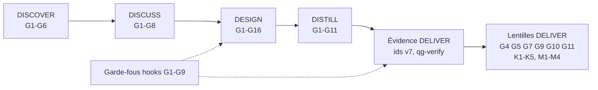

# Gates de revue

> Une *gate* est un critère explicite et binaire : le reviewer la déclare PASS ou
> FAIL avant que le pipeline passe à la phase suivante. Rien d'implicite, rien de
> « à l'œil ».

## Pourquoi — le problème que ça résout

Sans critères écrits, une revue dépend de l'humeur et de la mémoire du relecteur.
Les gates rendent la revue **reproductible** : chaque verdict s'appuie sur une liste
de contrôles connue d'avance, partagée par le producteur et le vérificateur. Une gate qui
échoue bloque la transition (BLOCKER) ou signale un risque (HIGH/MEDIUM) — jamais un
ressenti vague.

## Concepts clés — comment ça marche

Un identifiant `G<N>` est **propre à sa famille** : G5 de DESIGN, G5 de DISCOVER, G5 de la
lentille DELIVER et le garde-fou G5 des hooks sont quatre gates différentes. Lisez toujours
un identifiant avec sa famille.

| Famille | Phase | Identifiants | Producteur | Vérificateur | Source |
| --- | --- | --- | --- | --- | --- |
| Revue DISCOVER | DISCOVER (skraft-backlog) | G1–G6 | `backlog-discoverer` | 3 `discovery-*-lens` + `review-verdict.mjs` | `discovery-review-criteria` |
| Revue DISCUSS | DISCUSS (skraft-backlog) | G1–G8 | `backlog-planner` | 4 `planning-*-lens` + `review-verdict.mjs` | `planning-review-criteria` |
| Revue DESIGN | DESIGN | G1–G16 | `solution-architect` | `solution-architect-reviewer` | `architecture-review-criteria` |
| Revue DISTILL | DISTILL | G1–G11 | `acceptance-designer` | `acceptance-designer-reviewer` | `acceptance-review-criteria` |
| Évidence DELIVER | DELIVER | `test.acceptance` … `evidence.screenshots` | `software-engineer` | `qg-verify`, rapporté par `quality-gates-lens` | `quality-gates-evidence-contract` |
| Lentilles DELIVER | DELIVER | G4, G5, G7, G9, G10, G11 | `software-engineer` | `architecture-boundaries-lens`, `test-integrity-lens`, `cold-reader-lens` | descripteurs de lentille |
| Fidélité de contrat | DELIVER, conditionnelle | K1–K5 | `contract-testing-worker` | `contract-fidelity-lens` | descripteur de lentille |
| Fidélité de mock | DELIVER, conditionnelle | M1–M4 | `mock-integration-worker` | `mock-fidelity-lens` | descripteur de lentille |
| Garde-fous d'exécution | chaque phase d'ingénierie | G1–G9 | — | hooks et CLI d'état | `plugins/skraft-framework/src/domain/` |

**Gates de revue : 49** — DISCOVER 6, DISCUSS 8, DESIGN 16, DISTILL 11, évidence DELIVER 8.
Les gates de lentille, de fidélité et les garde-fous d'exécution s'y ajoutent.

**Identifiants en 1.17.2.** Seules les gates d'évidence DELIVER changent d'identifiant
(schéma d'évidence v7). Toutes les autres familles gardent leurs identifiants `G<N>` ; leur
renommage est reporté à la v2.

**Sévérité.** Les quatre phases de revue d'artefact attachent une sévérité à chaque gate :

| Sévérité | Signification | Effet sur le verdict |
| --- | --- | --- |
| **BLOCKER** | Violation fondamentale qui invalide l'artefact. | Force `rejected` (`REJECTED` sur skraft-backlog). |
| **HIGH** | Défaut significatif, source de rework en aval. | Force `changes_requested` (`NEEDS_REWORK`). |
| **MEDIUM** | Design smell, choix sous-optimal. | Force `changes_requested` (`NEEDS_REWORK`). |
| **LOW** | Détail de style ou de cohérence. | `approved` avec note. |

Les gates d'évidence DELIVER ne portent pas de sévérité : **chaque gate d'évidence bloque**.
Le skill `skraft-quality-bar` détient le niveau d'application de chaque gate et la valeur de
chaque seuil.

---

## DISCOVER — G1 à G6

Producteur : `backlog-discoverer` (plugin skraft-backlog). Vérificateur : 3 lentilles lancées
par `backlog-review-lenses`, verdict calculé par `review-verdict.mjs`. Vérifie le rapport de
triage et la proposition de sprint. Statut : active, identifiants inchangés.

| ID | Lentille | Ce que la gate vérifie | Condition de passage | Sévérité |
| --- | --- | --- | --- | --- |
| **G1** | Complétude | Les 3 modes de découverte ont été considérés, ou le rapport de triage documente explicitement pourquoi un mode est sauté. | Tous les modes pris en compte dans le rapport. | HIGH |
| **G2** | Complétude | Aucune issue P0 ou P1 n'existe dans le dépôt sans figurer au rapport de triage, vérifié par échantillon sur les 5 plus récentes. | Zéro issue critique absente du triage. | BLOCKER |
| **G3** | Priorisation | Toute P0 a une justification écrite ; P1–P3 suit l'ordre de valeur métier décroissante ; aucune inversion de priorité. | Aucune inversion. Toutes les P0 justifiées. | HIGH |
| **G4** | Priorisation | La proposition de sprint respecte la capacité déclarée (jours-équipe × 0,7) ; aucune P2/P3 n'occupe une place pendant qu'une P0/P1 est exclue ; aucune issue au-delà de 8 points dans le sprint. | Capacité respectée ; estimations au-delà de 8 exclues. | HIGH |
| **G5** | Détection de doublons | Deux issues du rapport de triage ne décrivent pas le même problème (similarité de titre normalisée > 80 %). | Zéro paire de doublons exacts ou proches non détectée. | HIGH |
| **G6** | Détection de doublons | Toutes les paires à similarité de titre normalisée de 40–80 % sont notées avec une recommandation (fusionner, lier ou garder séparées). | Toutes les paires proches signalées avec recommandation. | MEDIUM |

---

## DISCUSS — G1 à G8

Producteur : `backlog-planner` (plugin skraft-backlog). Vérificateur : 4 lentilles lancées
par `backlog-review-lenses`, verdict calculé par `review-verdict.mjs`. Vérifie les stories,
les critères d'acceptation et le plan de sprint. Statut : active, identifiants inchangés.

| ID | Lentille | Ce que la gate vérifie | Condition de passage | Sévérité |
| --- | --- | --- | --- | --- |
| **G1** | invest | Conformité INVEST : chaque story satisfait les 6 critères INVEST (Independent, Negotiable, Valuable, Estimable, Small, Testable). | Tous les critères passent pour chaque story. | HIGH |
| **G2** | invest | Indépendance du sprint : toutes les stories sont livrables indépendamment ; aucune dépendance circulaire. | Le graphe de dépendances est un DAG valide. | HIGH |
| **G3** | ac-quality | Complétude des critères : chaque story a ≥ 3 critères d'acceptation au format Given/When/Then ou liste ; aucun n'est une étape d'implémentation. | 3+ critères par story, bon format, sans prescription d'implémentation. | HIGH |
| **G4** | ac-quality | Non-ambiguïté des critères : aucun critère n'a deux interprétations valides pour un expert métier sans connaissance du code. | Chaque critère résout à un résultat unique et non ambigu. | BLOCKER |
| **G5** | planning-coherence | Périmètre du milestone : les stories cadrent avec le thème du milestone ; aucune ne chevauche plusieurs thèmes de sprint sans décomposition. | Chaque story s'aligne sur le thème et la fenêtre déclarés du milestone. | HIGH |
| **G6** | planning-coherence | DAG de dépendances : aucune dépendance circulaire ; la séquence de livraison respecte l'ordre topologique. | Le graphe de dépendances est un DAG. | BLOCKER |
| **G7** | dor-compliance | Gate DoR à 8 items : énoncé du problème, persona précis, 3+ exemples métier, scénarios UAT, critères dérivés des UAT, bon calibrage, notes techniques, dépendances. | 8/8 items pour chaque story. | BLOCKER |
| **G8** | dor-compliance | Absence d'anti-patterns : zéro anti-pattern CRITICAL (Implement-X, Giant Stories, No Examples), zéro anti-pattern HIGH (critère technique, données génériques, tests après le code, persona vague, dépendances manquantes). | Aucun anti-pattern CRITICAL ni HIGH détecté. | BLOCKER (CRITICAL) / HIGH |

---

## DESIGN — G1 à G16

Producteur : `solution-architect`. Vérificateur : `solution-architect-reviewer`, 3 lentilles
+ 1 gate transverse d'escalade. Vérifie les ADR, le registre de supersession, les diagrammes,
les contrats, les matrices de cohérence et le scan structurel. Statut : active, identifiants
inchangés.

Timing de ratification : la revue a lieu avant la ratification humaine des ADR. Un ADR
`Proposed` du passage courant satisfait une gate qui exige un ADR `Accepted`, et une gate qui
interdit un ADR `Accepted` interdit aussi un ADR `Proposed` de ce passage.

| ID | Lentille | Ce que la gate vérifie | Condition de passage | Sévérité |
| --- | --- | --- | --- | --- |
| **G1** | consistency | Tout engagement structurel — visible dans un diagramme ou détecté par `structural-scan.mjs` (bus de commande/requête, event store, saga ; ACL inter-contexte en revue manuelle) — est justifié par un ADR traçable. | Chaque élément structurel référence ≥ 1 ADR `Accepted` ou `Proposed` du passage courant. | BLOCKER |
| **G2** | consistency | Deux ADR ne se contredisent pas ; toute supersession est enregistrée dans le corps du nouvel ADR ET dans le registre append-only `docs/adr/supersessions.md`. | Zéro décision contradictoire ; ligne de registre et ligne de corps présentes. | BLOCKER |
| **G3** | architecture-compliance | Règle de dépendance : les couches Domain et Application ne dépendent ni d'Infrastructure ni d'API. | Zéro import d'Infrastructure/API dans les contrats Domain ou Application. | BLOCKER |
| **G4** | architecture-compliance | Toutes les interfaces applicatives (repositories, gateways, publishers d'événements) sont définies dans la couche Domain ou Application enregistrée par l'ADR de l'agrégat, jamais dans Infrastructure. | Zéro interface définie par l'Infrastructure dans les contrats. | BLOCKER |
| **G5** | architecture-compliance | Chaque agrégat fait respecter ses propres invariants, pas ceux d'un autre agrégat. | Zéro référence d'invariant inter-agrégat. | HIGH |
| **G6** | architecture-compliance | Le context map déclare chaque relation inter-contexte avec un pattern explicite (ACL, Conformist, Shared Kernel, Partnership, Open Host Service, Published Language) et chaque étiquette est admissible. | Zéro flèche non étiquetée et zéro étiquette inadmissible. | HIGH |
| **G7** | fitness | Chaque story de DISCUSS mappe à au moins un déclencheur (Command ou Query) du modèle d'événements. | Tous les IDs de story apparaissent dans une tranche. | HIGH |
| **G8** | fitness | Chaque **Command** a au moins un événement de domaine correspondant ; les Queries en sont exemptées. | Zéro Command sans événement de domaine. | HIGH |
| **G9** | fitness | Aucun agrégat, bounded context, adoption d'Event Sourcing ou Saga n'est introduit sans justification traçable par une story. | Zéro élément architectural injustifié. | MEDIUM |
| **G10** | consistency | Un `consistency-matrix-{story}.md` existe pour chaque story et sa ligne `consistency-gate` est `PASS` ; le journal de back-propagation explique chaque réécriture. | Une matrice par story, toutes PASS. | BLOCKER |
| **G11** | fitness | Tout ADR adoptant un pattern complexifiant (CQRS, Event Sourcing, Saga, cohérence éventuelle, split micro-service, ACL) cite une force admissible et évalue l'option « faire sans le pattern ». | Force admissible + alternative « faire sans » pour chaque ADR complexifiant. | HIGH |
| **G12** | consistency | Chaque ligne d'un `supersession-plan-{story}.md` est réalisée : ligne de corps d'ADR, ligne de registre, plus aucun artefact citant l'ADR remplacé comme source de vérité. | Les trois conditions tiennent pour chaque supersession planifiée. | BLOCKER |
| **G13** | escalade (transverse) | Chaque fichier blocker `decision-drift-*` a un fichier frère `-resolution.md` contenant la réponse humaine. | Un fichier de résolution pour chaque blocker. | BLOCKER (court-circuit) |
| **G14** | consistency | Aucun ADR n'encode le verdict dans le nom de fichier ; le verdict vit dans le frontmatter `Status:`. Un ADR `Status: Rejected` trace à une story déclencheuse et nomme l'alternative adoptée. | Zéro nom de fichier porteur de verdict ; chaque rejet tracé. | BLOCKER |
| **G15** | fitness | Aucun ADR ne ratifie une contrainte qui est le socle imposé du projet (CQS au niveau méthode, frontières de couches Clean Architecture, enregistrement des handlers par convention en DI, pattern repository en tant que tel). | Zéro ADR `Accepted`, et zéro ADR `Proposed` du passage courant, qui répète un socle imposé. | HIGH |
| **G16** | consistency | Les interfaces ou hooks comparables dans `contracts-{story}.md` suivent la même convention de forme d'état / retour / erreur, sauf si un ADR justifie la divergence. | Même convention pour chaque paire comparable, ou divergence couverte par un ADR `Accepted` ou `Proposed` du passage courant. | HIGH |

> Si G13 échoue, le reviewer renvoie `REJECTED` immédiatement **sans** évaluer les
> autres gates : la prochaine action est l'escalade humaine, pas un nouvel essai.

---

## DISTILL — G1 à G11

Producteur : `acceptance-designer`. Vérificateur : `acceptance-designer-reviewer`, 4
lentilles. Vérifie les scénarios Gherkin, le plan de test et le plan d'implémentation.
Statut : active, identifiants inchangés.

| ID | Lentille | Ce que la gate vérifie | Condition de passage | Sévérité |
| --- | --- | --- | --- | --- |
| **G1** | coverage | Bijection critère–scénario : chaque critère de `ac-draft-{story}.md` mappe à ≥ 1 scénario ; aucun scénario sans critère traçable. | Tous les critères couverts, aucun scénario orphelin. | BLOCKER |
| **G2** | coverage | Représentation des cas limites : les conditions limites et cas négatifs des exemples métier sont représentés en scénarios. | ≥ 1 scénario de cas limite par règle métier. | HIGH |
| **G3** | business-alignment | Vocabulaire métier : les étapes Given/When/Then utilisent le vocabulaire du domaine ; aucun nom de classe, de méthode, de verbe HTTP ou de framework. | Zéro identifiant technique dans les fichiers `.feature`. | HIGH |
| **G4** | business-alignment | Pas de jargon technique : les étapes ne contiennent ni code de statut HTTP, ni terme ORM, ni langage de base de données, ni référence au conteneur DI. | Zéro fuite d'implémentation. | BLOCKER |
| **G5** | testability | Non-ambiguïté des étapes : chaque étape est implémentable sans demander de clarification au concepteur. | Chaque étape mappe à une action ou un état métier unique. | HIGH |
| **G6** | testability | Complétude du plan d'implémentation : chaque scénario a une entrée dans `impl-plan-{story}.md` avec un chemin de fichier et une frontière de cas d'usage. | Bijection scénarios ↔ entrées de l'impl-plan. | HIGH |
| **G7** | boundary-enforcement | Respect des frontières de couches : chaque ligne de la matrice de couverture vise un cas d'usage de la couche Application nommé dans `contracts-{story}.md`, jamais un adaptateur d'Infrastructure comme point d'entrée principal. | Chaque entrée référence une frontière de cas d'usage des contrats. | BLOCKER |
| **G8** | boundary-enforcement | Couverture walking skeleton : au moins un scénario walking skeleton par flux majeur (tag `@smoke` ou marqué dans la matrice). | ≥ 1 entrée walking skeleton par flux. | HIGH |
| **G9** | boundary-enforcement | Évidence des critères visuels : chaque scénario `@visual` a ≥ 1 spec E2E Playwright dans `tests/e2e/` selon `impl-plan-{story}.md` ; une entrée jsdom/unitaire est invalide. | Bijection scénarios `@visual` ↔ entrées de spec E2E Playwright. | HIGH |
| **G10** | boundary-enforcement | Cohérence des contrats comparables : un hook/adaptateur/client planifié comparable à celui d'une story antérieure suit sa convention d'état / retour / erreur, sauf divergence justifiée notée dans le plan. | Chaque paire comparable partage sa convention, ou la divergence est justifiée dans l'impl-plan. | HIGH |
| **G11** | testability | Présence de la frontière de boucle interne : chaque cas d'usage NOUVEAU de la story a son test d'acceptation externe à la couche Application (`<Context>.UnitTest`), pas seulement un test Integration/HTTP, et ce fichier de test existe sur disque. | Aucun cas d'usage NOUVEAU couvert uniquement par `<Context>.IntegrationTest`. | BLOCKER |

---

## DELIVER — gates d'évidence (schéma v7)

Producteur : `software-engineer`, qui écrit `qg-{story}.json` une seule fois, après le dernier
commit de travail de la story. Vérificateur : `qg-verify`, qui re-résout chaque affirmation
contre les fichiers et l'arbre Git — personne ne rejoue une gate. Le producteur le lance
avant de rendre la main, le `software-engineer-reviewer` le relance, et `quality-gates-lens`
rapporte son résultat. Schéma : `quality-gates-evidence/v7`. Chaque gate ci-dessous bloque.

| Id v7 | Avant v7 | Libellé | Ce qu'elle atteste | Statut |
| --- | --- | --- | --- | --- |
| `test.acceptance` | G1 | Acceptance test(s) pass | Le scénario BDD/d'acceptation de la story active est vert. | active |
| `test.unit` | G2 | All unit tests pass | La suite unitaire complète est verte ; sur .NET elle inclut les tests d'architecture. | active |
| `build.compile` | G3 | Build passes | Compilation / vérification de types réussie. | active |
| `build.lint` | G4 | Static analysis pass | Linter / analyseur sans problème bloquant ; porte les règles de frontières de la stack (ESLint `boundaries/*`, Python `import-linter`). | active |
| `test.no-mocks-core` | G7 | No mocks in Domain/Application core | Le scan de l'adaptateur sur les projets Domain/Application et leurs tests unitaires n'a rien imprimé. | active |
| `commit.convention` | G8 | Conventional commit policy | Le message Git complet de chaque commit couvert respecte le scope fonctionnel, la référence d'issue optionnelle et le sign-off. | active |
| `test.integrity` | G9 | No test tampering (RED→GREEN integrity) | Pour chaque cycle, chaque fichier de test n'a changé que par AJOUT entre ses commits RED et GREEN, lu avec `git show`. | active |
| `evidence.screenshots` | — | Frontend screenshots captured | Le résultat frontend de la story est montré par au moins une capture d'écran hachée. | nouvelle en v7, requise pour une story frontend |

### Gates retirées

| Avant v7 | Id envisagé | Raison | Remplacement | Contrôle futur |
| --- | --- | --- | --- | --- |
| G5 | `arch.boundaries` | L'architecture n'est pas une gate du pipeline. | `test.unit` sur .NET (tests d'architecture) ; `build.lint` sur TypeScript (ESLint `boundaries/*`) et Python (`import-linter`). | Le `skraft doctor` de la v2 vérifie le prérequis. |
| G6 | `ci.mutation` | Le pipeline ne lance jamais la mutation. | La CI du projet, comme étape propre ; `/skraft-mutation` reste un outil manuel. | `skraft doctor` de la v2. |
| G11 | `ci.coverage` | Le pipeline ne lance jamais la couverture. | La CI du projet, avec une barre minimale et aucune exclusion. | `skraft doctor` de la v2. |
| ~~G10~~ | — | Retirée dans l'évidence v6 : le commit `test` RED du scénario fait preuve, aucun run RED n'est capturé. | — | — |

Un log v7 ne porte jamais `arch.boundaries`, `ci.coverage`, `ci.mutation` ni aucun
identifiant `G<N>` : `qg-verify` rapporte un identifiant inconnu en `inconclusive`
(`GATE_UNKNOWN`). Les logs v1–v6 se vérifient encore avec leurs identifiants `G<N>`, leurs
snapshots et leur commit d'évidence seule.

Les 100 % de couverture de lignes sur Domain et Application et la barre de mutation restent
la règle craft de `skraft-quality-bar` ; ils sont exécutés par la CI du projet, jamais par
le pipeline.

### Où vit l'évidence

| Élément | Valeur |
| --- | --- |
| Répertoire | `.copilot-tracking/skraft-plans/{projectSlug}/evidence/{date}/{story}/` — un par story |
| Contenu | `qg-{story}.json`, chaque capture (`.stdout`, `.exit`, `.stdout.sha256`) et `screenshots/` |
| `.gitignore` du consommateur | `.copilot-tracking/skraft-plans/*/evidence/` |
| Commité | Rien : aucun commit d'évidence, aucun snapshot. `repo_root_rev` vaut `HEAD`. |
| Sortie de `qg-verify` | `0` pass, `1` fail, `2` inconclusive |
| `EVIDENCE_COMMITTED` | `fail` : un fichier du répertoire d'évidence est suivi par Git |
| `SCREENSHOTS_MISSING` | `fail` : une story frontend n'enregistre aucune capture d'écran |

Une story est **frontend** quand ses commits couverts touchent un fichier `.feature`
contenant un scénario `@visual`, un chemin sous `tests/e2e/`, un `package.json` déclarant
`react`, ou un fichier `playwright.config.*`.

Une gate réellement non pertinente est marquée `not_applicable` **avec justification** —
jamais en remplacement d'un `fail` ou d'une évidence manquante. Une story non frontend omet
`evidence.screenshots` ou l'enregistre `not_applicable` avec justification.

### Politique `commit.convention`

- **Message :** `type(feature): sujet` (`!` optionnel avant `:`), avec le scope fonctionnel
  approuvé. Utiliser `git commit -s` pour le trailer `Signed-off-by`.
- **Issue :** pour une issue connue, terminer le corps par `Refs: #N` pour le travail
  intermédiaire ou `Closes #N` uniquement lorsque toute l'issue est réellement terminée et
  que toutes les gates requises passent. Omettre la ligne si l'issue est inconnue.
- **Vérification :** `qg-verify` contrôle la syntaxe, le sign-off et que le sujet déclaré
  est bien le sujet réel ; `quality-gates-lens` contrôle le scope fonctionnel et la ligne
  d'issue.

---

## DELIVER — gates des lentilles de revue

Producteur : `software-engineer`. Vérificateur : `software-engineer-reviewer`, qui lance 4
lentilles cœur (`quality-gates`, `architecture-boundaries`, `test-integrity`, `cold-reader`)
sur le patch depuis la base DELIVER. Ces identifiants de lentille jugent le diff ; ce ne sont
pas des gates d'évidence. `quality-gates-lens` rapporte le verdict de `qg-verify` sur les gates
d'évidence ci-dessus. Statut : active, identifiants inchangés.

| ID | Lentille | Ce que la gate vérifie | Sévérité |
| --- | --- | --- | --- |
| **G4** | [architecture-boundaries]({{ "/fr/dashboard/" | relative_url }}#lens-architecture-boundaries-lens) | Aucun mock dans les tests Domain/Application : `A.Fake<>`, `Mock<>`, `Substitute.For<>` sur des types Domain/Application ; un fake de port piloté est autorisé. | blocker |
| **G5** | [architecture-boundaries]({{ "/fr/dashboard/" | relative_url }}#lens-architecture-boundaries-lens) | Dépendances Clean Architecture vers l'intérieur : Domain → rien, Application → Domain seulement. Aucun ADR ne la contourne. | blocker |
| **G7** | [test-integrity]({{ "/fr/dashboard/" | relative_url }}#lens-test-integrity-lens) | Aucun pattern de test theater : tautologique, dominé par les mocks, vérification circulaire, miroir de l'implémentation, fixture theater. | blocker |
| **G9** | [test-integrity]({{ "/fr/dashboard/" | relative_url }}#lens-test-integrity-lens) | Aucun test modifié pour passer (Iron Rule) : aucune assertion affaiblie, aucun test supprimé, aucun `[Skip]` ajouté. | blocker |
| **G10** | [architecture-boundaries]({{ "/fr/dashboard/" | relative_url }}#lens-architecture-boundaries-lens) | Object Calisthenics sur le Domain : les 9 règles sur le code de la couche Domain. | medium |
| **G11** | [cold-reader]({{ "/fr/dashboard/" | relative_url }}#lens-cold-reader-lens) | Langage métier dans les tests : noms de tests, variables, messages d'assertion et noms de méthodes de production expriment l'intention métier. | medium |

## DELIVER — gates de fidélité (lentilles conditionnelles)

Une lentille de fidélité rejoint le panel uniquement quand le diff revu touche sa capacité, et
alimente la même matrice de sévérité que les lentilles cœur. Statut : active.

| ID | Lentille | Producteur | Ce que la gate vérifie | Sévérité |
| --- | --- | --- | --- | --- |
| **K1** | [contract-fidelity]({{ "/fr/dashboard/" | relative_url }}#worker-contract-fidelity-lens) | `contract-testing-worker` | Baseline WAF+HttpClient présente : un test d'intégration `WebApplicationFactory` + `HttpClient`, que Microcks soit activé ou non. | blocker |
| **K2** | contract-fidelity | `contract-testing-worker` | La couche Microcks correspond à l'opt-in (`testing.contract.microcks` ou demande du prompt). | high |
| **K3** | contract-fidelity | `contract-testing-worker` | Résultat du test de contrat non supprimé en cas d'opt-in : `TestResult.Success` est asserté. | blocker |
| **K4** | contract-fidelity | `contract-testing-worker` | Contrat de réponse réellement asserté : code de statut, content type, forme `ProblemDetails` sur les chemins d'erreur. | high |
| **K5** | contract-fidelity | `contract-testing-worker` | Aucune fuite d'appel réel vers l'aval. | blocker |
| **M1** | [mock-fidelity]({{ "/fr/dashboard/" | relative_url }}#worker-mock-fidelity-lens) | `mock-integration-worker` | Stratégie résolue respectée (double `inprocess` ou conteneur Microcks). | high |
| **M2** | mock-fidelity | `mock-integration-worker` | Le mock est réellement branché dans l'hôte de test. | blocker |
| **M3** | mock-fidelity | `mock-integration-worker` | Aucune fuite d'appel réel vers l'aval. | blocker |
| **M4** | mock-fidelity | `mock-integration-worker` | Mocke l'aval, pas le SUT. | high |

---

## Garde-fous d'exécution — G1 à G9

Les hooks et la CLI d'état appliquent ces garde-fous à chaque phase d'ingénierie ; aucun agent
ne les produit. Statut : actifs, identifiants inchangés. Détails :
[Garde-fous (hooks)]({{ "/fr/explanation/hooks" | relative_url }}) et
[Référence des hooks]({{ "/fr/reference/infrastructure/hooks" | relative_url }}).

| ID | Garde-fou | Appliqué par | Mode d'échec |
| --- | --- | --- | --- |
| **G1** | Ordre de dispatch | Hook `PreToolUse` | Fermé pour un agent de phase |
| **G2** | Skills obligatoires injectés | Hook `SubagentStart` | Ouvert |
| **G3** | Chargements de skills tracés et exigés | Hooks `PostToolUse` et `SubagentStop` | Ouvert |
| **G4** | Artefacts de phase enregistrés et présents | CLI d'état, à la clôture d'une phase | Fermé |
| **G5** | Verdict de revue conforme, et commit pour une phase DELIVER qui se clôt | CLI d'état, à la clôture d'une phase | Fermé |
| **G6** | Continuation : quoi enregistrer et quoi lancer ensuite | Hook `PostToolUse` | Ouvert |
| **G7** | État suivi protégé des écritures directes | Hook `PreToolUse` | Fermé |
| **G8** | L'orchestrateur n'écrit jamais `src/` ni `tests/` | Hook `PreToolUse` | Ouvert pour un appelant non nommé |
| **G9** | Le handoff de dispatch nomme chaque entrée enregistrée | Hook `PreToolUse` | Ouvert sur état illisible ou erreur interne |

---

## Logique de verdict

Sur les quatre phases de revue d'artefact, les gates s'agrègent selon une règle déterministe :

| Constat | Verdict |
| --- | --- |
| ≥ 1 gate **BLOCKER** échouée (ou G13 ouverte en DESIGN) | `rejected` / `REJECTED` |
| ≥ 1 gate **HIGH**, aucune BLOCKER | `changes_requested` / `NEEDS_REWORK` |
| Gates **MEDIUM** uniquement | `changes_requested` / `NEEDS_REWORK` |
| Gates **LOW** uniquement, ou tout passe | `approved` / `APPROVED` |

Sur l'évidence DELIVER (`qg-verify`), la règle est plate :

| Constat | Verdict |
| --- | --- |
| ≥ 1 gate `fail`, politique de commit violée, ligne retirée entre RED et GREEN, `EVIDENCE_COMMITTED` ou `SCREENSHOTS_MISSING` | `fail` |
| Log absent ou mal formé, identifiant de gate inconnu, fichier référencé inaccessible, sha256 discordant, `repo_root_rev` différent de `HEAD` | `inconclusive` |
| Chaque gate applicable est `pass` et chaque référence se résout | `pass` |

Sur la revue DELIVER, tout constat `blocker`, `high` ou `medium`, ou toute lentille
`inconclusive`, donne `NEEDS_REWORK` ; `low` seul ou tout passé donne `APPROVED`.
`inconclusive` n'équivaut jamais à `pass`.

## Pourquoi cette pratique

> « A software inspection is a rigorous review with explicit entry and exit criteria. »
> — Wiegers, K., *Peer Reviews in Software*, 2002.

Des critères d'entrée/sortie explicites, c'est exactement ce qu'une gate matérialise :
la phase n'est « faite » qu'une fois ses gates franchies.

## Pièges & anti-patterns

- **Identifiant sans famille** : « G5 a échoué » ne veut rien dire tant que la famille n'est
  pas dite — G5 de DESIGN, G5 de lentille DELIVER et le garde-fou G5 sont trois gates
  différentes.
- **Gate cosmétique** : un critère trop vague (« le code est propre ») n'est pas une
  gate — il faut un test binaire vérifiable.
- **Reviewer complaisant** : si le producteur et le reviewer sont la même entité, la
  gate perd son pouvoir. SKRAFT impose un reviewer *indépendant*.
- **Court-circuit** : G13 de DESIGN court-circuite toute la revue tant qu'un blocker humain
  reste non résolu — ne la contournez pas.
- **Évidence commitée** : un fichier d'évidence v7 suivi par Git fait échouer `qg-verify` ;
  gardez le répertoire d'évidence dans `.gitignore`.
- **Barre négociée** : une gate DELIVER ne se négocie pas — une gate qui n'a pas passé
  n'a pas passé.

## Pour aller plus loin

- [Catalogue agentique — lentilles et reviewers]({{ "/fr/dashboard/" | relative_url }})
- [Contrat d'évidence des quality gates]({{ "/fr/dashboard/" | relative_url }}#skill-quality-gates-evidence-contract)
- [La revue avant la revue]({{ "/fr/explanation/why-review-before-review" | relative_url }})
- [Le deep-dive review-before-review]({{ "/fr/explanation/deep-dive/review-before-review" | relative_url }})

## Sources

- Wiegers, K. *Peer Reviews in Software*, 2002.

Termes à connaître : **gate**, **reviewer**, **BLOCKER**, **INVEST**, **walking skeleton**
— voir le [glossaire]({{ "/fr/reference/glossary" | relative_url }}).
