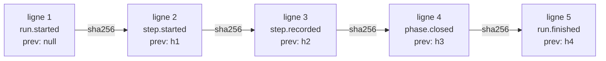

# Dossier de suivi et journal

> Tout ce que sait un run tient dans un dossier du dépôt et un journal chaîné, d'où le moteur recalcule l'état à chaque lecture sans rien stocker d'autre.

## Pourquoi — le problème que ça résout

En v1, l'état d'un run vivait dans un `state.json` réécrit à chaque étape. Un fichier réécrit
perd l'historique, et rien ne distingue une écriture du moteur d'une retouche à la main. La V2
le remplace par `events.jsonl` : un **journal** où chaque fait s'ajoute à la fin et où chaque
ligne porte l'empreinte de la précédente. L'état (phase en cours, tentatives, coût, blocage)
se recalcule depuis ce journal. Une modification casse la chaîne et le moteur la voit.

## Concepts clés — comment ça marche

### Arborescence

Le dossier de suivi vit **dans la copie de travail qui lance le run** :

```
.copilot-tracking/skraft-plans/
├── .active-slug                                   pipeline actif de la copie de travail
└── <slug>/
    ├── events.jsonl                               journal chaîné
    ├── research/<AAAA-MM-JJ>/<slug>-research.md   document de recherche
    ├── results/
    │   ├── <nœud>-<visite>-<tentative>.json       résultat qu'un agent écrit pour une tentative
    │   └── <nœud>-<visite>-<tentative>.documents.json   le dossier de suivi tel que cette tentative l'a trouvé
    ├── reviews/<nœud>-<visite>/                   ce que lisent les lentilles d'une passe de revue
    │   ├── changes.patch                          changements depuis la base du run
    │   ├── changed-files.txt                      chemins que ces changements touchent
    │   ├── code.patch, code-files.txt             les mêmes pour une lentille aveugle, sans docs/adr
    │   ├── context.md                             story, règles du projet, qui a écrit quel document
    │   ├── components.json                        stack, stratégie de mocking, contract testing
    │   └── verdict.yaml                           le verdict de la passe, écrit par le moteur
    └── gates/<composant>/<gate>-<n>.log           preuve de chaque gate lancée
```

`results/` et `reviews/` appartiennent au moteur : ce ne sont pas des documents du run, et une
revue ne les donne jamais à une lentille comme tels.

`verdict.yaml` est écrit à la fin de chaque passe de revue, chaque texte entre guillemets doubles :

```yaml
status: "NEEDS_REWORK"          # APPROVED | NEEDS_REWORK | BLOCKED
code: null                      # lens-inconclusive quand BLOCKED
summary: "NEEDS_REWORK: 1 reason to address"
findings:                       # les findings blocker, high et medium retenus
  - lens: "consistency"
    id: "F2"
    gate: "G1"
    severity: "high"
    location: "docs/adr/adr-001-card-payment.md:3"
    description: "two contexts own payments"
    suggestion: null
notes: []                       # les findings low, mêmes clés
refutations:                    # chaque vérification de cette passe
  - lens: "consistency"
    finding: "F1"
    verdict: "refuted"          # confirmed | refuted | unverifiable
    reason: "docs/adr/adr-001-card-payment.md:3 names Acme Pay"
    dissent: true               # seulement quand la lentille était seule (Dissent Rule)
reused:                         # les lentilles reprises de la passe précédente
  - lens: "fitness"
```

Le **slug** est le nom kebab-case d'un pipeline (`checkout-by-card`). Un slug = un pipeline =
un dossier.

### `.active-slug`

| Règle | Détail |
| --- | --- |
| Contenu | le slug suivi d'un saut de ligne, écrit par `skraft init <slug>` (et par Init dans le mod et le workflow) |
| Lecture | blancs retirés ; un contenu qui n'est pas kebab-case vaut « aucun pipeline actif » |
| Obligatoire | toute commande qui agit sur un run lit ce fichier ; le moteur ne devine jamais un slug |
| Portée | une copie de travail ; un worktree Git a donc le sien |

### `events.jsonl`

Un objet JSON par ligne, en UTF-8. Les lignes vides sont ignorées ; `\n` et `\r\n` sont
acceptés. Chaque événement porte trois champs communs :

| Champ | Contenu |
| --- | --- |
| `type` | type de l'événement (tableau ci-dessous) |
| `at` | instant ISO-8601 en UTC |
| `prev` | SHA-256 en hexadécimal minuscule de la ligne précédente (ses octets UTF-8, sans le saut de ligne) ; `null` sur la première ligne |



**Contrôle de la chaîne.** À chaque ouverture, le moteur vérifie toutes les lignes. La
première rupture donne `journal-tampered` avec ce message :
`journal tampered: events.jsonl line N <détail>; restore the file or start a new slug`.

| `<détail>` | Cause |
| --- | --- |
| `is not JSON` | la ligne n'est pas un objet JSON |
| `does not open the chain` | la ligne 1 a un `prev` non nul |
| `does not chain to line N-1` | `prev` n'est pas l'empreinte de la ligne précédente |

**Écritures concurrentes.** Avant chaque ajout, le moteur relit le journal. Si une autre
écriture est arrivée depuis l'ouverture, il s'arrête avec `journal-changed` :
`<slug>: another run wrote events.jsonl meanwhile; run again once it stops`.

### Événements

| `type` | Écrit par | Champs |
| --- | --- | --- |
| `run.started` | Init, au premier init du slug | `slug` ; `story` (`{ issue, title }` ou `null`) ; `workflow` (`skraft`) ; `base` (liste, voir ci-dessous) |
| `step.started` | le pipeline, avant de lancer un agent | `step` (`research`) ; `phase` (`RESEARCH`) ; `agent` (`solution-researcher`) ; `attempt` (1, 2…) ; `outputs` (chemins attendus, relatifs au dossier du slug) ; `missing` (chemins manquants à la tentative précédente, vide à la première) ; `assignment` : ce sur quoi l'agent tourne — `family`, `tier`, `source` (`agent`, `workflow`, `type`, `default`, `escalation`, `host`) et, par hôte, `model` (liste ou null), `effort` (ou null) et la `source` de chacun ; une tentative reprise tourne de nouveau dessus, quoi que dise la configuration depuis. Sur un nœud question, `question` (le type de question) à la place d'`agent` |
| `step.recorded` | le pipeline, après l'agent | `step` ; `attempt` ; `outcome` (`outputs-complete` ou `missing-outputs` ; sur un nœud question `answered`, ou `skipped` quand aucun humain n'était nécessaire, avec `answer` ; `aborted`, code `environment`, après un `ABORT`) ; `missing` ; `durationMs` ; `cost` (absent quand l'hôte n'en rend pas) ; `model` (le modèle de l'agent, null pour celui de la session ; absent sur une reprise qui ne l'a pas lancé) |
| `question.asked` | le pipeline, quand il pose une question à un humain | `key` (`adr-1`, `gates-1`), le nœud qui pose la question puis son rang parmi celles de ce nœud dans le run ; `kind` (`adr-ratification`, `reporting-consent`, `environment`) ; `text` ; `options` ; `refusals` ; `header` ; `step` ; `visit` ; `subjects` (les ADR à ratifier, vide sinon) |
| `question.answered` | la boîte de dialogue de l'hôte, ou `skraft decide` | `key` ; `answer` ; `reason` (`null` sans raison) ; `by` (`host` ou `decide`) |
| `phase.closed` | le pipeline | `phase` |
| `run.finished` | le pipeline | `status` (`incomplete` quand RESEARCH est close, `blocked` quand des sorties manquent après la dernière tentative) ; `reason` |
| `run.stopped` | le pipeline, quand l'agent ne démarre pas ou s'arrête, ou qu'une lentille répond deux fois sans verdict lisible | `code` (`agent-unavailable`, `agent-failed` ou `lens-unreadable`) ; `reason`. Jamais écrit quand la machine ne peut pas exécuter une étape : le moteur pose alors la question `environment` |
| `review.lens` | un nœud de revue, une fois par lentille, et une fois par passe pour chaque contrôle du moteur qui trouve quelque chose | `step` ; `visit` ; `lens` (`consistency` ; `test-integrity#patch` pour les findings G9 du moteur, `testability#layout` pour ses findings G11, sans `fingerprint`) ; `agent` (`consistency-lens`) ; `model` (le modèle sur lequel elle a tourné, `claude-haiku-5.5` ; null pour celui de la session) ; `fingerprint` (empreinte des entrées de la lentille) ; `verdict` (`pass`, `fail` ou `inconclusive`) ; `findings` (`{ id, gate, severity, location, description, suggestion }`, `gate` étant l'identifiant de la table de la lentille : `G7`, `M2`…) ; `cost` (absent s'il est inconnu) ; `reused` (`true` quand le résultat est repris de la passe précédente : mêmes entrées, rien trouvé) |
| `review.refuted` | un nœud de revue, une fois par finding blocker, high ou medium vérifié par `finding-refuter` ; les findings de plusieurs lentilles à une même ligne, vérifiés en un appel, en donnent un chacun avec son propre verdict, son `cost` sur le premier | `step` ; `visit` ; `lens` ; `finding` (son id) ; `verdict` (`confirmed`, `refuted` ou `unverifiable`) ; `reason` ; `dissent` (`true` quand la lentille du finding était seule à renvoyer le travail, et que le réfuteur l'a jugé avec toutes les entrées de la revue) ; `model` ; `cost` |
| `review.cost` | un nœud de revue, une fois par lot que l'hôte chiffre d'un bloc (le mod Claude Code) | `step` ; `visit` ; `cost` |
| `gate.ran` | `skraft gate`, une fois par gate | `component` ; `gate` (`build`… ou `none`) ; `scope` (`touched` ou `all`) ; `command` (`null` pour `none`) ; `status` (`pass` ou `fail`) ; `failure` (`environment`, `deterministic` ou `null`) ; `exitCode` (`null` si rien n'a tourné) ; `durationMs` ; `evidence` (chemin relatif au dossier du slug, `null` pour `none`) |

Chaque entrée de `run.started.base` : `{ component, root, repository, ref, source, sha }`.
`component` vaut `null` pour la copie de travail ; `ref` est la ref réellement utilisée
(`main` ou `origin/main`) ; `source` vaut `flag`, `component`, `config` ou `default`. Règle de
calcul : [skraft-config.json]({{ "/fr/reference/skraft-config" | relative_url }}).

Le coût vient de l'hôte : le mod Claude Code journalise l'écart de coût de la session en
USD ; le workflow Copilot n'en rend pas (Copilot compte en crédits, pas en USD). Cet écart
comprend tout ce qui s'est échangé dans la session pendant que l'agent tournait : le panneau et
le rapport l'affichent donc comme approximatif (`~$0.42`), avec une note.

Ce journal suit le contrat écrit dans `eng/regression/README.md`, qui compare un run V2 à un
run v1 sur les mêmes fixtures.

Le `step.started` d'un nœud de revue porte `lenses` au lieu d'`agent`, `assignments` (l'affectation de chaque agent lentille) et `refuter` (celle du réfutateur, par palier d'escalade : `standard`, `frontier`), que rejoue une revue reprise ; chaque `review.lens` et `review.refuted` porte l'`assignment` sur laquelle il a tourné ; son `step.recorded` a
un `outcome` `approved`, `needs-rework` ou `blocked` (`code` `lens-inconclusive` quand une
lentille a répondu `inconclusive` ou a échoué sans finding blocker, high ou medium : arrêt
définitif du nœud, qu'un nouveau lancement du même slug retrouve bloqué ; `reason` nomme chacune
de ces lentilles et ce qu'elle a noté), `failures` (les findings retenus, que le brief suivant
de l'agent de la phase liste) et `cost` (ses lentilles, ses vérifications et ses lots de cette passe, reprise comprise). Une étape où le run a été renvoyé, par les gates, une revue ou le refus d'un humain, porte
`sentBy` (`gate`, `review` ou `ask`) sur son `step.started` ; une étape que rien n'a renvoyée n'en a pas.
Le `step.recorded` d'un agent liste dans `documents` les fichiers du dossier de suivi que sa
tentative a créés ou modifiés (hors fichiers du moteur), et pour le solution architect le
`details/<date>/structural-scan.json` que le moteur a écrit avant la tentative ; une revue donne ces documents à chaque
lentille, par phase, et écrit `reviews/<nœud>-<visite>/context.md` : la story, les fichiers de
règles du projet trouvés (`AGENTS.md`, `CLAUDE.md`, `CONTRIBUTING.md`,
`.github/copilot-instructions.md`, `docs/adr/decisions-index.md`) et quel agent a écrit quel document.

> Les décisions humaines sont journalisées en `question.asked` et `question.answered`, qui
> tiennent lieu du `decision.recorded` que prévoyait le contrat de comparaison.

### Questions à un humain

Une question est posée une fois et journalisée (`question.asked`) ; sa réponse est
journalisée (`question.answered`), puis appliquée. Sans réponse, le run **attend** (fail
closed) : rien de plus n'est journalisé, et relancer le run repose la même question, avec la
même clé, sans relancer d'agent. Un run interrompu à n'importe quel point de décision reprend
de la même façon.

| Question | Clé | Posée quand | Réponse appliquée |
| --- | --- | --- | --- |
| `adr-ratification` | `<nœud>-<n>` (`adr-1`) | un ADR `docs/adr/adr-NNN-*.md` est `Proposed` ; aucun : `step.recorded` `skipped`, raison `no Proposed ADR to ratify` | `RATIFIED` : chaque ADR passe en `Accepted` (`status: Accepted`, `ratified_by: "human AAAA-MM-JJ"`, la ligne `**Status:**`, sa ligne dans `docs/adr/decisions-index.md` s'il existe), commités seuls en `docs(adr): ratify ADR-001, ADR-002`. `REJECTED` : DESIGN repasse avec la raison |
| `reporting-consent` | `<nœud>-<n>` | `publish.visuals` n'est pas réglé dans `skraft-config.json` et un composant est un frontend (stack `react`, ou `commands.e2e`) ; sinon : `step.recorded` `skipped`, réponse `DECLINED`, rien n'est écrit | la réponse écrite en `"publish": { "visuals": true\|false }`, et gardée pour la suite du run : une boucle qui repasse par le nœud ne la redemande pas |
| `environment` | `<nœud>-<n>`, le nœud qui ne peut pas tourner (`gates-1`) | une étape ne peut pas tourner sur cette machine | `RETRY` : la même étape est revérifiée ou relancée, son agent seulement si ses sorties manquaient encore ; `ABORT` : run bloqué |

La question `environment` se lit `<node> cannot run on this machine: <reason>. Fix it, then
RETRY; or ABORT the run.` Elle est posée quand un programme de gate est introuvable, qu'un
commit rouge ne peut pas être rejoué, qu'un composant n'a pas de commande de test, que Git
échoue, que `docs/adr` existe mais ne peut pas être listé (`docs/adr cannot be listed: Git or the file system refused to read it`, texte fixe qui ne
reprend jamais celui de l'erreur ; la ratification n'est alors jamais sautée) ou que Git refuse le commit de ratification. L'étape
reste ouverte. Le même échec après un `RETRY` pose une nouvelle question (`gates-2`). Après un
`RETRY` donné dans une boîte de dialogue de l'hôte, le moteur relit `skraft-config.json` ; s'il
est invalide, le run s'arrête avec `config-invalid` avant de lancer quoi que ce soit, sans rien
journaliser : une fois le fichier corrigé, relancer le run reprend l'étape ouverte.

### ADR non publiés

Un ADR est **publié** quand la base du run contient le fichier. Après chaque tentative
d'agent, chaque ADR modifié par la tentative et non publié doit :

- avoir le statut `Proposed` (seul le moteur pose `Accepted` ; modifier un ADR ratifié dans ce
  run, c'est le remettre en `Proposed`, et sa ratification est redemandée) ;
- ne porter aucun champ d'en-tête `amended_by`, `amended_in_place` ou `superseded_by` ;
- n'avoir aucune section d'historique (`## Historique`, `## History`) ;
- ne pas `supersedes` ni `amends` un autre ADR non publié, que le lien soit dans l'en-tête ou
  sur une ligne `**Supersedes:** ADR-MMM` : modifier celui-ci sur place.

Un ADR publié se remplace ou s'amende toujours de la manière habituelle. Un manquement
refuse la tentative avec le code d'échec `adr-lifecycle` et une ligne par manquement, par
exemple `docs/adr/adr-002-x.md supersedes ADR-001, which is not on the default branch yet:
edit docs/adr/adr-001-y.md in place instead`. L'agent recommence avec ces lignes.

### Document de recherche

| Règle | Détail |
| --- | --- |
| Chemin | `<slug>/research/<AAAA-MM-JJ>/<slug>-research.md` ; la date est le jour UTC de la première tentative, réutilisée par la relance |
| Pré-création | avant la tentative, le moteur l'écrit depuis le template `research.template.md` du plugin s'il n'existe pas |
| Rempli | le fichier existe, n'est pas vide, diffère du template et ne contient plus aucun `{{…}}` |
| Relance | non rempli après la tentative 1 : tentative 2 sur 2, avec la liste des chemins manquants |
| Arrêt | non rempli après la tentative 2 : `run.finished` `blocked`, code `missing-outputs` |
| Reprise | une tentative ouverte dont les sorties sont déjà remplies est enregistrée sans relancer l'agent |

### Preuves des gates

Chaque gate lancée écrit `<slug>/gates/<composant>/<gate>-<n>.log`, où `<n>` vaut 1 plus le
nombre de `gate.ran` déjà journalisés pour ce composant et cette gate. Format :

```
$ <commande lancée>
cwd: <racine du composant>
result: pass: exited 0
--- stdout
<sortie standard>
--- stderr
<sortie d'erreur>
```

La première ligne montre la commande telle qu'elle a démarré : `{baseSha}` remplacé, interpréteur
Python choisi, citée pour se relire en la même liste d'arguments. Le champ `command` de
`gate.ran` garde la ligne écrite dans `skraft-config.json`.

En échec, la ligne `result` vaut `fail (<classe>): <raison>`. Les sections `stdout` et
`stderr` manquent quand rien n'a été lancé (ligne refusée, Docker absent). Un composant sans
commande de gate n'écrit pas de preuve.

### Statuts et codes

Les commandes, le mod et le workflow rendent un **statut** et, en cas d'arrêt, un **code** :
`refused` (rien n'a été fait), `blocked` (le run ne peut pas avancer), `waiting` (le run
attend la réponse d'un humain), `done`.

| Statut | Code | Quand | Message type | Action |
| --- | --- | --- | --- | --- |
| `refused` | `invalid-slug` | slug pas en kebab-case | `slug must be kebab-case, got "<slug>"` | choisir un slug kebab-case |
| `refused` | `invalid-base` | `--base` n'est pas une ref git | `--base must be a git ref: text with no blank that does not start with -` (la valeur n'est jamais reprise) | passer une ref sans blanc ni `-` initial |
| `refused` | `config-invalid` | `skraft-config.json` invalide | `skraft-config.json is invalid: <toutes les erreurs>` | corriger chaque erreur listée |
| `refused` | `base-unresolved` | pas de merge-base avec la ref dans un dépôt | `… has no merge base with <ref>; set baseBranch in skraft-config.json or pass --base <ref>` | régler `baseBranch` ou passer `--base` |
| `refused` | `source-control-unavailable` | Git ne se lance pas alors que la config liste des composants | `<erreur>; the components of skraft-config.json need Git for their base` | installer Git, le mettre dans le PATH |
| `refused` | `no-active-pipeline` | pas de `.active-slug` valide | `no active pipeline in this working copy (.copilot-tracking/skraft-plans/.active-slug); start one with an explicit slug` | `skraft init <slug>` ou `/skraft <slug>` |
| `refused` | `slug-mismatch` | l'appel nomme un autre slug que le pipeline actif | `the active pipeline of this working copy is <actif>, not <demandé>; switch with an explicit init` | init explicite du slug voulu |
| `refused` | `not-initialised` | le slug actif n'a pas de journal | `<slug> has no journal (events.jsonl); start it with an explicit init` | init explicite du slug |
| `refused` | `no-components` | `skraft gate` sans composant | `skraft-config.json lists no component; run skraft init to detect them` | `skraft init` |
| `blocked` | `journal-tampered` | chaîne cassée | `journal tampered: events.jsonl line N …; restore the file or start a new slug` | restaurer le fichier ou démarrer un nouveau slug |
| `blocked` | `journal-changed` | un autre run écrit pendant celui-ci | `<slug>: another run wrote events.jsonl meanwhile; run again once it stops` | attendre la fin de l'autre run, relancer |
| `blocked` | `missing-outputs` | sorties absentes après la dernière tentative | `solution-researcher left required outputs missing after 2 attempts: <chemins>` | une reprise rend le même blocage ; corriger la cause et démarrer un nouveau slug |
| `blocked` | `design-records` | les traces DESIGN de l'architecte échouent encore après sa dernière tentative : pas de matrice de cohérence dont `consistency-gate` vaut `PASS` (G10), un ADR nommé `*-rejected.md`, `*-accepted.md`, `*-deprecated.md` ou `*-superseded.md` (G14), une ligne `**Supersedes:**` sans sa ligne dans `docs/adr/supersessions.md` (G2, G12) | `solution-architect still failed after 3 attempts: <chaque trace en faute>` | écrire la trace, puis démarrer un nouveau slug |
| `blocked` | `agent-blocked` | l'agent a répondu `blocked` | `<agent> is blocked: <résumé>` | définitif : une nouvelle exécution du slug reste bloquée |
| `blocked` | `environment` | l'architecte a laissé un `decision-drift-*.md` sans son `-resolution.md` (G13), entre autres causes | `<dérive> has no <dérive>-resolution.md beside it: a human answers the drift there, then resumes the run (G13)` | écrire la résolution à côté de la dérive, puis reprendre : l'étape est vérifiée de nouveau |
| `blocked` | `agent-unavailable` | l'hôte ne peut pas lancer l'agent | Claude Code : `skraft:solution-researcher could not be started: …` ; Copilot : `agent "solution-researcher" is not available in this Copilot session (agents: …); install or enable the skraft plugin, or pass agentIds` | installer ou activer le plugin, puis reprendre ; la tentative n'est pas consommée |
| `blocked` | `agent-failed` | l'agent s'arrête sans finir et ses sorties manquent | `<agent> stopped without finishing: <erreur>` | reprendre : l'étape reste ouverte et la même tentative est relancée |
| `blocked` | `review-rejected` | une revue répond `NEEDS_REWORK` et son nœud n'a pas d'arête `NEEDS_REWORK` | `<nœud> asked for rework and the workflow has no NEEDS_REWORK edge out of it; <findings>` | corriger les findings dans un nouveau slug, ou ajouter l'arête au workflow |
| `blocked` | `lens-inconclusive` | une lentille a répondu `inconclusive` (une lentille qui répond `fail` avec seulement des findings low passe, ses findings notés) | `<lentille>: inconclusive: <notes>`, une par lentille, séparées par `; ` | définitif : un nouveau lancement du slug reste bloqué ; donner à la lentille ce qui lui manquait et démarrer un nouveau slug |
| `blocked` | `lens-unreadable` | une lentille a répondu deux fois sans verdict lisible (`run.stopped`) | `<lentille>-lens answered 2 times without a readable verdict: <erreur>` | reprendre : les lentilles déjà journalisées dans cette passe sont gardées, les illisibles sont relancées |
| `blocked` | `loop-ceiling` | un refus ou un échec ferait passer une arête au-delà de son `max_visits` | `<from> -> <to> was already taken N times, its max_visits` | démarrer un nouveau slug |
| `blocked` | `environment` | un humain a répondu `ABORT` | `aborted by a human: <question>` | corriger la machine, démarrer un nouveau slug |
| `waiting` | `adr-ratification`, `reporting-consent`, `environment` | une question est sans réponse | `<question> Answer with skraft decide <clé> <A>\|<B>`, plus ` (a refusal with its reason)` quand la question a un refus | répondre par `skraft decide`, `/skraft decide` ou `skraft_decide` |
| `done` | — | RESEARCH close, ou plus rien à lancer | `RESEARCH closed` ou `nothing to run` | — |

Les gates ont en plus leurs propres statuts `passed` et `failed` :
[La ligne de commande skraft]({{ "/fr/reference/cli" | relative_url }}).

### Statuts de `skraft status`

| Statut | Condition | `reason` |
| --- | --- | --- |
| `idle` | pas de pipeline actif | message de `no-active-pipeline` |
| `not-initialised` | le slug actif n'a aucun événement | `<slug> has no journal (events.jsonl)` |
| `tampered` | la chaîne est cassée (code de sortie 1) | message de `journal-tampered` |
| `running` | journal ouvert, run ni fini ni arrêté ; c'est aussi le statut juste après `skraft init <slug>`, avant que l'hôte ne lance quoi que ce soit | vide |
| `waiting` | une question posée et sans réponse | texte de la question |
| `done` | `run.finished` avec un statut autre que `blocked` | raison de `run.finished` |
| `blocked` | `run.finished` `blocked`, ou dernier événement `run.stopped` | raison de l'événement |

Un `step.started` ou un `phase.closed` écrit après un `run.finished` rouvre le run.

## Pourquoi cette pratique

> « At its heart is the notion that you can use a different model to update information than the model you use to read information. »
> — Fowler, M., *Bliki: CQRS*, 2011.

Le journal est le modèle d'écriture : on n'y fait qu'ajouter des faits. Le statut, les phases
et le coût sont un modèle de lecture recalculé à chaque fois. Aucun des deux ne peut dériver
de l'autre en silence, et la chaîne d'empreintes rend toute retouche visible.

## Pièges & anti-patterns

- **Corriger `events.jsonl` à la main** : la chaîne casse et le run est `tampered`. Démarrez
  un nouveau slug.
- **Deviner le slug** : un hôte ou un agent ne choisit jamais le slug ; seul un init explicite
  change `.active-slug`.
- **Lancer deux runs sur le même slug** : le second s'arrête en `journal-changed`.
- **Passer soi-même un ADR en `Accepted` pendant un run** : la tentative est refusée
  (`adr-lifecycle`). Ratifiez-le en répondant à la question.
- **Lire `done` comme « livré »** : aujourd'hui `done` veut dire RESEARCH close
  (`run.finished` `incomplete`).

## Pour aller plus loin

- [Reprendre ou débloquer un run]({{ "/fr/how-to/resume-a-run" | relative_url }})
- [Lancer les gates et lire leurs preuves]({{ "/fr/how-to/run-gates" | relative_url }})
- [La ligne de commande skraft]({{ "/fr/reference/cli" | relative_url }})
- [skraft-config.json]({{ "/fr/reference/skraft-config" | relative_url }})
- [État et reprise (journal chaîné)]({{ "/fr/explanation/hve-core" | relative_url }})
- [Zéro hook, contrôles dans le moteur]({{ "/fr/explanation/hooks" | relative_url }})

## Sources

- Fowler, M. *Bliki: CQRS*, 2011.

Termes à connaître : **slug**, **journal**, **pipeline actif**, **gate** — voir le
[glossaire]({{ "/fr/reference/glossary" | relative_url }}).
