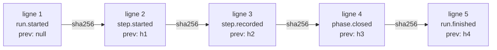

# Dossier de suivi et journal

> Tout ce que sait un run tient dans un dossier du dépôt et un journal chaîné, d'où le moteur recalcule l'état à chaque lecture sans rien stocker d'autre.

## Pourquoi — le problème que ça résout

En v1, l'état d'un run vivait dans un `state.json` réécrit à chaque étape. Un fichier réécrit
perd l'historique, et rien ne distingue une écriture du moteur d'une retouche à la main. La V2
le remplace par `events.jsonl` : un **journal** où chaque fait s'ajoute à la fin et où chaque
ligne porte l'empreinte de la précédente. L'état (phase en cours, tentatives, coût, blocage)
se recalcule depuis ce journal. Une modification casse la chaîne et le moteur la voit.

## Concepts clés — comment ça marche

### Arborescence

Le dossier de suivi vit **dans la copie de travail qui lance le run** :

```
.copilot-tracking/skraft-plans/
├── .active-slug                                   pipeline actif de la copie de travail
└── <slug>/
    ├── events.jsonl                               journal chaîné
    ├── research/<AAAA-MM-JJ>/<slug>-research.md   document de recherche
    └── gates/<composant>/<gate>-<n>.log           preuve de chaque gate lancée
```

Le **slug** est le nom kebab-case d'un pipeline (`checkout-by-card`). Un slug = un pipeline =
un dossier.

### `.active-slug`

| Règle | Détail |
| --- | --- |
| Contenu | le slug suivi d'un saut de ligne, écrit par `skraft init <slug>` (et par Init dans le mod et le workflow) |
| Lecture | blancs retirés ; un contenu qui n'est pas kebab-case vaut « aucun pipeline actif » |
| Obligatoire | toute commande qui agit sur un run lit ce fichier ; le moteur ne devine jamais un slug |
| Portée | une copie de travail ; un worktree Git a donc le sien |

### `events.jsonl`

Un objet JSON par ligne, en UTF-8. Les lignes vides sont ignorées ; `\n` et `\r\n` sont
acceptés. Chaque événement porte trois champs communs :

| Champ | Contenu |
| --- | --- |
| `type` | type de l'événement (tableau ci-dessous) |
| `at` | instant ISO-8601 en UTC |
| `prev` | SHA-256 en hexadécimal minuscule de la ligne précédente (ses octets UTF-8, sans le saut de ligne) ; `null` sur la première ligne |



**Contrôle de la chaîne.** À chaque ouverture, le moteur vérifie toutes les lignes. La
première rupture donne `journal-tampered` avec ce message :
`journal tampered: events.jsonl line N <détail>; restore the file or start a new slug`.

| `<détail>` | Cause |
| --- | --- |
| `is not JSON` | la ligne n'est pas un objet JSON |
| `does not open the chain` | la ligne 1 a un `prev` non nul |
| `does not chain to line N-1` | `prev` n'est pas l'empreinte de la ligne précédente |

**Écritures concurrentes.** Avant chaque ajout, le moteur relit le journal. Si une autre
écriture est arrivée depuis l'ouverture, il s'arrête avec `journal-changed` :
`<slug>: another run wrote events.jsonl meanwhile; run again once it stops`.

### Événements

| `type` | Écrit par | Champs |
| --- | --- | --- |
| `run.started` | Init, au premier init du slug | `slug` ; `story` (`{ issue, title }` ou `null`) ; `workflow` (`skraft`) ; `base` (liste, voir ci-dessous) |
| `step.started` | le pipeline, avant de lancer un agent | `step` (`research`) ; `phase` (`RESEARCH`) ; `agent` (`solution-researcher`) ; `attempt` (1, 2…) ; `outputs` (chemins attendus, relatifs au dossier du slug) ; `missing` (chemins manquants à la tentative précédente, vide à la première) |
| `step.recorded` | le pipeline, après l'agent | `step` ; `attempt` ; `outcome` (`outputs-complete` ou `missing-outputs`) ; `missing` ; `durationMs` ; `cost` (absent quand l'hôte n'en rend pas) |
| `phase.closed` | le pipeline | `phase` |
| `run.finished` | le pipeline | `status` (`incomplete` quand RESEARCH est close, `blocked` quand des sorties manquent après la dernière tentative) ; `reason` |
| `run.stopped` | le pipeline, quand l'agent ne démarre pas ou s'arrête | `code` (`agent-unavailable` ou `agent-failed`) ; `reason` |
| `gate.ran` | `skraft gate`, une fois par gate | `component` ; `gate` (`build`… ou `none`) ; `scope` (`touched` ou `all`) ; `command` (`null` pour `none`) ; `status` (`pass` ou `fail`) ; `failure` (`environment`, `deterministic` ou `null`) ; `exitCode` (`null` si rien n'a tourné) ; `durationMs` ; `evidence` (chemin relatif au dossier du slug, `null` pour `none`) |

Chaque entrée de `run.started.base` : `{ component, root, repository, ref, source, sha }`.
`component` vaut `null` pour la copie de travail ; `ref` est la ref réellement utilisée
(`main` ou `origin/main`) ; `source` vaut `flag`, `component`, `config` ou `default`. Règle de
calcul : [skraft-config.json]({{ "/fr/reference/skraft-config" | relative_url }}).

Le coût vient de l'hôte : le mod Claude Code journalise l'écart de coût de la session en
USD ; le workflow Copilot n'en rend pas (Copilot compte en crédits, pas en USD).

Ce journal suit le contrat écrit dans `eng/regression/README.md`, qui compare un run V2 à un
run v1 sur les mêmes fixtures.

> **À venir.** Le contrat de comparaison prévoit aussi `review.decided` et `decision.recorded`.
> Le moteur ne les écrit pas encore : ils viennent avec la revue par lentilles (lot 4) et les
> décisions humaines (lot 5). `run.finished` vaudra `completed` quand toutes les phases seront
> menées par le moteur (lot 3).

### Document de recherche

| Règle | Détail |
| --- | --- |
| Chemin | `<slug>/research/<AAAA-MM-JJ>/<slug>-research.md` ; la date est le jour UTC de la première tentative, réutilisée par la relance |
| Pré-création | avant la tentative, le moteur l'écrit depuis le template `research.template.md` du plugin s'il n'existe pas |
| Rempli | le fichier existe, n'est pas vide, diffère du template et ne contient plus aucun `{{…}}` |
| Relance | non rempli après la tentative 1 : tentative 2 sur 2, avec la liste des chemins manquants |
| Arrêt | non rempli après la tentative 2 : `run.finished` `blocked`, code `missing-outputs` |
| Reprise | une tentative ouverte dont les sorties sont déjà remplies est enregistrée sans relancer l'agent |

### Preuves des gates

Chaque gate lancée écrit `<slug>/gates/<composant>/<gate>-<n>.log`, où `<n>` vaut 1 plus le
nombre de `gate.ran` déjà journalisés pour ce composant et cette gate. Format :

```
$ <commande lancée>
cwd: <racine du composant>
result: pass: exited 0
--- stdout
<sortie standard>
--- stderr
<sortie d'erreur>
```

La première ligne montre la commande telle qu'elle a démarré : `{baseSha}` remplacé, interpréteur
Python choisi, citée pour se relire en la même liste d'arguments. Le champ `command` de
`gate.ran` garde la ligne écrite dans `skraft-config.json`.

En échec, la ligne `result` vaut `fail (<classe>): <raison>`. Les sections `stdout` et
`stderr` manquent quand rien n'a été lancé (ligne refusée, Docker absent). Un composant sans
commande de gate n'écrit pas de preuve.

### Statuts et codes

Les commandes, le mod et le workflow rendent un **statut** et, en cas d'arrêt, un **code** :
`refused` (rien n'a été fait), `blocked` (le run ne peut pas avancer), `done`.

| Statut | Code | Quand | Message type | Action |
| --- | --- | --- | --- | --- |
| `refused` | `invalid-slug` | slug pas en kebab-case | `slug must be kebab-case, got "<slug>"` | choisir un slug kebab-case |
| `refused` | `invalid-base` | `--base` n'est pas une ref git | `--base must be a git ref, got "<ref>"` | passer une ref sans blanc ni `-` initial |
| `refused` | `config-invalid` | `skraft-config.json` invalide | `skraft-config.json is invalid: <toutes les erreurs>` | corriger chaque erreur listée |
| `refused` | `base-unresolved` | pas de merge-base avec la ref dans un dépôt | `… has no merge base with <ref>; set baseBranch in skraft-config.json or pass --base <ref>` | régler `baseBranch` ou passer `--base` |
| `refused` | `source-control-unavailable` | Git ne se lance pas alors que la config liste des composants | `<erreur>; the components of skraft-config.json need Git for their base` | installer Git, le mettre dans le PATH |
| `refused` | `no-active-pipeline` | pas de `.active-slug` valide | `no active pipeline in this working copy (.copilot-tracking/skraft-plans/.active-slug); start one with an explicit slug` | `skraft init <slug>` ou `/skraft <slug>` |
| `refused` | `slug-mismatch` | l'appel nomme un autre slug que le pipeline actif | `the active pipeline of this working copy is <actif>, not <demandé>; switch with an explicit init` | init explicite du slug voulu |
| `refused` | `not-initialised` | le slug actif n'a pas de journal | `<slug> has no journal (events.jsonl); start it with an explicit init` | init explicite du slug |
| `refused` | `no-components` | `skraft gate` sans composant | `skraft-config.json lists no component; run skraft init to detect them` | `skraft init` |
| `blocked` | `journal-tampered` | chaîne cassée | `journal tampered: events.jsonl line N …; restore the file or start a new slug` | restaurer le fichier ou démarrer un nouveau slug |
| `blocked` | `journal-changed` | un autre run écrit pendant celui-ci | `<slug>: another run wrote events.jsonl meanwhile; run again once it stops` | attendre la fin de l'autre run, relancer |
| `blocked` | `missing-outputs` | sorties absentes après la dernière tentative | `solution-researcher left required outputs missing after 2 attempts: <chemins>` | une reprise rend le même blocage ; corriger la cause et démarrer un nouveau slug |
| `blocked` | `agent-unavailable` | l'hôte ne peut pas lancer l'agent | Claude Code : `skraft:solution-researcher could not be started: …` ; Copilot : `agent "solution-researcher" is not available in this Copilot session (agents: …); install or enable the skraft plugin, or pass agentIds` | installer ou activer le plugin, puis reprendre ; la tentative n'est pas consommée |
| `blocked` | `agent-failed` | l'agent s'arrête sans finir et ses sorties manquent | `<agent> stopped without finishing: <erreur>` | reprendre : l'étape reste ouverte et la même tentative est relancée |
| `done` | — | RESEARCH close, ou plus rien à lancer | `RESEARCH closed` ou `nothing to run` | — |

Les gates ont en plus leurs propres statuts `passed` et `failed` :
[La ligne de commande skraft]({{ "/fr/reference/cli" | relative_url }}).

### Statuts de `skraft status`

| Statut | Condition | `reason` |
| --- | --- | --- |
| `idle` | pas de pipeline actif | message de `no-active-pipeline` |
| `not-initialised` | le slug actif n'a aucun événement | `<slug> has no journal (events.jsonl)` |
| `tampered` | la chaîne est cassée (code de sortie 1) | message de `journal-tampered` |
| `running` | journal ouvert, run ni fini ni arrêté ; c'est aussi le statut juste après `skraft init <slug>`, avant que l'hôte ne lance quoi que ce soit | vide |
| `done` | `run.finished` avec un statut autre que `blocked` | raison de `run.finished` |
| `blocked` | `run.finished` `blocked`, ou dernier événement `run.stopped` | raison de l'événement |

Un `step.started` ou un `phase.closed` écrit après un `run.finished` rouvre le run.

## Pourquoi cette pratique

> « At its heart is the notion that you can use a different model to update information than the model you use to read information. »
> — Fowler, M., *Bliki: CQRS*, 2011.

Le journal est le modèle d'écriture : on n'y fait qu'ajouter des faits. Le statut, les phases
et le coût sont un modèle de lecture recalculé à chaque fois. Aucun des deux ne peut dériver
de l'autre en silence, et la chaîne d'empreintes rend toute retouche visible.

## Pièges & anti-patterns

- **Corriger `events.jsonl` à la main** : la chaîne casse et le run est `tampered`. Démarrez
  un nouveau slug.
- **Deviner le slug** : un hôte ou un agent ne choisit jamais le slug ; seul un init explicite
  change `.active-slug`.
- **Lancer deux runs sur le même slug** : le second s'arrête en `journal-changed`.
- **Lire `done` comme « livré »** : aujourd'hui `done` veut dire RESEARCH close
  (`run.finished` `incomplete`).

## Pour aller plus loin

- [Reprendre ou débloquer un run]({{ "/fr/how-to/resume-a-run" | relative_url }})
- [Lancer les gates et lire leurs preuves]({{ "/fr/how-to/run-gates" | relative_url }})
- [La ligne de commande skraft]({{ "/fr/reference/cli" | relative_url }})
- [skraft-config.json]({{ "/fr/reference/skraft-config" | relative_url }})
- [État et reprise (journal chaîné)]({{ "/fr/explanation/hve-core" | relative_url }})
- [Zéro hook, contrôles dans le moteur]({{ "/fr/explanation/hooks" | relative_url }})

## Sources

- Fowler, M. *Bliki: CQRS*, 2011.

Termes à connaître : **slug**, **journal**, **pipeline actif**, **gate** — voir le
[glossaire]({{ "/fr/reference/glossary" | relative_url }}).
