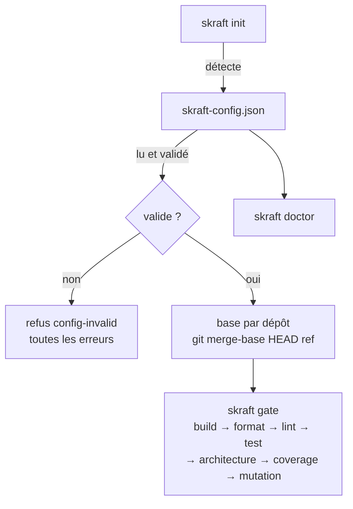

# skraft-config.json

> `skraft-config.json` dit au moteur de quels composants est fait le dépôt et quelles commandes, toujours celles écrites par le développeur, les construisent et les testent.

## Pourquoi — le problème que ça résout

En v1, les commandes de build et de test étaient devinées par des agents ou écrites dans des
recettes bash. Une recette qui marchait sur un poste échouait sur un autre, en particulier
sous PowerShell. La V2 décrit chaque **composant** (un projet buildable : une API .NET, un
front React…) dans un fichier versionné. Le moteur lance exactement ces commandes, sans
shell, depuis la racine du composant. Un développeur dont un script ne marche pas chez lui
remplace la commande dans le fichier ; rien d'autre ne la redéfinit.

## Concepts clés — comment ça marche

### Emplacement

Le fichier se trouve **à la racine du dépôt qui lance le run** (la copie de travail), à côté
de `.copilot-tracking/`. Un fichier absent n'est pas une erreur : il vaut une config sans
composant. `skraft init` sans slug le crée ou le complète.



### Exemple

```json
{
  "baseBranch": "main",
  "components": [
    { "name": "api", "root": "services/payment-api", "stack": "dotnet",
      "paths": { "src": ["src/"], "tests": ["tests/"] },
      "commands": { "build": "dotnet build --nologo", "test": "dotnet test --nologo",
                    "format": "dotnet format --verify-no-changes",
                    "mutation": "dotnet stryker --since:{baseSha}" } },
    { "name": "web", "root": "../payment-web", "stack": "react", "baseBranch": "develop",
      "mocking": { "strategy": "inprocess" },
      "commands": { "build": "npm run build", "lint": "npm run lint", "test": "npm test" } }
  ]
}
```

### Schéma — premier niveau

| Clé | Type | Défaut | Règle |
| --- | --- | --- | --- |
| `baseBranch` | string | absent (la base retombe sur `main`) | ref git : sans blanc, ne commence pas par `-` ; `null` vaut absent |
| `components` | array d'objets | `[]` | chaque entrée est un composant (ci-dessous) |
| `publish` | object | absent (`visuals` sans réponse) | `{ "visuals": true }` ou `{ "visuals": false }` ; `{}` vaut absent. Écrit par le moteur quand un humain répond à la question `reporting-consent`, toutes les autres clés du fichier conservées ; une fois posée, la question n'est plus reposée. `{ "reviewComment": true }` ou `false`, écrit à la main dans le fichier de l'équipe : si `skraft review --pr --publish` peut garder un commentaire sur la pull request qu'il revoit ; il l'emporte sur la réponse de chaque développeur, que le moteur garde dans son propre `~/.skraft/config.json` (`reviewComments`), jamais ici. |
| `models` | object | les alias Claude Code du plugin par palier | famille de modèle → `tier` et, par hôte (`claude-code`, `copilot`), `{ "model": nom ou liste, "effort": niveau }` ; voir [Personnaliser SKRAFT]({{ "/fr/how-to/customisation" | relative_url }}#models-and-effort) |
| `assign` | object | lentilles `reviewer`, workers `implementer`, `solution-researcher` `researcher`, `solution-architect` `planner`, défaut `implementer` | `{ "default", "types", "agents" }` : une famille, `inherit`, ou `{ "family", "<hôte>": { "effort" } }` ; lu aussi dans `~/.skraft/config.json` et `skraft-config.local.json` |
| `configurationConfirmed` | booléen | `false` | dans `skraft-config.local.json` seulement (refusé dans ce fichier et dans `~/.skraft/config.json`). Écrit `true` par le moteur quand vous répondez START à *Démarrer ce run avec la configuration de cette copie de travail ?*, qu'un run Copilot pose avant sa première phase tant qu'il est absent, et de nouveau avec `configure: true`. L'onglet Configuration du canvas skraft modifie les composants et les consentements de ce fichier, et l'`assign` et les `models` de `skraft-config.local.json`, vérifiés comme un run les charge |
| toute autre clé | quelconque | — | conservée telle quelle, jamais lue ni réécrite |

### Schéma — un composant

Toute clé hors de cette liste est refusée.

| Clé | Type | Défaut | Règle |
| --- | --- | --- | --- |
| `name` | string | obligatoire | kebab-case (`api`, `payment-web`) ; unique dans le fichier |
| `root` | string | obligatoire | chemin relatif à la copie de travail, non vide, jamais absolu (`/x`, `\x`, `C:x`) ; peut viser un dépôt voisin (`../payment-web`) ; normalisé (`./api/` devient `api`) |
| `stack` | string | obligatoire | `dotnet`, `java`, `python`, `typescript`, `javascript` ou `react` |
| `commands` | object | `{}` | nom → ligne de commande ; nom parmi `build`, `format`, `lint`, `test`, `architecture`, `coverage`, `mutation`, `e2e` ; ligne non vide |
| `baseBranch` | string | absent (retombe sur le `baseBranch` global) | ref git ; `null` vaut absent |
| `mocking` | object | `inprocess` pour `typescript`, `javascript` et `react`, `microcks` sinon | `strategy` vaut `microcks`, `inprocess` ou `null` ; absent ou `null` vaut le défaut de la stack. Le moteur la passe dans le brief et choisit la skill de mocking correspondante |
| `paths` | object | `["."]` pour chaque clé, toute la racine | `{ "src": […], "tests": […] }`, dossiers relatifs à la racine du composant, jamais absolus ni commençant par `..` ; `skraft init` les écrit. En DELIVER, le software engineer n'écrit que là (droits d'écriture) |
| `contractTesting` | boolean | `false` | `true` fait lire au software engineer les skills de contract testing de sa stack ; les lentilles de revue voient le réglage parmi ceux du composant |
| `mutationReport` | string | absent : le rapport qu'écrit l'outil de la stack, relatif à la racine : `StrykerOutput/reports/mutation-report.json` (.NET), `reports/mutation/mutation.json` (TypeScript, JavaScript, React), `mutation-report.json` (Python), `target/pit-reports/mutations.xml` (Java ; `build/reports/pitest/mutations.xml` quand la commande de mutation nomme Gradle) | le fichier où la commande `mutation` écrit son rapport, relatif à la racine du composant, jamais absolu ni hors d'elle. La gate de mutation y lit les mutants survivants et juge la barre 100 % / 80 % |

Les seuils qualité (couverture, mutation…) ne sont **pas** configurables : aucune clé ne les
porte.

### Validation et messages

Le moteur valide tout le fichier et rend **toutes** les erreurs d'un coup, jointes par `; `,
sous la forme `skraft-config.json is invalid: <erreur>; <erreur>…` (code `config-invalid`).
Dans les messages, `<label>` vaut `component <name>` si le nom est une chaîne, sinon
`components[<index>]`.

| Cas | Message exact |
| --- | --- |
| pas du JSON | `skraft-config.json is not JSON` (jamais le message du parseur, qui cite le fichier) |
| pas un objet | `skraft-config.json must hold a JSON object` |
| `baseBranch` global | `baseBranch must be a git ref, got <valeur JSON>` |
| `publish` | `publish must be { "visuals": true or false }` |
| `configurationConfirmed` | `configurationConfirmed belongs in skraft-config.local.json, never in <fichier>` ; `configurationConfirmed must be true or false` |
| `components` pas un tableau | `components must be an array` |
| entrée pas un objet | `components[<index>] must be an object` |
| nom | `components[<index>].name must be kebab-case, got <valeur JSON>` |
| nom en double | `component name <name> is used twice` |
| clé inconnue | `<label>: unknown key <clé> (allowed: name, root, stack, paths, commands, baseBranch, mocking, contractTesting)` |
| racine | `<label>: root must be a path relative to the working copy` |
| stack | `<label>: stack must be one of dotnet, java, python, typescript, javascript, react` |
| `commands` pas un objet | `<label>: commands must be an object of command lines` |
| nom de commande | `<label>: unknown command <nom> (allowed: build, format, lint, test, architecture, coverage, mutation, e2e)` |
| ligne vide | `<label>: command <nom> must be a non-empty command line` |
| `baseBranch` du composant | `<label>: baseBranch must be a git ref, got <valeur JSON>` |
| `mocking` | `<label>: mocking must be { "strategy": "microcks" or "inprocess" }` |
| `paths` | `<label>: paths must be { "src": [...], "tests": [...] }` ; `<label>: paths.<key> must list folders inside the component root` |
| `contractTesting` | `<label>: contractTesting must be true or false` |
| `mutationReport` | `<label>: mutationReport must be a file inside the component root` |

### Lignes de commande

Une ligne de `commands` est lancée **sans shell**, depuis la racine du composant. La même
ligne se comporte donc de la même façon sous sh, PowerShell et cmd.

| Règle | Détail |
| --- | --- |
| Découpage | sur les blancs ; le premier mot est le programme |
| Guillemets | `"…"` et `'…'` gardent les blancs dans un seul argument ; pas de caractère d'échappement |
| `{baseSha}` | remplacé, avant le découpage, par le SHA de la base du dépôt du composant |
| Syntaxe shell | un mot écrit sans guillemets qui contient <code>&#124;</code>, `&`, `;`, `<` ou `>` est refusé |
| Rien d'interprété | pas de variable, de joker ni de redirection : chaque mot part tel quel au programme |
| Programme | cherché dans le PATH (et PATHEXT sous Windows) ; un chemin avec `/` ou `\` part de la racine du composant |
| Windows | un `.cmd` ou `.bat` (npm, npx, gradlew.bat) passe par cmd.exe, arguments échappés |

Messages de refus d'une ligne (précédés de `command "<ligne>"` dans une gate, de
`"<ligne>"` dans le doctor) :

| Cas | Message |
| --- | --- |
| syntaxe shell | `uses shell syntax (<mot>); put the steps in a script and call the script` |
| guillemet non fermé | `has an unclosed <guillemet> quote` |
| `{baseSha}` sans base | `uses {baseSha} but the run has no base for this repository` |

Pour enchaîner des étapes (`a && b`), écrivez-les dans un script du dépôt et appelez le
script.

### Gates

Une **gate** est une commande dont le nom est l'un des sept noms ci-dessous. Elles tournent
dans cet ordre, quel que soit l'ordre du fichier :

| Ordre | Nom |
| --- | --- |
| 1 | `build` |
| 2 | `format` |
| 3 | `lint` |
| 4 | `test` |
| 5 | `architecture` |
| 6 | `coverage` |
| 7 | `mutation` |

`e2e`, le seul autre nom permis, n'est pas une gate : `skraft gate` ne la lance pas, mais
`skraft doctor` la vérifie. Un nom mal écrit (`tset`) rend la configuration invalide au lieu
de sauter la gate en silence. Un composant sans aucune commande de gate échoue (gate `none`,
classe `environment`) : `no gate command; give it at least one of build, format, lint, test,
architecture, coverage, mutation in skraft-config.json`. Un composant s'arrête à sa première
gate en échec.

Une ligne qui commence par `python` lance le premier interpréteur trouvé depuis la racine du
composant : `.venv/bin/python`, `.venv/Scripts/python.exe`, puis `python` et `python3` sur le
PATH. Le fichier garde `python` et reste le même sous Windows, macOS et Linux. Tout autre
programme démarre tel qu'écrit.

Avec Microcks (le défaut hors TypeScript, JavaScript et React), les tests qui l'utilisent font
tourner Microcks dans un conteneur, Docker ou Podman. Le moteur n'en cherche pas : un tel test
échoue quand aucun conteneur ne répond, comme tout test en échec.

### Classes d'échec

| Classe | Cas | Raison affichée | Qui agit |
| --- | --- | --- | --- |
| `environment` | programme ou dossier introuvable, programme impossible à lancer | `<erreur>; install it or change the command in skraft-config.json` | un humain, sur la machine ou la config |
| `environment` | code de sortie 127 (sh) ou 9009 (cmd) | `exited <code>` | idem |
| `environment` | programme arrêté par un signal | `<programme> was stopped by <signal>; run it again` | idem |
| `environment` | ligne refusée (syntaxe shell, guillemet, `{baseSha}`) | `command "<ligne>" <raison>` | idem |
| `environment` | composant sans commande de gate | message `no gate command` ci-dessus | idem |
| `deterministic` | tout autre code de sortie non nul | `exited <code>` | le code doit changer |

Sous la CLI et Copilot, la sortie d'une commande est gardée jusqu'à 64 Mio par flux. Au-delà, la preuve en garde le
début et la fin autour de `… output cut …`, la commande va jusqu'au bout, et son code de sortie
juge toujours la gate ; sa raison, réussie ou non, se termine par `; its output passed the
runner's limit: the evidence keeps only its head and its tail`.

### Composants modifiés

Sans `--all`, `skraft gate` ne lance que les composants **modifiés depuis leur base** :
fichiers changés depuis le SHA de base (commits, index, copie de travail) et fichiers non
suivis, dans la racine du composant. Ne comptent pas : les fichiers sous `.copilot-tracking/`
et ceux d'un composant imbriqué dans celui-ci. Un composant sans base (racine hors de tout
dépôt Git), ou dont Git ne sait pas lister les changements, compte comme modifié.
`skraft gate --all` les lance tous. En DELIVER, un nœud de gate lance d'abord les composants
modifiés ; une fois qu'ils passent, une gate d'objectif (`goal_gate=true`) lance aussi les
autres, si bien que DELIVER se clôt sur tous les composants.

### Règle de base

La **base** d'un dépôt est le commit depuis lequel on compare : `git merge-base HEAD <ref>`,
calculé dans le dépôt de chaque composant et dans celui de la copie de travail.

| Priorité | Source de `<ref>` | `source` journalisée |
| --- | --- | --- |
| 1 | `--base <ref>` | `flag` |
| 2 | `baseBranch` du composant | `component` |
| 3 | `baseBranch` global | `config` |
| 4 | `main` | `default` |

- Si la ref n'a pas de merge-base locale, le moteur essaie `origin/<ref>`.
- Un dossier hors de tout dépôt n'a pas de base ; ce n'est pas une erreur.
- Sans merge-base même avec `origin/<ref>` : refus `base-unresolved`, une partie par dépôt
  sans base (`the working copy (<dépôt>) has no merge base with <ref>` ou
  `component <nom> (<dépôt>) has no merge base with <ref>`), jointes par `; `, suivies de
  `; set baseBranch in skraft-config.json or pass --base <ref>`.
- Si la config liste des composants et que Git ne se lance pas : refus
  `source-control-unavailable`.
- La base est journalisée dans `run.started.base` au **premier** init du slug. Une reprise
  garde la base journalisée.

### Détection (`skraft init` sans slug)

Le moteur cherche les projets dans la copie de travail et dans chaque dossier `--add`,
jusqu'à **3 niveaux** de profondeur, en ignorant les dossiers cachés et `node_modules`. Un
projet sous un projet de la **même famille** n'est pas un composant (un `.csproj` sous une
solution) ; un projet d'une **autre famille** en est un (un front React sous une solution
.NET). Familles : `dotnet`, `java`, `python`, `js` (typescript, javascript, react).

Dans un même dossier, le premier marqueur trouvé dans cet ordre décide de la stack :

| Stack | Marqueurs | `build` | `test` | Autres commandes |
| --- | --- | --- | --- | --- |
| `dotnet` | `*.sln`, `*.slnx`, `*.csproj`, `*.fsproj`, `*.vbproj` | `dotnet build --nologo` | `dotnet test --nologo` | `format` : `dotnet format --verify-no-changes` ; `mutation` : `dotnet stryker --since:{baseSha}` |
| `java` (Maven) | `pom.xml` | `mvn -B -q -DskipTests package` (`./mvnw` si présent) | `mvn -B -q test` (`./mvnw` si présent) | — |
| `java` (Gradle) | `build.gradle`, `build.gradle.kts` | `gradle build -x test` (`./gradlew` si présent) | `gradle test` (`./gradlew` si présent) | — |
| `python` | `pyproject.toml`, `setup.py`, `setup.cfg`, `requirements.txt` | `python -m compileall -q src` (`.` sans dossier `src`) | `python -m pytest -q -p no:cacheprovider` | — |
| `react` / `typescript` / `javascript` | `package.json` | `npm run build` si script `build`, sinon `npx tsc --noEmit` (pas pour javascript) | `npm test` si script `test`, sinon `npx vitest run` si dépendance vitest, sinon `npx jest` si dépendance jest | `lint` : `npm run lint` si script `lint` |

Pour `package.json` : `react` si dépendance `react`, sinon `typescript` si `tsconfig.json`
existe ou dépendance `typescript`, sinon `javascript`. Les dépendances lues sont
`dependencies` et `devDependencies`.

`paths` proposés :

| Stack | `src` | `tests` |
| --- | --- | --- |
| `dotnet`, `python` | `src/` s'il existe, sinon `./` | `tests/` et/ou `test/` s'ils existent |
| `java` sans modules | `src/main/` | `src/test/` |
| `java` Maven à modules | les `<module>` du `pom.xml` hors modules de test | les modules dont le nom contient le mot `test`, `tests` ou `it` (seul ou séparé par `-`) |
| JS / TS / React | `src/` s'il existe, sinon `./` | `tests/`, `test/`, `__tests__/` s'ils existent, sinon comme `src` |

**Nom** : nom du dossier en kebab-case (`PaymentApi` devient `payment-api`), le nom du dossier
de la copie de travail pour la racine, `app` s'il ne reste rien ; `-2`, `-3`… si le nom est
pris. Une racine déjà listée n'est pas reproposée. Le moteur n'écrit ni `mocking` ni
`baseBranch` : les défauts s'appliquent.

## Pourquoi cette pratique

> « Don't Assume It—Prove It. »
> — Hunt, A. & Thomas, D., *The Pragmatic Programmer, 20th anniversary ed.*, 2019.

Une gate ne suppose pas que le code marche : elle le prouve par une commande. Écrites dans un fichier versionné,
lancées par le moteur sans shell, elles donnent le même résultat sur chaque poste et sous
chaque hôte. Ce qui change d'un poste à l'autre se règle dans la config, pas dans la prose
d'un agent.

## Pièges & anti-patterns

- **Une chaîne shell dans `commands`** (`npm ci && npm test`) : refusée. Mettez les étapes
  dans un script et appelez-le.
- **Compter sur une variable d'environnement** (`$HOME`, `%PATH%`) dans une ligne : elle part
  telle quelle au programme.
- **Un nom de gate mal écrit** (`Test`, `unit-test`) : ce n'est pas une gate, elle ne tourne
  jamais dans `skraft gate`.
- **Une racine absolue** : refusée ; un dépôt voisin s'écrit `../nom`.
- **Oublier Docker ou Podman avec Microcks** : démarrez-en un avant les tests, ou passez le
  composant en `inprocess` s'il ne mocke pas avec Microcks.

## Pour aller plus loin

- [Configurer les composants]({{ "/fr/how-to/configure-components" | relative_url }})
- [Lancer les gates et lire leurs preuves]({{ "/fr/how-to/run-gates" | relative_url }})
- [Ce qu'on peut adapter et le risque]({{ "/fr/how-to/customisation" | relative_url }})
- [La ligne de commande skraft]({{ "/fr/reference/cli" | relative_url }})
- [Dossier de suivi et journal]({{ "/fr/reference/run-journal" | relative_url }})

## Sources

- Hunt, A. & Thomas, D. *The Pragmatic Programmer, 20th anniversary ed.*, 2019.

Termes à connaître : **composant**, **gate**, **base**, **Microcks** — voir le
[glossaire]({{ "/fr/reference/glossary" | relative_url }}).
