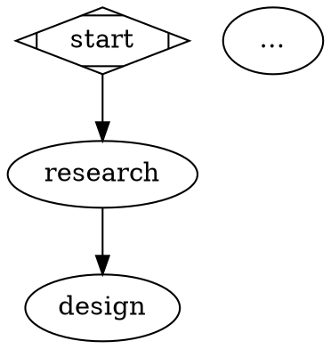
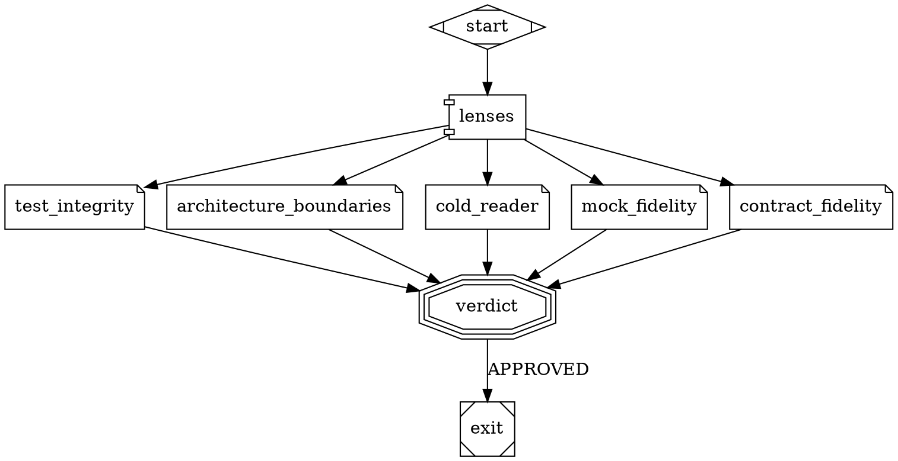

# Le workflow DOT

> Le pipeline et la revue DELIVER sont deux graphes DOT que le moteur lit, valide puis exécute ; cette page en donne la syntaxe complète.

Le pourquoi d'un pipeline décrit par un graphe plutôt que codé en dur :
[Architecture]({{ "/fr/explanation/architecture" | relative_url }}). Les commandes qui
copient, valident et comparent un workflow :
[`skraft workflow`]({{ "/fr/reference/cli" | relative_url }}). Ce que chaque phase du
workflow livré produit : [Phases]({{ "/fr/reference/phases" | relative_url }}).

## Fichiers {#files}

| Fichier | Rôle | Lu depuis |
| --- | --- | --- |
| `pipeline.skraft.dot` | le pipeline d'un run (`digraph skraft`) | `.skraft/pipeline.skraft.dot` de la copie de travail s'il existe, sinon `workflows/pipeline.skraft.dot` du plugin |
| `review.skraft.dot` | la revue que le nœud `deliver_review` appelle et que `skraft review --pr` lance (`digraph review`) | `.skraft/review.skraft.dot` s'il existe, sinon `workflows/review.skraft.dot` du plugin |
| `<nom>.skraft.dot` | tout workflow qu'un nœud d'appel nomme (`workflow="<nom>"`) | `.skraft/<nom>.skraft.dot`, sinon `workflows/<nom>.skraft.dot` du plugin ; introuvable : workflow refusé |

| Règle | Détail |
| --- | --- |
| Copie | `skraft workflow eject` écrit `.skraft/pipeline.skraft.dot`, `skraft workflow eject review` écrit `.skraft/review.skraft.dot` ; une copie existante n'est jamais écrasée |
| Version | chaque copie reçoit `skraft_version="<version du plugin>"` dans son `graph [...]` |
| Configuration | `skraft-config.json` ne nomme aucun workflow : une clé `workflow` est refusée (`workflow is no key: …`) |
| Écriture | aucun agent ne peut écrire dans `.skraft/` |
| Familles | une famille de modèle que nomme une copie (`model=`, `@<famille>`, `refuter=`) compte, quelles que soient les copies éjectées |

## Graphe {#graph}



| Élément | Règle |
| --- | --- |
| `digraph <nom> { … }` | un graphe orienté par fichier |
| `graph [ … ]` | attributs du graphe : `version`, `goal`, `skraft_version` (écrit par `eject`), `input_<nom>` |
| `input_<nom>` | `"required"` ou `"optional"` ; `<nom>` en lettres minuscules, chiffres et `_` ; déclare une entrée d'un workflow appelé |
| Commentaires | `// …` |
| Chaîne d'arêtes | `a -> b -> c` déclare deux arêtes |
| Sous-graphe | `subgraph cluster_<x> { … }` regroupe ses nœuds dans un dessin ; ses attributs (`label`) ne changent rien ; un sous-graphe dans un autre est refusé |
| Identifiant de nœud | lettres, chiffres, `_` et `-`, commençant par une lettre ou `_` : il nomme les fichiers du nœud dans le dossier de suivi |

## Formes de nœud {#node-shapes}

| Forme | Type | Attributs obligatoires | Attributs facultatifs | Arêtes sortantes |
| --- | --- | --- | --- | --- |
| `Mdiamond` | début | — | — | — ; exactement un par workflow ; aucune arête n'y entre |
| `Msquare` | fin | — | — | aucune ; au moins une par workflow |
| `box` | agent | `agent` | `model`, `outputs`, `writes`, `max_attempts`, `each`, `proposal` | exactement une, sans étiquette |
| `parallelogram` | gate de commandes | `gate` | `goal_gate`, `locked`, `unlock` | une `PASS` (une arête sans étiquette vaut `PASS`), au plus une `FAIL` |
| `parallelogram` + `publish=` | publication | `publish` | `when` | exactement une, sans étiquette |
| `component` | fan-out d'une revue | — | — | une par nœud lentille |
| `note` | nœud lentille | `lens` | `model`, `when`, `mandatory` | exactement une, vers le fan-in |
| `tripleoctagon` | fan-in d'une revue | — | `model`, `refuter`, `mandatory` | une `APPROVED` (une arête sans étiquette vaut `APPROVED`), au plus une `NEEDS_REWORK` |
| `hexagon` | question à un humain | `question` | — | une par réponse ; au plus une sans étiquette, qui vaut toute réponse sauf un refus ; un refus a sa propre arête ; `STOP` d'une question qui prend une consigne n'a pas d'arête (il termine le run), et une consigne suit l'arête de la première option |
| `house` | appel d'un workflow | `workflow` | `mandatory`, `with_<entrée>` | comme un fan-in : une `APPROVED`, au plus une `NEEDS_REWORK` |

Attributs communs à toutes les formes : `label`, `shape`, `phase`. Tout autre attribut est
refusé (`attribute <clé> is not supported on a <forme> node (supported: …)`).

## Attributs de nœud {#node-attributes}

| Attribut | Valeur | Règle |
| --- | --- | --- |
| `phase` | mot en majuscules (`DESIGN`) | absent : la phase du premier prédécesseur dans l'ordre du parcours depuis le début ; un nœud de travail sans phase est refusé |
| `agent` | id d'agent kebab-case | cherché dans le plugin, puis `.claude/agents/` (Claude Code) ou `.github/agents/` (Copilot) ; introuvable : refusé |
| `model` | famille de modèle (`reviewer`, `planner`, `gpt-codex`) | sur un agent : sa famille ; sur une lentille : la sienne ; sur un fan-in : celle de ses lentilles qui n'en nomment aucune ; une règle `assign.agents` l'emporte |
| `refuter` | famille de modèle | la famille de `finding-refuter` pour ce fan-in |
| `outputs` | chemins séparés par `,`, relatifs au dossier de suivi, sans `..` | remplace les sorties du rôle de l'agent ; `{date}` et `{slug}` remplis au lancement |
| `writes` | chemins séparés par `,`, relatifs à la copie de travail | s'ajoutent aux chemins que le rôle de l'agent peut écrire |
| `max_attempts` | entier positif | tentatives par passage ; défaut **3** |
| `each` | `survivor-file` | atteint par l'arête `FAIL` de la gate de mutation : un lancement par fichier portant des mutants survivants ; atteint par une autre arête : un seul lancement, avec ce que l'arête apporte |
| `proposal` | `true` ou `false` | avec `each="survivor-file"` (obligatoire) : l'agent écrit une proposition par fichier dans le fichier que crée le moteur (`proposals/<nœud>-<visite>-g<n>.md`) et ne change aucun code |
| `gate` | liste parmi `build`, `format`, `lint`, `test`, `architecture`, `coverage`, `mutation` | lancées dans cet ordre, quel que soit l'ordre écrit |
| `goal_gate` | `true` ou `false` | une fois les composants modifiés passés, lance aussi les autres composants |
| `locked` | `true` ou `false` | voir [Nœuds verrouillés](#locked-nodes) |
| `unlock` | texte non vide | la raison pour laquelle un nœud verrouillé est sauté |
| `publish` | `pull-request` ou `playwright-visuals` | ce que le nœud publie |
| `when` (publication) | `frontend` | saute le nœud quand aucun composant n'est un front end |
| `lens` | nom kebab-case | la lentille `<nom>` est l'agent `<nom>-lens` ; une fois au plus par revue |
| `when` (lentille) | `mock` ou `contract` | voir [Lentilles conditionnelles](#conditional-lenses) |
| `question` | `adr-ratification`, `reporting-consent`, `publish-consent` ou `mutation-plan` | voir [Phases]({{ "/fr/reference/phases" | relative_url }}#human-questions) |
| `workflow` | nom de base kebab-case (`review`) | le workflow appelé |
| `with_<entrée>` | `base`, `head`, `story`, `documents` ou `components` | lie l'entrée `<entrée>` du workflow appelé à cette valeur du run |
| `mandatory` | `true` | voir [Nœuds obligatoires](#mandatory-nodes) ; `mandatory=false` est refusé |

## Arêtes {#edges}

| Attribut | Valeur | Règle |
| --- | --- | --- |
| `label` | selon le nœud de départ | gate : `PASS`, `FAIL` ; fan-in et appel : `APPROVED`, `NEEDS_REWORK` ; question : une réponse de la question ; toute autre arête n'en prend aucun |
| `max_visits` | entier positif | nombre de fois où le run peut prendre l'arête ; obligatoire sur toute boucle |

## Règles de validité {#validity}

`skraft workflow check`, `skraft init` et chaque pilote valident le workflow avant tout run et
rendent toutes les erreurs. Un workflow est refusé quand :

| Règle | Message type |
| --- | --- |
| aucun ou plusieurs nœuds de début | `the workflow needs exactly one start node (shape=Mdiamond), has N` |
| aucun nœud de fin | `the workflow needs at least one exit node (shape=Msquare)` |
| nœud inatteignable | `node <id> is unreachable from start` |
| nœud qui n'atteint aucune fin | `node <id> never reaches an exit` |
| boucle sans `max_visits` | `loop a -> b -> a has no max_visits` |
| arête qui entre dans le début | `edge <a> -> <b>: no edge may enter the start node` |
| arête qui revient à une phase antérieure (sauf vers une fin) | `edge <a> -> <b> goes back from <PHASE> to <PHASE>` |
| nœud de travail sans phase | `node <id> has no phase; set phase="<PHASE>" on it or on a node before it` |
| forme absente ou inconnue | `node <id> has no shape; …`, `node <id>: shape <forme> is not supported (supported: …)` |
| attribut obligatoire absent | `node <id>: a <forme> node needs <clé>="…"` |
| nombre d'arêtes sortantes faux | `node <id>: gate node needs exactly one PASS edge, has N`, etc. |
| étiquette sur une arête qui n'en prend pas | `edge <a> -> <b>: only an edge leaving a gate, a review's fan-in (shape=tripleoctagon), a call (shape=house) or an ask node takes a label` |
| agent, lentille, `finding-refuter` ou skill qu'une lentille liste introuvable | le nœud, l'agent et la skill nommés |
| `proposal=true` sans `each` | `node <id>: proposal=true needs each="survivor-file", the mutants it proposes for` |
| forme `lenses="…"` (ancienne) | refusée ; le message écrit, en DOT, les nœuds et arêtes qui la remplacent |

Valide, `skraft workflow check` affiche `<fichier> is valid: phases RESEARCH, DESIGN, …` et, pour
chaque nœud déverrouillé, `; <nœud> is unlocked and skipped: <raison>`.

## Nœuds verrouillés {#locked-nodes}

Les gates de DELIVER du workflow du plugin (`gates`, `mutation`) portent `locked=true`. Une copie
qui les retire ou les change est refusée, sauf à les sauter avec `unlock="<raison>"`, que le
journal et la pull request reprennent.

| Une copie est refusée quand le nœud verrouillé… | Message |
| --- | --- |
| manque | `locked node <id> is missing; keep it with unlock="<reason>" to skip it` |
| perd une de ses gates | `locked node <id> drops <gates>; keep them, or skip the node with unlock="<reason>"` |
| perd `goal_gate=true` | `locked node <id> must stay goal_gate=true; skip it with unlock="<reason>" instead` |
| n'a plus d'arête `FAIL` vers un agent de sa phase | `locked node <id> has no FAIL edge back to an agent of <PHASE>` |
| est contourné | `<nœud> reaches the exit without passing <id>; keep the run going through <id>, or skip <id> with unlock="<reason>"` |

Un nœud de gates qui lance toutes les gates d'un nœud verrouillé (son `goal_gate` compris) et
n'est pas déverrouillé tient lieu de lui pour ce contrôle : dans le workflow du plugin,
`mutation_gates` tient lieu de `gates` sur le chemin `kill_mutants -> … -> mutation`.

## Nœuds obligatoires {#mandatory-nodes}

Les workflows du plugin marquent `mandatory=true` :

- dans `pipeline.skraft.dot` : les fan-in `design_review`, `distill_review`, `mutation_review`
  et l'appel `deliver_review` ;
- dans `review.skraft.dot` : le fan-in `verdict` et les lentilles `test_integrity` et
  `architecture_boundaries`.

Rien ne permet à un dépôt d'en sauter un : pas d'`unlock`, pas d'option CLI, pas de réglage
dans `skraft-config.json`. Le workflow du plugin décide : retirer l'attribut de la copie ne
change rien, et `mandatory=false` est refusé.

| Nœud obligatoire | Gardé quand |
| --- | --- |
| Fan-in d'une revue | il reste un fan-in de même id ; son arête `NEEDS_REWORK` revient vers un agent de sa phase dans le workflow du plugin (renommer cette phase est refusé) ; aucun chemin n'atteint la sortie sans lui depuis le départ, depuis cet agent, ou depuis un agent de sa phase que le run n'atteint qu'à travers la revue. Un chemin que le workflow du plugin a aussi est gardé : le run atteint la sortie autour de `mutation_review` depuis le départ quand la mutation passe |
| Appel | il reste un appel (`shape=house`) de même id, aux mêmes règles qu'un fan-in de revue. Il peut appeler un autre workflow : celui-ci doit garder les nœuds obligatoires du `review.skraft.dot` du plugin |
| Nœud lentille | il garde son id, sa lentille (son `model=` peut changer), son fan-out et son fan-in, et ne porte aucun `when`. Ceux de `review.skraft.dot` sont vérifiés dans le fichier que lit l'appel, éjecté ou non |
| Fan-in de `review.skraft.dot` | il garde son id (`verdict`), dans le workflow qu'appelle l'appel obligatoire, quel qu'il soit |

Chaque refus nomme le nœud et la règle violée, et finit par `this node is mandatory and cannot be
removed`. `skraft workflow diff` marque `(mandatory)` chaque nœud obligatoire qu'il liste comme
retiré ou modifié.

## Revue : fan-out, nœuds lentille, fan-in {#reviews}

Une revue s'écrit en un fan-out (`shape=component`), un nœud lentille par branche
(`shape=note`) et un fan-in (`shape=tripleoctagon`). Le journal nomme l'étape de revue d'après
le fan-in (`distill_review`). Le moteur lance les lentilles d'une revue ensemble, dans l'ordre
des arêtes du fan-out, là où l'hôte le permet. Ce qu'une revue calcule ensuite (réponse des
lentilles, réfutation, verdict) : [Gates]({{ "/fr/reference/gates" | relative_url }}).

```dot
distill_review_lenses [shape=component]
distill_review_coverage    [shape=note, lens="coverage"]
distill_review_testability [shape=note, lens="testability", when="mock"]
distill_review [shape=tripleoctagon]
distill -> distill_review_lenses
distill_review_lenses -> distill_review_coverage -> distill_review
distill_review_lenses -> distill_review_testability -> distill_review
distill_review -> distill [label="NEEDS_REWORK", max_visits=3]
distill_review -> deliver [label="APPROVED"]
```

| Règle | Détail |
| --- | --- |
| Fan-out (`shape=component`) | aucun attribut propre ; chaque arête qui en part est une branche qui porte exactement un nœud lentille, et toutes les branches aboutissent au même fan-in. Il ne prend aucune étiquette |
| Nœud lentille (`shape=note`) | `lens="<nom>"` obligatoire, kebab-case, une fois au plus par revue ; `model="<famille>"` et `when="mock"` ou `when="contract"` facultatifs. Entré par une arête venue de son fan-out, il sort par une arête vers son fan-in |
| Fan-in (`shape=tripleoctagon`) | entré seulement par les nœuds lentille d'un même fan-out ; `model=` (la famille de ses lentilles qui n'en nomment aucune) et `refuter=` facultatifs |
| `lenses="…"` | l'ancienne forme, refusée : `skraft workflow check` nomme chaque nœud qui l'utilise et écrit, en DOT, les nœuds et arêtes qui le remplacent : identifiants compris (`<revue>_lenses`, `<revue>_<lentille>`), `when` pour `mock-fidelity` et `contract-fidelity`, `label`, `phase`, `model` et `refuter` du nœud sur le fan-in, ses arêtes entrantes envoyées au fan-out |
| Modèle | une famille est un palier (`economy`, `standard`, `frontier`), un rôle (`reviewer`, `researcher`, `implementer`, `planner`) ou une famille libre avec un `tier` (`gpt-codex`). Le `model=` d'un nœud lentille, sinon celui du fan-in, nomme sa famille ; une règle `assign.agents` l'emporte quand même, et `skraft workflow check` le signale. Les workflows du plugin n'en nomment aucune : `assign` de la configuration décide ([Choisir les modèles des agents]({{ "/fr/how-to/choose-models" | relative_url }})). `finding-refuter` tourne un palier au-dessus de la lentille la plus forte de son groupe, `frontier` au plus, sauf si une règle nomme sa famille. Le journal enregistre l'affectation de chaque agent (`assignment`) et le modèle sur lequel il a tourné (`model`, null pour celui de la session) |
| Agent d'une lentille | la lentille `<nom>` est l'agent `<nom>-lens`, cherché dans le plugin, puis dans `.claude/agents/` (Claude Code) ou `.github/agents/` (Copilot) ; `finding-refuter` doit aussi être trouvé, sinon le workflow est refusé |
| Arête `APPROVED` | exactement une ; une arête sans étiquette compte comme `APPROVED` |
| Arête `NEEDS_REWORK` | au plus une ; sans elle, un `NEEDS_REWORK` arrête le run avec `review-rejected` ; au-delà de son `max_visits`, avec `loop-ceiling` |
| Pilote | le pilote d'hôte lance les lentilles et le réfuteur (profondeur 1) ; aucun agent n'en lance un autre |

## Nœud d'appel et `review.skraft.dot` {#call-node}

```dot
deliver_review [shape=house, workflow="review", mandatory=true]
gates -> deliver_review [label="PASS"]
deliver_review -> deliver [label="NEEDS_REWORK", max_visits=3]
deliver_review -> mutation [label="APPROVED"]
```

| Règle | Détail |
| --- | --- |
| Nœud d'appel (`shape=house`) | `workflow="<nom>"` obligatoire : le nom de base d'un workflow, en kebab-case (`review`) ; `mandatory`, `label`, `phase` et `with_<entrée>` facultatifs, rien d'autre (ni `model=` ni `refuter=` : le fan-in appelé les nomme). Ses arêtes sont celles d'un fan-in : une `APPROVED`, au plus une `NEEDS_REWORK`, avec `max_visits` |
| Workflow appelé | ne lance qu'une revue : start → fan-out → un nœud lentille par branche → fan-in → exit, sans arête `NEEDS_REWORK` (l'appel la porte). Ses nœuds prennent la phase de l'appel. Un appel en son sein est refusé |
| Entrées | chacune un attribut de graphe du workflow appelé, `input_<nom>="required"` ou `"optional"`. L'appel lie chacune par son nom à ce que le run détient : `base` et `head` (les changements que la revue lit), `story`, `documents` (ce que les agents ont rempli ou écrit, par phase), `components` (chaque composant avec les gates passées dessus). `with_<nom>="<valeur>"` la lie à une autre de ces valeurs. Une entrée requise non liée, un `with_` qui ne lie aucune entrée, ou un workflow appelé qui ne lie rien à `base` ou à `head` est refusé |
| Journal | celui d'un fan-in : `step.started` et `step.recorded` sous l'id de l'appel (`deliver_review`), `review.lens`, `review.refuted`. `NEEDS_REWORK` renvoie le travail à l'agent avec les findings (`sentBy: review`) |
| Entrée non liée | aucune lentille n'en reçoit rien : sans `documents`, pas de `context.md` ni de document du run ; sans `story`, le brief dit `Story: none` ; sans `components`, pas de `components.json` |

`review.skraft.dot` du plugin ne lit que ses entrées, jamais le journal d'un run :



## Entrées des lentilles {#lens-inputs}

Toutes les lentilles sauf `cold-reader` lisent aussi le `context.md` de la revue (story, règles
du projet, qui a écrit quel document), écrit seulement quand la revue est liée aux documents du
run (chaque revue de `pipeline.skraft.dot`, et `review` appelé par lui). Les fichiers sont dans
`reviews/<nœud>-<visite>/` ([Dossier de suivi et journal]({{ "/fr/reference/run-journal" | relative_url }})).

| Lentille | Lit |
| --- | --- |
| `architecture-compliance`, `testability`, `boundary-enforcement` | documents de la phase, patch, chemins changés |
| `architecture-boundaries` | documents de la story et des autres phases, patch, chemins changés, `components.json` |
| `cold-reader` | patch et chemins changés seulement, sans les ADR ni la [documentation durable]({{ "/fr/reference/run-journal" | relative_url }}#durable-docs) : ni story, ni périmètre, ni contexte |
| `mock-fidelity`, `contract-fidelity` | patch, chemins changés, `components.json` |
| `fitness` | tout ce qui précède, patch et chemins changés limités à `docs/adr/`, `docs/architecture/` et `docs/domain/event-model/` (`design.patch`, `design-files.txt`) |
| `business-alignment` | tout ce qui précède, patch et chemins changés limités à `docs/features/` (`features.patch`, `features-files.txt`) |
| toute autre lentille (`consistency`, `coverage`, `test-integrity`, une lentille du dépôt) | tout ce qui précède |

Le patch contient tous les changements depuis la base du run, hors dossier de suivi. Quand le
run n'a rien changé hors du dossier de suivi, une lentille qui lit les changements ne reçoit
aucun des deux fichiers et son brief le dit (`Changes since the base of the run: none outside
the tracking folder`). Un chemin changé sans section dans le patch est un fichier nouveau non
suivi : la lentille l'ouvre.

`components.json` liste chaque composant avec `name`, `root`, `stack`, `mocking` (la stratégie
résolue, défaut de la stack compris), `contractTesting` et `gates` (les gates passées sur lui
dans ce run, dans l'ordre des gates).

**Skills.** Le brief donne à chaque lentille le `SKILL.md` de chaque skill que son descripteur
liste sous `metadata.skills`, pris dans le plugin, puis dans `.claude/skills/` ou
`.github/skills/`. Une skill qu'une lentille ou `finding-refuter` liste et qui est introuvable
refuse le workflow, en nommant le nœud, l'agent et la skill.

## Lentilles conditionnelles {#conditional-lenses}

Un nœud lentille avec `when=` ne tourne que si un chemin changé ou une ligne que le patch ajoute
ou garde correspond à son déclencheur ; sinon la revue tourne sans lui. Un nœud lentille sans
`when` tourne toujours.

| `when` | Chemin | Ligne |
| --- | --- | --- |
| `mock` | un nom de fichier contenant `mock`, `stub` ou `fake` | `WireMock…`, `MockServer`, `Microcks…`, `Mountebank`, `HttpMessageHandler`, `nock`, `msw` |
| `contract` | un nom de fichier contenant `contract`, `.apiexamples`, `.apimetadata`, `openapi….yaml/json` | `VerifyAsync`, `Pact…`, `ProviderVerifier`, `ContractTest` |

## Workflow du plugin {#plugin-workflow}

Les nœuds de `workflows/pipeline.skraft.dot`, dans l'ordre du fichier. La phase entre
parenthèses est héritée du prédécesseur.

| Nœud | Forme | Attributs | Phase |
| --- | --- | --- | --- |
| `start` | `Mdiamond` | — | — |
| `publish_consent` | `hexagon` | `question="publish-consent"` | RESEARCH |
| `visuals_consent` | `hexagon` | `question="reporting-consent"` | (RESEARCH) |
| `research` | `box` | `agent="solution-researcher"` | RESEARCH |
| `design` | `box` | `agent="solution-architect"` | DESIGN |
| `design_review_lenses` → `design_review` | revue | lentilles `consistency`, `architecture-compliance`, `fitness` ; fan-in `mandatory=true` | (DESIGN) |
| `adr` | `hexagon` | `question="adr-ratification"` | (DESIGN) |
| `distill` | `box` | `agent="acceptance-designer"` | DISTILL |
| `distill_review_lenses` → `distill_review` | revue | lentilles `coverage`, `business-alignment`, `testability`, `boundary-enforcement` ; fan-in `mandatory=true` | (DISTILL) |
| `deliver` | `box` | `agent="software-engineer"` | DELIVER |
| `gates` | `parallelogram` | `gate="build,format,lint,test,architecture,coverage"`, `goal_gate=true`, `locked=true` | DELIVER |
| `deliver_review` | `house` | `workflow="review"`, `mandatory=true` | (DELIVER) |
| `mutation` | `parallelogram` | `gate="mutation"`, `goal_gate=true`, `locked=true` | (DELIVER) |
| `kill_proposal` | `box` | `agent="software-engineer"`, `each="survivor-file"`, `proposal=true` | (DELIVER) |
| `mutation_plan` | `hexagon` | `question="mutation-plan"` | (DELIVER) |
| `kill_mutants` | `box` | `agent="software-engineer"`, `each="survivor-file"` | (DELIVER) |
| `mutation_review_lenses` → `mutation_review` | revue | lentille `test-integrity` ; fan-in `mandatory=true` | (DELIVER) |
| `mutation_gates` | `parallelogram` | `gate="build,format,lint,test,architecture,coverage"`, `goal_gate=true` | (DELIVER) |
| `visuals` | `parallelogram` | `publish="playwright-visuals"`, `when="frontend"` | (DELIVER) |
| `pr_writer` | `box` | `agent="pr-writer"` | PUBLISH |
| `publish` | `parallelogram` | `publish="pull-request"` | (PUBLISH) |
| `exit` | `Msquare` | — | — |

| Arête | Étiquette | `max_visits` |
| --- | --- | --- |
| `design_review -> design` | `NEEDS_REWORK` | 3 |
| `design_review -> adr` | `APPROVED` | — |
| `adr -> distill` | `RATIFIED` | — |
| `adr -> design` | `REJECTED` | 3 |
| `distill_review -> distill` | `NEEDS_REWORK` | 3 |
| `distill_review -> deliver` | `APPROVED` | — |
| `gates -> deliver` | `FAIL` | 3 |
| `gates -> deliver_review` | `PASS` | — |
| `deliver_review -> deliver` | `NEEDS_REWORK` | 3 |
| `deliver_review -> mutation` | `APPROVED` | — |
| `mutation -> visuals` | `PASS` | — |
| `mutation -> kill_proposal` | `FAIL` | 5 |
| `mutation_plan -> kill_mutants` | `APPLY` | — |
| `mutation_review -> kill_mutants` | `NEEDS_REWORK` | 3 |
| `mutation_review -> mutation_gates` | `APPROVED` | — |
| `mutation_gates -> kill_mutants` | `FAIL` | 3 |
| `mutation_gates -> mutation` | `PASS` | — |

Les autres arêtes n'ont ni étiquette ni plafond : `start -> publish_consent -> visuals_consent
-> research -> design`, `distill -> distill_review_lenses`, `deliver -> gates`,
`kill_proposal -> mutation_plan`, `kill_mutants -> mutation_review_lenses`, `visuals -> pr_writer -> publish -> exit`, et celles
de chaque revue.

## Voir aussi {#see-also}

- [La ligne de commande skraft]({{ "/fr/reference/cli" | relative_url }}) — `skraft workflow eject|check|diff`
- [Phases]({{ "/fr/reference/phases" | relative_url }})
- [Gates]({{ "/fr/reference/gates" | relative_url }})
- [Adapter skraft : ce que coûte chaque réglage]({{ "/fr/explanation/customisation-trade-offs" | relative_url }})
- [Architecture]({{ "/fr/explanation/architecture" | relative_url }})

Termes à connaître : **workflow**, **lentille**, **fan-out**, **fan-in**, **gate** — voir le
[glossaire]({{ "/fr/reference/glossary" | relative_url }}).
