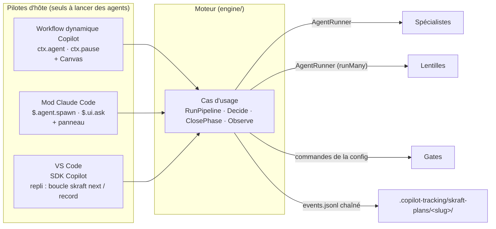
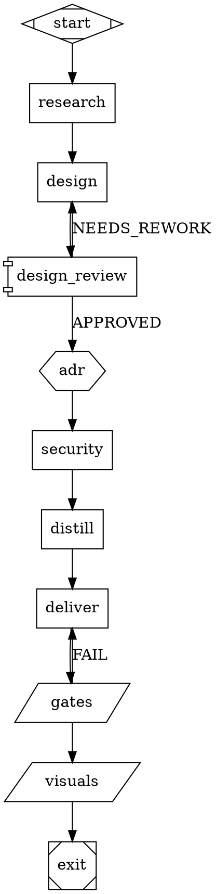

# Skraft V2 — PRD et plan détaillé

> Source de vérité : https://claude.ai/code/artifact/123456c6-9d3b-4078-9fa6-4a2c82089a43 — copie du 2026-10-10.

10 octobre 2026 · Sébastien Degodez

## Résumé

La V2 s'appuie sur le **mod Claude Code** et le **workflow dynamique GitHub Copilot** : chacun pilote les mêmes cas d'usage d'un moteur testé, qui décide de chaque étape. Une vue Canvas (Copilot) et un panneau (Claude Code) montrent le run en direct. La comparaison se fait entre deux branches, `main` (v1) et `integration/v2-next` (v2) : sur la branche v2, le code de la v1 est supprimé dès le lot 0, pour que tout le code qui reste soit propre.

- **Pilotes d'hôte** : le workflow dynamique Copilot lance les agents par `ctx.agent` et attend l'humain par `ctx.pause` ; le mod Claude Code les lance par `$.agent.spawn` et pose les questions par `$.ui.ask`. L'agent orchestrateur redevient un lanceur. Sous VS Code, qui n'a ni l'un ni l'autre, un pilote de repli fait tourner les mêmes cas d'usage par une boucle `skraft next` / `skraft record`.
- **Profondeur 1** : seul le pilote lance des sous-agents, lentilles comprises, en parallèle quand l'hôte le permet. Aucun agent ne lance un autre agent.
- **Contrôles en code** : ordre des phases, sorties attendues, droits d'écriture (diff git par étape), gates et verdict de revue sont calculés par le moteur. Les hooks repartent de zéro et reviennent un par un, sur preuve d'un besoin.
- **Autonomie du développeur** : `skraft-config.json` décrit chaque composant (racine, technologie) et ses commandes importantes (build, test, format, couverture, mutation, architecture), y compris pour plusieurs technologies et plusieurs dépôts. Détectées par `skraft init`, vérifiées par `skraft doctor`, modifiables à la main si un script échoue.
- **Templates sans anomalie** : le moteur pré-crée chaque fichier de sortie depuis son template avant de lancer l'agent, et le brief donne des chemins absolus. Plus de `$SKRAFT_PLUGIN_ROOT`, plus de heredoc.
- **Non-régression** : chaque lot compare la v2 à la v1 sur les fixtures et les suites d'agents ; une régression bloque la PR du lot.
- **Deux plugins** : `skraft` (central, toujours installé) et `skraft-brownfield` (autonome, sans lien par chemin vers le central). Le plugin `skraft-backlog` de la PR #204 garde son contrat de fichiers.

Le workflow est un graphe DOT que le développeur peut copier et enrichir (agents, lentilles, gates, questions) ; la fin de run publie les captures Playwright dans la pull request ; Microcks est le mock par défaut des composants backend, MSW en mémoire celui des composants JavaScript, TypeScript et React ; le développeur change ce choix par composant.

Le plan compte 12 lots, chacun en PR vers `integration/v2-next`, puis une seule PR vers `main` pour la 2.0.0. Les sections suivantes donnent le PRD, l'architecture, la doctrine de test, l'élagage des agents et skills, les lots et la correspondance avec les issues.

## Constat de départ

`integration/v2` a déjà sorti la machine à états en code (RunPipeline), mais seulement pour Copilot CLI (workflow dynamique, en préversion) et Claude Code (mod) : **sous VS Code, le pipeline ne tourne plus**, l'orchestrateur n'étant qu'un lanceur de 1,7 Ko sans outil. Relevé sur `main` 1.14.1 (`5dfe1e4`), `integration/v2` (`94bf90e`), `feat/review-lot-1` et `feat/autonomous-plugins`.

| Sujet | État constaté | Conséquence pour la V2 |
| --- | --- | --- |
| Orchestration | `main` : 29 Ko de prose. `integration/v2` : `run-pipeline.mjs` (476 lignes) + adaptateurs Copilot workflow et mod Claude, rien pour VS Code. ADR-010 encore `Proposed`. | Garder le mod et le workflow comme pilotes principaux, sur un moteur à cas d'usage repris par TDD ; ajouter un repli pour VS Code. |
| Hooks | 5 entrées sans matcher, un `node` par appel d'outil. Provenance inopérante (aucun nom d'appelant). G3 trace inerte sous Claude Code (`file_path` non lu). G8 bloque DELIVER sous Copilot (#206). G7 utile mais parseur POSIX seulement. | Zéro hook au départ. G7 et G8 remplacés par des vérifications du moteur (journal chaîné, diff git par étape). |
| Agents | 31 agents, environ 284 Ko. Reviewers DESIGN/DISTILL : 3 ou 4 « lentilles » dans un seul contexte Haiku. Le reviewer DELIVER lance ses lentilles (profondeur 2). Contrôles dupliqués entre prose, `qg-verify`, lentilles et brief. | Lentilles lancées par l'orchestrateur, prose réduite à la tâche propre de l'agent. |
| Skills | 51 skills (43 cœur, 8 backlog). Scripts tous en Node. Chemin des scripts via un placeholder `<skill>` deviné par le modèle ; aucun `${CLAUDE_SKILL_DIR}`. Scripts chauds : `capture`, `snapshot` (par cycle TDD), `validate-mikado` (par feuille). | Chemins absolus fournis par le moteur. Scripts chauds supprimés ou réécrits en `sh` + `ps1` jumeaux. |
| Templates | Via `node "$SKRAFT_PLUGIN_ROOT/src/cli/artifact.mjs"` et heredocs `<<'EOF'`. Variable absente sous Copilot et VS Code, heredoc inexistant sous PowerShell. | Le moteur pré-crée les sorties ; aucune variable d'environnement, aucun heredoc. |
| Commandes de stack | Aucune clé de config. Détection par marqueurs dans une skill, résultat dans `stack-commands.md`. Seuils figés. | `skraft-config.json` éditable, `skraft doctor`. Les seuils restent fixés par la barre qualité. |
| Tests du framework | Dossiers par feature, unit/use-case/acceptance/architecture dans une seule suite. Beaucoup de tests de domaine écrits pour tuer des mutants. Doubles InMemory et faux hôte scripté réussis. | Deux vitesses (`test/unit`, `test/integration`), tests d'acceptation applicatifs par défaut, faux hôte repris. |

Réutilisable presque tel quel : `step-policy`, `expected-outputs`, `dispatch-brief`, `review-outcome`, le domaine `review/*` de RunReview (contrat de lentille, déclencheurs, verdict), `checkpoint`, les contrats de ports, `fake-host.mjs`, la règle de dépendances. À ne pas reprendre : `session-guard-policy` (473 lignes) et `shell-command-reading` (330 lignes), qui ne servent qu'à surveiller un LLM qui écrirait l'état par le shell, ainsi que `handoff-policy`, devenu circulaire.

## PRD

**Problème.** Un pipeline SKRAFT peut durer 8 h sur un projet .NET presque vide sous VS Code (Windows et Mac), et ne tourne plus du tout sous VS Code sur `integration/v2`. Les causes sont structurelles : décisions laissées à la prose, hooks coûteux et inégaux selon l'hôte, sous-agents imbriqués, recettes bash sous PowerShell, preuves assemblées par le LLM.

**Objectif.** Un même pipeline RESEARCH → DESIGN → DISTILL → DELIVER, lancé par un orchestrateur, au comportement identique et reproductible sous Claude Code, Copilot CLI et VS Code, sur Windows et macOS.

### Utilisateurs

| Utilisateur | Besoin principal |
| --- | --- |
| Développeur sous VS Code (Windows ou Mac) | Un run qui avance sans réglage caché ni blocage silencieux, et une reprise après interruption |
| Développeur sous Copilot CLI ou Claude Code | Le même run, plus rapide quand l'hôte le permet (lentilles en parallèle) |
| Développeur dont un script ne marche pas chez lui | Remplacer une commande dans la config sans attendre une release |
| Équipe de qualification | Le plan de test et les preuves (couverture, mutation) pour juger la fragilité du service et les E2E à prévoir |
| Mainteneur de skraft | Un cœur testé, mutable sans peur, où chaque contrôle existe parce qu'il a une valeur prouvée |

### Exigences fonctionnelles

1. **FR-1 Orchestration** : le pipeline est conduit par un pilote d'hôte, le mod Claude Code ou le workflow dynamique Copilot, et par une boucle `skraft next` / `skraft record` en repli sous VS Code. Aucun pilote ne décide de l'ordre, du verdict ni de l'avancement : il exécute ce que le moteur demande. Le Canvas et le panneau montrent le run en direct.
2. **FR-2 Définition du pipeline** : phases, agents, sorties attendues, droits d'écriture, lentilles et gates sont déclarés en données dans le moteur, versionnés avec lui.
3. **FR-3 Sorties validées** : chaque agent rend un résultat JSON à un chemin donné, validé par schéma ; une relance si invalide, puis arrêt nommé.
4. **FR-4 Droits d'écriture** : après chaque étape, le moteur compare le diff git au périmètre de l'agent et refuse l'étape hors périmètre (remplace G8, résout #208).
5. **FR-5 Gates déterministes** : build, tests, format, couverture, architecture et mutation (mode `since`) sont lancés par le moteur depuis la config ; les preuves sont écrites par le moteur, jamais par le LLM.
6. **FR-6 Revue en code** : lentilles lancées par l'orchestrateur (en parallèle si l'hôte le permet), findings JSON typés, réfutation des BLOCKER/HIGH, verdict calculé, re-revue incrémentale.
7. **FR-7 Points de décision humains** : questions typées, échec fermé (pas de réponse = attente), réponses journalisées, reprise exacte.
8. **FR-8 Configuration** : `skraft-config.json` décrit des composants (racine, technologie, chemins, commandes), plusieurs technologies et plusieurs dépôts possibles ; `skraft init` (détection), `skraft doctor` (exécution à sec), surcharge manuelle prioritaire.
9. **FR-9 Templates** : les sorties sont pré-créées depuis leur template ; `skraft template <nom>` pour un usage ponctuel.
10. **FR-10 Reprise et observation** : journal d'événements par run, état dérivé, `skraft status` et rapport de run (temps et coût par étape).
11. **FR-11 Brownfield** : plugin séparé, utilisable seul aux côtés du central, sans lien par chemin vers lui.
12. **FR-12 Démarrage depuis des artefacts** : `skraft init --from-artifacts` reprend un travail DISCUSS fait hors pipeline (#164).
13. **FR-13 Workflow personnalisable** : le workflow est un fichier `skraft-workflow.dot` que le développeur peut copier dans son dépôt et modifier (ajouter une étape, un agent, une lentille, une gate, une question) ; le moteur le valide avant tout run.
14. **FR-14 Publication visuelle** : en fin de run, pour un composant frontend, le moteur lance les tests E2E Playwright et publie captures et vidéos dans la pull request de la branche.
15. **FR-15 Mock par défaut selon la stack** : un mock de dépendance externe passe par Microcks pour un composant .NET, Java ou Python, et par un double en mémoire (MSW) pour un composant JavaScript, TypeScript ou React ; le développeur change ce choix par composant dans la config ; le contract testing est optionnel et désactivé par défaut.

### Exigences non fonctionnelles

| Id | Exigence | Mesure |
| --- | --- | --- |
| NFR-1 | Compatibilité hôtes | Run de référence vert sous Claude Code, Copilot CLI et VS Code (réglages par défaut) |
| NFR-2 | Compatibilité OS | CI bloquante Windows, macOS, Linux ; aucune commande ne dépend de bash sous Windows |
| NFR-3 | Surcoût par appel d'outil | 0 ms par défaut (aucun hook) ; un hook réintroduit doit être mesuré |
| NFR-4 | Surcoût par étape | `skraft next` + `record` sous 300 ms chacun |
| NFR-5 | Économie de tokens | Agents limités à leur tâche ; somme des prompts d'agents réduite d'au moins 40 % par rapport aux 284 Ko actuels |
| NFR-6 | Prérequis | Node 22 LTS ou plus pour le moteur, vérifié par `skraft doctor` ; aucune dépendance npm à l'exécution (moteur livré en un seul fichier) |
| NFR-7 | Qualité du moteur | Tests d'acceptation applicatifs pour chaque cas d'usage, mutation incrémentale en CI |

Non-régression : jusqu'à la 2.0.0, chaque exigence se mesure aussi contre la v1 (branche `main`) sur les mêmes fixtures : phases atteintes, verdicts, gates, artefacts, durée, coût, relances.

### Non-objectifs

- Remplacer les hôtes par un serveur ou un binaire autonome (Archon, Fabro le font ; pas nous).
- Rendre les seuils de qualité configurables.
- Réécrire le plugin backlog (PR #204) : seul son contrat de fichiers est repris.

### Métriques de succès

- Run de référence sur la fixture .NET vide : durée divisée par 4 au moins par rapport aux 8 h, zéro preuve `inconclusive`, zéro relance due à l'environnement, sur Mac et Windows.
- Aucun blocage propre à un hôte dans les issues ouvertes après 2.0.0.

## Architecture cible

Le moteur porte les cas d'usage et toutes les décisions ; chaque hôte le pilote avec ce qu'il sait faire de mieux. Le mod Claude Code et le workflow dynamique Copilot sont les pilotes principaux ; sous VS Code, le SDK Copilot fait tourner le même pilote, et une boucle conduite par l'agent sert de repli s'il manque.

Figure — boucle orchestrateur–moteur, profondeur 1 :



### Pilotes d'hôte

| Pilote | Lance les agents | Pose les questions | Montre le run | Point d'entrée |
| --- | --- | --- | --- | --- |
| Workflow dynamique Copilot (CLI) | `ctx.agent`, journalisé et rejoué à la reprise ; concurrence bornée par `maxConcurrentSubagents` | `ctx.pause(key)` puis l'outil `skraft_decide`, et reprise | Canvas : étapes cochées, verdicts, tests, coût | workflow `skraft-pipeline` |
| Mod Claude Code | `$.agent.spawn({ subagentType, prompt, model, cwd })`, asynchrone, donc lentilles via `Promise.all` | `$.ui.ask(question, options)` | Panneau (`$.ui.open` + `ui.render`), `$.ui.status` | `/skraft …`, outil `mcp__skraft__run_pipeline` |
| VS Code : SDK Copilot, sinon repli | l'agent orchestrateur, sur l'étape `dispatch` / `fanout` rendue par `skraft next` | étape `ask`, réponse par `skraft decide` | `WORKFLOW.md` régénéré | agent `skraft-orchestrator` |

Les trois pilotes appellent les mêmes cas d'usage (`RunPipeline`, `Decide`, `ClosePhase`, `Observe`) à travers trois ports : `AgentRunner`, `HumanInteraction`, `PipelineProgress`. Le domaine et l'application n'utilisent ni Node ni `$` : c'est la condition pour être importés par le module du mod, qui n'a pas Node, et par l'extension Copilot, qui l'a. Dans le mod, chaque appel à `$` reste une fonction d'une ligne dans le module enregistré ; les adaptateurs importés reçoivent ces fonctions, ce qui les rend testables sans le moteur de Claude Code.

Sous VS Code, le développeur passe par le SDK Copilot : le même pilote que le workflow, lancé depuis le terminal ou une tâche VS Code. Si le SDK n'est pas disponible, skraft fonctionne quand même par le repli : `skraft next` exécute le cas d'usage jusqu'à la prochaine étape qui demande un agent ou un humain, la rend en JSON à l'agent orchestrateur, et `skraft record` reprend. Plus lent (lentilles en séquence, un aller-retour par étape), mais même journal.

### Workflow personnalisable

Le workflow n'est plus figé dans le code : c'est un graphe DOT livré dans le plugin (`workflows/skraft.dot`), que le moteur charge, valide et exécute. Le développeur le copie dans son dépôt par `skraft workflow eject`, le modifie, et `skraft-config.json` le désigne (`"workflow": "skraft-workflow.dot"`). Le Canvas et le panneau dessinent ce même graphe.



- **Types d'étape**, par la forme du nœud : agent (`box`), lentilles en parallèle (`component`), gate de commandes (`parallelogram`), question humaine (`hexagon`), condition (`diamond`), début et fin. Les arêtes portent le résultat attendu (`APPROVED`, `NEEDS_REWORK`, `FAIL`) et un plafond `max_visits` obligatoire sur toute boucle.
- **Agents du développeur** : un nœud peut nommer un agent du dépôt (`.claude/agents/`, `.github/agents/`) ; `skraft doctor` vérifie qu'il existe sur l'hôte avant le run. Ses sorties et son périmètre d'écriture sont déclarés sur le nœud (`outputs=`, `writes=`).
- **Garde-fous du moteur** : un graphe sans début ni fin, avec un nœud inatteignable, une boucle sans plafond ou un agent introuvable est refusé avec la raison. Les nœuds `locked` (gates de DELIVER) ne peuvent être retirés qu'avec `unlock="<raison>"`, journalisé ; les contrôles du moteur (journal, droits d'écriture) ne sont pas des nœuds et restent toujours actifs.
- **Mises à jour** : le graphe copié porte la version du plugin ; quand le défaut évolue, `skraft workflow diff` montre l'écart sans rien écraser.

Le moteur lit un sous-ensemble de DOT (nœuds, arêtes, attributs entre crochets, commentaires) avec un analyseur pur dans le domaine, sans dépendance.

Règles de portabilité pour ce que les agents exécutent eux-mêmes : pas de variable d'environnement, pas de heredoc, pas de pipe, des données passées par fichiers aux chemins rendus par le moteur, des commandes qui marchent telles quelles sous `sh` et PowerShell (`node "<chemin>" <sous-commande> --option valeur`).

### Deux branches, la v1 retirée tôt

```text
plugins/skraft-framework/                    # même identité d'installation qu'en v1
  engine/domain/                            # politiques pures, sans Node
  engine/application/<feature>/*-usecase.mjs # points d'entrée applicatifs ; factories createXxx conservées
  engine/application/<feature>/*.mjs        # helpers de la feature
  engine/application/shared/               # helpers transverses
  engine/application/ports/                # contrats partagés
  engine/infrastructure/                    # fichiers, git, processus (Node) ; adaptateurs $ du mod (sans Node)
  engine/drivers/                           # pilotes : workflow Copilot + Canvas, mod + panneau, CLI de repli
  hooks/hooks.json + hooks/skraft-mod.tsx   # déclaration du module du mod (« modules »), câblage de $ ; aucun hook de commande
  com.github.copilot/extensions/skraft-pipeline/  # extension : workflow dynamique, Canvas
  com.anthropic.claude-code/agents/  com.github.copilot/agents/  skills/
plugins/skraft-brownfield/                  # lot 9
plugins/skraft-backlog/                     # PR #204
tests/skraft-framework/unit/<feature>/         # acceptation applicative, doubles InMemory
tests/skraft-framework/integration/<feature>/  # adaptateurs réels, pilotes sur hôte simulé, architecture
eng/regression/                             # compare une ref de main (v1) à la branche courante
```

Les features applicatives sont `pipeline` (Init, RunPipeline, Observe), `decisions` (Decide),
`config` (ConfigureComponents), `diagnostics` (Doctor), `gates` (RunGate), `workflow`
(WorkflowCommands), `review` et `journal`. Les helpers restent dans leur feature ; seuls ceux
utilisés par plusieurs features vont dans `shared`. Le suffixe `-usecase.mjs` distingue les
points d'entrée des helpers, sans changer les noms des factories ni leurs méthodes.

La v1 vit sur `main` et sert de référence ; elle n'a pas besoin de cohabiter dans le même arbre. Au lot 0, la branche `integration/v2-next` supprime le moteur v1 (`src/` : hooks, CLI `state`/`artifact`/`report`, politiques, `skraft-framework.config.json` généré) et ses tests ; agents et skills restent, comme contenu que le nouveau moteur lance, et sont élagués au lot 6. Les chemins publics (nom du plugin, dossiers d'agents et de skills, `.copilot-tracking`) ne changent pas, donc la PR finale est une fusion ordinaire, sans déplacement.

`eng/regression/` ouvre un worktree sur une ref de `main`, lance la v1 et la v2 sur les mêmes fixtures (`payment` .NET, `payment-spring`, `payment-fastapi`, React, multi-dépôt) et les mêmes suites d'agents, puis compare : phases atteintes, verdicts, gates, artefacts présents, durée, coût, relances. La référence v1 est enregistrée au lot 0 et rafraîchie quand `main` bouge. Une PR de lot qui dégrade un critère sans raison écrite est bloquée.

Le code d'`integration/v2` (adaptateurs du workflow et du mod, Canvas, `fake-host.mjs`, domaine de RunReview) est repris dans `engine/` par TDD : chaque morceau revient derrière un test d'acceptation, pas par copie en bloc.

### État et reprise

- `.copilot-tracking/skraft-plans/<slug>/events.jsonl` : un événement par fait (étape lancée, résultat enregistré, gate, décision), chaque ligne portant le hachage de la précédente. L'état est recalculé à la lecture ; une modification à la main casse la chaîne et le moteur s'arrête en le disant (remplace G7 sans hook).
- `.copilot-tracking/skraft-plans/.active-slug` : pipeline actif de la copie de travail ; obligatoire, jamais deviné. Un worktree a son propre `.copilot-tracking/`, donc un pipeline par worktree.
- Les artefacts de phase restent où ils sont aujourd'hui, sous `.copilot-tracking/skraft-plans/<slug>/` ; seul `state.json` est remplacé par le journal, et `skraft migrate` convertit un `state.json` v1 en cours.

### Configuration du développeur

```json
{
  "baseBranch": "main",
  "components": [
    {
      "name": "api",
      "root": "services/payment-api",
      "stack": "dotnet",
      "paths": { "src": ["src/"], "tests": ["tests/"] },
      "commands": {
        "build": "dotnet build --nologo",
        "test": "dotnet test --nologo",
        "format": "dotnet format --verify-no-changes",
        "architecture": "dotnet test --filter Category=Architecture",
        "mutation": "dotnet stryker --since:{baseSha}"
      }
    },
    {
      "name": "web",
      "root": "../payment-web",
      "stack": "react",
      "baseBranch": "develop",
      "paths": { "src": ["src/"], "tests": ["src/"] },
      "commands": {
        "build": "npm run build",
        "test": "npx vitest run",
        "lint": "npx eslint .",
        "mutation": "npx stryker run --since {baseSha}"
      }
    }
  ]
}
```

Le fichier s'appelle `skraft-config.json` (le nom actuel, à la racine du dépôt ou de l'espace de travail) et décrit une liste de **composants** : chacun a sa racine, sa technologie, ses chemins source et test, et ses commandes. Un projet peut donc mêler .NET, Java, Python et React, et un composant peut être un autre dépôt (`../payment-web`).

- `skraft init` parcourt l'espace de travail, propose un composant par projet détecté (.NET, Java, Python, TypeScript/JavaScript, React) avec ses commandes par défaut, souvent celles des skills `quality-gates-*`.
- `skraft doctor` lance chaque commande de chaque composant une fois, depuis sa racine, et dit laquelle échoue.
- Une commande modifiée à la main est toujours prioritaire ; les seuils, eux, restent ceux de la barre qualité.
- La base de comparaison est toujours, par défaut, le point de divergence avec `main` (`git merge-base HEAD main`), calculé par dépôt Git. Le développeur peut en choisir une autre : `baseBranch` global ou par composant dans la config (ex. `develop` pour le front), ou `--base <ref>` au lancement d'un run, qui prime. La base retenue est journalisée au démarrage du run. `{baseSha}` est remplacé par celle du dépôt du composant ; le diff de chaque étape, la mutation `since` et les gates des composants touchés en dépendent, toutes les gates tournant à la clôture de DELIVER.
- Le périmètre d'écriture d'un agent s'exprime par composant (`src`, `tests`) : en DELIVER, le software-engineer écrit dans les chemins source et test des composants de la story, rien d'autre.

### Templates

Avant un `dispatch`, le moteur crée chaque fichier de sortie depuis son template (ADR, revue, plan de test, rapport) et donne leurs chemins absolus dans le brief : l'agent remplit, il ne cherche rien. Les templates propres à une skill restent dans la skill et sont lus en chemin relatif à son `SKILL.md`.

### Revue

Le domaine `review/*` de RunReview est repris : le moteur lance les lentilles par l'`AgentRunner` du pilote (`runMany`, en parallèle sous Copilot et Claude Code, en séquence sous le repli), chacune avec ses seules entrées (la lentille de lecture à froid n'a ni story ni scope), puis la réfutation des BLOCKER/HIGH, puis calcule le verdict. DESIGN et DISTILL suivent le même chemin avec leur lentille de critères de phase.

### Mocking : Microcks au centre

Microcks est la façon par défaut de simuler une dépendance externe, en test d'intégration comme en test de contrat (`OPEN_API_SCHEMA`), pour les composants .NET, Java et Python. Un composant JavaScript, TypeScript ou React (souvent un frontend) simule par défaut en mémoire avec MSW sous Vitest : pas de Docker dans la boucle TDD du frontend. Le développeur s'en écarte par composant dans `skraft-config.json` (`"mocking": { "strategy": "inprocess", "library": "respx" }`), et le moteur passe la stratégie retenue dans le brief : plus aucune lecture de `.github/instructions/skraft.instructions.md` par l'agent. Avec Microcks, `skraft doctor` vérifie que Docker répond ; s'il ne répond pas, la gate rend `environment` au lieu d'un échec de test.

### Publication des résultats visuels

Après les gates de DELIVER, le nœud `visuals` s'exécute pour chaque composant frontend (ou qui déclare une commande `e2e`) : le moteur lance Playwright, rassemble captures, vidéos et traces dans le manifeste de la skill `playwright-evidence`, puis publie un commentaire dans la pull request de la branche, avec les images.

- **Hébergement** : captures et vidéos restent dans `.copilot-tracking/skraft-plans/<slug>/` (dossier `evidence` de la story), commitées sur la branche de travail ; le commentaire de PR les affiche par leur URL au commit de tête.
- **Consentement** : demandé une fois par dépôt (question humaine), avec l'avertissement que les captures peuvent montrer des données privées ; réglable par `"publish": { "visuals": false }`.
- **Pas de PR** : le run se termine avec les preuves en local et le dit ; `skraft publish` republie une fois la PR ouverte.
- La skill `playwright-evidence` garde la capture et le manifeste ; la règle actuelle « jamais d'envoi » devient « envoi seulement par le nœud `visuals`, après consentement ».

### Vues : Canvas et panneau

Le Canvas Copilot et le panneau Claude Code lisent la même vue, calculée par le cas d'usage `Observe` depuis le journal : phases et étapes cochées, agent en cours, verdicts et findings, résultats de tests, coût par étape, question en attente avec ses options. Un bouton répond à la question sans retaper de commande. La vue est un plus : le run avance pareil sans elle, et le repli VS Code se contente de `WORKFLOW.md`.

## Concepts repris d'Archon, Fabro et Skwad

Archon et Fabro sont des moteurs autonomes (serveur ou binaire) qui pilotent les agents de l'extérieur ; Skwad est une app macOS qui fait cohabiter plusieurs agents. On reprend leurs idées de modélisation, pas leur forme d'exécution, puisque skraft doit vivre dans l'hôte.

| Concept | Source | Forme dans skraft V2 |
| --- | --- | --- |
| Pipeline déclaré en données, nœuds typés (agent, script, humain, boucle, fan-out) | Archon (DAG YAML), Fabro (graphe DOT) | Définition de pipeline dans le moteur : types d'étape `dispatch`, `fanout`, `gate`, `ask`, `loop` |
| Sorties validées par schéma, relance bornée | Archon `output_format`, Fabro `context_updates` | Fichier de résultat JSON par agent, schéma par rôle, une relance puis arrêt nommé |
| « Fini » prouvé par un script, pas par l'agent | Fabro `goal_gate`, Archon `until_bash` | DELIVER ne se clôt que sur les gates du moteur (tests, couverture, mutation `since`) |
| Boucles à sortie mécanique et plafond obligatoire | Archon `max_iterations`, Fabro `max_visits` | Boucle de clôture mutation et relances de revue avec plafond explicite |
| Classes d'échec et disjoncteur sur échecs identiques | Fabro (`transient`, `deterministic`, `budget`, breaker à 3) | `environment` (escalade humaine), `agent` (relance), `deterministic` (arrêt) ; arrêt après 2 résultats identiques |
| Points de décision humains typés, échec fermé, relance sur refus avec la raison | Fabro gates, Archon `approval.on_reject` | Étape `ask` à options ; refus = relance avec le motif ; pas de réponse = attente |
| Journal d'événements et reprise exacte | Archon (événements par nœud), Fabro (checkpoint par nœud) | `events.jsonl` chaîné par hachage ; l'étape suivante est recalculée, rien n'est rejoué |
| Contexte minimal par nœud, juges isolés | Fabro `fidelity: truncate` | Brief de lentille limité à ses entrées ; lecture à froid sans story ni scope |
| Modèle par nœud | Fabro stylesheet, Archon `model` par nœud | Modèle fixé par agent dans son fichier, une table hôte → nom de modèle (VS Code exige le nom exact) |
| Rétrospective de run | Fabro retro agent | Rapport de run déterministe (temps, coût, relances par étape) ; pas d'agent LLM |
| Un run par worktree | Archon, Skwad | `.copilot-tracking/` par copie de travail, `.copilot-tracking/skraft-plans/.active-slug` obligatoire |
| Statut d'agent visible (en cours, bloqué) | Skwad | `skraft status` et `WORKFLOW.md` régénéré depuis le journal ; Canvas Copilot et panneau Claude Code |

Écarté : messagerie entre agents (Skwad), fan-out en worktrees parallèles fusionnés (Fabro), fournisseurs multiples dans un même run (Archon). Ces idées supposent un exécuteur hors de l'hôte ou des agents qui se parlent, ce qui contredit la profondeur 1 et la reproductibilité.

Sources : [Archon](https://github.com/coleam00/Archon), [guide de workflows Archon](https://archon.diy/guides/authoring-workflows/), [Fabro](https://github.com/fabro-sh/fabro), [nœuds Fabro](https://docs.fabro.sh/workflows/stages-and-nodes.md), [échecs Fabro](https://docs.fabro.sh/execution/failures.md), [Skwad](https://github.com/Kochava-Studios/skwad).

## Doctrine de test du moteur

Le moteur applique à lui-même ce que skraft impose aux projets : clean-architecture-testing pour la structure, outside-in TDD pour l'ordre de travail. Le LLM n'est jamais appelé par le moteur ; il est simulé par des fichiers de résultat écrits par le test.

### Structure (clean-architecture-testing)

| Suite | Contenu | Doubles | Vitesse |
| --- | --- | --- | --- |
| `tests/skraft-framework/unit/<feature>/` | Tests d'acceptation applicatifs : on entre par le cas d'usage (NextStep, RecordResult, RunGate, Decide…) et on vérifie l'étape rendue, les événements, les fichiers | InMemory écrits à la main : `InMemoryRunStore`, `InMemoryWorkspace` (fichiers + faits git), `ScriptedCommandRunner` (codes de sortie), `FixedClock` ; objets du domaine réels ; aucune librairie de mock | Toute la suite en moins de 5 s |
| `tests/skraft-framework/integration/<feature>/` | Adaptateurs réels (fichiers temporaires, vrai dépôt git, vrais processus), CLI de bout en bout, **hôte simulé** qui joue l'orchestrateur sur tout un pipeline, règles d'architecture | Aucun ; dossiers temporaires | Matrice Windows, macOS, Linux |

- Dossiers nommés par fonctionnalité (`pipeline-flow`, `write-scope`, `review`, `gates`, `decisions`, `config`, `templates`), jamais par ticket.
- Test de domaine seulement pour une règle complexe extraite et déjà couverte par l'acceptation (ex. matrice de verdict), jamais pour un constructeur ou une valeur simple.
- Règles d'architecture (reprises de `pipeline-dependency-rule`) : `domain` n'importe que `domain` ; `application` n'importe que `domain` et ses ports ; aucun `process`, `fs` ou `child_process` hors `infrastructure` et `cli` ; chaque port a son contrat.
- L'hôte simulé reprend l'idée de `fake-host.mjs` : il appelle `skraft next`, écrit ce qu'un agent écrirait (sortie conforme, sortie manquante, hors périmètre, findings), appelle `skraft record`, jusqu'à `done` ou `blocked`. Un scénario par chemin du pipeline.

### Ordre de travail (outside-in TDD)

1. Chaque lot part de scénarios d'acceptation approuvés (listés dans la section des lots) ; ils deviennent les premiers tests, au niveau du cas d'usage.
2. Un seul test d'acceptation rouge à la fois, rouge sur une assertion métier (une erreur de compilation ou d'import n'est pas un rouge). Le commit en rouge est autorisé sur la branche du lot.
3. Entre rouge et vert : nommer le type et la couche qui portent le comportement ; les types du domaine émergent des échecs.
4. Après le vert : vérification du câblage (`git diff`) et refactoring, sans toucher au test.
5. Fin de lot : la suite d'intégration de l'hôte simulé couvre le nouveau chemin ; mutation incrémentale sur les fichiers modifiés.

### Mutation

Stryker en mode incrémental sur `plugins/skraft-framework/engine`, en CI sur chaque PR de lot, seuil `break` à 80. Un mutant survivant se tue par un scénario d'acceptation plus précis, pas par un test de domaine écrit pour lui ; un mutant équivalent est exclu avec sa raison. Pas de liste `mutate` tenue à la main : tout `engine/` sauf le point d'entrée CLI. Les règles d'`AGENTS.md` sur Stryker et le placement des tests sont réécrites au lot 0 en conséquence.

### Scripts de skill

Un script chaud existe en deux jumeaux, `.sh` et `.ps1`, testés par la même suite de contrat (`tests/skill-scripts/`) lancée sur les trois OS. Un script peu appelé reste en Node.

### Pilotes

- Les adaptateurs du workflow Copilot sont testés en intégration contre un faux `ctx` (`agent`, `pause`, journal de reprise), sur le modèle des tests `copilot-workflow-adapter` d'`integration/v2` : concurrence bornée, mêmes libellés à la reprise, aucun appel refait.
- Les adaptateurs du mod reçoivent des fonctions (`spawn`, `ask`, `readFile`, `run`) et sont testés en Node avec des fonctions scriptées ; le module enregistré, réduit au câblage de `$`, est testé par `claude plugin test` et vérifié par `claude plugin validate`.
- Le Canvas et le panneau sont testés sur la vue rendue par `Observe` (données), pas sur leur rendu ; un test monte le panneau sur `terminal` et `desktop`.
- La règle d'architecture interdit tout import Node ou `$` dans `domain` et `application`, et toute dépendance d'un pilote vers un autre.

### Agents et skills

Les prompts ne se testent pas en unitaire : chaque agent et chaque skill modifiés passent une suite Vally sur Sonnet, avec un bras « sans » et un bras « avec ». L'orchestrateur a sa suite propre : sur une fixture, il doit suivre la boucle sans décider à la place du moteur.

## Agents, skills et hooks

Règle d'élagage : un contrôle reste dans la prose d'un agent seulement s'il n'est fait nulle part ailleurs et s'il produit une erreur que l'agent est le seul à pouvoir éviter. Tout ce que le moteur vérifie (ordre, entrées, sorties, conventions, gates, verdict) sort des prompts. Chaque retrait passe une suite Vally (Sonnet) avant/après ; un retrait qui fait perdre est annulé.

### Agents du plugin central

| Agent V2 | Origine | Décision | Ce qui sort de la prose |
| --- | --- | --- | --- |
| skraft-orchestrator | 29 Ko (main), 1,7 Ko (v2) | Lanceur d'environ 2 Ko : appelle le workflow `skraft-pipeline` (Copilot) ou l'outil du mod (Claude Code), relaie les questions ; sous VS Code, exécute la boucle de repli. Aucun outil d'édition | Toute décision de phase, de verdict, d'état |
| solution-researcher | 5,9 Ko | Gardé, allégé | Règles de commit et de markdown (dans le brief) |
| solution-architect | 33 Ko | Gardé, cible 15 Ko | Porte de lecture de phase (le moteur ne lance qu'avec entrées), tableau de signatures (lire le scan), ratification (le moteur la fait), phase 10, règles de commit. La réconciliation de la matrice (9.2, à base de grep) devient une gate de script |
| lentilles DESIGN | solution-architect-reviewer (20,7 Ko) | Devient trois lentilles isolées : consistency, architecture-compliance, fitness | Relance de `structural-scan`, rendu par `artifact.mjs`, contrôle de persistance |
| acceptance-designer | 15,4 Ko | Gardé, allégé | Porte de lecture ; la confirmation du rouge est faite par le moteur (commande de test) |
| lentilles DISTILL | acceptance-designer-reviewer | Devient quatre lentilles isolées : coverage, business-alignment, testability, boundary-enforcement | Contrôle de persistance, rendu de revue |
| software-engineer | 20,6 Ko | Gardé, cible 10 Ko | Checklist imprimée, Iron Rule répétée, convention de commit, lancement de mutation, écriture du log de preuves, journal d'exécution. Restent : rouge sur assertion métier, vérification du câblage après vert |
| test-integrity-lens, cold-reader-lens | DELIVER | Gardées | Les contrôles G9 déjà faits par le moteur |
| architecture-boundaries-lens | DELIVER | Gardée, réduite à Object Calisthenics et au design | G4 (pas de mock dans le cœur) et G5 (sens des dépendances) : commandes `architecture` et script de la skill |
| contract-fidelity-lens, mock-fidelity-lens | DELIVER | Gardées, déclenchées par le moteur sur les chemins modifiés | — |
| finding-refuter | nouveau (#193) | Ajouté, lecture seule | — |
| software-engineer-reviewer | 15,4 Ko | **Retiré** : le moteur fait le fan-out et le verdict | — |
| quality-gates-lens | 6,6 Ko | **Retiré** : relayait un JSON ; la règle Refs/Closes passe dans le moteur | — |
| contract-testing-worker, mock-integration-worker | DELIVER | **Retirés** comme agents (profondeur 2) ; le software-engineer charge directement les skills de contrat et de mocking | — |
| Agents backlog (discoverer, planner, lentilles) | — | Restent dans `skraft-backlog` (PR #204) | — |

Modèle : fixé dans le fichier de chaque agent. Une source unique par agent génère les fichiers Claude Code (alias `haiku`, `sonnet`, `opus`) et Copilot/VS Code (nom exact tiré d'une table hôte → modèle, vérifiée en CI). Fin des paliers `cost_role_class`.

### Plugin skraft-brownfield

Agents : brownfield-analyst, brownfield-harness-builder, brownfield-refactorer, refactoring-worker (lancé par le refactorer pris comme agent principal, donc profondeur 1). Skills : characterize-brownfield (avec compose-brownfield-prd fusionnée), characterize-with-contracts (généralisée au-delà de .NET), mikado-method (`validate-mikado` en `.sh` + `.ps1`), strangler-fig-method. Dépendances vers le central par nom de skill (contract-testing, mocking-strategy-roster) et par `skraft-config.json` pour les commandes ; aucun chemin. Aucune de ces skills n'a d'éval Vally aujourd'hui : elles en reçoivent une.

### Skills

| Décision | Skills |
| --- | --- |
| Nouvelle | `skraft-run` (moteur + règle de la boucle pour l'orchestrateur) |
| Fusionnée | adr-eligibility-gate → architecture-decisions ; contract-testing-roster → contract-testing ; mutation-testing → chaque quality-gates-\* |
| Retirée | resolving-stack-commands (remplacée par `skraft init` et `doctor`) ; quality-gates-evidence-contract (le moteur écrit les preuves) ; le bundle `qg-verify` copié dans 4 skills |
| Réduite | outside-in-tdd (25 Ko, liste de tests ordonnée de #132 évaluée ici), architecture-patterns (100 Ko), architecture-review-criteria (52 Ko de références), clean-architecture-dotnet (78 Ko de références) |
| Gardée | clean-architecture-\* (dotnet, java, python, react), clean-architecture-testing, craft-discipline, test-design-mandates, test-refactoring-catalog, bdd-methodology, architecture-decisions, skraft-quality-bar, contract-testing(-dotnet, -python), mocking-\*, playwright-evidence, qa-reporting (templates), github-publication |
| Scripts | `capture` et `snapshot` retirés (le moteur lance les commandes et garde les preuves) ; `coverage-core`, `no-mocks-in-core`, `configure-mutation`, `mutation-gate` restent en Node (une fois par story) et servent de commandes par défaut |
| Déplacée | github-search-protocol et skills backlog → `skraft-backlog` ; skills brownfield → `skraft-brownfield` |

### Hooks : départ à zéro

| Hook actuel | V2 |
| --- | --- |
| SessionStart (export `SKRAFT_PLUGIN_ROOT`, purge des journaux) | Retiré : plus aucune variable nécessaire ; la purge devient `skraft housekeeping` |
| Provenance des dispatchs | Retiré : n'a jamais de nom d'appelant |
| G1 ordre, G9 complétude du handoff | Dans le moteur (il compose lui-même le brief) |
| G2 injection des skills | Frontmatter `skills:` sous Claude Code ; chemins absolus des skills obligatoires dans le brief ailleurs |
| G3 contrôle à SubagentStop, G3 trace | Retirés ; le chargement réel est mesuré par Vally |
| Journal de dispatch | Événements du moteur |
| G7 écriture directe de l'état | Détection par chaîne de hachage au `next` suivant |
| G8 droits d'écriture | Diff git du moteur après chaque étape ; l'orchestrateur n'a pas d'outil d'édition |

Un hook revient s'il protège une action irréversible que le moteur ne peut pas détecter après coup, si son coût est mesuré, et s'il marche sur les trois hôtes ou documente son comportement d'échec.

## Plan par lots

Douze lots, chacun en PR (squash, titre conventionnel) vers `integration/v2-next`, créée depuis `main` après la fusion de #204. Chaque lot commence par ses scénarios d'acceptation en tests rouges et finit quand les pilotes passent sur l'hôte simulé, que la mutation tient et que la comparaison avec la v1 ne montre aucune régression. Le lot 1 livre déjà RESEARCH de bout en bout par le mod Claude Code et par le workflow Copilot.

Ordre : 0 → 1 → 2 → 3 est le chemin critique. Après 3, les lots 4, 5 et 8 avancent en parallèle ; 7 suit 4 ; 6 suit 4 et 5 ; 10 (repli VS Code) suit 5 ; 9 ne dépend que de 2 et peut démarrer tôt. 11 ferme la marche.

### Lot 0 — Cadrage et socle

- Création d'`integration/v2-next` depuis `main` après #204 ; suppression du moteur v1 (`src/`, hooks, CLI, config générée) et de `tests/skraft-framework/` v1 ; agents et skills gardés tels quels.
- ADR-001 « Moteur à cas d'usage, pilotes mod Claude Code et workflow Copilot, repli VS Code » (première ADR de la V2, les ADR v1 étant supprimées de la branche ; à ratifier) ; ce PRD versionné dans `docs/` ; `AGENTS.md` réécrit (placement des tests unit/integration, Stryker).
- Squelette `engine/` (domain, application, infrastructure, drivers), règles d'architecture (ni Node ni `$` dans domain/application), Stryker incrémental.
- `eng/regression/` : worktree sur `main`, capture de la référence v1 (suites d'agents, run RESEARCH→DELIVER sur la fixture .NET) et comparateur de runs.
- Vérifications d'hôte : workflow dynamique et Canvas sous Copilot CLI ; `claude plugin validate` et `claude plugin test` sur un module de mod minimal ; présence ou non du workflow dynamique dans Copilot sous VS Code.
- CI bloquante : unit sur Linux ; intégration sur Windows, macOS, Linux ; mutation ; validation du mod.
- **Fini quand** : plus aucune ligne du moteur v1 sur la branche, CI verte sur un test d'architecture et un test d'acceptation trivial sur les trois OS, référence v1 enregistrée.

### Lot 1 — RESEARCH de bout en bout par le mod et le workflow

- Cas d'usage `Init`, `RunPipeline` (RESEARCH seule), `Observe` ; journal chaîné ; `.copilot-tracking/skraft-plans/.active-slug` ; pré-création des sorties depuis template.
- Pilote workflow Copilot (`skraft-pipeline`, `skraft_decide`) et pilote mod Claude Code (`/skraft`, `mcp__skraft__run_pipeline`) ; agent orchestrateur lanceur ; solution-researcher branché.
- Scénarios (identiques pour les deux pilotes) : (a) slug neuf → le researcher est lancé avec sa sortie pré-créée ; (b) sortie remplie → phase close ; (c) sortie absente → relance avec la liste des fichiers manquants, puis arrêt au plafond ; (d) journal modifié à la main → arrêt « journal altéré » ; (e) aucun `.copilot-tracking/skraft-plans/.active-slug` → refus explicite ; (f) reprise après interruption → le researcher n'est pas relancé.
- **Fini quand** : les deux pilotes passent sur l'hôte simulé sur les 3 OS, un run réel RESEARCH réussit sous Claude Code et sous Copilot CLI, et sa sortie ne régresse pas face à la v1.

### Lot 2 — Configuration et gates

- `skraft init` (détection .NET, Java, Python, TypeScript/JavaScript, React, un composant par projet, plusieurs dépôts), `skraft doctor`, `skraft-config.json` à composants ; `RunGate` lance les commandes depuis la racine de chaque composant, écrit les preuves, classe l'échec (`environment` ou `deterministic`).
- Scénarios : (a) dépôt .NET seul → un composant et ses commandes par défaut ; (b) espace de travail avec une API .NET et un front React → deux composants ; (c) composant dans un dépôt voisin → base et diff propres à ce dépôt ; (d) sans réglage → base = `merge-base` avec `main` ; (e) `baseBranch: develop` sur un composant, ou `--base <ref>` au lancement → cette base est utilisée et journalisée ; (f) commande modifiée à la main → c'est elle qui tourne ; (g) commande introuvable → `doctor` la nomme, la gate rend `environment` ; (h) story qui ne touche que le front → seules les gates du front tournent pendant la boucle, toutes à la clôture.
- **Fini quand** : `doctor` passe sur les fixtures `payment` (.NET), `payment-spring`, `payment-fastapi`, React et sur une fixture multi-dépôt .NET + React, sous Windows et macOS.

### Lot 3 — Phases DESIGN, DISTILL, DELIVER

- Workflow par défaut `workflows/skraft.dot` et analyseur DOT dans le domaine ; `skraft workflow eject`, `check`, `diff` ; `skraft-config.json` désigne le workflow du dépôt.
- Briefs ; validation par schéma des résultats ; périmètre d'écriture par diff git ; plafond `max_visits` ; classes d'échec et disjoncteur ; convention de commit vérifiée ; `init --from-artifacts` (#164).
- Scénarios : (a) l'architecte écrit dans `src/` → étape refusée avec les fichiers fautifs (#208) ; (b) le software-engineer écrit dans les chemins source et test de ses composants en DELIVER → accepté ; (c) deux résultats invalides identiques → arrêt sans troisième essai ; (d) DELIVER ne se clôt pas tant qu'une gate échoue ; (e) stories DISCUSS présentes sans run → `init --from-artifacts` démarre en DESIGN ; (f) workflow du dépôt avec un agent `acme-security-reviewer` entre DESIGN et DISTILL → l'agent est lancé à sa place ; (g) boucle sans plafond, nœud inatteignable ou agent introuvable → workflow refusé avec la raison ; (h) gate verrouillée retirée sans `unlock` → refusé.
- **Fini quand** : les pilotes font les 4 phases sur le scénario nominal, sur chaque chemin d'échec et sur un workflow personnalisé.

Preuve du TDD (D3), dans ce lot : chaque cycle est un commit rouge, puis un commit vert, puis le refactoring. Le moteur rejoue la commande de test au commit rouge pour confirmer l'échec et mesure ce rejeu ; au-delà d'un seuil de temps (par défaut 20 % de la durée de DELIVER), il prévient le développeur et propose de ne rejouer que le dernier rouge de chaque story. Scénarios : un commit « rouge » dont les tests passent est refusé ; un vert sans rouge avant lui est refusé ; un rejeu trop long déclenche la question.

### Lot 4 — Revue en code

- Reprise du domaine RunReview (#191) : lentilles lancées en parallèle par le pilote, contrat JSON, verdict calculé ; DESIGN et DISTILL ont dès le départ leurs propres lentilles isolées (consistency, architecture-compliance, fitness ; coverage, business-alignment, testability, boundary-enforcement) au lieu d'un reviewer qui les joue toutes (#194) ; réfutation (#193) ; re-revue incrémentale par empreinte d'entrées (#193) ; coût par lentille (#192).
- Scénarios : (a) toutes les lentilles passent → APPROVED ; (b) un BLOCKER confirmé → NEEDS\_REWORK avec findings dans le brief suivant ; (c) un BLOCKER réfuté → non compté ; `unverifiable` gardé ; (d) relance → seules les lentilles dont les entrées ont changé ou qui avaient des findings repartent ; (e) réponse de lentille illisible deux fois → arrêt nommé ; (f) lentille ajoutée dans le workflow du dépôt → lancée avec les autres.
- **Fini quand** : mêmes verdicts que la v1 sur les suites Vally `software-engineer-delivery`, `adversarial-review-lenses`, et sur les suites des reviewers DESIGN et DISTILL.

### Lot 5 — Décisions humaines

- Étape `ask` typée, `skraft decide`, échec fermé, refus avec motif ; ratification d'ADR, escalade d'environnement, consentement au reporting ; ADR non publiés modifiés en place (#209).
- Scénarios : (a) question posée, pas de réponse → `wait`, reprise exacte après `decide` ; (b) ADR rejeté → relance de l'architecte avec le motif ; (c) ADR absent de la branche par défaut et contredit → modification en place, repassé `Proposed`.
- **Fini quand** : un run interrompu à chaque point de décision reprend sans rejouer d'agent.

### Lot 6 — Agents et skills : migration et élagage

- Source unique d'agent → fichiers Claude Code et Copilot ; table de modèles par hôte ; retraits et fusions de la section précédente ; brief avec chemins absolus des skills obligatoires.
- Lentilles DESIGN et DISTILL extraites des deux reviewers en agents isolés (D6).
- Mocking : Microcks par défaut pour .NET, Java et Python, MSW en mémoire par défaut pour JavaScript, TypeScript et React ; stratégie lue dans `skraft-config.json` et passée par le brief. Contract testing : optionnel, désactivé par défaut, chargé par le software-engineer seulement si le composant l'active (`"contractTesting": true`).
- `playwright-evidence` : envoi autorisé par le seul nœud `visuals`, après consentement.
- Suites Vally (Sonnet) avant/après pour chaque agent et chaque skill touchés ; liste de tests ordonnée TPP de #132 évaluée sur outside-in-tdd.
- **Fini quand** : aucune perte significative sur Vally ni face à la v1, somme des prompts d'agents réduite d'au moins 40 %, aucun `$SKRAFT_PLUGIN_ROOT` ni heredoc dans un agent ou une skill.

### Lot 7 — Boucle de clôture mutation (#195)

- Mutation lancée par le moteur, survivants regroupés par fichier, un `dispatch` par groupe, lentille test-integrity sur chaque tour ; arrêt au seuil ou après deux tours sans progrès.
- **Fini quand** : le seuil est atteint sur la fixture .NET sans intervention, ou le run s'arrête en nommant les mutants restants.

### Lot 8 — Vues et reporting

- Canvas Copilot et panneau Claude Code dessinent le graphe du workflow (défaut ou personnalisé) avec la vue `Observe` : étapes cochées, agent en cours, verdicts, tests, coût par étape, question en attente avec boutons de réponse.
- Nœud `visuals` : Playwright lancé par le moteur pour les composants frontend, manifeste `playwright-evidence`, images poussées sur `skraft/evidence`, commentaire dans la PR de la branche ; consentement une fois par dépôt ; `skraft publish` pour republier.
- Rapport de run (temps, coût, relances par étape) ; `WORKFLOW.md` régénéré ; commentaire de progression sur l'issue suivie, seulement en mode `from-issue` (#171) ; plan de test pour l'équipe de qualification.
- **Fini quand** : la même vue s'affiche dans le Canvas et le panneau pendant un run réel ; la PR de la fixture React reçoit un commentaire avec ses captures ; l'issue reçoit un commentaire par transition et un récapitulatif final, identiques sous les deux pilotes.

### Lot 9 — Plugin skraft-brownfield

- Plugin autonome, skills et agents de la section précédente, `validate-mikado` en jumeaux `.sh`/`.ps1`, évals Vally créées.
- **Fini quand** : installé seul à côté du central, un parcours caractérisation → harnais → Mikado réussit sur une fixture, sous Windows et macOS.

### Lot 10 — VS Code (SDK Copilot, puis repli) et hooks à la demande

- Pilote SDK : le même pilote que le workflow Copilot, lancé depuis VS Code par le SDK Copilot (`skraft run` dans le terminal ou une tâche VS Code), avec le Canvas.
- Repli quand le SDK n'est pas disponible : pilote CLI `skraft next` / `record` / `decide`, skill `skraft-run` (moteur en un fichier), l'orchestrateur exécute la boucle dans le chat VS Code, lentilles en séquence. `skraft doctor` dit lequel des deux sera utilisé et pourquoi.
- Mesure sur runs réels : un hook revient seulement selon le critère de la section Agents, skills et hooks.
- **Fini quand** : sous VS Code sur Windows et macOS, un run réel réussit par le SDK et un autre par le repli, et les deux donnent le même journal que le mod et le workflow sur le scénario de référence.

### Lot 11 — Bascule et 2.0.0

- `skraft migrate` convertit les `state.json` v1 en cours en journal, sur place dans `.copilot-tracking/skraft-plans` ; `skraft-config.json` v1 (clé `trackingLayout`) lu et réécrit au format à composants ; documentation FR/EN ; comparaison finale v1/v2 sur toutes les fixtures ; marketplace ; run de référence Mac et Windows chiffré.
- **Fini quand** : la métrique de succès du PRD est atteinte sans régression face à la v1, puis PR unique `integration/v2-next` → `main` (commit de fusion) qui clôt l'epic et ses sous-issues.

## Issues et PR existantes

Rien n'est fermé maintenant : chaque issue reçoit un commentaire qui la rattache à son lot, et l'epic V2 liste les lots en sous-issues. Les fermetures passent par la PR finale vers `main`.

| Issue / PR | Sujet | Rattachement V2 |
| --- | --- | --- |
| #190 | Epic revue en code (RunReview) | Absorbée par le lot 4 ; le domaine `review/*` est repris |
| #191 | Lot 1 RunReview, DELIVER | Lot 4 |
| #192 | Lentilles en parallèle, coût par lentille | Lot 4 (coût) et lot 10 (parallèle par accélérateur) |
| #193 | Réfutation, re-revue incrémentale | Lot 4 |
| #194 | DESIGN, DISTILL et backlog sur RunReview | Lot 4 (DESIGN, DISTILL) ; backlog reste dans `skraft-backlog` |
| #195 | Boucle de clôture mutation | Lot 7 |
| #208 | Droits d'écriture par agent (G8) | Lot 3 : diff git par étape, sans hook |
| #209 | ADR non publiés modifiés en place | Lot 5 |
| #171 | Progression sur l'issue suivie | Lot 8 |
| #164 | État orphelin après un agent backlog seul | Lot 3 (`init --from-artifacts`) |
| #161 | Retirer `trackingLayout` | Sans objet en V2 (un seul emplacement, `.copilot-tracking/skraft-plans/`) ; à fermer avec la 2.0.0 |
| #132 / PR #134 | TDD strict ordonné (TPP) | Lot 6, évalué sur outside-in-tdd |
| PR #196 | RunReview lot 1 vers `integration/v2` | Gelée ; code de domaine repris au lot 4 |
| PR #210 | G8 vers `integration/v2` | Gelée ; remplacée par le lot 3 |
| PR #204 | Deux plugins autonomes | À fusionner dans `main` avant de créer `integration/v2-next` |
| #162, #165, PR #205, #181, #180, #131 | Évals, CI, tableau de bord | Hors V2, inchangés |

Créés le 10 octobre : l'epic [#211](https://github.com/SebastienDegodez/skraft-plugin/issues/211) et ses 12 sous-issues, [#212](https://github.com/SebastienDegodez/skraft-plugin/issues/212) (lot 0) à [#223](https://github.com/SebastienDegodez/skraft-plugin/issues/223) (lot 11), chacune avec ses scénarios et son critère de fin. Un commentaire de rattachement a été posté sur chaque issue et PR du tableau ci-dessus. `integration/v2` reste en lecture comme référence de code ; elle ne reçoit plus de PR.

## Décisions ouvertes et risques

### À trancher avant le lot 1

Toutes les décisions sont tranchées (10 octobre).

| Id | Question | Décision |
| --- | --- | --- |
| D1 | Branche de départ | `integration/v2-next` depuis `main` après la fusion de #204 ; `integration/v2` gelée comme référence |
| D2 | Emplacement de l'état | `.copilot-tracking/skraft-plans/<slug>/`, comme aujourd'hui ; config dans `skraft-config.json`, à composants |
| D3 | Preuve du rouge | TDD appliqué tel quel : test rouge commité, puis vert, puis refactoring. Le moteur rejoue chaque commit rouge pour confirmer l'échec et mesure le temps que cela prend ; au-delà d'un seuil, il le signale au développeur et propose de ne rejouer que le dernier rouge de la story |
| D4 | Contrat et mocking en DELIVER | Skills chargées par le software-engineer, plus de workers. Mocking : Microcks par défaut (backend), MSW par défaut (JavaScript, TypeScript, React). Contract testing : optionnel, désactivé par défaut et non recommandé, activé par composant si le développeur le veut (`"contractTesting": true`) |
| D5 | Langage | Moteur en JavaScript + JSDoc (`checkJs`) ; module du mod en TypeScript |
| D6 | Lentilles DESIGN et DISTILL | Plusieurs dès le départ, isolées : DESIGN = consistency, architecture-compliance, fitness ; DISTILL = coverage, business-alignment, testability, boundary-enforcement |
| D7 | VS Code | Les développeurs passent par le SDK Copilot (pilote programmatique lancé depuis VS Code) ; si le SDK n'est pas disponible, skraft fonctionne quand même par la boucle conduite par l'agent |
| D8 | Multi-dépôt | Le suivi vit dans le dépôt qui lance le run ; les autres dépôts sont des composants |
| D9 | Retrait des gates DELIVER dans un workflow personnalisé | Possible avec `unlock="<raison>"`, journalisé et visible dans le rapport de run et la PR |
| D10 | Images publiées dans la PR | Stockées dans `.copilot-tracking/skraft-plans/<slug>/` sur la branche de travail, référencées depuis le commentaire de PR |

### Risques

| Risque | Effet | Parade |
| --- | --- | --- |
| Workflow dynamique, extensions et Canvas Copilot en préversion | API qui change, run cassé après une mise à jour du CLI | Adaptateurs minces derrière les ports, tests d'intégration sur faux `ctx`, version du CLI épinglée en CI |
| Runtime des mods sans Node ni import dynamique | Code du moteur refusé au chargement | Règle d'architecture : domain et application purs ; `claude plugin validate` en CI dès le lot 0 |
| Reprise Copilot fondée sur le libellé et le prompt de `ctx.agent` | Un changement de formulation relance des agents déjà faits | Libellés stables dérivés de l'id d'étape ; test de reprise par pilote |
| L'orchestrateur du repli s'écarte de la boucle | Étape perdue ou décidée par le modèle | Le moteur refuse tout `next` tant que l'étape précédente n'est pas enregistrée ; suite Vally dédiée ; agent sans outil d'édition |
| Node absent du PATH sous VS Code | Repli injoignable | `skraft doctor` et message de prérequis dans l'agent |
| Suppression des hooks | Une action irréversible passe sans garde | Critère de retour explicite, mesures au lot 10 ; détection a posteriori par le moteur dès le lot 1 |
| Nom de modèle exact exigé par VS Code | Agent lancé sur le modèle principal sans message | Table hôte → modèle vérifiée en CI ; le pilote passe le modèle au lancement quand l'hôte l'accepte |
| Élagage trop agressif des prompts | Perte de qualité silencieuse | Vally avant/après et comparaison v1/v2 sur chaque retrait, retour arrière si perte |
| Deux branches V2 en parallèle | Confusion, travail en double | `integration/v2` gelée, commentaire sur #196 et #210 |

### Hors périmètre de ce plan

Évaluation des PR de forks (#162), tableau de bord des évals (PR #180), Renovate (PR #131).
