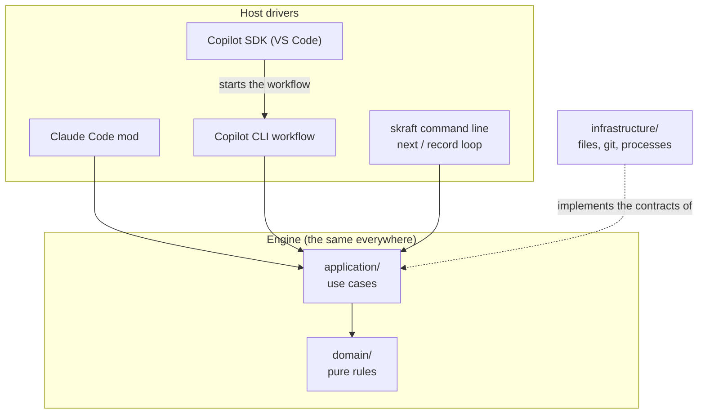
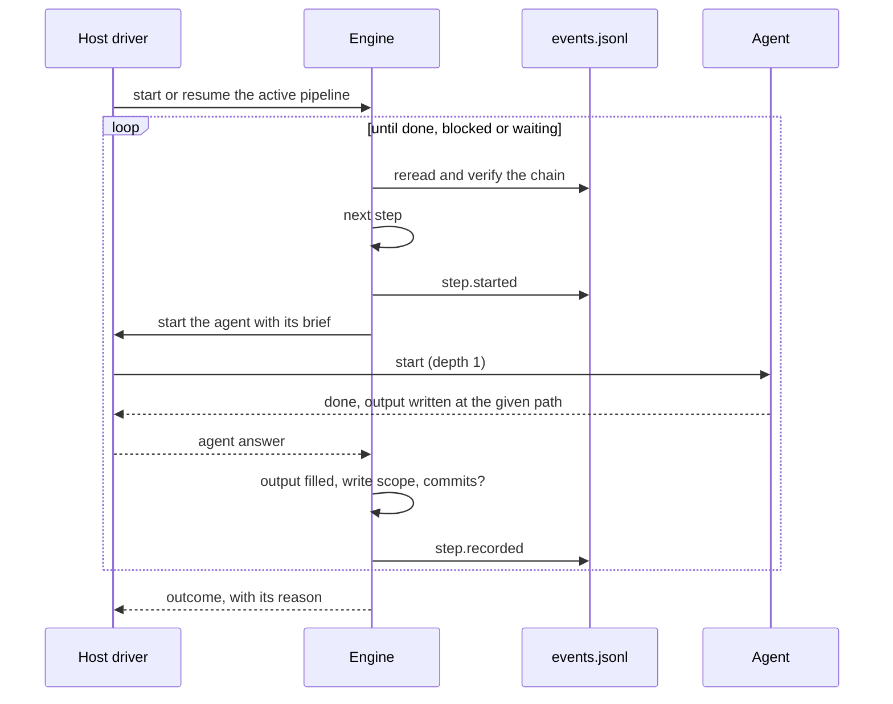

# Architecture

One engine decides everything; each host runs it with what it can do. Only the driver starts
agents, and no agent starts another.

## The problem to solve

SKRAFT must run the same pipeline under Claude Code, GitHub Copilot CLI and VS Code, on Windows,
macOS and Linux. These hosts do not offer the same means: one starts an agent from a mod
module, another from a dynamic workflow, the third has neither and can only let an agent call a
command.

In v1, the phase order and the verdicts lived in the prose of an orchestrator agent. Each host
and each model followed it its own way: one pipeline did not behave the same from one tool to
another, and no test could prove it did. V2 takes those decisions out of the prose and puts them
in tested code, the same everywhere.

## An engine that does not know the host

The **engine** (`plugins/skraft-framework/engine/`) follows the Clean Architecture dependency
rule: the pure rules (`domain/`) depend on nothing, the use cases (`application/`) depend only on
them, and the details — files, git, processes, hosts — are outside
([Martin, 2017](../reference/citations.mdx#cite-martin-cleanarch-2017)). A **use case** is a complete action from
the user's point of view: start a pipeline, move it forward, observe its state, run the gates,
answer a question. It decides; it does no input or output itself, it goes through contracts the
outside implements — the ports-and-adapters idea
([Cockburn, 2005](../reference/citations.mdx#cite-cockburn-hexagonal-2005)).

This discipline is not aesthetic. `domain/` and `application/` use no `node:` modules, no
`process`, no child processes. That is what lets the same code be loaded by the Claude Code mod
module, which has no Node, and by the Copilot extension, which does. A tested architecture rule
enforces it; without it, the engine would soon be rewritten once per host.

*Figure 1 — The engine in the middle, the drivers around it: each arrow points to what does not
know its caller; the SDK driver goes through the Copilot workflow.*

## Host drivers execute, they do not decide

A **host driver** connects the engine to a host. It gives the engine the means to start an agent,
ask a human a question and show progress, then calls the use case. It decides neither the order,
nor the verdict, nor the progression. The list of drivers, what each one starts, how it asks
questions and what each host can do are in the [Hosts](../reference/hosts.md)
reference.

This split has a direct consequence: adding a host means writing a driver, not a second
pipeline. And when a host cannot do something — start lenses in parallel, ask a question in a
dialog — the driver does less, but the engine decides the same way. Under VS Code without the
Copilot SDK, an agent conducts the `skraft next` / `skraft record` loop; the engine refuses any
`next` until the previous step is recorded.

When the engine needs a human (ratify ADRs, consent to a publication, choose the fate of
surviving mutants, repair the machine), it asks the driver. Without an answer, the run **waits**:
it does not guess, it takes no default decision. The answer is journaled, whatever the host, and
the next run applies it without starting an agent again.

### The Copilot driver contract

The Copilot driver assumes nothing about the host it has not measured: each behaviour it relies
on has a check in the `eng/host-probe/copilot-probe.mjs` probe, and its result is recorded with
the CLI version in `docs/v2/host-verification.md`. The reason is simple: a host behaviour that
"looks right" changes from one version to the next, and only a check sees it change.

The other rules follow from the same concern. Only the extension entry point imports the Copilot
SDK. Nothing throws on the run path: every failure becomes an outcome with a status, a code and a
reason fixed by the code, never an exception text. The workflow's arguments, written by a model,
are refused as soon as a key is unknown, without ever echoing the refused value. A human decision
is journaled (`by: 'host-confirmed'`) only once the host's dialog has returned it, and the driver refuses to ask in
`autopilot` mode or when the host cannot ask a question: a model cannot answer in a person's
place.

## The driver ↔ engine loop

The driver calls the use case that moves the pipeline forward. The engine rereads the journal,
computes the next step, pre-creates the expected output from its template, journals the start,
then asks the driver to start the agent. When the agent returns, the engine checks the output and
the commits itself, and journals the result before deciding what comes next.

*Figure 2 — One turn of the loop: the engine decides and checks, the driver starts; the journal
keeps each fact before the next step is decided.*

A missing output starts the agent again with the list of what is missing, within its attempts;
the same failure twice stops the run earlier, because a third identical attempt would teach
nothing. A step the machine cannot run (program not found, git failing) is not blamed on the
agent: the engine asks a human to repair, then retry or abort. The codes:
[Tracking and journal](../reference/run-journal.md#statuses-and-codes).

## Depth 1

Only the driver starts agents, review lenses included. In v1, the DELIVER reviewer started its
lenses (depth 2): one more context to pay for, duplicated checks, a behaviour that depended on
what each host allowed a sub-agent to do. At depth 1, the engine sees every start in its
journal, and the driver starts a review's lenses in parallel when the host allows it.

A review follows this path. The lenses answer with typed findings; `finding-refuter` checks each
finding that would send the work back; when a single lens stands against the others, the refuter
judges it with every input of the review (the *Dissent Rule*) rather than setting it aside
without a reason. The engine computes the verdict on what remains. The why:
[Review before review](./deep-dive/review-before-review.md);
the computation: [Gates](../reference/gates.md#review-run).

## The checks live in the code

What an agent could forget, the engine checks: the phase order, computed from the workflow graph;
the expected outputs, pre-created then checked; the journal's integrity; the command gates; what
each step may write, through a git diff; the red and green TDD commits; the ADR lifecycle; the
review verdict. Each of these checks is tested without a host, and behaves the same everywhere.
Why they left the v1 hooks: [Guardrails](./guardrails.md). How
the workflow that carries them is read and copied:
[DOT workflow](../reference/workflow-dot.mdx).

## Alternatives considered

**A standalone engine, server or binary.** An executor outside the host would drive the agents
from outside. It would need its own access to model providers, and SKRAFT would no longer live in
the developer's tool. V2 keeps execution in the host and puts into the engine what such an
executor would bring: typed nodes, "done" proven by a command, capped loops, failure classes, an
event journal.

**An agent-driven loop as the main driver.** An agent calls `skraft next`, does the step, calls
`skraft record`. It works everywhere, but costs a round trip per step, runs the lenses in
sequence and leaves progression to a model that can stray from the loop. It remains only as a
fallback under VS Code.

**Keeping the hooks.** See [Guardrails](./guardrails.md).

## Going further

- [The event journal](./event-journal.md) — the recomputed state and resume.
- [Clean Architecture](./clean-architecture.md) — the dependency rule, applied to the engine too.
- [Reference: hosts](../reference/hosts.md) and [the command line](../reference/cli.md).

## Sources

- [Cockburn, A. *Hexagonal Architecture*, 2005.](../reference/citations.mdx#cite-cockburn-hexagonal-2005)
- [Martin, R. C. *Clean Architecture*, 2017.](../reference/citations.mdx#cite-martin-cleanarch-2017)
