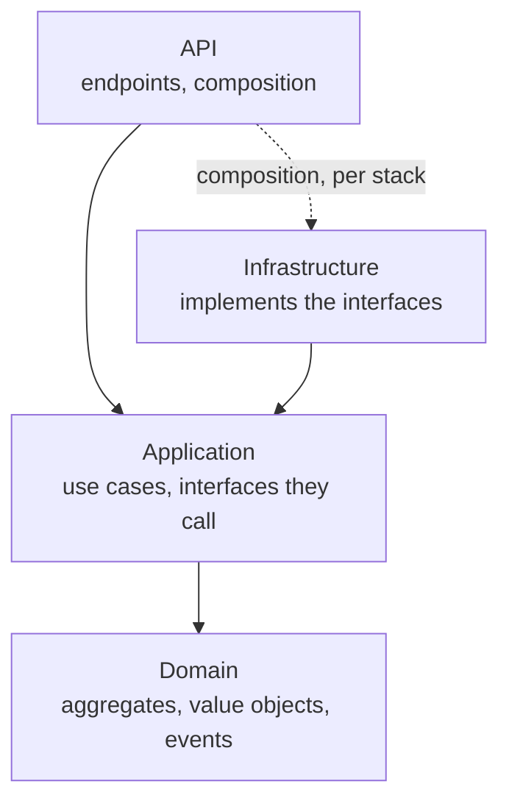
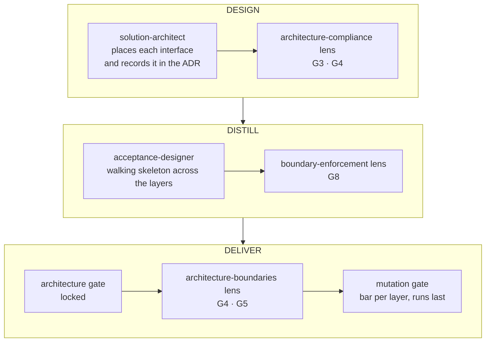

# Clean Architecture and hexagonal architecture

The business at the centre, the technical details at the edge, and dependencies that always
point inward. skraft does not just recommend it: a gate checks it.

## The problem: a business held hostage by its tools

When a business rule imports the HTTP client, the ORM or the web framework, it can no longer be
tested without them, nor change without them. Switching databases becomes a rewrite; testing a
discount rule requires starting a server. Worse, the logic leaks into controllers and SQL
queries, and nobody knows where it lives any more.

Two answers, born ten years apart, say the same thing in different words.

## Hexagonal architecture: ports and adapters

Alistair Cockburn proposes to place the application at the centre of a hexagon and have it talk to
the outside world only through **ports** — interfaces the application defines, according to its
own needs — into which technology-specific **adapters** plug
([Cockburn, 2005](../reference/citations.mdx#cite-cockburn-hexagonal-2005)). He distinguishes two sides: the one
that **drives** the application (a user interface, an automated test) and the one the application
**drives** (a database, an external service). The stated goal is to let the application be run
equally by a user or by tests, without a real interface or database.

The word *adapter* echoes the "Gang of Four" Adapter pattern: converting an interface into the one
the client expects ([Gamma et al., 1994](../reference/citations.mdx#cite-gamma-patterns-1994)).

## Clean Architecture: the dependency rule

Robert C. Martin presents Clean Architecture as a synthesis of several earlier architectures,
hexagonal among them, which share one objective: separating concerns and making the core
independent of frameworks, the user interface, the database and any external agency
([Martin, 2017](../reference/citations.mdx#cite-martin-cleanarch-2017)). He derives a single rule from it, the
**dependency rule**: source code dependencies point only inward. An inner circle knows no name
declared in an outer circle. When the flow of control has to go out — a use case that saves —, it
goes through an interface declared inside and implemented outside: that is dependency inversion.

skraft adopts this vocabulary. The `clean-architecture-<stack>` skills it applies to projects even
forbid `ports` or `adapters` folders: code is organised by layer and by feature. The hexagonal
idea is intact; only the names change.

| Hexagonal idea | In a project delivered by skraft |
| --- | --- |
| The application at the centre | Domain (aggregates, value objects, events) and Application (use cases) |
| Driven-side port | Interface declared by Application, or by Domain for an aggregate's repository |
| Driven-side adapter | Implementation in Infrastructure (database, broker, HTTP client) |
| Driving-side adapter | API: the endpoint translates a request into a use-case call |
| Test without database or UI | Acceptance test at the use-case level, doubles on the outgoing gateways only |

## skraft's layers

*Figure 1 — The dependency rule applied to skraft's four layers: each arrow is an allowed
dependency, and none leaves Domain; the dotted arrow is the composition of the application, which
goes through Infrastructure depending on the stack. Adapted from Martin's concentric circles
(2017); the layer names are those of the `architecture-patterns` skill.*

- **Domain** depends on nothing. The business rules live there, and nothing in it imports a
  framework.
- **Application** depends on Domain. It orchestrates the use cases and declares the interfaces it
  calls (repository, gateway, publisher), with no framework type such as `DbContext` or
  `IQueryable`.
- **Infrastructure** implements those interfaces. Real input-output lives there.
- **API** receives requests and translates them into use cases; a controller never touches a
  domain object or a repository. The composition of the application (who builds what) happens at
  the program's root, differently per stack.

The use case is the only way in: it echoes Fowler's *Service Layer*, which defines an
application's boundary and its set of available operations
([Fowler, 2002](../reference/citations.mdx#cite-fowler-peaa-2002)). The precise rules per stack are in the
`clean-architecture-<stack>` skills and in [the patterns reference](../reference/patterns.md).

## How skraft enforces the rule

*Figure 2 — The checkpoints of the dependency rule in the pipeline, after `pipeline.skraft.dot`,
`review.skraft.dot` and the lenses named.*

**In DESIGN, you decide where each interface lives.** The `solution-architect` places a
repository interface in Domain when it returns the aggregate and guards its invariants, in
Application for an entity without invariants or a read-oriented contract, never in
Infrastructure; the aggregate's ADR records that choice and its reason. The
`architecture-compliance` lens refuses a Domain or Application contract that names an
Infrastructure or API type (G3) and an interface filed in Infrastructure (G4). The same lens checks
the [Domain-Driven Design](./domain-driven-design.md) model.

**In DISTILL, you trace the full path.** The `acceptance-designer` writes, for each scenario, its
use-case boundary, its layer and its double type, and commits red acceptance tests with the
skeleton they call. The `boundary-enforcement` lens requires at least one walking skeleton per
flow (G8): the thinnest slice that crosses every layer and proves the wiring exists
([Freeman & Pryce, 2009](../reference/citations.mdx#cite-freeman-goos-2009)). See
[Walking Skeleton](./deep-dive/walking-skeleton.md).

**In DELIVER, a gate checks it on every pass.** `architecture` is one of the gates of DELIVER's
locked node, between `test` and `coverage`. Its command, declared per component in
`skraft-config.json`, runs the project's architecture tests: an `ArchitectureTests` filter in
.NET, `import-linter` in Python, an `architecture-gate.mjs` script in TypeScript, according to the
component's `quality-gates-<stack>` skill. In review, the `architecture-boundaries` lens,
mandatory in `review.skraft.dot`, checks that dependencies point inward (G5).

**Doubles sit at the boundaries, not at the centre.** Gerard Meszaros named the *test double* and
distinguishes its forms, among them the *fake* — a simplified, in-memory implementation
([Meszaros, 2007](../reference/citations.mdx#cite-meszaros-xunit-2007)). skraft accepts them only on outgoing
interfaces: no double of a Domain or Application type in a unit test (`architecture-boundaries`
lens, G4); mocks or hand-written in-memory fakes on the outgoing gateways — repository, external
service — (`clean-architecture-testing` skill); real containers or contract mocks to test
Infrastructure.

**The mutation bar follows the layer.** The `mutation` gate classifies each file by the names of
its folders: a folder ending in `domain` or `application` is the core, judged at 100 %; everything
else — API, Infrastructure — is the boundary, judged at 80 % (`skraft-quality-bar` skill). The
dependency rule therefore also decides how demanding the tests must be.

## skraft applies the rule to itself

skraft's engine is built the same way: `domain/` imports only `domain/`, `application/` declares
its contracts in `application/ports/`, `infrastructure/` implements them, and each host driver
plays the part of a driving-side adapter. An architecture test in the repository fails on any
forbidden dependency. There, the word *port* stayed. See
[Architecture](./architecture.md).

## The trade-offs

- **More indirection.** An interface and its translation between layers cost code. skraft limits
  it: Application declares an interface only where it calls out.
- **An upfront investment.** The walking skeleton and the architecture tests come before the first
  feature; they keep the structure from decaying without anyone noticing.
- **Fast tests at the centre, real ones at the edge.** The core is tested in memory, in
  milliseconds; Infrastructure is tested against real containers or contract mocks, more slowly but
  without illusion.

## Pitfalls and misreadings

- **Organising by technical kind** (`Repositories`, `Services`): each layer is organised by
  feature, and a feature does not import another feature's application code.
- **Letting a framework type leak** into an Application interface: the core becomes dependent
  again on the tool it was meant to ignore.
- **Believing a review is enough**: the `clean-architecture-testing` skill says it plainly, layer
  discipline is enforced by CI, not by reading.

## Sources

- [Cockburn, A. *Hexagonal Architecture*, 2005.](../reference/citations.mdx#cite-cockburn-hexagonal-2005)
- [Fowler, M. *Patterns of Enterprise Application Architecture*, 2002.](../reference/citations.mdx#cite-fowler-peaa-2002)
- [Freeman, S. & Pryce, N. *Growing Object-Oriented Software, Guided by Tests*, 2009.](../reference/citations.mdx#cite-freeman-goos-2009)
- [Gamma, E., Helm, R., Johnson, R. & Vlissides, J. *Design Patterns*, 1994.](../reference/citations.mdx#cite-gamma-patterns-1994)
- [Martin, R. C. *Clean Architecture*, 2017.](../reference/citations.mdx#cite-martin-cleanarch-2017)
- [Meszaros, G. *xUnit Test Patterns*, 2007.](../reference/citations.mdx#cite-meszaros-xunit-2007)

## See also <!-- #see-also -->

- [Domain-Driven Design](./domain-driven-design.md) — what lives
  in Domain.
- [Software craftsmanship](./software-craftsmanship.md) — why the
  gates are not negotiated.
- [Outside-In TDD](./deep-dive/outside-in-tdd.md),
  [the DELIVER phase](./pipeline/deliver.md),
  [the gates](../reference/gates.md) and
  [the glossary](../reference/glossary.md).
