# L3 zoom: contract testing

The [architecture](../architecture.md) view stops at
L2. This page zooms into the sibling L3 detail: how DELIVER verifies that **our own**
API behaves as its contract says.

## Why this zoom

The system-level diagram keeps `software-engineer` (L2) as a single box. Inside DELIVER
that agent wires the provider-side contract test itself, with the `contract-testing` and
`contract-testing-<stack>` skills its brief names. The engine names them only for a
component that sets `"contractTesting": true` in `skraft-config.json`; contract testing is
off by default. That is level **L3**, hidden from the main diagram to keep it readable.

Unlike [mocking](./mocking-microcks.md)
(consumer-side, replaces what the service calls), contract testing is **provider-side**: it
verifies our own API. The two never overlap.

## The L3 chain

```mermaid
graph LR
    BR[brief<br/>contractTesting: on] -->|names| SE[software-engineer<br/>L2]
    SE -->|loads| CT[contract-testing]
    SE -->|loads| CTD[contract-testing-dotnet]
    SE -->|Layer 1 always| BL[(WAF + HttpClient test)]
    SE -->|Layer 2 iff opt-in| MC[(Microcks TestEndpointAsync)]
    BL -.if active.-> CFL[contract-fidelity-lens]
    MC -.if active.-> CFL
    CFL -->|findings| DR[DELIVER review<br/>verdict computed by the engine]

    style SE fill:#2d5a3d,stroke:#4ed58a,stroke-width:2px
    style CFL fill:#3a2e1a,stroke:#d5a84e
```

The brief carries the component's stack and its contract-testing setting; the
`contract-testing` skill then picks the stack adapter and the Microcks layer.

| Layer | When | What it wires |
| --- | --- | --- |
| Layer 1 — baseline | **always**, regardless of opt-in | a `WebApplicationFactory` + `HttpClient` integration test |
| Layer 2 — Microcks | only when the opt-in is `true` | a `TestEndpointAsync(OPEN_API_SCHEMA)` provider test, **added** to the baseline |

The Microcks layer is **additive** — it never replaces the baseline and is never
suppressed. The contract test goes through the same red/green commits as the business
code.

## How the fidelity lens audits it

When the reviewed diff touches a contract, a `VerifyAsync`/`TestEndpointAsync` call, or
a provider-side scaffold, the `contract-fidelity-lens` joins the lenses of the DELIVER
review (conditional, not one of the three CORE lenses).

| Gate | What it checks | Severity |
| --- | --- | --- |
| K1 | The baseline WAF + HttpClient test is present | blocker |
| K2 | The Microcks layer matches the opt-in (present iff `true`) | high |
| K3 | The contract test result is asserted, not suppressed, when the opt-in is on | blocker |
| K4 | The response contract is actually asserted (codes, headers, ProblemDetails shape) | high |
| K5 | No real downstream call leaks | blocker |

## Why this practice

> « We grow working software, guided by tests, from the outside in. »
> — Freeman, S. & Pryce, N., *Growing Object-Oriented Software, Guided by Tests*, 2009.

A provider-side contract test pins the boundary of our own API so a consumer can trust
its shape without a live end-to-end environment.

## Pitfalls & anti-patterns

- **Dropping the baseline** when the Microcks opt-in is on — Layer 1 is always required
  (K1); Layer 2 is additive, never a replacement (K2 / K3).
- **Asserting only the status code** and ignoring headers or the ProblemDetails shape —
  the contract is under-verified (K4).
- **A live hostname** leaking into the provider test instead of the in-process host
  (K5).

## Sources

- Freeman, S. & Pryce, N., *Growing Object-Oriented Software, Guided by Tests*, 2009.

## See also <!-- #see-also -->

- [Architecture](../architecture.md) — the L1 + L2 view this page zooms out of.
- [L3 zoom: mocking (Microcks)](./mocking-microcks.md) — the sibling consumer-side wiring.
- [DELIVER](../pipeline/deliver.mdx) — the phase that owns this wiring.
- [Agentic catalogue](pathname:///dashboard/) — every agent and lens. Unsure about a term? See the [glossary](../../reference/glossary.md).
