# L3 zoom: mocking (Microcks)

The [architecture](../architecture.md) view stops at
L2. This page zooms into one L3 detail: how DELIVER mocks a downstream dependency
the service-under-test calls.

## Why this zoom

The system-level diagram keeps `software-engineer` (L2) as a single box so it stays
readable. Inside DELIVER that agent wires its integration tests with the
`mocking-<strategy>-<stack>` skill its brief names for each component it writes. That is
level **L3**: a detail the main diagram intentionally hides.

This page makes the L3 chain explicit so you can reason about it without crowding the
top-level view.

## The L3 chain

```mermaid
graph LR
    CFG[skraft-config.json<br/>mocking.strategy] -->|brief| SE[software-engineer<br/>L2]
    SE -->|microcks default| MMD[mocking-microcks-dotnet]
    SE -->|inprocess override| MID[mocking-inprocess-dotnet]
    SE -->|test wiring| A[(integration test)]
    A -.if active.-> MFL[mock-fidelity-lens]
    MFL -->|findings| DR[DELIVER review<br/>verdict computed by the engine]

    style SE fill:#2d5a3d,stroke:#4ed58a,stroke-width:2px
    style MFL fill:#3a2e1a,stroke:#d5a84e
```

Mocking is **consumer-side**: it replaces what the service-under-test calls, never
the service itself. The strategy is the component's `mocking.strategy` in
`skraft-config.json` — `microcks` by default for every stack — and the engine names the
matching skill in the brief; the agent never chooses it.

| Resolved strategy | Concrete wiring |
| --- | --- |
| `microcks` (default) | a Microcks container seeded from the downstream contract |
| `inprocess` (override) | an in-process double — `fakeiteasy`, `nsubstitute` or `moq` |

The wiring goes through the same red/green commits as the business code (the test
fails first, then passes). The downstream is mocked; the service-under-test is not.

## How the fidelity lens audits it

When the reviewed diff touches a mock or an integration test that uses one, the
`mock-fidelity-lens` joins the lenses of the DELIVER review
(it is conditional, not one of the three CORE lenses).

| Gate | What it checks | Severity |
| --- | --- | --- |
| M1 | The resolved strategy was honored (no Microcks where in-process was in force, and vice-versa) | high |
| M2 | The mock is actually wired into the test host | blocker |
| M3 | No real downstream call leaks | blocker |
| M4 | It mocks the downstream, not the service-under-test | high |

## Why this practice

> « Only mock types that you own. »
> — Freeman, S. & Pryce, N., *Growing Object-Oriented Software, Guided by Tests*, 2009.

Mocking a downstream you own the contract for keeps the integration test fast and
deterministic while still exercising the real boundary the service depends on.

## Pitfalls & anti-patterns

- **Mocking the service-under-test** instead of its downstream — the test then proves
  nothing about real behaviour (M4).
- **A mock created but never injected** into the SUT's client — the test still calls
  the real dependency (M2 / M3).
- **Hardcoding `dotnet test`** instead of the component's test command — the brief
  names it.

## Sources

- Freeman, S. & Pryce, N., *Growing Object-Oriented Software, Guided by Tests*, 2009.

## See also <!-- #see-also -->

- [Architecture](../architecture.md) — the L1 + L2 view this page zooms out of.
- [L3 zoom: contract testing](./contract-testing.md) — the sibling provider-side wiring.
- [DELIVER](../pipeline/deliver.mdx) — the phase that owns this wiring.
- [Agentic catalogue](pathname:///dashboard/) — every agent and lens. Unsure about a term? See the [glossary](../../reference/glossary.md).
