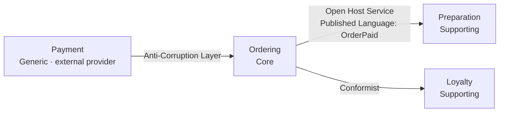
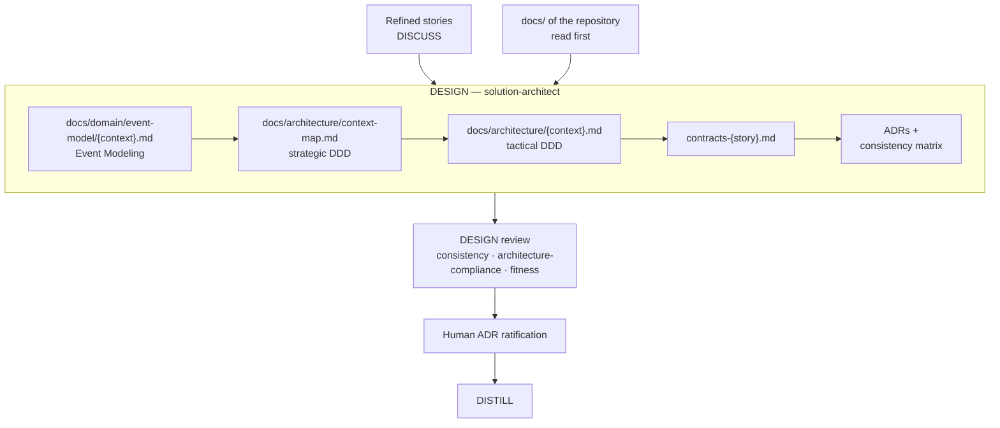

# Domain-Driven Design — from the business language to the code

Software is worth what its understanding of the business is worth. DDD gives the tools to keep
that understanding intact, from the story to the code; skraft checks that it is not lost on the
way.

## The problem: the model gets lost in translation

The business says "paid order", the story says "validated order", the code says
`OrderStatus = 2`. Each translation is a chance to get it wrong, and the error only shows in
production. Eric Evans places the complexity of software first in its **domain**: technology can
be mastered, but the business model has to be discovered and must stay shared between experts and
developers ([Evans, 2003](../reference/citations.mdx#cite-evans-ddd-2003)).

With agents, the risk grows: each agent works in its own context and can rename a concept without
anyone noticing. skraft answers by making DDD a thread that runs through the phases, with a check
at each handoff.

## The ubiquitous language

Evans's first tool is the **ubiquitous language**: a single vocabulary, the business experts',
used as is in conversations, documents, tests and code. In skraft, this language is written early
and then checked at every phase.

- **DISCUSS** writes it. Stories are refined against INVEST
  ([Wake, 2003](../reference/citations.mdx#cite-wake-invest-2003); `planning-invest-lens`, G1); the Definition of
  Ready requires at least three domain examples with real values (`planning-dor-lens`, G7), and no
  acceptance criterion may admit two readings by a business expert (`planning-ac-quality-lens`,
  G4).
- **DESIGN** fixes it. The event model, the context map, the diagrams and the contracts must name
  the same contexts, aggregates, commands, events and fields as the story (`consistency` lens,
  C1).
- **DISTILL** makes it executable. Every term of a Given/When/Then comes from the story's
  vocabulary, with no class or framework name (`business-alignment` lens, G3); when the project
  keeps a business lexicon, it serves as the reference.
- **DELIVER** keeps it in the code. The `software-engineer` checks that its tests speak the
  business language (`craft-discipline` skill, C7), and the `cold-reader` lens checks it in the
  code and the tests (G11).

## The bounded context: a language boundary

The same word changes meaning from one part of the business to another. Rather than forcing a
single model, Evans draws **bounded contexts**: inside, each term has one meaning; at the
boundary, you translate ([Evans, 2003](../reference/citations.mdx#cite-evans-ddd-2003)). The
`architecture-patterns` skill derives from it the signals the `solution-architect` uses: same
word, different meaning; a term that must be translated when crossing a module; different teams,
rates of change or data stores. The boundary is linguistic, not technical: a context may span
several services, but a service never spans several contexts — Sam Newman likewise recommends
looking for microservice boundaries in the bounded contexts
([Newman, 2021](../reference/citations.mdx#cite-newman-microservices-2021)).

Each context gets a subdomain class: **Core** (the competitive advantage), **Supporting**
(necessary but not differentiating) or **Generic** (a commodity you buy or reuse). Vlad Khononov
makes this classification the starting point of design choices
([Khononov, 2021](../reference/citations.mdx#cite-khononov-lddd-2021)); skraft uses it to measure how much DDD to
apply: a rich model for the Core, standard patterns elsewhere.

The `solution-architect` writes all of this in the repository's context map,
`docs/architecture/context-map.md`: one file, completed story after story, that the next runs read
before designing. Splitting or merging a context needs an ADR, and the `fitness` lens refuses a
context no story asks for (G9).

## The context map: naming every relationship

Two contexts that exchange have a relationship, and that relationship has a price. Evans names its
forms — Conformist, Anti-Corruption Layer, Shared Kernel, Open Host Service, Published Language —
and his *DDD Reference* adds Partnership
([Evans, 2003](../reference/citations.mdx#cite-evans-ddd-2003);
[Evans, 2015](../reference/citations.mdx#cite-evans-dddref-2015)). The context map makes them visible.

skraft adds three selection rules, in the `architecture-patterns` skill, to apply before labelling
an arrow:

1. a **Core** downstream is never Conformist: it protects itself with an Anti-Corruption Layer;
2. consuming a stable published contract is not Conformist: it is Open Host Service + Published
   Language;
3. a local copy or translation is an Anti-Corruption Layer, however simple.

*Figure 1 — An illustrative context map on the [running example](./pipeline/fil-rouge.md) (a
Starbucks order); arrows go from upstream to downstream.*

The `architecture-compliance` lens of the DESIGN review requires every relationship between
contexts to carry an explicit pattern and no dependency to stay undeclared (G6). An ACL always
needs an ADR, and that ADR must cite an admissible force and assess the "without the pattern"
option (`fitness` lens, G11).

## From strategic to tactical

**Strategic** design draws the boundaries; **tactical** design models the inside of a context.
skraft enforces the order: tactical design happens only inside an already defined context. The
`architecture-patterns` skill composes the patterns from the outside in: Event Modeling, strategic
DDD, tactical DDD, Clean Architecture, then CQRS, Event Sourcing and sagas only when a force asks
for them.

*Figure 2 — The DESIGN artefacts, in the order the `solution-architect` writes them.*

**Event Modeling first.** Before drawing aggregates, the `solution-architect` models behaviour on
a timeline: a command (an intent, which may be rejected), an event (a past fact), a read model
(what the user sees) ([Dymitruk, 2019](../reference/citations.mdx#cite-dymitruk-eventmodeling-2019)). skraft calls
a command, its events and its read model a **slice**: the smallest unit of deliverable value. The
`fitness` lens requires every story to have at least one command or query (G7) and every command
to have an event for its success (G8).

**Then Evans's tactical building blocks**, in the tactical design of each context,
`docs/architecture/{bounded-context}.md`:

- the **aggregate** is a consistency boundary: one root, invariants guaranteed inside, never
  across two aggregates ([Evans, 2003](../reference/citations.mdx#cite-evans-ddd-2003)). Vaughn Vernon draws
  practical rules from it — small aggregates, referenced by their identity, eventually consistent
  with each other through events ([Vernon, 2013](../reference/citations.mdx#cite-vernon-iddd-2013)); the
  `architecture-compliance` lens checks that an aggregate guarantees only its own invariants and
  references others by identity only (G5);
- the **entity** has a lasting identity; the **value object** is immutable, equal by value and
  self-validating;
- the **domain event** is a past-tense fact, raised by the aggregate root after the state change;
- the **repository**, one per aggregate, gives the illusion of an in-memory collection
  ([Evans, 2003](../reference/citations.mdx#cite-evans-ddd-2003);
  [Fowler, 2002](../reference/citations.mdx#cite-fowler-peaa-2002)). Its interface lives in Domain or in
  Application, never in Infrastructure, and the aggregate's ADR records that choice
  (`architecture-compliance` lens, G4).

**CQRS and Event Sourcing remain options.** Separating commands from queries
([Fowler, 2011](../reference/citations.mdx#cite-fowler-cqrs-2011)) or deriving state from the history of events
([Fowler, 2005](../reference/citations.mdx#cite-fowler-eventsourcing-2005)) needs an ADR that cites an admissible
force — read/write asymmetry, an audit trail a story asks for, a cross-service transaction, a
measured contention hotspot, a regulatory separation (`fitness` lens, G11). Before each attempt of
the architect, the engine searches the code for the signatures of a CQRS bus, an event store or a
saga (`structural-scan.json`) so that a commitment already present does not stay without an ADR.

## A model that outlives the story

The event model, the context map and the tactical design describe the domain, not one story. The
architect writes them under `docs/` of the repository, on the story's branch, and the pull request
shows them next to the code. The next run reads them before anything else and completes them
rather than starting again; when they already cover its story, the architect says so, cites them
and moves on. The scenarios DISTILL writes follow the same path, under `docs/features/`. The
contracts and the consistency matrix belong to one story and stay in the run's tracking folder.
The full list: [Durable documentation](../reference/run-journal.md#durable-docs).

## Consistency between artefacts

Four artefacts describe the same model; they drift easily. The `solution-architect` keeps a
**consistency matrix** per story: one row per concept an ADR names, one column per artefact, one
verdict per row. The ADRs are the source of truth; on a label or classification drift, the
descriptive artefact is rewritten to the ADR's label, and the rewrite is logged. The engine checks
these records at each attempt, and the human ratifies the ADRs before DISTILL relies on them. The
phase is detailed in [DESIGN](./pipeline/design.md).

## The trade-offs

- **No full DDD everywhere.** CRUD with no rule is served by Clean Architecture and a repository;
  the depth follows the subdomain class.
- **Too many contexts costs as much as too few.** Twenty contexts for one domain, or "one
  microservice = one context", multiply the translations.

## Sources

- [Dymitruk, A. *Event Modeling: What is it?*, 2019.](../reference/citations.mdx#cite-dymitruk-eventmodeling-2019)
- [Evans, E. *Domain-Driven Design*, 2003.](../reference/citations.mdx#cite-evans-ddd-2003)
- [Evans, E. *Domain-Driven Design Reference*, 2015.](../reference/citations.mdx#cite-evans-dddref-2015)
- [Fowler, M. *Patterns of Enterprise Application Architecture*, 2002.](../reference/citations.mdx#cite-fowler-peaa-2002)
- [Fowler, M. *Event Sourcing*, 2005.](../reference/citations.mdx#cite-fowler-eventsourcing-2005)
- [Fowler, M. *Bliki: CQRS*, 2011.](../reference/citations.mdx#cite-fowler-cqrs-2011)
- [Khononov, V. *Learning Domain-Driven Design*, 2021.](../reference/citations.mdx#cite-khononov-lddd-2021)
- [Newman, S. *Building Microservices*, 2nd ed., 2021.](../reference/citations.mdx#cite-newman-microservices-2021)
- [Vernon, V. *Implementing Domain-Driven Design*, 2013.](../reference/citations.mdx#cite-vernon-iddd-2013)
- [Wake, B. *INVEST in Good Stories, and SMART Tasks*, 2003.](../reference/citations.mdx#cite-wake-invest-2003)

## See also <!-- #see-also -->

- [Clean Architecture and hexagonal architecture](./clean-architecture.md)
  — where aggregates and repositories live once the model is designed.
- [Software craftsmanship](./software-craftsmanship.md) — the
  discipline that keeps this model clean.
- [The patterns](../reference/patterns.md), [the gates](../reference/gates.md)
  and [the glossary](../reference/glossary.md).
