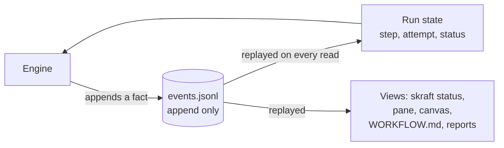

# The event journal

The engine does not write a state; it writes facts. The state is recomputed on every read, and
resume starts from the last recorded fact.

## The problem: a state anyone can write

In v1, the pipeline state lived in a `state.json` file, in the run's tracking folder: current
phase, verdicts, retry counters. It was a snapshot, rewritten on every transition. That tracking
folder, `.copilot-tracking/`, comes from HVE Core, the set of Copilot agents SKRAFT was built on;
SKRAFT kept it.

A snapshot has three weaknesses:

- it does not say **how** the run got there;
- a hand edit, or one by an agent going through the shell, is indistinguishable from a legitimate
  write; v1 needed a hook to forbid it, and that hook only read POSIX commands;
- two runs writing at the same time overwrite each other without knowing.

## Facts rather than a state

V2 replaced `state.json` with `events.jsonl`, in the same folder. It is an **event journal**: one
JSON object per line, one event per fact. The run starts, a step is started then recorded, a gate
runs, a question is asked then answered, a phase closes, the run finishes. The engine writes each
fact before deciding what comes next, and it never modifies a line already written: it appends.

This is the idea of *event sourcing*: keep the sequence of changes rather than their result, and
rebuild the state by replaying them ([Fowler, 2005](../reference/citations.mdx#cite-fowler-eventsourcing-2005)).
The journal is the write model; the state — current phase, attempt, missing outputs, run status —
is a read model the engine recomputes on every read. Separating the two models is the principle
of CQRS ([Fowler, 2011](../reference/citations.mdx#cite-fowler-cqrs-2011)). No state file can therefore drift
from the journal.

*Figure 1 — A single write model, the journal; the state that guides the engine and the views a
human reads are all recomputed from it.*

The human views take the same path: `skraft status`, the Claude Code mod's pane, the Copilot
workflow's canvas, and the `WORKFLOW.md`, `run-report.md` and `qa-report.md` files the engine
rewrites from the journal after each step. None can tell a different story from the journal.

## Exact resume, without replaying a finished agent

An interrupted run — host closed, machine off, agent stopped — resumes where it stopped: the
engine rereads the journal and recomputes the next step. Nothing is started again "just to see".
A started step whose output is already filled is recorded without starting the agent again; an
agent the host could not start does not use up its attempt; the git comparison base, journaled
at first start, stays the run's. An unanswered question puts the run in waiting; starting it
again asks the same question and starts no agent.

A run v1 left in progress is not lost: `skraft migrate` writes it a journal from its
`state.json`, which it leaves intact, and the run then resumes like any other.

## A signed chain to detect an edit

Each line carries the fingerprint of the previous one: editing, deleting or inserting a line
breaks the chain. A chain alone can be recomputed by whoever edits the file; each line therefore
also carries a signature under a key of the run, kept on the machine that started it. On the next
read, the engine sees the break and stops, naming the faulty line. It "repairs" nothing and
guesses nothing: restore the file or start a new slug.

This check replaces the v1 hook that forbade writing the state, at no cost per tool call and the
same way on every host. A journal started on another machine cannot be verified here; a person
can adopt it explicitly, and only the following lines are then signed under a local key. The
exact format of the chain and the signature:
[Tracking and journal](../reference/run-journal.md#events-jsonl).

## Two sessions that cannot overwrite each other

Before appending a fact, the engine checks that nobody else has written since it read; otherwise
it stops rather than overwrite. Upstream, a session that conducts a pipeline holds a **lease** on
it and renews it while it works: a second session on the same pipeline is refused, and a lease no
longer renewed is the trace of a vanished session, which the next one can take over.

## `.active-slug`: never guessed

The tracking folder's `.active-slug` file names the working copy's active pipeline. Without it,
the engine refuses instead of picking the latest folder: neither the engine nor an agent picks a
slug in the developer's place. Each git worktree has its own tracking folder, hence its own
active pipeline: two stories progress in parallel in two worktrees without sharing state.

## Trade-offs

- **A journal grows.** It is never rewritten; that is the price of a complete history.
- **A hand edit stops the run.** That is intended: a run whose history was touched up can no
  longer prove what it did.
- **The key stays on one machine.** Resuming a run elsewhere takes an explicit human act, rather
  than implicit trust.

## Going further

- [Resume or unblock a run](../how-to/resume-a-run.md).
- [Reference: tracking folder, `events.jsonl`, codes](../reference/run-journal.md).
- [Guardrails](./guardrails.md) — what the journal replaces among the v1 hooks.
- [Architecture](./architecture.md).

## Sources

- [Fowler, M. *Event Sourcing*, 2005.](../reference/citations.mdx#cite-fowler-eventsourcing-2005)
- [Fowler, M. *Bliki: CQRS*, 2011.](../reference/citations.mdx#cite-fowler-cqrs-2011)
