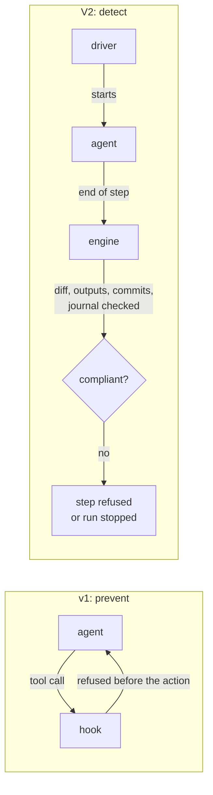

# Guardrails: from hook to engine

In v1, hooks watched the agent on every tool call. In V2, the engine that starts the agent
checks what matters itself, before and after each step.

## What a guardrail was in v1

A **hook** is a program the host runs on an event: before or after a tool call, when a sub-agent
starts or stops, when a session opens. v1 used them to enforce its invariants: the phase order,
skill loading, the completeness of an agent's brief, the ban on hand-writing the state, the
orchestrator's write permissions.

The idea was right: an invariant is only worth something if it is applied mechanically. What
changed is where to apply it.

## Why V2 starts from zero hooks

**A cost on every tool call.** v1 declared five hook entries with no filter: every tool call
started a `node` process, on every host, for every agent, even when no invariant was at stake. V2
aims for zero overhead per tool call.

**Uneven behaviour across hosts.** A hook depends on what the host passes it and on how the host
honours its answer. In v1, the provenance of a start never saw the calling agent's name; the
skill-loading check stayed inert under Claude Code; the write-permission check blocked DELIVER
under Copilot; the ban on writing the state only read POSIX shell commands, not PowerShell. One
pipeline therefore behaved differently depending on the tool — the opposite of what SKRAFT
promises.

**Checks the engine already does.** In V2, the engine composes each agent's brief itself, sets
its outputs and writes the journal. It no longer needs to watch a model that would write the
state through the shell: the state is no longer a file the agent modifies, it is a
[journal](./event-journal.md) the engine rereads and verifies.

Result: no command hook ships. The `hooks/hooks.json` file declares only one **module**: the
Claude Code mod's, which gives Claude Code the `/skraft` command, the tool that starts the
pipeline and the Skraft pane. That module reacts to no tool call; it drives the engine, as the
Copilot workflow does under Copilot.

## What replaces each guardrail

- **The phase order**: the engine computes the next step from the workflow graph and the journal;
  an agent starts only when the run reaches its node.
- **The brief and the skills**: the engine composes the brief, with the absolute path of every
  input, every output and every skill to read, the same way on every host. Whether the agent
  really reads its skills is measured by evaluations, not by a hook.
- **Artifacts, verdict, commits**: expected outputs are pre-created then checked; a review's
  verdict is computed by the engine; the commit convention and the red TDD commits are checked
  after each step.
- **The ban on writing the state**: the journal's signed hash chain, verified on every read; a
  hand edit stops the run.
- **Write permissions**: a git diff after each step, compared with what the step was allowed to
  write.
- **Start provenance**: removed. Only the driver starts agents, and no agent starts another; the
  journal sees every start.

Two checks have no v1 equivalent: the **session lease**, which refuses a second session on a
pipeline another one is conducting, and the workflow's **locked and mandatory nodes**, which a
repository copy cannot silently remove
([DOT workflow](../reference/workflow-dot.md#locked-nodes)).

## Prevent or detect

*Figure 1 — The hook refuses a tool call before it happens; the engine observes after the step
and refuses the whole step.*

A hook **prevents**: it refuses the tool call before it happens. The engine **detects**: it
observes after the step that a file was edited by hand, that an output is missing, that an agent
wrote outside its scope or committed a red test that passes, and it refuses the step or stops the
run, saying so.

This is a deliberate choice. Without a hook, an agent started by hand outside the engine is not
stopped while it works; the gap is discovered afterwards, through the journal or the git diff. In
exchange, the check is the same on every host, is tested without a host, and costs tool calls
nothing.

## When a hook may come back

A hook comes back only if it meets three conditions: it protects an **irreversible** action the
engine cannot detect afterwards; its per-call cost is **measured**; its behaviour is documented on
Claude Code, Copilot CLI and VS Code. No hook has met them so far. The Copilot driver additionally
forbids any hook before a tool call
([Architecture](./architecture.md#the-copilot-driver-contract)).

## What no guardrail covers

Neither a hook nor the engine detects a **factual error**: an invented business rule, an endpoint
that does not exist, wrong domain knowledge in a test. They check the structure of the work —
order, outputs, integrity, gates — not the truth of its content. That remains the job of review,
business acceptance tests and the human reviewer: peer review remains one of the most effective
quality practices ([Wiegers, 2002](../reference/citations.mdx#cite-wiegers-peer-reviews-2002)).

## Going further

- [Architecture](./architecture.md) — the engine, the drivers, depth 1.
- [The event journal](./event-journal.md) — the signed chain that replaces the ban on writing the state.
- [Reference: tracking folder and journal](../reference/run-journal.md).
- [Run the gates and read their evidence](../how-to/run-gates.md).

## Sources

- [Wiegers, K. *Peer Reviews in Software*, 2002.](../reference/citations.mdx#cite-wiegers-peer-reviews-2002)
