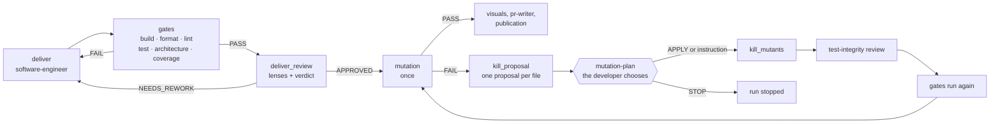

# DELIVER

Turn the contract green in small proven steps, have the code reviewed, then test the tests —
once, last.

## Why this phase exists

Code is the only artifact that goes to production. DELIVER grows it from the contract DISTILL
left failing: the `software-engineer` works in **Outside-In TDD**, from the acceptance test to
the unit tests, then to the code ([Freeman & Pryce, 2009](../../reference/citations.mdx#cite-freeman-goos-2009)).
Each step is a commit: a red `test(…)`, a green `feat(…)` or `fix(…)`, a `refactor(…)`.

The engine does not take the agent's word for it. It reads those commits, replays each red to
check it fails, and refuses a green with no red before it. Test first
([Beck, 2003](../../reference/citations.mdx#cite-beck-tdd-2003)) becomes a fact in the git history, not a promise.

:::info[☕ Running example — Starbucks *(illustrative)*]

The scenario enters. DELIVER implements the total calculation and loyalty crediting in **red →
green** cycles, the review reads the code, then **mutation** shows the tests genuinely protect the
loyalty rule. The code goes into a pull request.
:::

## The order: gates, review, then mutation

*Figure 1 — The DELIVER loop as `workflows/pipeline.skraft.dot` (2.0.0-alpha.19) describes it,
simplified: mutation only judges code already reviewed, and its survivors go through a human
decision.*

The command gates run first: they are fast, deterministic, and a red build needs no reviewer.
Then come the DELIVER review's lenses: test integrity, architecture boundaries, cold reading,
and, when the change touches them, mock and contract fidelity. A rework the review asks for goes
back through `deliver` and the gates, never through mutation.

### Why mutation runs last

Mutation testing injects small faults into the code and measures how many the tests catch
([Jia & Harman, 2011](../../reference/citations.mdx#cite-jia-mutation-2011)). It is the only measure that tells
whether a green suite would detect a mistake, and it is also the most expensive step of the
pipeline.

Up to version 2.0.0-alpha.18 it ran right after the gates, before the review. So it ran several
times: after each pass fixing survivors, then again after each rework the review asked for — and
it judged code that review could still change. Since 2.0.0-alpha.19, it runs **once, last**, on
the code the review approved. On the normal path, the most expensive measure runs once, and it
measures the code that will actually ship.

### Why the developer chooses

A surviving mutant has no single right answer. It ends one of three ways:

1. **a sharper test kills it**, because an input the story allows tells the mutant from the
   code;
2. **the code is deleted**, because no behaviour of the story asks for it;
3. **the mutant is declared equivalent**, because no input can tell it from the code.

These three outcomes do not have the same consequences: the first adds protection, the second
removes code, the third accepts a gap. Telling an equivalent mutant apart is a known hard
problem no tool settles on its own ([Jia & Harman, 2011](../../reference/citations.mdx#cite-jia-mutation-2011)).
Letting an agent "kill the mutants" as it sees fit invites tests tailored to the mutant rather
than to a behaviour.

So the decision is shared. For each file that keeps survivors, the `software-engineer` writes a
**proposal** in a file the engine creates, one outcome per mutant, without touching the code. The
`mutation-plan` question shows those proposals to the developer, who answers `APPLY`, gives their
own instruction, or `STOP`. The `software-engineer` then applies that choice in a single pass;
the `test-integrity` lens reviews the tests added, the gates run again, then mutation again.

The bar itself does not move: the `mutation` gate stays locked and its threshold fixed. The
developer chooses **how** to reach it, never **whether** to.

## Tests wired by the same agent

The `software-engineer` wires its own integration tests, within its own red / green cycles: the
brief the engine composes names each component's mocking skills, and the contract-testing ones
when the component turns it on. It starts no sub-agent. When the change touches a mock or a
contract, the matching fidelity lens joins the review. The why:
[Mocking with Microcks](../deep-dive/mocking-microcks.md) and
[Contract testing](../deep-dive/contract-testing.md).

## Trade-offs

- **A human may be asked at the end of the run.** When mutation fails, the run waits for the
  answer to `mutation-plan`. That is the price of a decision that commits the code.
- **A review rework does not re-measure mutation.** It goes back through the faster gates;
  mutation judges the code once it has settled.
- **No negotiable threshold.** 100 % on the core, 80 % on the boundary, whatever the repository:
  see [Software craftsmanship](../software-craftsmanship.md).

## Sources

- [Beck, K. *Test-Driven Development by Example*, 2003.](../../reference/citations.mdx#cite-beck-tdd-2003)
- [Freeman, S. & Pryce, N. *Growing Object-Oriented Software, Guided by Tests*, 2009.](../../reference/citations.mdx#cite-freeman-goos-2009)
- [Jia, Y. & Harman, M. *An Analysis and Survey of the Development of Mutation Testing*, 2011.](../../reference/citations.mdx#cite-jia-mutation-2011)

## See also <!-- #see-also -->

- [Reference: DELIVER](../../reference/phases.md#deliver) — nodes, proposals, `mutation-plan` answers, edges.
- [Reference: DELIVER review criteria](../../reference/gates.md#deliver).
- [Review before review](../deep-dive/review-before-review.md).
- [Run the gates](../../how-to/run-gates.md).
