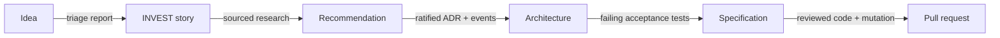

# The running example — a Starbucks order end to end

One request, followed from idea to delivered code, to see how each phase hands the baton to the next.

This page is a **narrative**: it does not describe SKRAFT in the abstract, it walks
you through **one concrete example** from end to end. The thread is the *artifact
flow* — each phase's output becomes the next phase's input.

:::info[☕ Running example — Starbucks *(illustrative)*]

The Starbucks case below is invented for teaching. It is not derived from the plugin's code;
no figure in it is real.

:::

## What you will follow

The request: **"let a customer order and pay for a customised drink from the
mobile app, to pick it up in store."**

You will see this request turn, phase by phase, into tested code.



*Figure 1 — The Starbucks request and the artifact it becomes at each handoff, from idea to
pull request.*

## Optional product preflight

DISCOVER then DISCUSS belong to the `skraft-backlog` plugin: the developer starts them, outside
the engine, in this order, when the request does not already arrive refined.

### Step 1 — DISCOVER: triage the idea

The idea arrives as a **raw issue** in the backlog. The `backlog-discoverer`
triages it: it assigns priority **P1**, detects it overlaps an older "in-app
payment" request, and records it in a **triage report**.

- **What enters:** "enable mobile ordering in the app".
- **What exits:** a prioritised line in the triage report.

➡️ Phase detail: [DISCOVER](./discover.md).

### Step 2 — DISCUSS: turn it into a story

The `backlog-planner` receives the report and turns the prioritised line into an
**INVEST story**:

> As a customer, I order a customised drink to pick up in store, so that I save
> time on arrival.

With its **acceptance criteria**:

1. The customer chooses size and milk type before paying.
2. Payment is required before the order goes to preparation.
3. An unavailable drink cannot be added to the cart.

- **What enters:** the triage line.
- **What exits:** the story + its 3 criteria.

➡️ Phase detail: [DISCUSS](./discuss.md).

## Orchestrated engineering pipeline

### Step 3 — RESEARCH: gather evidence

The `solution-researcher` analyses the story, existing code, and conventions. It
compares payment options and recommends a sourced approach without writing code
or deciding the ADR.

- **What enters:** the story and its criteria.
- **What exits:** the cited research document and its handoff to DESIGN.

➡️ Phase detail: [RESEARCH](./research.md).

### Step 4 — DESIGN: decide the architecture

The `solution-architect` designs the solution. It proposes an **ADR**:

:::note[Decision]
delegate payment to an external provider via an anti-corruption
layer (ACL), so the ordering domain is not coupled to the provider.
:::

And an **event model**:

```
PlaceOrder → OrderPaid → OrderReady
```

Three lenses review the design, then the run waits: a human must **ratify** the ADR before
DISTILL starts. A rejection sends the architect back to work, with the reason.

- **What enters:** the story, its criteria, and the research document.
- **What exits:** the ratified ADR + the event model + the contracts.

➡️ Phase detail: [DESIGN](./design.md).

### Step 5 — DISTILL: write the executable contract

The `acceptance-designer` translates the architecture into a **Gherkin
scenario**, readable by the business:

```gherkin
Scenario: pay for a customised drink
  Given a cart containing a medium latte with oat milk
  When payment is approved
  Then a receipt is issued
  And loyalty points are credited to the customer
```

It also writes the matching acceptance test and the code skeleton it calls, and commits them
**failing**: the engine replays the test to check it really fails.

- **What enters:** the ADR + the event model.
- **What exits:** the `.feature`, the test plan and the red acceptance test.

➡️ Phase detail: [DISTILL](./distill.md).

### Step 6 — DELIVER: implement, guided by tests

The `software-engineer` makes the scenario green with **Outside-In TDD**: red test, green code,
clean-up, commit after commit. The engine runs the gates (build, tests, architecture, coverage),
then the DELIVER review reads the code. Once the code is approved, **mutation** runs once, last:
it checks the tests would catch a mistake in the loyalty rule. If a mutant survives, the agent
proposes how to treat it and the developer chooses.

- **What enters:** the red acceptance test + the plan.
- **What exits:** the reviewed code, mutation passed, then the pull request.

➡️ Phase detail: [DELIVER](./deliver.mdx).

## What you have just seen

One request crossed two optional product workflows, then the engineering
pipeline, without losing its context:

| Phase | Artifact produced |
| --- | --- |
| DISCOVER | Prioritised line in the triage report |
| DISCUSS | INVEST story + 3 acceptance criteria |
| RESEARCH | Cited research document + recommendation |
| DESIGN | Ratified ADR (payment via ACL) + event model |
| DISTILL | Gherkin scenario + red acceptance test |
| DELIVER | Reviewed code + mutation passed + pull request |

Each artifact became the **context** of the next step, and every handoff stayed readable:
what was not written down was not passed on.

## See also <!-- #see-also -->

- [Pipeline overview](./index.mdx)
- [Reference: the phases](../../reference/phases.md) — inputs, outputs, lenses of each phase
- [The event journal](../event-journal.md) — where the run keeps the trace of each handoff
