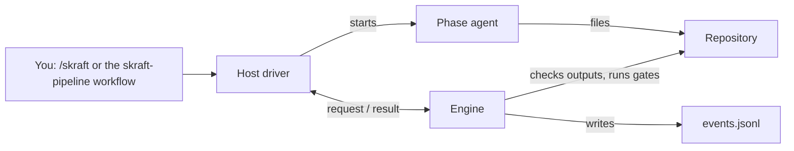

# SKRAFT — The Handbook

SKRAFT takes a story through four phases: **RESEARCH → DESIGN → DISTILL → DELIVER**.
In V2, a single **engine** decides everything — phase order, expected outputs, retries, verdicts,
gates — and it is the same under Claude Code, GitHub Copilot CLI and VS Code.
**Host drivers** carry out what the engine asks and are the only ones that start agents; no agent
starts another, and no command hook slows down your tool calls.

> « The only way to go fast is to go well. »
> — Martin, R. C., *Clean Architecture*, 2017.

## First visit

Follow the [Getting started tutorial](./tutorials/getting-started.md): you
install the plugin, describe your repository in `skraft-config.json`, and run one story from
RESEARCH to its pull request description, on a small repository.

## Available today, and what comes next {/* #roadmap */}
SKRAFT V2 is built in **lots**, tracked in the epic [#211](https://github.com/SebastienDegodez/skraft-plugin/issues/211) and its issues #212 to
#223. This table is the project's only roadmap; each lot lands on the `integration/v2-next`
branch, and one final pull request to `main` ships 2.0.0.

| Lot | Capability | State |
| --- | --- | --- |
| 0 – 2 | **RESEARCH** phase end to end (pre-created document, retry when missing, stop at the cap), hash-chained journal, resume, component-based `skraft-config.json`, detection (`skraft init`), `skraft doctor`, per-repository base, gates run by hand (`skraft gate`) | Available |
| 3 | DESIGN, DISTILL and DELIVER driven by the engine on a DOT workflow; write scope by git diff; gates as pipeline steps | Available |
| 4 | Code review through isolated lenses, refuter, computed verdict, incremental re-review | Available |
| 5 | Human decisions (`skraft decide`, dialogs, pane buttons), ADR ratification | Available |
| 6 | v1 agents and skills pruned | Available |
| 7 | Mutation closing loop (100 % core, 80 % boundary) | Available |
| 8 | Pane view, run and QA reports, end-of-run pull request, screenshot publishing, issue progress | Available; the Copilot Canvas's display in the app is to be checked by hand |
| 9 | `skraft-brownfield` plugin | Available |
| 10 | VS Code: Copilot SDK driver, then the `skraft next` / `skraft record` fallback | Available |
| 11 | `skraft migrate`, `skraft review --pr`, V2 documentation, reference run timed on Mac and Windows, version 2.0.0 | `migrate` and `review --pr` available; documentation in progress ([#367](https://github.com/SebastienDegodez/skraft-plugin/issues/367)); reference run and 2.0.0 to come |

Hosts available today: **Claude Code** (`/skraft` command, "Skraft" pane), **GitHub Copilot
CLI** (`skraft-pipeline` and `skraft-review` workflows) and **VS Code** (Copilot SDK, or the
`skraft-orchestrator` agent loop).

## How to read this handbook

The documentation follows **Diátaxis**: four doors depending on what you are looking for.

| Door | For… | Pages |
| --- | --- | --- |
| **Learn** (tutorial) | a first guided run | [Getting started](./tutorials/getting-started.md) |
| **Do** (how-to) | completing a precise task | [Install skraft](./how-to/install-on-a-host.mdx), [Configure components](./how-to/configure-components.md), [Run the gates](./how-to/run-gates.md), [Resume or unblock a run](./how-to/resume-a-run.md), [Answer a question](./how-to/answer-a-question.md), [Choose the models](./how-to/choose-models.md), [Add a lens](./how-to/customise-review.md), [Publish the pull request](./how-to/publish-pull-request.md), [Evaluate a skill](./how-to/evaluate-a-skill.md), [Contributing](./how-to/contributing.md) |
| **Look up** (reference) | finding an exact fact | [Hosts](./reference/hosts.md), [The `skraft` command line](./reference/cli.md), [DOT workflow](./reference/workflow-dot.md), [Phases](./reference/phases.md), [`skraft-config.json`](./reference/skraft-config.md), [Run journal](./reference/run-journal.md), [Glossary](./reference/glossary.md), [Agent and skill catalogue](pathname:///dashboard/), [Gates](./reference/gates.md) |
| **Understand** (explanation) | knowing *why* it is built this way | [For executives](./explanation/for-executives.md), [Architecture](./explanation/architecture.md), [Guardrails](./explanation/guardrails.md), [The event journal](./explanation/event-journal.md), [The phases](./explanation/pipeline/index.md), [The backlog](./explanation/backlog.md), [Clean Architecture](./explanation/clean-architecture.md), [Outside-In TDD](./explanation/deep-dive/outside-in-tdd.md), [Brownfield](./explanation/brownfield.md) |

## Where to go by role

- **Executive** — the problem V2 solves and the targets it aims for:
  [For executives](./explanation/for-executives.md).
- **Developer** — first the [tutorial](./tutorials/getting-started.md),
  then the guides: [configure components](./how-to/configure-components.md),
  [run the gates](./how-to/run-gates.md),
  [resume or unblock a run](./how-to/resume-a-run.md).
- **Architect** — engine, host drivers, depth 1:
  [Architecture](./explanation/architecture.md).
- **Quality assurance** — where the evidence lives and how to read it:
  [Run the gates](./how-to/run-gates.md),
  [Run journal](./reference/run-journal.md).

## SKRAFT V2 in one picture

The engine never starts an agent; it tells the driver what to start, checks what the agent wrote,
then records each step in `.copilot-tracking/skraft-plans/<slug>/events.jsonl`.
