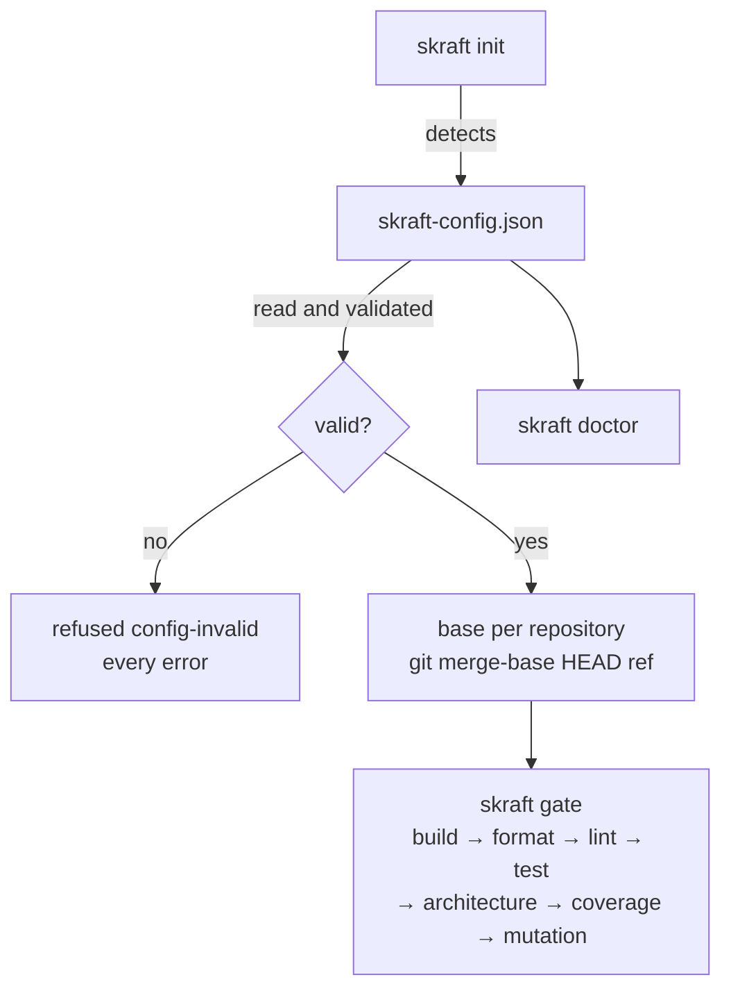

# skraft-config.json

`skraft-config.json` tells the engine which components make up the repository and which commands, always those the developer wrote, build and test them.

How to describe a repository's components step by step: [Configure the components](../how-to/configure-components.md). Why commands written in a versioned file rather than guessed: [Architecture](../explanation/architecture.md).

## Location <!-- #location -->

The file sits **at the root of the repository that starts the run** (the working copy), next
to `.copilot-tracking/`. A missing file is not an error: it counts as a config with no
component. `skraft init` without a slug creates or completes it.

The configuration read is the merge of four layers, each a JSON Merge Patch (RFC 7386) on the
ones before it; a `null` removes what a lower layer set:

| Order | Layer | Committed | May hold |
| --- | --- | --- | --- |
| 1 | the plugin's defaults | — | `models`, `assign` |
| 2 | `~/.skraft/config.json` (the developer's home folder) | no | any key but `components` |
| 3 | `skraft-config.json` (root of the working copy) | yes | every key |
| 4 | `skraft-config.local.json` (beside the previous one) | no | any key but `components` |

Each file is validated on its own, then the merge is validated. JSON schemas:
`schemas/skraft-config.schema.json` and `schemas/skraft-config.local.schema.json` in the plugin.



## Example <!-- #example -->

```json
{
  "baseBranch": "main",
  "components": [
    { "name": "api", "root": "services/payment-api", "stack": "dotnet",
      "paths": { "src": ["src/"], "tests": ["tests/"] },
      "commands": { "build": "dotnet build --nologo", "test": "dotnet test --nologo",
                    "format": "dotnet format --verify-no-changes",
                    "mutation": "dotnet stryker --since:{baseSha}" } },
    { "name": "web", "root": "../payment-web", "stack": "react", "baseBranch": "develop",
      "mocking": { "strategy": "inprocess" },
      "commands": { "build": "npm run build", "lint": "npm run lint", "test": "npm test" } }
  ]
}
```

## Schema — top level <!-- #top-level -->

| Key | Type | Default | Rule |
| --- | --- | --- | --- |
| `baseBranch` | string | absent (the base falls back to `main`) | git ref: no blank, does not start with `-`; `null` counts as absent |
| `forge` | string | absent (deduced from the Git remote, see [Forge](#forge)) | `github` or `azure-devops`; `null` counts as absent. A value you write always wins over the remote |
| `components` | array of objects | `[]` | each entry is a component (below) |
| `tdd` | object | `{ "replay": "all" }` | `{ "replay": "all" }`, `{ "replay": "last-red" }`; `replay` absent or `null` counts as `all`; see [tdd](#tdd) |
| `publish` | object | `{}` | see [publish](#publish) |
| `models` | object | the plugin's Claude Code aliases per tier | model family → `tier` and, per host (`claude-code`, `copilot`), `{ "model": name or list, "effort": level }`; see [Choose the agents' models](../how-to/choose-models.md) |
| `assign` | object | lenses `reviewer`, workers `implementer`, `solution-researcher` `researcher`, `solution-architect` `planner`, `pr-writer` `economy`, default `implementer` | `{ "default", "types", "agents" }`: a family, `inherit`, or `{ "family", "<host>": { "effort" } }`; also read from `~/.skraft/config.json` and `skraft-config.local.json` |
| `rank`, `workflow` | — | — | refused: `rank is no key: …`, `workflow is no key: …` |
| `configurationConfirmed` | boolean | `false` | in `skraft-config.local.json` only (refused in this file and in `~/.skraft/config.json`). Written `true` by the engine when you answer START to *Start this run with the configuration of this working copy?*, which a Copilot run asks before its first phase while it is absent, and again with `configure: true`. The Configuration tab of the skraft canvas edits the forge, the components and the consents of this file and the `assign` and `models` of `skraft-config.local.json`, checked as a run loads them |
| any other key | any | — | kept as is, never read or rewritten |

`components` is allowed only in `skraft-config.json`; in a personal layer:
`components belongs in skraft-config.json, never in <file>`.

## Schema — one component <!-- #component -->

Any key outside this list is refused.

| Key | Type | Default | Rule |
| --- | --- | --- | --- |
| `name` | string | required | kebab-case (`api`, `payment-web`); unique in the file |
| `root` | string | required | path relative to the working copy, not empty, never absolute (`/x`, `\x`, `C:x`); may point to a neighbour repository (`../payment-web`); normalised (`./api/` becomes `api`) |
| `stack` | string | required | `dotnet`, `java`, `python`, `typescript`, `javascript` or `react` |
| `commands` | object | `{}` | name → command line; name among `build`, `format`, `lint`, `test`, `architecture`, `coverage`, `mutation`, `e2e`; non-empty line |
| `baseBranch` | string | absent (falls back to the global `baseBranch`) | git ref; `null` counts as absent |
| `mocking` | object | `inprocess` for `react`, `microcks` otherwise | `strategy` is `microcks`, `inprocess` or `null`; absent or `null` means the stack's default. The engine passes it in the brief and picks the matching mocking skill |
| `paths` | object | `["."]` for each key, the whole root | `{ "src": […], "tests": […] }`, folders relative to the component root, never absolute nor starting with `..`; `skraft init` writes them. In DELIVER, the software engineer may write only there (write scope) |
| `contractTesting` | boolean | `false` | `true` makes the software engineer read the contract testing skills of its stack; the review lenses see the setting among the component settings |
| `bdd` | list or `false` | required | where each runner of the component reads its scenarios and the definitions that bind them: a list of `{ runner, features, steps }`, folders relative to the component root, `runner` optional, and `steps` optional too — left out, the scenarios are written and nothing is asked of them, so no runner reads them. **One pair per runner**, because the binding scope is the runner's own: a definition of another pair binds no step of this one, so a component holding several test projects declares one pair each. `false` names none, and asks DISTILL for no `.feature`: the acceptance designer takes its scenarios from the test plan's `Scenario` column and TDD runs as it always does. **No key at all, and a bare `true`, decide nothing**: the engine invents no folder — one nobody chose is one the runner may never read — so a run is refused with `skraft is not initialised: run /skraft-init (<component>: bdd is unanswered)` and `skraft doctor` fails on that component. It declares a practice, never a threshold: a component that names its folders is held to its scenarios in full. The folders are where DISTILL writes the story's scenarios and where the engine reads them back: one resolution for the brief, the write scope of the acceptance designer, the folder the engine creates before its attempt, and the check. A declared folder that is no folder of the working copy fails `skraft doctor`, and a pair naming a runner whose `steps` is no folder refuses the run (`bdd-unbound`) — a runner with no bindings executes nothing; `features` is exempt, since DISTILL creates it with the first scenario. The Gherkin keywords are English whatever language the sentences are in. `skraft init` detects the pairs, `/skraft-init` asks for the ones it did not find, `skraft doctor` names them, the engine passes the folders in the brief, and the review lenses see the setting among the component settings |
| `mutationReport` | string | absent: the report the stack's tool writes, relative to the root: `StrykerOutput/reports/mutation-report.json` (.NET), `reports/mutation/mutation.json` (TypeScript, JavaScript, React), `mutation-report.json` (Python), `target/pit-reports/mutations.xml` (Java; `build/reports/pitest/mutations.xml` when the mutation command names Gradle) | the file the `mutation` command writes its report to, relative to the component root, never absolute nor outside it. The mutation gate reads its surviving mutants there and judges the 100 % / 80 % bar |
| `infrastructure` | object | `{}`: every row is the plugin's ([infrastructure policy](#infrastructure)) | the rows of the policy the component's tests override: `entryPoint`, `internalGateway` and `clock`, each `{ "targeted", "walkingSkeleton" }`; for `react`, `entryPoint` and `clock` `{ "targeted" }` and `frontToBack` `{ "targeted", "e2e" }`. Each value among `in-process`, `real`, `in-memory`, `testcontainers`, `microcks`, `fake`, `msw`. `externalGateway` is refused: `mocking.strategy` sets it. A stage left out keeps the plugin's mechanism |
| `testReports` | list of strings | the stack's: `**/TestResults/*.trx` and `**/TestResults/*.xml` (.NET), `**/target/surefire-reports/TEST-*.xml`, `**/target/failsafe-reports/TEST-*.xml` and `**/build/test-results/*/*.xml` (Java), `reports/junit.xml` (Python), `reports/junit.xml` and `junit.xml` (TypeScript, JavaScript, React) | where the component's `test` and `e2e` commands write JUnit XML: at least one path or glob relative to the component root, never absolute nor naming `..`; normalised (`./reports/junit.xml` becomes `reports/junit.xml`). The engine reads them when it replays a commit: a red with no report is refused ([Commits and replays](./gates.md#commits)) |

Quality thresholds (coverage, mutation…) are **not** configurable: no key carries them.

## Infrastructure policy <!-- #infrastructure -->

What a component's tests run each kind of dependency on, in a targeted scenario and in the
walking skeleton. A `react` component has none, the walking skeleton living in a back component:
its end-to-end run is `e2e`. A row the component's `infrastructure` names wins; `skraft doctor` prints
one line per row with its source: `plugin`, `skraft-config.json` (an override) or `skraft-config.json (mocking.strategy)` (a mocking strategy other than the stack's default).

| Row | Covers | Targeted | Walking skeleton |
| --- | --- | --- | --- |
| `entryPoint` | controller, CLI, UI, webhook received, topic consumed | `in-process` | `real` |
| `internalGateway` | repository, database, cache | `in-memory` | `testcontainers` |
| `externalGateway` | REST, SOAP, GraphQL, gRPC, Kafka, RabbitMQ, MQTT, WebSocket, webhook sent | `microcks`, or `in-process` when `mocking.strategy` is `inprocess` | same as targeted |
| `clock` | clock, randomness | `fake` | `fake` |

| Row (`react`) | Targeted | E2E |
| --- | --- | --- |
| `entryPoint` | `in-process` | — |
| `frontToBack` | `msw`, or `microcks` when `mocking.strategy` is `microcks` | `microcks` |
| `clock` | `fake` | — |

| Mechanism | Tool doctor names |
| --- | --- |
| `in-process` | `WebApplicationFactory` (.NET), `MockMvc / @SpringBootTest` (Java), `FastAPI TestClient` (Python), `app.inject / supertest` (TypeScript, JavaScript), `Testing Library` (React) |
| `testcontainers` | Testcontainers |
| `microcks` | Microcks uber native image via Testcontainers, one container per test session; `Playwright + Microcks` in `e2e` |
| `msw` | MSW |

`testcontainers` and `microcks` need Docker or Podman: `skraft doctor` names the one that
answers, or warns `Microcks and Testcontainers scenarios will be reported INDETERMINATE until
Docker or Podman runs`. Only `skraft-config.json` holds `infrastructure`, as every component key.

```json
{ "name": "api", "root": "services/payment-api", "stack": "dotnet",
  "infrastructure": { "internalGateway": { "walkingSkeleton": "in-memory" } } }
```

## `tdd` <!-- #tdd -->

| Key | Value | Effect |
| --- | --- | --- |
| `replay` | `all` (default) | the engine replays each red commit of an acceptance test (`test(<story>): …`, DISTILL) with its component's `test` command, reads its JUnit reports (`testReports`) and checks that it fails on an assertion ([Commits and replays](./gates.md#commits)) |
| `replay` | `last-red` | only the last red commit of each story (same commit scope) is replayed |
| `replay` | `null` | counts as `all` |

With `all`, when the replays take more than 20 % of a phase's duration, the engine journals
`tdd.replay-slow` once per phase and prints `<slug>: replaying test commits took N% of <PHASE>;
set "tdd": { "replay": "last-red" } in skraft-config.json to replay only the last test commit of
each story`. Any other value: `tdd must be { "replay": "all" or "last-red" }`. The replay of a
scenario's green commit does not depend on this key.

## `publish` <!-- #publish -->

| Key | Type | Default | Effect |
| --- | --- | --- | --- |
| `pullRequest` | boolean | absent: a run that publishes is refused, `/skraft-init` asks for it | the run may push its branch, open or update its pull request and keep a progress comment on its story's issue |
| `visuals` | boolean | absent: a run that publishes screenshots is refused, `/skraft-init` asks for it (only with a front end) | the run may publish a front end's screenshots and videos in the pull request |
| `draft` | boolean | `true` | a pull request skraft opens is a draft |
| `reviewComment` | boolean | absent: asked once per repository | `skraft review --pr --publish` may keep one comment on the pull request it reviews; written by hand in the team's file, it wins over each developer's answer, which the engine keeps in their `~/.skraft/config.json` (`reviewComments`) |
| `questionVersions` | object | `1` per key | the version of the question's text each answer was given to (`visuals`, `pullRequest`, `reviewComment`, whole numbers from 1); an acceptance of an earlier version is not settled: the run is refused until `/skraft-init` asks again |

The engine writes `pullRequest` or `visuals`, and their `questionVersions`, when a human answers
the question, every other key of the file kept. Any other key or value:
`publish must be an object of visuals, pullRequest, reviewComment and draft, each true or false`.

## Forge <!-- #forge -->

The forge is where the engine reads the story's issue, keeps the run's comment on it, opens
the pull request and reads the pull request a review comments on. The `forge` key names it;
without it, the engine reads the URL of the working copy's remote (`origin`, else the first
remote Git lists):

| Host of the remote | Forge |
| --- | --- |
| `dev.azure.com`, `ssh.dev.azure.com`, any `*.visualstudio.com` | `azure-devops` |
| any other host (GitHub, GitHub Enterprise…), or no remote | `github` |

On `github`, the engine goes through `gh` (see below), and the pull request's body opens with
`Closes #<issue>` when it targets the default branch, `Refs #<issue>` otherwise. On
`azure-devops`, the engine opens the pull request on Azure Repos through `az` (the Azure CLI
with its `azure-devops` extension), Azure DevOps Services only: its body opens with
`Fixes #<work item>` when it targets the default branch, which completes the work item when the
pull request merges, `#<work item>` otherwise, and the pull request is linked to the story's
work item when it is created. The story is the work item (see
[Azure DevOps through az](#azure-devops-through-az)),
and the run keeps its progress comment on it. `skraft review --pr` reviews an Azure Repos pull request too
(see [Azure DevOps through az](#azure-devops-through-az)).
`gh` is never run on an Azure DevOps remote. `skraft review --pr` reads `forge` only in your
own files (`~/.skraft/config.json`, `skraft-config.local.json`), else from the remote: the
`skraft-config.json` of the pull request under review, which its author wrote, chooses no forge.

Under Copilot, the **Configuration** tab of the skraft canvas chooses it: its first choice, *From the Git remote: &lt;forge&gt;*, leaves `forge` out of `skraft-config.json` and names the forge the remote gives; *GitHub* or *Azure DevOps* writes it. `skraft doctor` says which forge a run uses and what chose it, on its `forge` line.

### The engine and MCP servers <!-- #engine-and-mcp -->

The engine never calls an MCP server: a server is a tool for an agent. It reads and writes the
forge only through the forge's command line, `gh` on `github`, `az` on `azure-devops`, with no
fallback from one to the other. A GitHub or Azure DevOps MCP server you connect in your host
serves the agents that use it (the backlog plugin's skills, for instance), never the engine.

A run started from an issue that the forge's command line cannot read (no remote, `gh` or `az`
missing, not signed in) is refused before anything is journaled (`issue-unreadable`). A run whose
publish consent is accepted in `skraft-config.json` checks the forge before its first agent: out
of reach, the run is refused (`forge-unreachable`, `<reason>. Fix it, then start the run again.`)
and asks nothing. The reason is the one `skraft doctor` gives on its `forge` line.

### GitHub through gh <!-- #github-through-gh -->

On `github`, the engine reads the issue, keeps its comment, finds, opens and edits the pull
request, and reads and comments the pull request under review through `gh`, installed and
signed in to the repository's host. Issues are read on the repository `gh` reads them on (its
default, else `upstream`, else `origin`); pull requests and the issue comment go to `origin`.
The pull request is found before one is opened, only your own comment is rewritten, and every
reason is fixed by the engine, never `gh`'s output. The push stays `git`.

### Azure DevOps through az <!-- #azure-devops-through-az -->

On `azure-devops`, a run started from a work item number (`--issue 42`) reads that work item,
and keeps the run's progress in one comment on it, through `az` (the Azure CLI with its
`azure-devops` extension, signed in to the organization). The run details of a pull request are
kept as one thread of it, through `az devops invoke` (area `git`).

`skraft review --pr` on an Azure Repos pull request reads it through `az repos pr show` and keeps
its review comment through `az devops invoke` (area `git`). The engine lists the threads page by
page (100 at a time), up to ten pages. The review comment is one thread, created *Closed*; its
first comment is rewritten at each pass. The engine finds it again at the address the journal
keeps, else the last thread whose first comment begins as the review's comment does and holds the
marker (raw, or with `<` and `>` as HTML entities, named or numeric, and read behind a byte order
mark or blank lines), whoever wrote it: Azure does not tell the author here. A pull request of
another project or repository than the Git remote's is refused (`pr-unreadable`). None of this is
measured on a real organization: see `docs/v2/host-verification.md`.

What a run reads: the work item's title and page, then its
description, then an `## Acceptance criteria` section from `Microsoft.VSTS.Common.AcceptanceCriteria`,
kept in `<slug>/plans/<date>/issue-<number>.md` for every agent. A field written in HTML (a work
item made by hand) becomes Markdown; a field already in Markdown stays as written. A field the work
item lacks says so in one fixed line (`The work item has no description …`,
`The work item has no acceptance criteria: … is empty, or its work item type does not have it.`). The run is refused,
with nothing journaled, when the work item is not a story (`issue-not-a-story`; the types read are
`User Story`, `Product Backlog Item`, `Requirement`, `Issue` and `Bug`), or is in another project
of the organization than the one the Git remote names (`issue-in-other-project`); the project is
checked again before every write of the comment, which is skipped with a fixed reason otherwise.

The comment is rewritten in place (found by the URL the journal kept, else the last comment that
starts with its hidden marker, as written or with `<`, `>` and `&` escaped as an agent's MCP server
may have written it) and posted again only if that search fails. Two reservations: how Azure Boards
renders and stores the escaped marker is not measured, and the search does not check who wrote a
comment (Azure gives no author there), so a comment that someone else started with the marker would
be rewritten. Its `url` is the REST address of the comment, since Azure Boards documents no web
anchor for one. What `az` answers for a work item is not measured yet: see
`docs/v2/host-verification.md`.

## Validation and messages <!-- #validation -->

The engine validates the whole file and returns **every** error at once, joined with `; `,
as `skraft-config.json is invalid: <error>; <error>…` (code `config-invalid`). In the
messages, `<label>` is `component <name>` when the name is a string, `components[<index>]`
otherwise.

| Case | Exact message |
| --- | --- |
| not JSON | `skraft-config.json is not JSON` (never the parser's message, which quotes the file) |
| not an object | `skraft-config.json must hold a JSON object` |
| global `baseBranch` | `baseBranch must be a git ref, got <JSON value>` |
| `forge` | `forge must be "github" or "azure-devops"` |
| `tdd` | `tdd must be { "replay": "all" or "last-red" }` |
| `publish` | `publish must be an object of visuals, pullRequest, reviewComment and draft, each true or false`; `publish.questionVersions must be an object of visuals, pullRequest and reviewComment, each a whole number from 1` |
| `rank`, `workflow` | `rank is no key: …`; `workflow is no key: …` |
| `components` outside `skraft-config.json` | `components belongs in skraft-config.json, never in <file>` |
| `configurationConfirmed` | `configurationConfirmed belongs in skraft-config.local.json, never in <file>`; `configurationConfirmed must be true or false` |
| `components` not an array | `components must be an array` |
| entry not an object | `components[<index>] must be an object` |
| name | `components[<index>].name must be kebab-case, got <JSON value>` |
| duplicate name | `component name <name> is used twice` |
| unknown key | `<label>: unknown key <key> (allowed: name, root, stack, paths, commands, baseBranch, mocking, contractTesting, bdd, mutationReport, infrastructure, testReports)` |
| root | `<label>: root must be a path relative to the working copy` |
| stack | `<label>: stack must be one of dotnet, java, python, typescript, javascript, react` |
| `commands` not an object | `<label>: commands must be an object of command lines` |
| command name | `<label>: unknown command <name> (allowed: build, format, lint, test, architecture, coverage, mutation, e2e)` |
| empty line | `<label>: command <name> must be a non-empty command line` |
| component `baseBranch` | `<label>: baseBranch must be a git ref, got <JSON value>` |
| `mocking` | `<label>: mocking must be { "strategy": "microcks" or "inprocess" }` |
| `paths` | `<label>: paths must be { "src": [...], "tests": [...] }`; `<label>: paths.<key> must list folders inside the component root` |
| `contractTesting` | `<label>: contractTesting must be true or false` |
| `bdd` | `<label>: bdd must be true, false, or a list of { runner, features, steps } whose folders are inside the component root; steps may be left out when nothing binds the scenarios` |
| `mutationReport` | `<label>: mutationReport must be a file inside the component root` |
| `infrastructure` | `<label>: infrastructure must be an object of rows (allowed: <rows>)`; `<label>: infrastructure.externalGateway is set by mocking.strategy; write "mocking": { "strategy": ... } instead`; `<label>: unknown infrastructure row <row> (allowed: <rows>)`; `<label>: infrastructure.<row> must be an object of <stages>`; `<label>: infrastructure.<row>: unknown field <stage> (allowed: <stages>)`; `<label>: infrastructure.<row>.<stage> must be one of in-process, real, in-memory, testcontainers, microcks, fake, msw` |
| `testReports` | `<label>: testReports must list the JUnit XML files its tests write, as paths or patterns inside the component root` |

## Command lines <!-- #command-lines -->

A `commands` line runs **with no shell**, from the component's root. The same line therefore
behaves the same way under sh, PowerShell and cmd.

| Rule | Detail |
| --- | --- |
| Splitting | on blanks; the first word is the program |
| Quotes | `"…"` and `'…'` keep blanks inside one argument; no escape character |
| `{baseSha}` | replaced, before splitting, with the base SHA of the component's repository |
| Shell syntax | a word written with no quotes that contains <code>&#124;</code>, `&`, `;`, `<` or `>` is refused |
| Nothing interpreted | no variable, wildcard or redirection: each word goes to the program as is |
| Program | looked up on the PATH (and PATHEXT under Windows); a path with `/` or `\` starts from the component's root |
| Windows | a `.cmd` or `.bat` (npm, npx, gradlew.bat) goes through cmd.exe, arguments escaped |

Messages refusing a line (prefixed with `command "<line>"` in a gate, with `"<line>"` in the
doctor):

| Case | Message |
| --- | --- |
| shell syntax | `uses shell syntax (<word>); put the steps in a script and call the script` |
| unclosed quote | `has an unclosed <quote> quote` |
| `{baseSha}` with no base | `uses {baseSha} but the run has no base for this repository` |

To chain steps (`a && b`), write them in a script of the repository and call the script.

## Gates <!-- #gates -->

A **gate** is a command whose name is one of the seven names below. They run in this order,
whatever the order in the file:

| Order | Name |
| --- | --- |
| 1 | `build` |
| 2 | `format` |
| 3 | `lint` |
| 4 | `test` |
| 5 | `architecture` |
| 6 | `coverage` |
| 7 | `mutation` |

`e2e`, the only other name allowed, is not a gate: `skraft gate` does not run it, but
`skraft doctor` checks it. A misspelt name (`tset`) makes the configuration invalid instead
of silently skipping the gate. A component with no gate command fails (gate `none`, class `environment`):
`no gate command; give it at least one of build, format, lint, test, architecture, coverage,
mutation in skraft-config.json`. A component stops at its first failing gate.

A line that starts with `python` starts the first interpreter found from the component's
root: `.venv/bin/python`, `.venv/Scripts/python.exe`, then `python` and `python3` on the
PATH. The file keeps `python` and stays the same on Windows, macOS and Linux. Any other
program starts as written.

With Microcks (the default outside React), the tests that use it run Microcks in a container,
Docker or Podman. The gates do not look for one: such a test fails when no container answers, like
any failing test; `skraft doctor` warns when neither answers.

## Failure classes <!-- #failure-classes -->

| Class | Case | Reason shown | Who acts |
| --- | --- | --- | --- |
| `environment` | program or folder not found, program cannot start | `<error>; install it or change the command in skraft-config.json` | a human, on the machine or the config |
| `environment` | exit code 127 (sh) or 9009 (cmd) | `exited <code>` | same |
| `environment` | program stopped by a signal, with no exit code | `<program> was stopped by <signal>; run it again` | same |
| `environment` | line refused (shell syntax, quote, `{baseSha}`) | `command "<line>" <reason>` | same |
| `environment` | component with no gate command | `no gate command` message above | same |
| `unknown` | exit code above 128: a signal on POSIX (128 + its number), a crash code from `0xC0000000` on Windows | `was stopped by a signal or crashed (exit <code>), not by a failing check` | a human, reading the evidence; never an agent |
| `deterministic` | any other non-zero exit code, 128 included (Git's fatal error) | `exited <code>` | the code must change |

Under the CLI and Copilot, a command's output is kept up to 64 MiB per stream. Past that, the evidence keeps its head and
its tail around `… output cut …`, the command still runs to its end, and its exit code still
judges the gate; its reason, pass or fail, ends with `; its output passed the runner's limit:
the evidence keeps only its head and its tail`.

## Changed components <!-- #changed-components -->

Without `--all`, `skraft gate` runs only the components **changed since their base**: files
changed since the base SHA (commits, index, working tree) and untracked files, under the
component's root. These do not count: files under `.copilot-tracking/` and files of a
component nested inside this one. A component with no base (root outside any Git
repository), or whose changes Git cannot list, counts as changed. `skraft gate --all` runs
them all. In DELIVER, a gate node runs the changed components first; once they pass, a goal
gate (`goal_gate=true`) runs the others too, so DELIVER closes on every component.

## Base rule <!-- #base -->

The **base** of a repository is the commit it is compared from: `git merge-base HEAD <ref>`,
computed in each component's repository and in the working copy's.

| Priority | Source of `<ref>` | Journaled `source` |
| --- | --- | --- |
| 1 | `--base <ref>` | `flag` |
| 2 | component `baseBranch` | `component` |
| 3 | global `baseBranch` | `config` |
| 4 | `main` | `default` |

- When the ref has no local merge base, the engine tries `origin/<ref>`.
- A folder outside any repository has no base; that is not an error.
- With no merge base even with `origin/<ref>`: refused `base-unresolved`, one part per
  repository without a base (`the working copy (<repository>) has no merge base with <ref>`
  or `component <name> (<repository>) has no merge base with <ref>`), joined by `; `, then
  `; set baseBranch in skraft-config.json or pass --base <ref>`.
- When the config lists components and Git does not start: refused
  `source-control-unavailable`.
- The base is journaled in `run.started.base` at the **first** init of the slug. A resume
  keeps the journaled base.

## Detection (`skraft init` without a slug) <!-- #detection -->

:::caution[The file is yours]
**`skraft init` proposes; making the configuration right is the developer's job.** Detection reads
a bounded part of the working copy — a few folders deep, the manifests it knows, the folder names
each runner conventionally uses — so it can miss a project, propose a path that is not the one you
meant, or find nothing at all. Nothing downstream second-guesses it: a run takes this file as the
truth, and the engine has no way to know that a path you accepted is not the one your tools use.

A wrong path costs silence rather than a failure. Scenarios written where no runner reads them run
nowhere, and every gate still passes. So read what init wrote before the first run, let
`skraft doctor` tell you what it sees, and correct the file rather than work around it.
:::

The engine looks for projects in the working copy and in each `--add` folder, down to
**3 levels**, skipping hidden folders and `node_modules`. A project under a project of the
**same family** is not a component (a `.csproj` under a solution); a project of **another
family** is one (a React front end under a .NET solution). Families: `dotnet`, `java`,
`python`, `js` (typescript, javascript, react).

In one folder, the first marker found in this order decides the stack:

| Stack | Markers | `build` | `test` | Other commands |
| --- | --- | --- | --- | --- |
| `dotnet` | `*.sln`, `*.slnx`, `*.csproj`, `*.fsproj`, `*.vbproj` | `dotnet build --nologo` | `dotnet test --nologo` | `format`: `dotnet format --verify-no-changes`; `mutation`: `dotnet stryker --since:{baseSha}` |
| `java` (Maven) | `pom.xml` | `mvn -B -q -DskipTests package` (`./mvnw` when present) | `mvn -B -q test` (`./mvnw` when present) | — |
| `java` (Gradle) | `build.gradle`, `build.gradle.kts` | `gradle build -x test` (`./gradlew` when present) | `gradle test` (`./gradlew` when present) | — |
| `python` | `pyproject.toml`, `setup.py`, `setup.cfg`, `requirements.txt` | `python -m compileall -q src` (`.` with no `src` folder) | `python -m pytest -q -p no:cacheprovider` | — |
| `react` / `typescript` / `javascript` | `package.json` | `npm run build` when a `build` script exists, otherwise `npx tsc --noEmit` (not for javascript) | `npm test` when a `test` script exists, followed by `-- <junit reporter>` when that script runs Vitest, or Jest with a `jest-junit` dependency, and writes no JUnit yet; otherwise `npx vitest run` with a vitest dependency, otherwise `npx jest` with a jest dependency; Vitest writes `reports/junit.xml`, Jest through `jest-junit` when it is a dependency | `lint`: `npm run lint` when a `lint` script exists |

For `package.json`: `react` with a `react` dependency, otherwise `typescript` when
`tsconfig.json` exists or with a `typescript` dependency, otherwise `javascript`. The
dependencies read are `dependencies` and `devDependencies`.

Proposed `paths`:

| Stack | `src` | `tests` |
| --- | --- | --- |
| `dotnet`, `python` | `src/` when it exists, otherwise `./` | `tests/` and/or `test/` when they exist |
| `java` without modules | `src/main/` | `src/test/` |
| `java` Maven with modules | the `pom.xml` `<module>`s other than test modules | the modules whose name holds the word `test`, `tests` or `it` (alone or separated by `-`) |
| JS / TS / React | `src/` when it exists, otherwise `./` | `tests/`, `test/`, `__tests__/` when they exist, otherwise as `src` |

**Name**: the folder name in kebab-case (`PaymentApi` becomes `payment-api`), the working
copy's folder name for the root, `app` when nothing is left; `-2`, `-3`… when the name is
taken. A root already listed is not proposed again. The engine writes neither `mocking` nor
`baseBranch`: the defaults apply.

**BDD pairs**: a project names its runner in its own manifest, so init reads it there — Reqnroll or
SpecFlow in a `.csproj`, Cucumber in a `package.json` or a `pom.xml`, behave or pytest-bdd in a
Python manifest. A folder of the project named like bindings holds them — `Steps`,
`StepDefinitions`, `step_definitions`, `step_defs`, `Bindings` or `glue`, whichever runner the
project names, because which of those names a given runner reads is the runner's own rule and init
reads none of it — and the folder its `.feature` files sit in is the scenarios'. Init proposes the
first folder it meets of each, four folders below the component root and four below a project, past
neither installed dependencies nor hidden folders. A project that names a runner but shows only one
of the two is written without `bdd`: a half-guessed pair is worse than a question, and the question
is asked rather than answered by a default. Each test project of a component gives its own pair, in
folder order.

**No stack decides the folders.** The stack does not determine the runner — behave and pytest-bdd
read different folders, and so do Cucumber-JS and jest-cucumber — and a component holding several
test projects (a solution with `Cart.Tests` and `Billing.Tests` under one `dotnet test`) would get
one pair belonging to neither. So the folders come from the detection, from `/skraft-init`, or from
the list written by hand, and never from the component's stack. A component whose `bdd` says
nothing, or says a bare `true`, stops the run until one of the three answers it; `skraft doctor`
names it meanwhile. The dividing line between pairs is the unit of commands: test projects sharing
one `test` command are one component with several pairs; projects with their own stacks and commands
are separate components.

`skraft init` does not look at a component already listed, so an existing file keeps what it says
until `/skraft-init` or a hand edit answers for it.

## Pitfalls & anti-patterns

- **Accepting the detection without reading it**: `skraft init` proposes from what it can see, and
  the file is yours from then on. A `bdd` pair naming a folder no runner reads leaves the scenarios
  unrun with every gate green.
- **A shell chain in `commands`** (`npm ci && npm test`): refused. Put the steps in a script
  and call it.
- **Relying on an environment variable** (`$HOME`, `%PATH%`) in a line: it goes to the
  program as is.
- **A misspelt gate name** (`Test`, `unit-test`): it is not a gate and never runs in
  `skraft gate`.
- **An absolute root**: refused; a neighbour repository is written `../name`.
- **Forgetting Docker or Podman with Microcks**: start one before the tests, or switch the
  component to `inprocess` when it does not mock with Microcks.

## See also <!-- #see-also -->

- [Configure the components](../how-to/configure-components.md)
- [Run the gates and read their evidence](../how-to/run-gates.md)
- [What you can adapt, and the risk](../explanation/customisation-trade-offs.md)
- [The skraft command line](./cli.md)
- [Tracking folder and journal](./run-journal.md)

Terms to know: **component**, **gate**, **base**, **Microcks** — see the
[glossary](./glossary.md).
