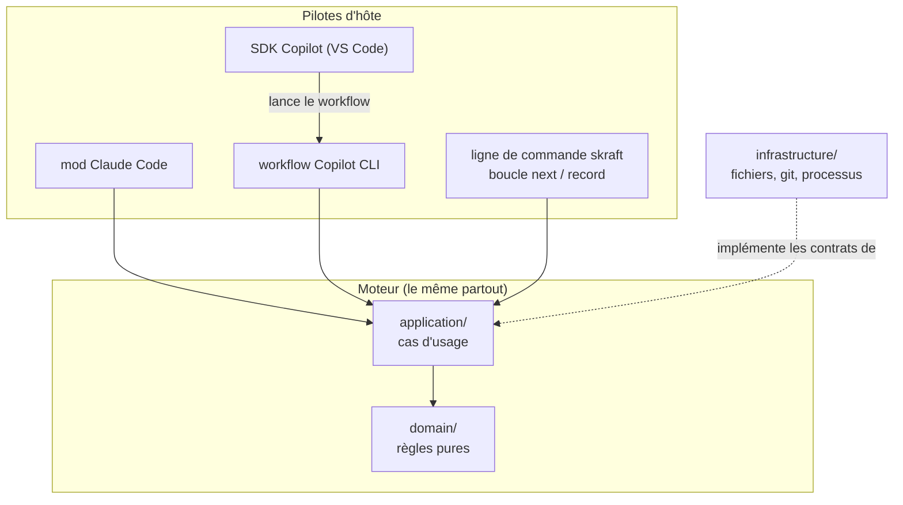
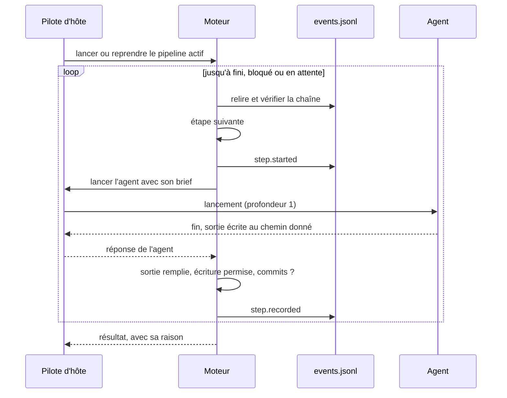

# Architecture

Un seul moteur décide de tout ; chaque hôte le fait tourner avec ce qu'il sait faire. Seul
le pilote lance des agents, et aucun agent n'en lance un autre.

## Le problème à résoudre

SKRAFT doit dérouler le même pipeline sous Claude Code, GitHub Copilot CLI et VS Code, sur
Windows, macOS et Linux. Ces hôtes n'offrent pas les mêmes moyens : l'un lance un agent depuis
un module de mod, l'autre depuis un workflow dynamique, le troisième n'a ni l'un ni l'autre et
ne sait que laisser un agent appeler une commande.

En v1, l'ordre des phases et les verdicts vivaient dans la prose d'un agent orchestrateur.
Chaque hôte et chaque modèle la suivaient à leur façon : un même pipeline ne se comportait pas
pareil d'un outil à l'autre, et aucun test ne pouvait le prouver. La V2 sort ces décisions de la
prose et les met dans du code testé, le même partout.

## Un moteur qui ne connaît pas l'hôte

Le **moteur** (`plugins/skraft-framework/engine/`) suit la règle de dépendance de la Clean
Architecture : les règles pures (`domain/`) ne dépendent de rien, les cas d'usage
(`application/`) ne dépendent que d'elles, et les détails — fichiers, git, processus, hôtes —
sont à l'extérieur ([Martin, 2017](../reference/citations.mdx#cite-martin-cleanarch-2017)). Un **cas
d'usage** est une action complète du point de vue de l'utilisateur : démarrer un pipeline, le
faire avancer, observer son état, lancer les gates, répondre à une question. Il décide ; il ne
fait aucune entrée-sortie lui-même, il passe par des contrats que l'extérieur implémente — l'idée
des ports et adaptateurs ([Cockburn, 2005](../reference/citations.mdx#cite-cockburn-hexagonal-2005)).

Cette discipline n'est pas esthétique. `domain/` et `application/` n'utilisent ni modules
`node:`, ni `process`, ni processus enfants. C'est ce qui permet au même code d'être chargé par
le module du mod Claude Code, qui n'a pas Node, et par l'extension Copilot, qui l'a. Une règle
d'architecture testée l'impose ; sans elle, le moteur serait vite réécrit une fois par hôte.

*Figure 1 — Le moteur au centre, les pilotes autour : chaque flèche pointe vers ce qui ne
connaît pas l'appelant ; le pilote SDK passe par le workflow Copilot.*

## Les pilotes d'hôte exécutent, ils ne décident pas

Un **pilote d'hôte** relie le moteur à un hôte. Il fournit au moteur de quoi lancer un agent,
poser une question à un humain et montrer la progression, puis appelle le cas d'usage. Il ne
décide ni de l'ordre, ni du verdict, ni de l'avancement. La liste des pilotes, ce que chacun
lance, comment il pose les questions et ce que chaque hôte peut faire sont dans la référence
[Hôtes](../reference/hosts.md).

Ce partage a une conséquence directe : ajouter un hôte, c'est écrire un pilote, pas un second
pipeline. Et quand un hôte ne sait pas faire quelque chose — lancer des lentilles en parallèle,
poser une question dans une boîte de dialogue — le pilote fait moins, mais le moteur décide
pareil. Sous VS Code sans SDK Copilot, un agent conduit la boucle `skraft next` /
`skraft record` ; le moteur refuse tout `next` tant que l'étape précédente n'est pas
enregistrée.

Quand le moteur a besoin d'un humain (ratifier des ADR, consentir à une publication, choisir le
sort des mutants survivants, réparer la machine), il le demande au pilote. Sans réponse, le run
**attend** : il ne devine pas, il ne prend pas de décision par défaut. La réponse est
journalisée, quel que soit l'hôte, et le run suivant l'applique sans relancer d'agent.

### Le contrat du pilote Copilot

Le pilote Copilot ne suppose rien de l'hôte qu'il n'ait mesuré : chaque comportement dont il
dépend a un contrôle dans la sonde `eng/host-probe/copilot-probe.mjs`, et son résultat est
consigné avec la version du CLI dans `docs/v2/host-verification.md`. La raison est simple : un
comportement d'hôte qui « a l'air correct » change d'une version à l'autre, et seul un contrôle
le voit changer.

Les autres règles découlent du même souci. Seul le point d'entrée de l'extension importe le SDK
Copilot. Rien ne lève d'exception sur le chemin d'un run : chaque échec devient un résultat
avec un statut, un code et une raison fixée par le code, jamais un texte d'exception. Les
arguments du workflow, écrits par un modèle, sont refusés dès qu'une clé est inconnue, sans
jamais reprendre la valeur refusée. Une décision humaine n'est journalisée (`by: 'host-confirmed'`) qu'une fois rendue
par la boîte de dialogue de l'hôte, et le pilote refuse de la demander en mode `autopilot` ou
quand l'hôte ne sait pas poser de question : un modèle ne peut pas répondre à la place d'une
personne.

## La boucle pilote ↔ moteur

Le pilote appelle le cas d'usage qui fait avancer le pipeline. Le moteur relit le journal,
calcule l'étape suivante, pré-crée la sortie attendue depuis son gabarit, journalise le
lancement, puis demande au pilote de lancer l'agent. Quand l'agent rend la main, le moteur
vérifie lui-même la sortie et les commits, et journalise le résultat avant de décider de la
suite.

*Figure 2 — Un tour de boucle : le moteur décide et vérifie, le pilote lance ; le journal garde
chaque fait avant que la suite soit décidée.*

Une sortie absente relance l'agent avec la liste de ce qui manque, dans la limite de ses
tentatives ; le même échec deux fois arrête le run plus tôt, parce qu'une troisième tentative
identique n'apprendrait rien. Une étape que la machine ne peut pas exécuter (programme
introuvable, git en échec) n'est pas imputée à l'agent : le moteur demande à un humain de
réparer, puis de relancer ou d'abandonner. Les codes : [Suivi et journal](../reference/run-journal.md#statuses-and-codes).

## Profondeur 1

Seul le pilote lance des agents, lentilles de revue comprises. En v1, le reviewer de DELIVER
lançait ses lentilles (profondeur 2) : un contexte de plus à payer, des contrôles dupliqués, un
comportement qui dépendait de ce que chaque hôte permettait à un sous-agent. À profondeur 1, le
moteur voit chaque lancement dans son journal, et le pilote lance les lentilles d'une revue en
parallèle quand l'hôte le permet.

Une revue suit ce chemin. Les lentilles répondent par des findings typés ; `finding-refuter`
vérifie chaque finding qui renverrait le travail ; quand une seule lentille s'oppose aux autres,
le réfuteur la juge avec toutes les entrées de la revue (la *Dissent Rule*) plutôt que de
l'écarter sans raison. Le moteur calcule le verdict sur ce qui reste. Le pourquoi :
[La revue avant la revue](./deep-dive/review-before-review.md) ;
le calcul : [Gates](../reference/gates.md#review-run).

## Les contrôles vivent dans le code

Ce qu'un agent pourrait oublier, le moteur le vérifie : l'ordre des phases, calculé depuis le
graphe du workflow ; les sorties attendues, pré-créées puis vérifiées ; l'intégrité du journal ;
les gates de commandes ; ce que chaque étape a le droit d'écrire, par un diff git ; les commits
rouges et verts du TDD ; le cycle de vie des ADR ; le verdict des revues. Chacun de ces
contrôles est testé sans hôte, et se comporte pareil partout. Pourquoi ils ont quitté les hooks
de la v1 : [Garde-fous](./guardrails.md). Comment le workflow
qui les porte se lit et se copie : [Workflow DOT](../reference/workflow-dot.md).

## Alternatives écartées

**Un moteur autonome, serveur ou binaire.** Un exécuteur hors de l'hôte piloterait les agents de
l'extérieur. Il lui faudrait ses propres accès aux fournisseurs de modèles, et SKRAFT ne vivrait
plus dans l'outil du développeur. La V2 garde l'exécution dans l'hôte et met dans le moteur ce
qu'un tel exécuteur apporterait : nœuds typés, « fini » prouvé par une commande, boucles
plafonnées, classes d'échec, journal d'événements.

**Une boucle conduite par l'agent comme pilote principal.** Un agent appelle `skraft next`,
fait l'étape, appelle `skraft record`. Cela marche partout, mais coûte un aller-retour par étape,
met les lentilles en séquence et laisse l'avancement à un modèle qui peut s'écarter de la
boucle. Elle reste seulement comme repli sous VS Code.

**Garder les hooks.** Voir [Garde-fous](./guardrails.md).

## Pour aller plus loin

- [Le journal d'événements](./event-journal.md) — l'état recalculé et la reprise.
- [Clean Architecture](./clean-architecture.md) — la règle de dépendance, appliquée aussi au moteur.
- [Référence : hôtes](../reference/hosts.md) et [la ligne de commande](../reference/cli.md).

## Sources

- [Cockburn, A. *Hexagonal Architecture*, 2005.](../reference/citations.mdx#cite-cockburn-hexagonal-2005)
- [Martin, R. C. *Clean Architecture*, 2017.](../reference/citations.mdx#cite-martin-cleanarch-2017)
