# Zoom L3 : contract testing

La vue [architecture](../architecture.md) s'arrête à
L2. Cette page zoome sur le détail L3 frère : comment DELIVER vérifie que **notre
propre** API se comporte comme son contrat l'annonce.

## Pourquoi ce zoom

Le schéma système garde `software-engineer` (L2) comme une seule boîte. Dans DELIVER,
cet agent câble lui-même le test de contrat côté fournisseur, avec les skills
`contract-testing` et `contract-testing-<stack>` que son brief nomme. Le moteur ne les nomme
que pour un composant qui porte `"contractTesting": true` dans `skraft-config.json` ; le
contract testing est désactivé par défaut. C'est le niveau **L3**, masqué du schéma
principal pour le garder lisible.

Contrairement au [mocking](./mocking-microcks.md)
(côté consommateur, remplace ce que le service appelle), le contract testing est **côté
fournisseur** : il vérifie notre propre API. Les deux ne se recouvrent jamais.

## La chaîne L3

```mermaid
graph LR
    BR[brief<br/>contractTesting: on] -->|nomme| SE[software-engineer<br/>L2]
    SE -->|charge| CT[contract-testing]
    SE -->|charge| CTD[contract-testing-dotnet]
    SE -->|Layer 1 toujours| BL[(test WAF + HttpClient)]
    SE -->|Layer 2 si opt-in| MC[(Microcks TestEndpointAsync)]
    BL -.si actif.-> CFL[contract-fidelity-lens]
    MC -.si actif.-> CFL
    CFL -->|findings| DR[revue DELIVER<br/>verdict calculé par le moteur]

    style SE fill:#2d5a3d,stroke:#4ed58a,stroke-width:2px
    style CFL fill:#3a2e1a,stroke:#d5a84e
```

Le brief porte la stack du composant et son réglage de contract testing ; la skill
`contract-testing` choisit ensuite l'adaptateur de la stack et la couche Microcks.

| Couche | Quand | Ce qu'elle câble |
| --- | --- | --- |
| Layer 1 — baseline | **toujours**, quel que soit l'opt-in | un test d'intégration `WebApplicationFactory` + `HttpClient` |
| Layer 2 — Microcks | seulement quand l'opt-in est `true` | un test fournisseur `TestEndpointAsync(OPEN_API_SCHEMA)`, **ajouté** à la baseline |

La couche Microcks est **additive** — elle ne remplace jamais la baseline et n'est
jamais supprimée. Le test de contrat passe par les mêmes commits rouge/vert que le code
métier.

## Comment la lentille de fidélité l'audite

Quand le diff relu touche un contrat, un appel `VerifyAsync`/`TestEndpointAsync`, ou un
scaffold côté fournisseur, la `contract-fidelity-lens` rejoint les lentilles de la revue
DELIVER (conditionnelle, pas l'une des trois lentilles CORE).

| Gate | Ce qu'elle vérifie | Sévérité |
| --- | --- | --- |
| K1 | Le test baseline WAF + HttpClient est présent | blocker |
| K2 | La couche Microcks correspond à l'opt-in (présente ssi `true`) | high |
| K3 | Le résultat du test de contrat est assérté, non supprimé, quand l'opt-in est actif | blocker |
| K4 | Le contrat de réponse est réellement assérté (codes, en-têtes, forme ProblemDetails) | high |
| K5 | Aucun appel réel au dépendant ne fuit | blocker |

## Pourquoi cette pratique

> « We grow working software, guided by tests, from the outside in. »
> — Freeman, S. & Pryce, N., *Growing Object-Oriented Software, Guided by Tests*, 2009.

Un test de contrat côté fournisseur fige la frontière de notre propre API pour qu'un
consommateur puisse se fier à sa forme sans environnement end-to-end vivant.

## Pièges & anti-patterns

- **Abandonner la baseline** quand l'opt-in Microcks est actif — la Layer 1 est toujours
  requise (K1) ; la Layer 2 est additive, jamais un remplacement (K2 / K3).
- **N'assérter que le code de statut** en ignorant les en-têtes ou la forme
  ProblemDetails — le contrat est sous-vérifié (K4).
- **Un hostname vivant** qui fuit dans le test fournisseur au lieu du host in-process
  (K5).

## Sources

- Freeman, S. & Pryce, N., *Growing Object-Oriented Software, Guided by Tests*, 2009.

## Voir aussi <!-- #see-also -->

- [Architecture](../architecture.md) — la vue L1 + L2 d'où cette page zoome.
- [Zoom L3 : mocking (Microcks)](./mocking-microcks.md) — le câblage frère, côté consommateur.
- [DELIVER](../pipeline/deliver.mdx) — la phase qui possède ce câblage.
- [Catalogue agentique](pathname:///dashboard/) — chaque agent et lentille. Un terme vous échappe ? Voir le [glossaire](../../reference/glossary.md).
