# Zoom L3 : mocking (Microcks)

La vue [architecture](../architecture.md) s'arrête à
L2. Cette page zoome sur un détail L3 : comment DELIVER mocke un dépendant aval que
le service-sous-test appelle.

## Pourquoi ce zoom

Le schéma système garde `software-engineer` (L2) comme une seule boîte pour rester
lisible. Dans DELIVER, cet agent câble ses tests d'intégration avec la skill
`mocking-<stratégie>-<stack>` que son brief nomme pour chaque composant qu'il écrit. C'est
le niveau **L3** : un détail que le schéma principal masque volontairement.

Cette page rend la chaîne L3 explicite pour que vous puissiez la raisonner sans
surcharger la vue de haut niveau.

## La chaîne L3

```mermaid
graph LR
    CFG[skraft-config.json<br/>mocking.strategy] -->|brief| SE[software-engineer<br/>L2]
    SE -->|microcks defaut| MMD[mocking-microcks-dotnet]
    SE -->|inprocess surcharge| MID[mocking-inprocess-dotnet]
    SE -->|cablage de test| A[(test d'integration)]
    A -.si actif.-> MFL[mock-fidelity-lens]
    MFL -->|findings| DR[revue DELIVER<br/>verdict calculé par le moteur]

    style SE fill:#2d5a3d,stroke:#4ed58a,stroke-width:2px
    style MFL fill:#3a2e1a,stroke:#d5a84e
```

Le mocking est **côté consommateur** : il remplace ce que le service-sous-test appelle,
jamais le service lui-même. La stratégie est le `mocking.strategy` du composant dans
`skraft-config.json` — `microcks` par défaut pour toutes les stacks — et le moteur nomme la
skill correspondante dans le brief ; l'agent ne la choisit jamais.

| Stratégie résolue | Câblage concret |
| --- | --- |
| `microcks` (défaut) | un conteneur Microcks amorcé depuis le contrat du dépendant |
| `inprocess` (surcharge) | un double in-process — `fakeiteasy`, `nsubstitute` ou `moq` |

Le câblage passe par les mêmes commits rouge/vert que le code métier (le test échoue
d'abord, puis passe). Le dépendant est mocké ; le service-sous-test ne l'est pas.

## Comment la lentille de fidélité l'audite

Quand le diff relu touche un mock ou un test d'intégration qui en utilise un, la
`mock-fidelity-lens` rejoint les lentilles de la revue DELIVER (elle est
conditionnelle, pas l'une des trois lentilles CORE).

| Gate | Ce qu'elle vérifie | Sévérité |
| --- | --- | --- |
| M1 | La stratégie résolue a été respectée (pas de Microcks là où in-process était en vigueur, et inversement) | high |
| M2 | Le mock est réellement câblé dans le test host | blocker |
| M3 | Aucun appel réel au dépendant ne fuit | blocker |
| M4 | Il mocke le dépendant, pas le service-sous-test | high |

## Pourquoi cette pratique

> « Only mock types that you own. »
> — Freeman, S. & Pryce, N., *Growing Object-Oriented Software, Guided by Tests*, 2009.

Mocker un dépendant dont on possède le contrat garde le test d'intégration rapide et
déterministe tout en exerçant la vraie frontière dont le service dépend.

## Pièges & anti-patterns

- **Mocker le service-sous-test** au lieu de son dépendant — le test ne prouve alors
  rien du comportement réel (M4).
- **Un mock créé mais jamais injecté** dans le client du SUT — le test appelle encore
  la vraie dépendance (M2 / M3).
- **Coder en dur `dotnet test`** au lieu de la commande de test du composant — le brief
  la nomme.

## Sources

- Freeman, S. & Pryce, N., *Growing Object-Oriented Software, Guided by Tests*, 2009.

## Voir aussi <!-- #see-also -->

- [Architecture](../architecture.md) — la vue L1 + L2 d'où cette page zoome.
- [Zoom L3 : contract testing](./contract-testing.md) — le câblage frère, côté fournisseur.
- [DELIVER](../pipeline/deliver.mdx) — la phase qui possède ce câblage.
- [Catalogue agentique](pathname:///dashboard/) — chaque agent et lentille. Un terme vous échappe ? Voir le [glossaire](../../reference/glossary.md).
