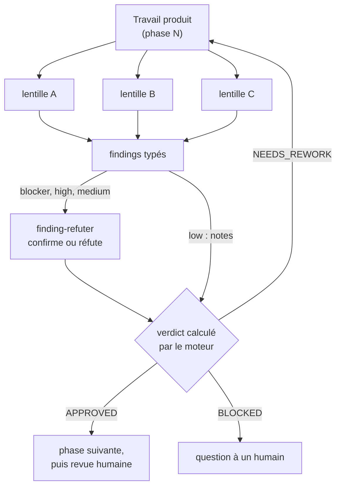

# La revue avant la revue — pourquoi et comment

Avant que l'humain ne relise, des lentilles indépendantes attaquent le travail sous plusieurs
angles et le moteur calcule un verdict sur ce qu'elles trouvent. La revue humaine reçoit un
artefact déjà filtré — pas un brouillon.

## Le problème : la revue humaine absorbe trop de bruit

Quand la première relecture d'un changement est faite par un humain, elle consomme le temps le
plus cher de l'équipe sur des défauts qu'un contrôle systématique aurait pu attraper : un test
qui n'assère rien, une dépendance qui viole une frontière, un critère d'acceptation oublié, un
nom qui cache l'intention. Le relecteur se fatigue sur le trivial et passe à côté du subtil, et
chaque aller-retour allonge le cycle.

L'idée de la *revue avant la revue* : intercaler une revue **adverse assistée** entre la
production et la revue humaine. Elle ne remplace pas l'humain ; elle lui livre un travail déjà
débarrassé des défauts détectables, pour qu'il se concentre sur ce qu'il est seul à pouvoir
juger.

## Pourquoi ça fonctionne

Deux observations bien établies fondent cette approche.

D'abord, la revue par les pairs reste l'une des pratiques qualité les plus efficaces, et
plusieurs regards indépendants, guidés par des critères écrits, trouvent ce qu'un lecteur seul
manque ([Wiegers, 2002](../../reference/citations.mdx#cite-wiegers-peer-reviews-2002)). Plus un défaut est trouvé
tôt, moins il coûte : la revue assistée déplace la détection en amont, avant même l'humain.

Ensuite, vitesse et stabilité ne s'opposent pas : les équipes les plus performantes livrent
souvent et cassent rarement, parce qu'elles automatisent les contrôles au lieu de les reporter
sur une revue manuelle tardive ([Forsgren et al., 2018](../../reference/citations.mdx#cite-forsgren-accelerate-2018)).

## Comment SKRAFT l'applique

Chaque phase revue a sa propre **revue** : des lentilles qui n'ont pas produit le travail,
chacune dans un contexte neuf, chacune sous un seul angle. Elles lisent et ne modifient rien :
l'agent qui produit écrit, les lentilles ne font que questionner — la séparation des commandes
et des requêtes de Meyer ([Meyer, 1997](../../reference/citations.mdx#cite-meyer-oosc-1997)) appliquée aux rôles.

*Figure 1 — Une revue SKRAFT : les lentilles trouvent, le réfuteur vérifie, le moteur tranche ;
un seul finding qui tient suffit à renvoyer le travail.*

Chaque finding blocker, high ou medium passe par `finding-refuter`, qui relit l'endroit cité et
le confirme ou le réfute, en disant pourquoi. Un seul finding qui tient suffit à renvoyer le
travail (`NEEDS_REWORK`) ; les findings low restent des notes. Une lentille qui ne peut pas
conclure bloque la revue au lieu de valoir approbation. Quand une seule lentille trouve ce qui
renverrait le travail alors que les autres ont passé, le réfuteur la juge avec toutes les
entrées de la revue — la *Dissent Rule* : une voix isolée n'est ni écartée sans raison, ni suivie
sans vérification. Les reprises sont bornées avant de remonter à un humain, et le verdict garde
ses findings : la revue humaine voit **pourquoi** le travail est passé.

Le calcul exact du verdict : [Gates](../../reference/gates.md#review-run).

## Les lentilles de DELIVER en pratique

En DELIVER, les gates de commandes passent d'abord ; viennent ensuite les lentilles, chacune
indépendante et sur un angle différent.

| Lentille | Ce qu'elle vérifie |
| --- | --- |
| `architecture-boundaries` | Les frontières entre les couches Domain, Application, Infrastructure et API sont respectées |
| `cold-reader` | Un développeur qui découvre le code comprend son intention, dans la langue du métier |
| `test-integrity` | Les tests vérifient réellement un comportement : aucun test de façade, aucun test affaibli pour passer |

La revue n'est pas figée : quand le changement touche un mock ou un contrat que le
`software-engineer` a câblé, la lentille de fidélité correspondante (`mock-fidelity` ou
`contract-fidelity`) rejoint la revue, et ses findings passent par le même réfuteur et le même
verdict. Voir [Mocking avec Microcks](./mocking-microcks.md)
et [Contract testing](./contract-testing.md).

:::note[Jargon]
*Domain / Application / Infrastructure / API* : les couches de la Clean
Architecture ; chacune a une responsabilité précise et ne dépend que des couches intérieures
([Clean Architecture](../clean-architecture.md)).
:::

## Ce que ça change, et ce que ça ne change pas

La pull request n'arrive plus chez l'humain avec des défauts détectables mécaniquement ; le
relecteur ne signale plus des erreurs de base et se concentre sur la conception et l'intention
métier. On attend moins de cycles de révision par story *(estimé)*.

Le jugement humain, lui, reste entier : pertinence métier, choix de conception non évidents,
expérience utilisateur. SKRAFT filtre le bruit ; il ne décide pas à la place du relecteur.

## Ce que la revue adverse ne voit pas

Les lentilles détectent des **violations structurelles et de couverture** : une frontière
franchie, un test qui ne vérifie rien, un code dont l'intention est opaque. Elles ne détectent
pas les **erreurs factuelles** : une règle métier inventée par le modèle, une API externe
inexistante citée comme valide, une hypothèse du domaine fausse intégrée dans la logique. Ces
erreurs sont invisibles à une relecture structurelle. Les attraper demande des tests
d'acceptation métier et le jugement du relecteur humain : les garde-fous gardent la structure
honnête, pas les faits.

## Pièges & anti-patterns

- **Lentille = producteur** : la revue perd son indépendance et son pouvoir de réfutation.
- **Synthèse qui moyenne** : agréger les avis en « moyenne » au lieu d'honorer chaque finding qui
  tient laisse filer le critique — le moteur ne moyenne jamais.
- **Boucle infinie** : sans borne de reprises, un désaccord entre agent et lentille ne remonte
  jamais à l'humain — SKRAFT borne et escalade.

## Pour aller plus loin

- [L'équipe et les relais](../pipeline/team.md) — qui produit, qui juge.
- [Référence : gates et verdict](../../reference/gates.md).
- [Le catalogue des lentilles](pathname:///fr/dashboard/).
- [Pour décideurs](../for-executives.md) — l'effet sur le délai de livraison.

## Sources

- [Forsgren, N., Humble, J. & Kim, G. *Accelerate*, 2018.](../../reference/citations.mdx#cite-forsgren-accelerate-2018)
- [Meyer, B. *Object-Oriented Software Construction*, 2nd ed., 1997.](../../reference/citations.mdx#cite-meyer-oosc-1997)
- [Wiegers, K. *Peer Reviews in Software*, 2002.](../../reference/citations.mdx#cite-wiegers-peer-reviews-2002)
