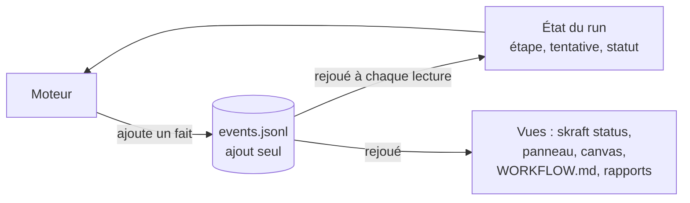

# Le journal d'événements

Le moteur n'écrit pas un état ; il écrit des faits. L'état se recalcule à chaque lecture, et
la reprise repart du dernier fait enregistré.

## Le problème : un état que tout le monde peut écrire

En v1, l'état du pipeline tenait dans un fichier `state.json`, dans le dossier de suivi du run :
phase courante, verdicts, compteurs de reprise. C'était un instantané, réécrit à chaque
transition. Ce dossier de suivi, `.copilot-tracking/`, vient de HVE Core, le socle d'agents
Copilot sur lequel SKRAFT a été construit ; SKRAFT l'a gardé.

Un instantané a trois faiblesses :

- il ne dit pas **comment** on en est arrivé là ;
- une écriture à la main, ou par un agent passant par le shell, est indiscernable d'une
  écriture légitime ; la v1 avait besoin d'un hook pour l'interdire, et ce hook ne lisait que
  les commandes POSIX ;
- deux runs qui écrivent en même temps s'écrasent sans le savoir.

## Des faits plutôt qu'un état

La V2 a remplacé `state.json` par `events.jsonl`, dans le même dossier. C'est un **journal
d'événements** : un objet JSON par ligne, un événement par fait. Le run démarre, une étape est
lancée puis enregistrée, une gate tourne, une question est posée puis répondue, une phase se
clôt, le run finit. Le moteur écrit chaque fait avant de décider de la suite, et il ne modifie
jamais une ligne déjà écrite : il ajoute.

C'est l'idée de l'*event sourcing* : garder la suite des changements plutôt que leur résultat,
et reconstruire l'état en les rejouant
([Fowler, 2005](../reference/citations.mdx#cite-fowler-eventsourcing-2005)). Le journal est le modèle
d'écriture ; l'état — phase en cours, tentative, sorties manquantes, statut du run — est un
modèle de lecture que le moteur recalcule à chaque lecture. Séparer ces deux modèles, c'est le
principe de CQRS ([Fowler, 2011](../reference/citations.mdx#cite-fowler-cqrs-2011)). Aucun fichier d'état ne
peut donc diverger du journal.

*Figure 1 — Un seul modèle d'écriture, le journal ; l'état qui guide le moteur et les vues que
lit l'humain en sont tous recalculés.*

Les vues humaines suivent le même chemin : `skraft status`, le panneau du mod Claude Code, le
canvas du workflow Copilot, et les fichiers `WORKFLOW.md`, `run-report.md` et `qa-report.md` que
le moteur réécrit depuis le journal après chaque étape. Aucun ne peut raconter une autre
histoire que le journal.

## Reprise exacte, sans rejouer un agent fini

Un run interrompu — hôte fermé, machine éteinte, agent arrêté — reprend là où il s'était
arrêté : le moteur relit le journal et recalcule l'étape suivante. Rien n'est relancé « pour
voir ». Une étape lancée dont la sortie est déjà remplie est enregistrée sans relancer l'agent ;
un agent que l'hôte n'a pas pu lancer ne consomme pas sa tentative ; la base de comparaison git,
journalisée au premier démarrage, reste celle du run. Une question sans réponse met le run en
attente ; le relancer repose la même question et ne lance aucun agent.

Un run que la v1 a laissé en cours n'est pas perdu : `skraft migrate` lui écrit un journal à
partir de son `state.json`, qu'il laisse intact, et le run reprend ensuite comme un autre.

## Une chaîne signée pour détecter une modification

Chaque ligne porte l'empreinte de la précédente : modifier, supprimer ou insérer une ligne casse
la chaîne. Une chaîne seule se recalcule par qui modifie le fichier ; chaque ligne porte donc
aussi une signature sous une clé du run, gardée sur la machine qui l'a démarré. À la lecture
suivante, le moteur voit la rupture et s'arrête en nommant la ligne fautive. Il ne « répare »
rien et ne devine rien : il faut restaurer le fichier ou démarrer un nouveau slug.

Ce contrôle remplace le hook de la v1 qui interdisait d'écrire l'état, sans coût par appel
d'outil et de la même façon sur tous les hôtes. Un journal démarré sur une autre machine ne
peut pas être vérifié ici ; une personne peut l'adopter explicitement, et seules les lignes
suivantes sont alors signées sous une clé locale. Le format exact de la chaîne et de la
signature : [Suivi et journal](../reference/run-journal.md#events-jsonl).

## Deux sessions qui ne s'écrasent pas

Avant d'ajouter un fait, le moteur vérifie que personne d'autre n'a écrit depuis sa lecture ;
sinon il s'arrête plutôt que d'écraser. En amont, une session qui conduit un pipeline tient un
**bail** sur lui et le renouvelle tant qu'elle travaille : une deuxième session sur le même
pipeline est refusée, et un bail qui n'est plus renouvelé est la trace d'une session disparue,
que la suivante peut reprendre.

## `.active-slug` : jamais deviné

Le fichier `.active-slug` du dossier de suivi désigne le pipeline actif de la copie de travail.
Sans lui, le moteur refuse au lieu de choisir le dernier dossier venu : ni le moteur ni un agent
ne choisissent un slug à la place du développeur. Chaque worktree git a son propre dossier de
suivi, donc son propre pipeline actif : deux stories avancent en parallèle dans deux worktrees
sans partager d'état.

## Les compromis

- **Un journal grandit.** Il n'est jamais réécrit ; c'est le prix d'un historique complet.
- **Une modification à la main arrête le run.** C'est voulu : un run dont l'histoire a été
  retouchée ne peut plus prouver ce qu'il a fait.
- **La clé reste sur une machine.** Reprendre un run ailleurs demande un geste humain explicite,
  plutôt qu'une confiance implicite.

## Sources

- [Fowler, M. *Event Sourcing*, 2005.](../reference/citations.mdx#cite-fowler-eventsourcing-2005)
- [Fowler, M. *Bliki: CQRS*, 2011.](../reference/citations.mdx#cite-fowler-cqrs-2011)

## Voir aussi <!-- #see-also -->

- [Reprendre ou débloquer un run](../how-to/resume-a-run.md).
- [Référence : dossier de suivi, `events.jsonl`, codes](../reference/run-journal.md).
- [Garde-fous](./guardrails.md) — ce que le journal remplace dans les hooks de la v1.
- [Architecture](./architecture.md).
