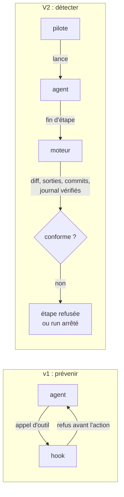

# Garde-fous : du hook au moteur

En v1, des hooks surveillaient l'agent à chaque appel d'outil. En V2, le moteur qui lance
l'agent vérifie lui-même ce qui compte, avant et après chaque étape.

## Ce qu'était un garde-fou en v1

Un **hook** est un programme que l'hôte lance sur un événement : avant ou après un appel
d'outil, au démarrage ou à l'arrêt d'un sous-agent, à l'ouverture d'une session. La v1 s'en
servait pour faire respecter ses invariants : l'ordre des phases, le chargement des skills, la
complétude du brief d'un agent, l'interdiction d'écrire l'état à la main, les droits d'écriture
de l'orchestrateur.

L'idée était juste : un invariant ne vaut que s'il est appliqué mécaniquement. Ce qui a changé,
c'est l'endroit où l'appliquer.

## Pourquoi la V2 part de zéro hook

**Un coût à chaque appel d'outil.** La v1 déclarait cinq entrées de hook sans filtre : chaque
appel d'outil lançait un processus `node`, sur chaque hôte, pour chaque agent, même quand aucun
invariant n'était en jeu. La V2 vise zéro surcoût par appel d'outil.

**Un comportement inégal selon l'hôte.** Un hook dépend de ce que l'hôte lui transmet et de la
façon dont il respecte sa réponse. En v1, la provenance d'un lancement ne voyait jamais le nom
de l'agent appelant ; le contrôle des skills chargées restait inerte sous Claude Code ; le
contrôle des droits d'écriture bloquait DELIVER sous Copilot ; l'interdiction d'écrire l'état ne
lisait que les commandes shell POSIX, pas PowerShell. Un même pipeline se comportait donc
différemment selon l'outil — le contraire de ce que SKRAFT promet.

**Des contrôles que le moteur fait déjà.** En V2, le moteur compose lui-même le brief de chaque
agent, fixe ses sorties et écrit le journal. Il n'a plus besoin de surveiller un modèle qui
écrirait l'état par le shell : l'état n'est plus un fichier que l'agent modifie, c'est un
[journal](./event-journal.md) que le moteur relit et vérifie.

Résultat : aucun hook de commande n'est livré. Le fichier `hooks/hooks.json` ne déclare qu'un
**module** : celui du mod Claude Code, qui donne à Claude Code la commande `/skraft`, l'outil qui
démarre le pipeline et le panneau Skraft. Ce module ne réagit à aucun appel d'outil ; il pilote
le moteur, comme le workflow Copilot sous Copilot.

## Ce qui remplace chaque garde-fou

- **L'ordre des phases** : le moteur calcule l'étape suivante depuis le graphe du workflow et le
  journal ; un agent ne démarre que quand le run atteint son nœud.
- **Le brief et les skills** : le moteur compose le brief, avec le chemin absolu de chaque
  entrée, de chaque sortie et de chaque skill à lire, de la même façon sur tous les hôtes. Que
  l'agent lise réellement ses skills se mesure par les évaluations, pas par un hook.
- **Les artefacts, le verdict, les commits** : les sorties attendues sont pré-créées puis
  vérifiées ; le verdict d'une revue est calculé par le moteur ; la convention de commit et les
  commits rouges du TDD sont vérifiés après chaque étape.
- **L'interdiction d'écrire l'état** : la chaîne de hachage signée du journal, vérifiée à chaque
  lecture ; une modification à la main arrête le run.
- **Les droits d'écriture** : un diff git après chaque étape, comparé à ce que l'étape avait le
  droit d'écrire.
- **La provenance des lancements** : retirée. Seul le pilote lance des agents, et aucun agent
  n'en lance un autre ; le journal voit chaque lancement.

Deux contrôles n'ont pas d'équivalent en v1 : le **bail de session**, qui refuse une deuxième
session sur un pipeline qu'une autre conduit, et les **nœuds verrouillés et obligatoires** du
workflow, qu'une copie du dépôt ne peut pas retirer en silence
([Workflow DOT](../reference/workflow-dot.md#locked-nodes)).

## Prévenir ou détecter

*Figure 1 — Le hook refuse un appel d'outil avant qu'il ait lieu ; le moteur constate après
l'étape et refuse l'étape entière.*

Un hook **prévient** : il refuse l'appel d'outil avant qu'il ait lieu. Le moteur **détecte** : il
constate après l'étape qu'un fichier a été modifié à la main, qu'une sortie manque, qu'un agent
a écrit hors de son périmètre ou commité un test rouge qui passe, et il refuse l'étape ou arrête
le run en le disant.

C'est un choix assumé. Sans hook, un agent lancé à la main hors du moteur n'est pas arrêté
pendant qu'il travaille ; l'écart est découvert ensuite, par le journal ou le diff git. En
échange, le contrôle est le même sur tous les hôtes, se teste sans hôte, et ne coûte rien aux
appels d'outil.

## Quand un hook peut revenir

Un hook revient seulement s'il remplit trois conditions : il protège une action
**irréversible** que le moteur ne peut pas détecter après coup ; son coût par appel est
**mesuré** ; son comportement est documenté sur Claude Code, Copilot CLI et VS Code. Aucun hook
ne les a remplies à ce jour. Le pilote Copilot s'interdit en plus tout hook avant un appel
d'outil ([Architecture](./architecture.md#le-contrat-du-pilote-copilot)).

## Ce qu'aucun garde-fou ne couvre

Ni un hook ni le moteur ne détectent une **erreur factuelle** : une règle métier inventée, un
endpoint qui n'existe pas, une connaissance du domaine fausse dans un test. Ils contrôlent la
structure du travail — ordre, sorties, intégrité, gates — pas la vérité de son contenu. Cela
reste le rôle de la revue, des tests d'acceptation métier et du relecteur humain : la revue par
les pairs reste l'une des pratiques qualité les plus efficaces
([Wiegers, 2002](../reference/citations.mdx#cite-wiegers-peer-reviews-2002)).

## Pour aller plus loin

- [Architecture](./architecture.md) — le moteur, les pilotes, la profondeur 1.
- [Le journal d'événements](./event-journal.md) — la chaîne signée qui remplace l'interdiction d'écrire l'état.
- [Référence : dossier de suivi et journal](../reference/run-journal.md).
- [Lancer les gates et lire leurs preuves](../how-to/run-gates.md).

## Sources

- [Wiegers, K. *Peer Reviews in Software*, 2002.](../reference/citations.mdx#cite-wiegers-peer-reviews-2002)
