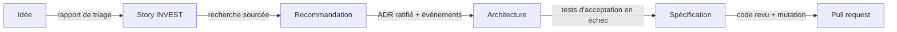

# Le fil rouge — une commande Starbucks de bout en bout

Une seule demande, suivie de l'idée jusqu'au code livré, pour voir comment chaque phase passe le relais à la suivante.

Cette page est une **narration** : elle ne décrit pas SKRAFT dans l'abstrait, elle
vous fait suivre **un exemple concret** d'un bout à l'autre. Le fil conducteur est
le *flux d'artefacts* — la sortie d'une phase devient l'entrée de la suivante.

> ☕ **Exemple illustratif.** Le cas Starbucks ci-dessous est inventé pour la
> pédagogie. Il n'est pas tiré du code du plugin ; aucun chiffre n'y est réel.

## Ce que vous allez suivre

La demande : **« permettre à un client de commander et payer une boisson
personnalisée depuis l'application mobile, pour la récupérer en magasin. »**

Vous verrez cette demande se transformer, phase par phase, en code testé.



*Figure 1 — La demande Starbucks et l'artefact qu'elle devient à chaque relais, de l'idée à la
pull request.*

## Préparation produit optionnelle

DISCOVER puis DISCUSS appartiennent au plugin `skraft-backlog` : le développeur les lance
lui-même, hors du moteur, dans cet ordre, quand la demande n'arrive pas déjà affinée.

### Étape 1 — DISCOVER : trier l'idée

L'idée arrive comme une **issue brute** dans le backlog. Le `backlog-discoverer`
la trie : il lui donne la priorité **P1**, détecte qu'elle recoupe une ancienne
demande « paiement in-app », et l'inscrit dans un **rapport de triage**.

- **Ce qui entre :** « permettre la commande mobile dans l'app ».
- **Ce qui sort :** une ligne priorisée du rapport de triage.

➡️ Détail de la phase : [DISCOVER](./discover.md).

### Étape 2 — DISCUSS : en faire une story

Le `backlog-planner` reçoit le rapport et transforme la ligne priorisée en
**story INVEST** :

> En tant que client, je commande une boisson personnalisée pour la récupérer en
> magasin, afin de gagner du temps à l'arrivée.

Avec ses **critères d'acceptation** :

1. Le client choisit la taille et le type de lait avant de payer.
2. Le paiement est exigé avant que la commande parte en préparation.
3. Une boisson indisponible ne peut pas être ajoutée au panier.

- **Ce qui entre :** la ligne de triage.
- **Ce qui sort :** la story + ses 3 critères.

➡️ Détail de la phase : [DISCUSS](./discuss.md).

## Pipeline d'ingénierie orchestré

### Étape 3 — RESEARCH : réunir les preuves

Le `solution-researcher` analyse la story, le code existant et les conventions.
Il compare les options de paiement et recommande une approche sourcée sans écrire
de code ni décider l'ADR.

- **Ce qui entre :** la story et ses critères.
- **Ce qui sort :** le document de recherche cité et son handoff vers DESIGN.

➡️ Détail de la phase : [RESEARCH](./research.md).

### Étape 4 — DESIGN : décider l'architecture

Le `solution-architect` conçoit la solution. Il propose un **ADR** :

:::note[Décision]
déléguer le paiement à un fournisseur externe via une couche
anti-corruption (ACL), pour ne pas coupler le domaine commande au prestataire.
:::

Et un **modèle d'événements** :

```
PasserCommande → CommandePayée → CommandePrête
```

Trois lentilles relisent la conception, puis le run attend : un humain doit **ratifier** l'ADR
avant que DISTILL commence. Un refus renvoie l'architecte au travail, avec la raison.

- **Ce qui entre :** la story, ses critères et le document de recherche.
- **Ce qui sort :** l'ADR ratifié + le modèle d'événements + les contrats.

➡️ Détail de la phase : [DESIGN](./design.md).

### Étape 5 — DISTILL : écrire le contrat exécutable

L'`acceptance-designer` traduit l'architecture en **scénario Gherkin**, lisible
par le métier :

```gherkin
Scénario: payer une boisson personnalisée
  Étant donné un panier contenant un latte taille moyenne, lait d'avoine
  Quand le paiement est validé
  Alors un reçu est émis
  Et des points de fidélité sont crédités au client
```

Il écrit aussi le test d'acceptation correspondant et le squelette de code qu'il appelle, et
les commite **en échec** : le moteur rejoue le test pour vérifier qu'il échoue vraiment.

- **Ce qui entre :** l'ADR + le modèle d'événements.
- **Ce qui sort :** le `.feature`, le plan de test et le test d'acceptation rouge.

➡️ Détail de la phase : [DISTILL](./distill.md).

### Étape 6 — DELIVER : implémenter, guidé par les tests

Le `software-engineer` rend le scénario vert en **Outside-In TDD** : test rouge, code vert,
nettoyage, commit après commit. Le moteur lance les gates (build, tests, architecture,
couverture), puis la revue DELIVER relit le code. Une fois le code approuvé, la **mutation**
passe une fois, en dernier : elle vérifie que les tests attraperaient une erreur dans la règle
de fidélité. Si un mutant survit, l'agent propose comment le traiter et c'est le développeur
qui choisit.

- **Ce qui entre :** le test d'acceptation rouge + le plan.
- **Ce qui sort :** le code revu, la mutation passée, puis la pull request.

➡️ Détail de la phase : [DELIVER](./deliver.md).

## Ce que vous venez de voir

Une seule demande a traversé deux workflows produit optionnels, puis le pipeline
d'ingénierie, sans perdre son contexte :

| Phase | Artefact produit |
| --- | --- |
| DISCOVER | Ligne priorisée du rapport de triage |
| DISCUSS | Story INVEST + 3 critères d'acceptation |
| RESEARCH | Document de recherche cité + recommandation |
| DESIGN | ADR ratifié (paiement via ACL) + modèle d'événements |
| DISTILL | Scénario Gherkin + test d'acceptation rouge |
| DELIVER | Code revu + mutation passée + pull request |

Chaque artefact est devenu le **contexte** de l'étape suivante, et chaque relais est resté
relisible : ce qui n'était pas écrit n'a pas été transmis.

## Pour aller plus loin

- [Vue d'ensemble du pipeline](./index.mdx)
- [Référence : les phases](../../reference/phases.md) — entrées, sorties, lentilles de chaque phase
- [Le journal d'événements](../event-journal.md) — où le run garde la trace de chaque relais
