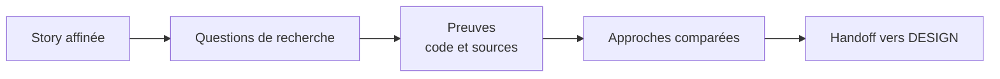

# RESEARCH — réduire l'incertitude avant de concevoir

RESEARCH cherche des preuves dans le code, les conventions et les sources externes. Il
recommande une approche sans écrire de code ni prendre la décision d'architecture.

## Pourquoi cette phase existe

Un architecte qui conçoit sans regarder l'existant réinvente un agrégat qui existe déjà, ou
choisit une bibliothèque que le dépôt a abandonnée. RESEARCH sépare deux métiers : **savoir ce
qui est vrai** et **décider ce qu'on fait**. Le `solution-researcher` ne fait que le premier.
Parce qu'il ne construit rien, ce qu'il rapporte peut être cru : il n'a aucun intérêt à défendre
une solution qu'il aurait déjà écrite.

C'est la première phase que conduit le moteur. Avant de lancer le chercheur, le run demande
au développeur s'il consent à publier la pull request et, pour un front end, les captures : ces
questions arrivent tôt pour ne pas interrompre le run plus tard.

:::info[☕ Fil rouge — Starbucks *(exemple illustratif)*]

La story « commander une boisson personnalisée » entre avec ses critères. RESEARCH repère le
fournisseur de paiement existant, les contraintes du dépôt et les options d'intégration. Il
transmet à DESIGN une recommandation sourcée, sans choisir l'ADR.
:::

## Une affirmation sans source est retirée

Chaque constat du document de recherche cite un chemin du dépôt avec ses lignes, ou une URL.
Une affirmation que le chercheur ne peut pas vérifier n'est pas nuancée : elle est retirée. Le
document compare plusieurs approches, en recommande une avec ses raisons et garde les autres
avec les preuves qui les écartent, puis liste ce que DESIGN devra trancher.

*Figure 1 — Le chemin d'une story dans RESEARCH : des questions aux preuves, des preuves aux
approches comparées, puis le relais à DESIGN.*

## Partir de ce que le dépôt documente

Avant le code, le chercheur lit la documentation que les stories précédentes ont laissée sous
`docs/` : la context map, la conception tactique, le modèle d'événements, les scénarios et les
ADR. Quand elle répond déjà à la story, le document de recherche le dit, cite ces fichiers et
s'arrête là. Le moteur contrôle seulement que le document existe, pas ce qu'il cite. Le document de recherche lui-même
reste dans le dossier de suivi : il sert une seule story.

## Pas de revue, mais un juge en aval

RESEARCH est la seule phase d'ingénierie sans lentilles de revue. Le moteur vérifie seulement
que le document existe et qu'il est rempli : ni vide, ni identique au gabarit, sans marqueur
laissé. Le jugement sur le fond revient à DESIGN, qui doit citer ces constats plutôt que de
refouiller le code ; la cohérence entre la recherche et les ADR est ensuite jugée par la revue
DESIGN. Une revue de plus coûterait un cycle de lentilles sur un document que la phase suivante
relit de toute façon.

Quand les stories arrivent de DISCUSS avec `skraft init --from-artifacts`, le run démarre en
DESIGN : la recherche a eu lieu pendant la préparation produit.

## Voir aussi <!-- #see-also -->

- [Référence : RESEARCH](../../reference/phases.md#research) — nœuds, sortie, contrôle, tentatives.
- [Référence : le document de recherche](../../reference/run-journal.md#research-document).
- [Référence : documentation durable](../../reference/run-journal.md#durable-docs) — ce qui va dans `docs/`, ce qui reste dans le dossier de suivi.
- [DESIGN](./design.md) — la phase qui décide.
